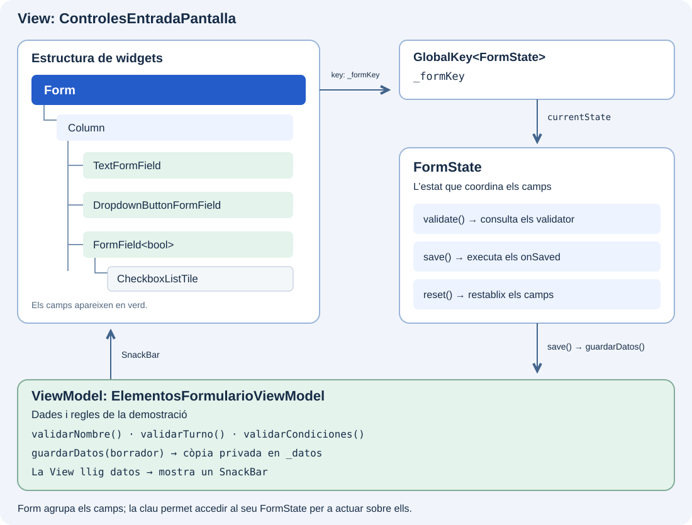

Un formulari reunix camps, regles de validació i accions per a treballar amb les dades introduïdes. Abans de construir la inscripció del catàleg, coneixerem els seus elements i entendrem com col·laboren: què agrupa els camps, qui coordina les operacions i com es definix cada entrada.

## Les quatre peces del formulari

Un formulari de Flutter es basa en **quatre peces** que permeten agrupar els camps i treballar amb els seus valors:

| Peça | Què aporta |
| --- | --- |
| **`Form`** | És el widget contenidor que agrupa camps per a operar sobre ells conjuntament. |
| **`FormState`** | És l’estat associat a `Form`. Oferix `validate()`, `save()` i `reset()`. Hi accedirem amb una `GlobalKey<FormState>`. |
| **`FormField<T>`** | És el widget base d’un camp participant: manté el valor, la validació i els errors. Es registra en el `Form` antecessor més pròxim quan n’hi ha. |
| **Camps concrets** | `TextFormField`, `DropdownButtonFormField` i altres implementacions de `FormField` proporcionen el control visual preparat per a usar-lo. |

## Com encaixen



Pots col·locar una `Column` dins de `Form` i, dins d’ella, els camps del formulari. Encara que hi haja widgets intermedis que els organitzen o afigen espai, eixos camps continuen pertanyent al formulari.

Perquè `Form` puga validar un control, este ha de ser un `FormField` o una implementació com `TextFormField`. Un `TextField` o un `Checkbox` per si sols no participen en eixa validació, encara que estiguen dins de `Form`. Per a una casella, veurem com envoltar-la en un `FormField<bool>`.

## 🎯 Què aprendràs

- Diferenciar el contenidor `Form`, el seu `FormState` i l’estat de cada camp.
- Triar camps concrets per a text i seleccions.
- Interpretar `validator`, `onSaved`, `initialValue` i `onChanged`.
- Integrar un control propi amb `FormField<T>` i `didChange`.
- Reconéixer què aporta l’autocompletat en introduir dades.

## El formulari que construirem

Afegirem al catàleg una fitxa senzilla per a **indicar un nom, triar un torn i acceptar les condicions**. Ens servirà per a observar com es comporten diferents tipus de camp dins del mateix formulari.

| Element en pantalla | Què demanarem a l’usuari | Com el construirem |
| --- | --- | --- |
| **Nombre** | Escriure almenys dos caràcters, sense comptar espais exteriors. | `TextFormField`. |
| **Turno** | Triar Mañana o Tarde; al principi no hi haurà cap opció seleccionada. | `DropdownButtonFormField<String>`. |
| **Acepto las condiciones** | Marcar la casella; al principi estarà desmarcada. | `CheckboxListTile` dins de `FormField<bool>`. |

Davall hi haurà dos botons:

- **Comprobar y recoger** revisarà els tres camps. Si falta alguna dada, veurem l’error al costat del camp corresponent. Si tot és vàlid, mostrarà els valors que el ViewModel conserva després de rebre l’esborrany.
- **Reiniciar campos** deixarà Nombre buit, Turno sense selecció i la casella desmarcada. També buidarà `_borrador`.

Per exemple, si escrius «Ana» i tries «Tarde» però no acceptes les condicions, apareixerà l’error de la casella. En acceptar-les i tornar a prémer el botó, s’arreplegaran els tres valors: `nombre: Ana`, `turno: tarde` i `condiciones: true`.

Construirem esta fitxa per parts: primer el contenidor i els botons, després Nombre i, finalment, el desplegable i la casella. L’autocompletat es provarà com un exemple complementari fora d’estos tres camps.

## View i ViewModel en esta demostració

Les quatre peces de Flutter pertanyen a la **View**: construïxen els camps, gestionen l’edició i coordinen `validate()`, `save()` i `reset()`. El **ViewModel** definix les regles que consulten els validadors i conserva les dades arreplegades.

La View usa `_borrador` com un mapa temporal: cada `onSaved` hi copia el valor del camp. Quan acaba `save()`, la View entrega eixe mapa a `guardarDatos()`. El ViewModel fa una còpia privada en `_datos`. Després, la View llig `datos` i les mostra en un `SnackBar`. La clau, els controladors i `FormState` no es passen al ViewModel.

## Preparar el ViewModel en el catàleg

Conserva `catalogo_widgets` i el seu `main.dart`. Crea `lib/ui/catalogo/view_models/elementos_formulario_viewmodel.dart`:

```dart
import 'package:flutter/foundation.dart';

class ElementosFormularioViewModel extends ChangeNotifier {
  Map<String, Object?> _datos = {};
  Map<String, Object?> get datos => Map.unmodifiable(_datos);

  String? validarNombre(String? valor) => (valor ?? '').trim().length < 2
      ? 'Escribe al menos dos caracteres'
      : null;

  String? validarTurno(String? valor) =>
      valor == null ? 'Elige un turno' : null;

  String? validarCondiciones(bool? valor) =>
      valor == true ? null : 'Acepta las condiciones';

  void guardarDatos(Map<String, Object?> valores) {
    _datos = Map.of(valores);
    notifyListeners();
  }

  void reiniciar() {
    _datos = {};
    notifyListeners();
  }
}
```

El getter `datos` permet consultar el resultat sense modificar el mapa del ViewModel. `guardarDatos` copia l’esborrany; així, buidar-lo després en la View no esborra accidentalment el resultat. Estes operacions treballen en memòria.

## Preparar la View

Crea o substituïx `lib/ui/catalogo/ui/controles_entrada_pantalla.dart` amb esta base. Els camps s’afegiran en els apartats següents. En acabar `_recogerDatos()`, la View mostra els valors en un `SnackBar`, un missatge temporal en la part inferior. No necessitem reconstruir una zona de resultats en la pantalla:

```dart
import 'package:flutter/material.dart';

import '../view_models/elementos_formulario_viewmodel.dart';

class ControlesEntradaPantalla extends StatefulWidget {
  const ControlesEntradaPantalla({super.key, required this.viewModel});
  final ElementosFormularioViewModel viewModel;

  @override
  State<ControlesEntradaPantalla> createState() =>
      _ControlesEntradaPantallaState();
}

class _ControlesEntradaPantallaState extends State<ControlesEntradaPantalla> {
  final _formKey = GlobalKey<FormState>();
  final _borrador = <String, Object?>{};

  void _recogerDatos() {
    final formulario = _formKey.currentState;
    if (formulario == null || !formulario.validate()) return;
    _borrador.clear();
    formulario.save();
    widget.viewModel.guardarDatos(_borrador);
    ScaffoldMessenger.of(context)
      ..hideCurrentSnackBar()
      ..showSnackBar(
        SnackBar(content: Text('Valores recogidos: ${widget.viewModel.datos}')),
      );
  }

  void _reiniciar() {
    _formKey.currentState?.reset();
    _borrador.clear();
    widget.viewModel.reiniciar();
    ScaffoldMessenger.of(context).hideCurrentSnackBar();
  }

  @override
  Widget build(BuildContext context) {
    return Scaffold(
      appBar: AppBar(title: const Text('Elementos de un formulario')),
      body: SingleChildScrollView(
        padding: const EdgeInsets.all(24),
        child: Column(
          children: [
            Form(
              key: _formKey,
              child: Column(
                children: [
                  // Añade aquí TextFormField, dropdown y FormField.
                ],
              ),
            ),
            const SizedBox(height: 16),
            FilledButton(
              onPressed: _recogerDatos,
              child: const Text('Comprobar y recoger'),
            ),
            TextButton(
              onPressed: _reiniciar,
              child: const Text('Reiniciar campos'),
            ),
            // Añade aquí los ejemplos complementarios.
          ],
        ),
      ),
    );
  }
}
```

## Obrir l’exemple des del catàleg

Crea `lib/ui/catalogo/ui/elementos_formulario_ejemplo.dart`. Este widget crea el ViewModel una vegada, l’entrega a la View i l’allibera en abandonar l’exemple:

```dart
import 'package:flutter/material.dart';

import '../view_models/elementos_formulario_viewmodel.dart';
import 'controles_entrada_pantalla.dart';

class ElementosFormularioEjemplo extends StatefulWidget {
  const ElementosFormularioEjemplo({super.key});

  @override
  State<ElementosFormularioEjemplo> createState() =>
      _ElementosFormularioEjemploState();
}

class _ElementosFormularioEjemploState
    extends State<ElementosFormularioEjemplo> {
  final _viewModel = ElementosFormularioViewModel();

  @override
  void dispose() {
    _viewModel.dispose();
    super.dispose();
  }

  @override
  Widget build(BuildContext context) {
    return ControlesEntradaPantalla(viewModel: _viewModel);
  }
}
```

En `catalogo_pantalla.dart`, substituïx l’import directe de `controles_entrada_pantalla.dart` per `elementos_formulario_ejemplo.dart`. Afig o actualitza una única entrada:

```dart
ListTile(
  leading: const Icon(Icons.input),
  title: const Text('Elementos de un formulario'),
  onTap: () {
    Navigator.of(context).push(
      MaterialPageRoute<void>(
        builder: (_) => const ElementosFormularioEjemplo(),
      ),
    );
  },
),
```
