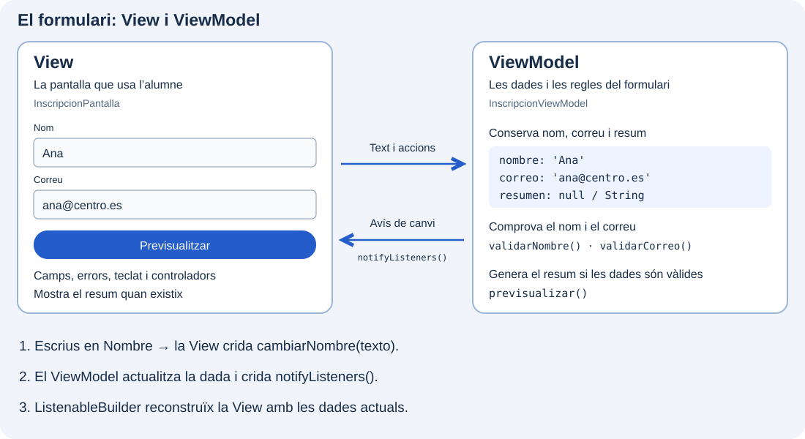

Aplicarem el que hem aprés en [Elements d’un formulari](../controles-de-entrada/) per a construir una inscripció amb Nombre i Correo. Conservem `Form`, la clau i els camps amb validació; ací ens centrarem a connectar l’edició amb el ViewModel, mantindre un resum actualitzat i gestionar el focus.

Treballarem en **`catalogo_widgets`**, el mateix projecte que hem anat ampliant. Afegirem la inscripció com una entrada del menú. Cada pas amplia els arxius de l’anterior; `main.dart` continuarà arrancant el catàleg.

## Dos parts del mateix formulari

La View serà `InscripcionPantalla` i el seu ViewModel, `InscripcionViewModel`. En este exemple, el nom i el correu s’actualitzaran **mentre s’editen**, en lloc d’arreplegar-los en un esborrany amb `onSaved`.



Per exemple, en escriure «Ana», la pantalla comunica el text amb `cambiarNombre`. El ViewModel guarda el valor i avisa del canvi. Més avant connectarem eixe avís amb `ListenableBuilder`, perquè la pantalla mostre el resultat actualitzat.

En prémer «Previsualizar», la pantalla demana validar els camps usant les regles del ViewModel. Si són correctes, crida `previsualizar()` i mostra el resum que este genera.

## 🎯 Què aprendràs

- Construir una pantalla amb camps de nom i correu.
- Arreplegar el text introduït i comprovar si les dades són vàlides.
- Mostrar errors i generar una previsualització amb un botó.
- Llegir i modificar camps amb controladors i gestionar el focus del teclat.

Obri la carpeta de `catalogo_widgets` que conté `pubspec.yaml`. No necessites crear un altre projecte ni instal·lar paquets.

```text
lib/
├── main.dart
└── ui/
    └── inscripcion/
        ├── ui/
        │   └── inscripcion_pantalla.dart
        └── view_models/
            └── inscripcion_viewmodel.dart
```

Seguim la convenció del curs: les peces visuals van en `ui`, i el ViewModel en `view_models`, dins de la mateixa funcionalitat.

## Passos del formulari

1. [Preparar la pantalla](./preparar-la-pantalla/).
2. [Arreplegar el nom i el correu](./recoger-los-datos/).
3. [Comprovar les dades](./validar-los-datos/).
4. [Afegir el botó i el resultat](./boton-y-resultado/).
5. [Llegir i modificar els camps](./controladores-y-cambios/).
6. [Gestionar el focus](./gestionar-el-foco/).
7. [Completar la pantalla](./completar-la-pantalla/).
8. [Provar el formulari](./probar-el-formulario/).
