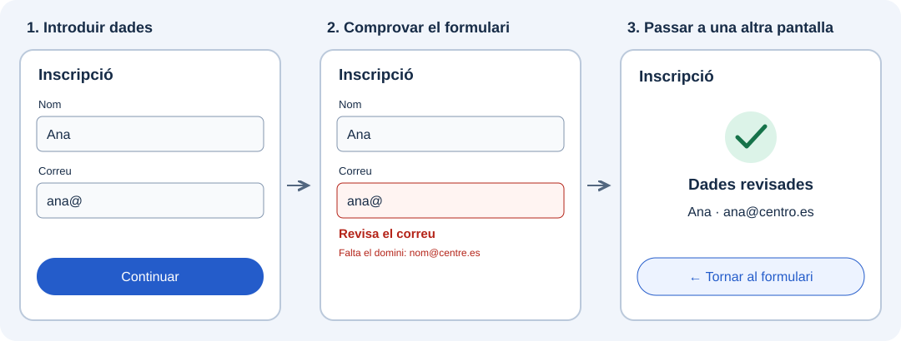

En una aplicació no basta amb mostrar informació: també necessitem que les persones puguen escriure dades, triar opcions i desplaçar-se entre pantalles. Pensa en una inscripció: introduïxes el nom i el correu, corregixes els errors que apareixen i continues per a revisar les dades.

En esta unitat aprendràs a construir eixes interaccions amb Flutter.

:::tip[Dos conceptes que treballen junts]
Els **formularis** permeten arreplegar i comprovar la informació; la **navegació** permet organitzar les pantalles i moure’s entre elles.
:::

L’esquema mostra un possible recorregut d’una aplicació. Primer treballarem l’entrada i la comprovació de dades; després aprendrem a obrir altres pantalles i tornar a l’anterior.

## 🎯 Què aprendràs

- Triar controls per a introduir text i seleccionar opcions.
- Construir un formulari i mostrar missatges que ajuden a corregir-ne les dades.
- Connectar pantalles, intercanviar informació i organitzar seccions i diàlegs.

## Com treballarem

1. **[Elements d’un formulari](./controles-de-entrada/).** Coneixeràs el contenidor, l’estat i els camps que componen un formulari, i com es relacionen.
2. **[Crear un formulari](./formulario-con-viewmodel/).** Construiràs una inscripció pas a pas: preparar la pantalla, arreplegar nom i correu, validar els camps i mostrar un resultat.
3. **[Navegació](./navegacion/).** Connectaràs pantalles, passaràs dades entre elles i usaràs barres, pestanyes i diàlegs. Al final integraràs el que has aprés en el catàleg.

:::note[El punt de partida]
Partirem dels widgets que ja coneixes i incorporarem cada concepte quan faça falta en l’exemple.
:::

Comença per la introducció als [elements d’un formulari](./controles-de-entrada/).
