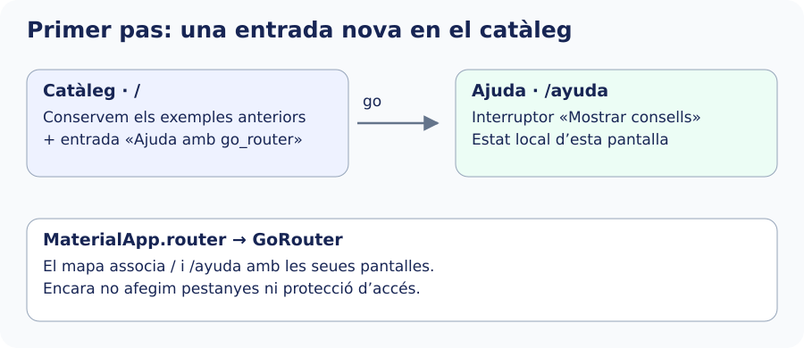

En este pas crearem el primer mapa de rutes amb dos destinacions: el catàleg (`/`) i una pantalla d’Ajuda (`/ayuda`). En acabar, l’entrada **Ayuda con go_router** del catàleg obrirà Ajuda mitjançant la seua adreça.



Crearem o modificarem estos fitxers:

```text
lib/
  main.dart                                   ← crea el router i usa MaterialApp.router
  ui/
    core/app_router.dart                      ← nou: el mapa de rutes
    catalogo/ui/catalogo_pantalla.dart        ← entrada nova
    navegacion_avanzada/ui/ayuda_pantalla.dart ← pantalla nova
```

## 1. La pantalla de destinació

Ajuda és un `StatefulWidget` amb un interruptor. Eixe estat local ens servirà més avant per a comprovar quan es conserva una pantalla i quan es crea de nou. El botó de la capçalera torna al catàleg amb `context.go('/')`; en el pas següent veurem per què el necessitem.

`lib/ui/navegacion_avanzada/ui/ayuda_pantalla.dart`

```dart
import 'package:flutter/material.dart';
import 'package:go_router/go_router.dart';

class AyudaPantalla extends StatefulWidget {
  const AyudaPantalla({super.key});

  @override
  State<AyudaPantalla> createState() => _AyudaPantallaState();
}

class _AyudaPantallaState extends State<AyudaPantalla> {
  bool _mostrar = false;

  @override
  Widget build(BuildContext context) => Scaffold(
    appBar: AppBar(
      title: const Text('Ayuda'),
      actions: [
        IconButton(
          tooltip: 'Catálogo',
          icon: const Icon(Icons.home_outlined),
          onPressed: () => context.go('/'),
        ),
      ],
    ),
    body: ListView(
      children: [
        SwitchListTile(
          title: const Text('Mostrar consejos'),
          value: _mostrar,
          onChanged: (valor) => setState(() => _mostrar = valor),
        ),
        if (_mostrar)
          const Padding(
            padding: EdgeInsets.all(16),
            child: Text('Elige un taller para consultar su detalle.'),
          ),
      ],
    ),
  );
}
```

## 2. El mapa de rutes

Guardem la configuració de la navegació en `lib/ui/core/`, al costat de les peces compartides per tota la interfície.

`lib/ui/core/app_router.dart`

```dart
import 'package:go_router/go_router.dart';
import '../catalogo/ui/catalogo_pantalla.dart';
import '../navegacion_avanzada/ui/ayuda_pantalla.dart';

GoRouter crearRouter() => GoRouter(
  initialLocation: '/',
  debugLogDiagnostics: true,
  routes: [
    GoRoute(
      path: '/',
      name: 'catalogo',
      builder: (context, state) => const CatalogoPantalla(),
    ),
    GoRoute(
      path: '/ayuda',
      name: 'ayuda',
      builder: (context, state) => const AyudaPantalla(),
    ),
  ],
);
```

Analitzem cada part:

- **`GoRouter`** reunix tota la configuració. El creem dins d’una funció (`crearRouter`) per a poder passar-li dependències en els pròxims passos.
- **`initialLocation`** és la ubicació amb què arranca l’aplicació quan ningú en demana una altra (per exemple, un enllaç o la barra d’adreces del navegador).
- **`debugLogDiagnostics: true`** escriu en la consola de depuració cada navegació: quina ubicació es demana, quina ruta coincidix i, més avant, quines redireccions s’apliquen. És molt útil mentre aprenem; en una versió publicada es lleva.
- **`routes`** és la llista de rutes de primer nivell. go_router recorre la llista i tria la primera el patró de la qual coincidix amb la ubicació.
- **`path`** és el patró de la ruta. Les rutes de primer nivell **comencen sempre per `/`**.
- **`name`** és un nom únic i opcional. Permet navegar amb `context.goNamed('ayuda')` sense escriure l’adreça literal; si un dia canviem `/ayuda` per `/soporte`, els botons que utilitzen el nom continuen funcionant.
- **`builder`** rep el `BuildContext` i el `GoRouterState` de la navegació i retorna el widget de la pantalla. Encara no utilitzem `state`; en el pas 4 en llegirem els paràmetres.

:::note[builder i pageBuilder]
`builder` utilitza la transició per defecte de la plataforma. Si algun dia necessites una animació pròpia (per exemple, una fosa), `GoRoute` també admet `pageBuilder`, que retorna una `Page` com `CustomTransitionPage`. En esta secció no la necessitem.
:::

## 3. Crear el router en l’arrancada

Fins ara, `main.dart` arrancava un `MaterialApp` que obria el catàleg amb `home`. Substituïx el fitxer per esta versió, que crea el router i el lliura a `MaterialApp.router`:

`lib/main.dart`

```dart
import 'package:flutter/material.dart';
import 'ui/core/app_router.dart';

void main() {
  final router = crearRouter();
  runApp(
    MaterialApp.router(
      debugShowCheckedModeBanner: false,
      title: 'Catálogo de widgets',
      routerConfig: router,
    ),
  );
}
```

- **`MaterialApp.router`** substituïx `MaterialApp`. En lloc de `home` o de la taula `routes` de `MaterialApp`, rep **`routerConfig`**: el router decidix quines pantalles es mostren. No combines `routerConfig` amb `home` ni amb `routes`.
- Creem el router **una sola vegada**, en `main()`, abans de `runApp`. No el crees mai dins del `build` d’un widget: `build` es pot executar moltes vegades, i un router nou en cada una reiniciaria la navegació.
- El router viu mentre dura l’aplicació, així que no cal alliberar-lo.

Si el teu `MaterialApp` anterior tenia `theme`, copia’l també a `MaterialApp.router`.

El catàleg ja no l’obri `home`: l’obri la ruta `/`, que és la `initialLocation`.

## 4. Afegir l’entrada al catàleg

En `lib/ui/catalogo/ui/catalogo_pantalla.dart`, afig l’import de go_router i, al final de la llista del `ListView`, esta entrada. Conserva les anteriors:

```dart
import 'package:go_router/go_router.dart';
```

```dart
const Divider(),
const ListTile(title: Text('Navegación con go_router')),
ListTile(
  leading: const Icon(Icons.help_outline),
  title: const Text('Ayuda con go_router'),
  trailing: const Icon(Icons.chevron_right),
  onTap: () => context.go('/ayuda'),
),
```

`context.go('/ayuda')` demana al router la ubicació `/ayuda`. El router busca en el mapa la ruta que coincidix i construïx `AyudaPantalla`.

## Provar

Executa `flutter run` (o fes **hot restart** si ja estava en marxa). Obri **Ayuda con go_router**, activa l’interruptor i torna amb la icona de la casa. Observa la consola de depuració: veuràs línies de `GoRouter` que indiquen cada ubicació sol·licitada.

Les entrades antigues del catàleg que utilitzen `Navigator.push` continuen funcionant: `MaterialApp.router` també crea un `Navigator`, i `push` apila la pantalla damunt del catàleg com abans. La diferència és que eixes pantalles no tenen adreça pròpia.

Referències: [GoRouter](https://pub.dev/documentation/go_router/latest/go_router/GoRouter-class.html) i [GoRoute](https://pub.dev/documentation/go_router/latest/go_router/GoRoute-class.html).
