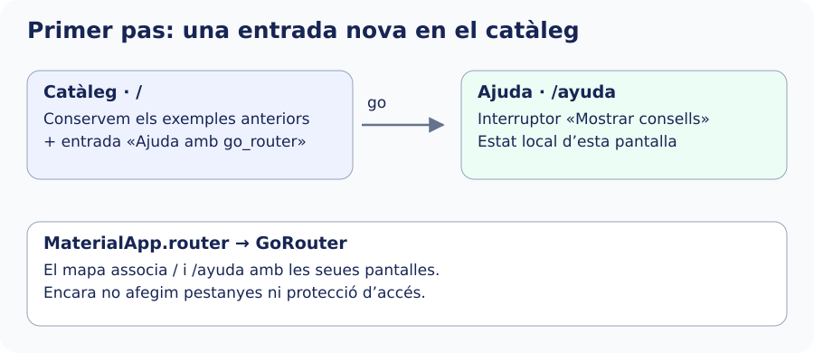

En este pas construirem la primera part de l’exemple: des del catàleg, polsarem **Ayuda con go_router** i veurem una pantalla amb l’interruptor **Mostrar consejos**. En activar-lo, apareixerà un text d’ajuda. L’objectiu és comprovar com una entrada del catàleg obri una pantalla mitjançant una ruta declarada. Encara no implementarem la consulta de tallers ni el login.

Començarem amb dos rutes públiques: `/` conserva el catàleg i `/ayuda` obri una pantalla nova. `GoRouter` definix la taula de rutes, cada `GoRoute` associa un `path` a una destinació i `builder` construïx eixa destinació. El `state` que rep conté informació de la URL.

Este és el resultat del primer pas: una entrada del catàleg obri Ajuda. La resta d’exemples es conserva. Més avant ampliarem este mapa.



## Preparar una pantalla de destinació

Crea este fitxer complet. L’interruptor conserva estat local i ens servirà per a observar després què ocorre en canviar de secció.


`lib/ui/navegacion_avanzada/ui/ayuda_pantalla.dart`

```dart
import 'package:flutter/material.dart';

class AyudaPantalla extends StatefulWidget {
  const AyudaPantalla({super.key});
  @override
  State<AyudaPantalla> createState() => _AyudaPantallaState();
}

class _AyudaPantallaState extends State<AyudaPantalla> {
  bool _mostrar = false;
  @override
  Widget build(BuildContext context) => Scaffold(
    appBar: AppBar(title: const Text('Ayuda')),
    body: ListView(
      children: [
        SwitchListTile(
          title: const Text('Mostrar consejos'),
          value: _mostrar,
          onChanged: (valor) => setState(() => _mostrar = valor),
        ),
        if (_mostrar)
          const Padding(
            padding: EdgeInsets.all(16),
            child: Text('Elige un taller para consultar su detalle.'),
          ),
      ],
    ),
  );
}
```

## Declarar les rutes

Crea `lib/app/router/app_router.dart` amb este codi. `initialLocation` és la ubicació inicial quan no n’arriba una altra des de la plataforma. Els `path` de primer nivell comencen per `/`; `name` és un identificador únic per a navegar sense repetir eixa ruta literal.


```dart
import 'package:go_router/go_router.dart';
import '../../ui/catalogo/ui/catalogo_pantalla.dart';
import '../../ui/navegacion_avanzada/ui/ayuda_pantalla.dart';

GoRouter crearRouter() => GoRouter(
  initialLocation: '/',
  routes: [
    GoRoute(path: '/', builder: (context, state) => const CatalogoPantalla()),
    GoRoute(path: '/ayuda', name: 'ayuda',
      builder: (context, state) => const AyudaPantalla()),
  ],
);
```

## Connectar el router en l’arrancada

Crea `lib/app/catalogo_router_app.dart` amb esta versió inicial. El router es crea una vegada en `initState`, no dins de `build`: reconstruir el widget no ha de reiniciar la configuració de navegació. `routerConfig` connecta `MaterialApp.router` amb ell. No es combina amb `home` ni amb la taula `routes` de `MaterialApp`.


```dart
import 'package:flutter/material.dart';
import 'package:go_router/go_router.dart';
import 'router/app_router.dart';

class CatalogoRouterApp extends StatefulWidget {
  const CatalogoRouterApp({super.key});
  @override
  State<CatalogoRouterApp> createState() => _CatalogoRouterAppState();
}
class _CatalogoRouterAppState extends State<CatalogoRouterApp> {
  late final GoRouter _router;
  @override
  void initState() { super.initState(); _router = crearRouter(); }
  @override
  void dispose() { _router.dispose(); super.dispose(); }
  @override
  Widget build(BuildContext context) => MaterialApp.router(
    debugShowCheckedModeBanner: false,
    title: 'Catálogo con rutas',
    routerConfig: _router,
  );
}
```

Obri el fitxer **`lib/main.dart`**. Afig l’import de `catalogo_router_app.dart` que apareix a continuació i canvia la funció `main()` perquè `runApp` reba `CatalogoRouterApp`. Així, en iniciar l’aplicació, s’utilitzarà el mapa de rutes que acabem de configurar.

El bloc següent mostra els imports necessaris i la nova funció `main()`. Conserva qualsevol altre codi del fitxer que continue utilitzant el teu projecte:

```dart
import 'package:flutter/material.dart';
import 'app/catalogo_router_app.dart';

void main() => runApp(const CatalogoRouterApp());
```

En `catalogo_pantalla.dart`, conserva les entrades i afegix `import 'package:go_router/go_router.dart';` i esta entrada a la llista:


```dart
ListTile(
  title: const Text('Ayuda con go_router'),
  onTap: () => context.go('/ayuda'),
),
```

Des de l’arrel del projecte executa `flutter run`, obri eixa entrada i observa Ajuda. Les demostracions anteriors que utilitzen `Navigator.push` continuen funcionant, però eixes rutes imperatives no tenen una URL pròpia declarada i no són destinacions d’enllaç directe. `go` pot substituir-les en reconstruir la pila d’una ubicació.

Referència: [GoRouter](https://pub.dev/documentation/go_router/latest/go_router/GoRouter-class.html).
