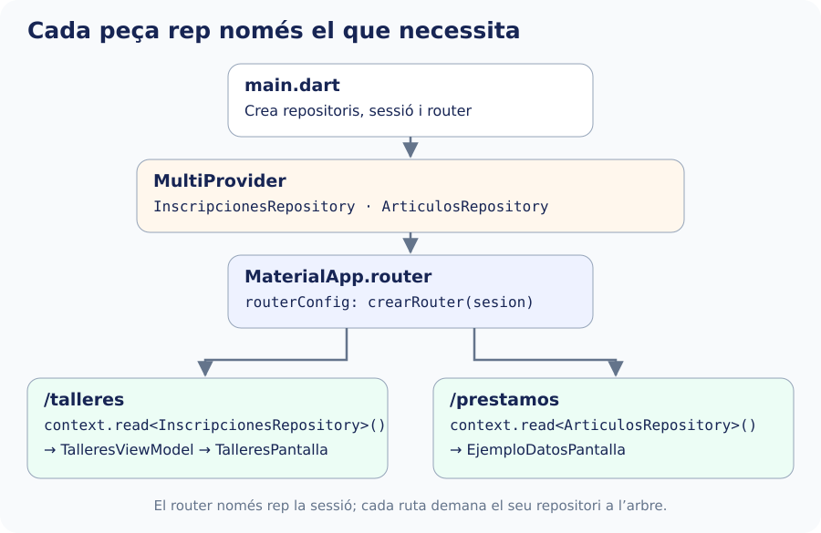

En l’exemple, `crearRouter` rep el repositori d’inscripcions i la sessió, perquè les seues rutes els necessiten per a crear els ViewModels. Amb dos dependències funciona, però en una aplicació real cada funcionalitat porta el seu propi repositori: tallers, préstecs, reserves, usuaris… Si tots passen per `crearRouter`, el router acaba coneixent totes les peces de l’aplicació, encara que ell només s’encarrega de decidir quina pantalla mostrar.

En esta ampliació separarem dos responsabilitats: **qui crea** les dependències (l’arrancada) i **qui les utilitza** (cada ruta). Utilitzarem el paquet **provider**, el que recomana l’equip de Flutter en la seua [guia d’arquitectura](https://docs.flutter.dev/app-architecture/case-study/dependency-injection) per a injectar dependències.

## El problema: un router que ho coneix tot

Imagina que l’aplicació continua creixent i cada pantalla nova necessita un repositori diferent. La signatura de `crearRouter` creixeria així:

```dart
GoRouter crearRouter(
  InscripcionesRepository inscripciones,
  ArticulosRepository articulos,
  ReservasRepository reservas,
  UsuariosRepository usuarios,
  SesionViewModel sesion,
) => GoRouter(/* ... */);
```

Cada funcionalitat nova obliga a modificar `crearRouter`, `main.dart` i totes les funcions de rutes intermèdies que reenvien els repositoris. A més, el router rep objectes que no utilitza: només els passa als `builder`.

## La idea: les dependències viuen en l’arbre de widgets

Recorda que el `context` d’un widget permet buscar informació **en els widgets que té per damunt**: així funcionen `Theme.of(context)` o `GoRouterState.of(context)`. provider aprofita el mateix mecanisme per a qualsevol objecte:

1. En `main.dart` col·loquem els repositoris **per damunt** de `MaterialApp.router`, embolcallats en un `MultiProvider`.
2. Totes les pantalles de l’aplicació queden per davall. En el `builder` de cada ruta, `context.read<T>()` busca cap amunt l’objecte de tipus `T` i el retorna.
3. El router només rep el que necessita per a **decidir**: la sessió, per a `redirect` i `refreshListenable`.



## 1. Instal·lar provider

provider és un paquet extern, així que primer l’afegim al projecte. Des de l’arrel de `catalogo_widgets`, executa:

```bash
flutter pub add provider
```

## 2. Registrar els repositoris en l’arrancada

L’arrancada continua sent l’**arrel de composició**: l’únic lloc que coneix les implementacions de `data`. La diferència és que, en lloc de passar els repositoris al router, els entrega a l’arbre de widgets. Substituïx `main.dart`:

`lib/main.dart`

```dart
import 'package:flutter/material.dart';
import 'package:provider/provider.dart';
import 'data/repositories/inscripciones_local_repository.dart';
import 'data/services/inscripciones_local_service.dart';
import 'domain/repositories/inscripciones_repository.dart';
import 'ui/core/app_router.dart';
import 'ui/core/view_models/sesion_viewmodel.dart';

void main() {
  final sesion = SesionViewModel();
  final router = crearRouter(sesion);
  runApp(
    MultiProvider(
      providers: [
        Provider<InscripcionesRepository>(
          create: (_) => InscripcionesLocalRepository(
            const InscripcionesLocalService(),
          ),
        ),
      ],
      child: MaterialApp.router(
        debugShowCheckedModeBanner: false,
        title: 'Catálogo de widgets',
        routerConfig: router,
      ),
    ),
  );
}
```

- **`MultiProvider`** agrupa diversos proveïdors en un sol widget. El posem per damunt de `MaterialApp.router` perquè totes les pantalles que construïsca el router puguen trobar-los.
- **`Provider<InscripcionesRepository>`** registra l’objecte **amb el tipus del contracte**, no amb el de la implementació. Les rutes demanaran un `InscripcionesRepository` sense saber que és local. El dia que existisca `InscripcionesRemoteRepository`, només canviarà esta línia.
- **`create`** s’executa una sola vegada, la primera vegada que algú demana el repositori. A partir d’aleshores, totes les rutes compartixen la mateixa instància.
- **`crearRouter(sesion)`** ja no rep repositoris. La sessió sí, perquè el router la utilitza directament en `redirect` i `refreshListenable`.

## 3. Demanar les dependències en cada ruta

Cada ruta obté ara les seues dependències de l’arbre, en el moment de construir la seua pantalla. Ho fa amb `context.read<T>()`, que busca l’objecte del tipus indicat en els widgets superiors.

Substituïx `ruta_talleres.dart`. La funció ja no rep paràmetres:

`lib/ui/core/ruta_talleres.dart`

```dart
import 'package:go_router/go_router.dart';
import 'package:provider/provider.dart';
import '../../domain/repositories/inscripciones_repository.dart';
import '../navegacion_avanzada/ui/detalle_taller_pantalla.dart';
import '../navegacion_avanzada/ui/talleres_pantalla.dart';
import '../navegacion_avanzada/view_models/detalle_taller_viewmodel.dart';
import '../navegacion_avanzada/view_models/talleres_viewmodel.dart';

GoRoute rutaTalleres() => GoRoute(
  path: '/talleres',
  name: 'talleres',
  builder: (context, state) => TalleresPantalla(
    viewModel: TalleresViewModel(
      context.read<InscripcionesRepository>(),
      consulta: state.uri.queryParameters['q'] ?? '',
    ),
  ),
  routes: [
    GoRoute(
      path: ':id',
      name: 'taller',
      builder: (context, state) => DetalleTallerPantalla(
        viewModel: DetalleTallerViewModel(
          context.read<InscripcionesRepository>(),
          state.pathParameters['id']!,
        ),
      ),
    ),
  ],
);
```

En `app_router.dart` cal fer tres canvis:

1. Afig este import:

   ```dart
   import 'package:provider/provider.dart';
   ```

2. Canvia la signatura perquè només reba la sessió:

   ```dart
   GoRouter crearRouter(SesionViewModel sesion) => GoRouter(
   ```

3. En la ruta `login`, demana el repositori a l’arbre, i en la branca de Tallers crida `rutaTalleres()` sense arguments:

   ```dart
   builder: (context, state) => LoginRutaPantalla(
     repository: context.read<InscripcionesRepository>(),
     onLogin: sesion.iniciarSesion,
   ),
   ```

   ```dart
   StatefulShellBranch(routes: [rutaTalleres()]),
   ```

### `context.read` i `context.watch`

provider oferix dos maneres d’obtindre un objecte:

| Mètode | Què fa | Quan utilitzar-lo |
| --- | --- | --- |
| `context.read<T>()` | Retorna l’objecte una vegada, sense escoltar canvis. | Per a obtindre dependències que no canvien, com un repositori. És el que utilitzem en els `builder` de les rutes. |
| `context.watch<T>()` | Retorna l’objecte i reconstruïx el widget cada vegada que notifica un canvi. | Per a mostrar en pantalla un estat que canvia. En este curs ho fem amb `ListenableBuilder` i el ViewModel. |

Una regla que manté el codi ordenat: **només els `builder` de les rutes criden `context.read`**. Les pantalles i els ViewModels continuen rebent les seues dependències per constructor, com fins ara; així no depenen de provider i es poden reutilitzar en qualsevol lloc.

## 4. Afegir una funcionalitat amb un altre repositori

Ara veiem l’avantatge: afegir una funcionalitat amb el seu propi repositori no obliga a tocar la signatura de `crearRouter`. Com a exemple, convertirem en ruta la miniaplicació de préstecs de l’[exemple amb dades](../../../widgets/ejemplo-con-datos/), que utilitza `ArticulosRepository`.

Primer registrem el nou repositori en `main.dart`. Afig estos imports i el proveïdor a la llista `providers`, després del d’inscripcions:

```dart
import 'data/repositories/articulos_repository.dart';
import 'data/services/articulos_local_service.dart';
```

```dart
Provider<ArticulosRepository>(
  create: (_) => ArticulosRepository(
    service: const ArticulosLocalService(),
  ),
),
```

Després declarem la seua ruta en un fitxer propi. Serà filla de `/`, com Login i Compte, perquè la capçalera mostre la fletxa de tornar al catàleg:

`lib/ui/core/ruta_prestamos.dart`

```dart
import 'package:go_router/go_router.dart';
import 'package:provider/provider.dart';
import '../../data/repositories/articulos_repository.dart';
import '../prestamos/ui/ejemplo_datos_pantalla.dart';

GoRoute rutaPrestamos() => GoRoute(
  path: 'prestamos',
  name: 'prestamos',
  builder: (context, state) => EjemploDatosPantalla(
    repository: context.read<ArticulosRepository>(),
  ),
);
```

En `app_router.dart`, importa `ruta_prestamos.dart` i afig `rutaPrestamos()` a la llista `routes` de la ruta `/`, al costat de `login` i `cuenta`:

```dart
routes: [
  GoRoute(path: 'login', /* ... */),
  GoRoute(path: 'cuenta', /* ... */),
  rutaPrestamos(),
],
```

Finalment, en el catàleg, canvia l’`onTap` de l’entrada **Ejemplo con datos** perquè navegue per la seua adreça:

```dart
onTap: () => context.go('/prestamos'),
```

Fixa’t en el que **no** ha canviat: la signatura de `crearRouter`, la de `rutaTalleres` i la pantalla `EjemploDatosPantalla`. Cada funcionalitat nova es resol amb un proveïdor en `main.dart` i una funció de rutes pròpia.

## 5. Reunir els proveïdors en un fitxer

Amb dos repositoris, `main.dart` ja mescla dos tasques: arrancar l’aplicació i crear totes les seues dependències. Cada funcionalitat nova afegiria imports de `data` i un proveïdor més a eixe fitxer. Perquè `main.dart` quede curt i llegible, portem la llista de proveïdors a un fitxer propi, al costat d’ell.

Crea este fitxer. Conté tots els imports de `data` i una llista amb els proveïdors:

`lib/dependencias.dart`

```dart
import 'package:provider/provider.dart';
import 'package:provider/single_child_widget.dart';
import 'data/repositories/articulos_repository.dart';
import 'data/repositories/inscripciones_local_repository.dart';
import 'data/services/articulos_local_service.dart';
import 'data/services/inscripciones_local_service.dart';
import 'domain/repositories/inscripciones_repository.dart';

/// Repositorios que la aplicación pone a disposición de las rutas.
/// Para añadir uno nuevo, solo hay que modificar esta lista.
List<SingleChildWidget> get dependencias => [
  Provider<InscripcionesRepository>(
    create: (_) => InscripcionesLocalRepository(
      const InscripcionesLocalService(),
    ),
  ),
  Provider<ArticulosRepository>(
    create: (_) => ArticulosRepository(
      service: const ArticulosLocalService(),
    ),
  ),
];
```

- **`SingleChildWidget`** és el tipus que espera `providers` de `MultiProvider`: cada `Provider` és un widget que embolcalla un sol fill. S’importa des de `package:provider/single_child_widget.dart`.
- **`get dependencias`** és un *getter*: es llig com una variable (`dependencias`), però construïx la llista en el moment d’utilitzar-la. Els objectes no es creen ací: cada `create` s’executa la primera vegada que una ruta demana el seu repositori.

Ara `main.dart` només arranca l’aplicació. Substituïx-lo per esta versió, que ja no importa res de `data`:

`lib/main.dart`

```dart
import 'package:flutter/material.dart';
import 'package:provider/provider.dart';
import 'dependencias.dart';
import 'ui/core/app_router.dart';
import 'ui/core/view_models/sesion_viewmodel.dart';

void main() {
  final sesion = SesionViewModel();
  final router = crearRouter(sesion);
  runApp(
    MultiProvider(
      providers: dependencias,
      child: MaterialApp.router(
        debugShowCheckedModeBanner: false,
        title: 'Catálogo de widgets',
        routerConfig: router,
      ),
    ),
  );
}
```

A partir d’ací, afegir una funcionalitat amb un repositori nou consistix a afegir el seu proveïdor a `dependencias.dart` i la seua funció de rutes a `app_router.dart`. `main.dart` no torna a canviar. L’aplicació d’exemple de la guia d’arquitectura de Flutter seguix la mateixa organització, amb els seus proveïdors en un fitxer a banda.

## 6. On es crea cada ViewModel?

Les dependències ja estan resoltes, però falta decidir on es creen els ViewModels. Depén de si tenen estat que canvia i s’han d’alliberar amb `dispose`:

| Tipus de ViewModel | On es crea | Exemple |
| --- | --- | --- |
| Sense estat que canvie (només dades `final`) | Directament en el `builder` de la ruta. Si el router reconstruïx la pàgina, se’n crea un altre igual i no hi ha res a alliberar. | `TalleresViewModel`, `DetalleTallerViewModel` |
| Amb `ChangeNotifier` (estat que canvia) | En l’`initState` d’un `StatefulWidget` que l’allibera en `dispose`. La ruta només li passa el repositori. | `LoginRutaPantalla`, `EjemploDatosPantalla` |

El segon cas és important: si un `ChangeNotifier` es creara en el `builder`, cada reconstrucció en crearia un de nou, es perdria l’estat (el que s’ha escrit en un formulari, un filtre…) i l’anterior no s’alliberaria mai. Per això `LoginRutaPantalla` i `EjemploDatosPantalla` reben el repositori i creen ells mateixos el seu ViewModel una sola vegada.

:::note[Una altra opció: ChangeNotifierProvider]
provider també pot crear i alliberar un ViewModel per nosaltres: `ChangeNotifierProvider(create: (context) => MiViewModel(context.read()), child: ...)` crida automàticament `dispose` quan la pantalla desapareix. És útil quan diverses pantalles compartixen el mateix ViewModel. En este curs continuem amb `initState` i `dispose`, que ja coneixem.
:::

## Què coneix cada peça

Amb esta organització, cada part de l’aplicació coneix només el que necessita:

| Peça | Què coneix |
| --- | --- |
| `dependencias.dart` | Les implementacions de `data`. Les registra com a proveïdors. |
| `main.dart` | La sessió, el router i la llista de dependències. Només arranca l’aplicació. |
| `crearRouter` | La sessió, per a decidir l’accés. Cap repositori. |
| Funcions de rutes (`rutaTalleres`, `rutaPrestamos`…) | Els contractes que necessiten les seues pantalles, que demanen amb `context.read`. |
| Pantalles i ViewModels | El que reben per constructor. No saben que existix provider. |

## Altres alternatives

provider no és l’única manera de resoldre el problema. Estes són les opcions més habituals i per què triem la tercera:

| Opció | Avantatge | Inconvenient |
| --- | --- | --- |
| Passar tots els repositoris a `crearRouter` | No necessita paquets. | La signatura creix amb cada funcionalitat. |
| Una classe `Dependencias` amb tots els repositoris, que es passa al router | Un únic paràmetre. | El router continua rebent-ho tot, i qualsevol ruta pot utilitzar qualsevol repositori. |
| **provider** (`MultiProvider` + `context.read`) | Cada ruta demana només el que utilitza; és l’opció recomanada en la guia d’arquitectura de Flutter. | Afig un paquet. |
| Un localitzador de servicis global, com `get_it` | S’hi accedix des de qualsevol lloc, sense `context`. | Les dependències queden ocultes: mirant una classe no es veu què necessita. |

## Provar

Executa `flutter pub get` si el teu editor no ho ha fet, fes **hot restart** i comprova que tot continua funcionant igual:

| Acció | Resultat |
| --- | --- |
| Talleres con go_router, buscar i obrir un detall | Igual que abans: el repositori arriba des de `main.dart`. |
| Mi cuenta protegida i login amb Ana | Igual que abans. |
| Ejemplo con datos | S’obri en `/prestamos` amb fletxa per a tornar al catàleg. |
| Escriure `/prestamos` en la barra del navegador (web) | Obri directament els préstecs. |
| Buscar `context.read` en el projecte | Només apareix en els fitxers de rutes de `lib/ui/core/`. |
| Buscar imports de `data/` en `main.dart` | No n’hi ha cap: estan en `dependencias.dart`. |

Referències: [injecció de dependències en la guia d’arquitectura de Flutter](https://docs.flutter.dev/app-architecture/case-study/dependency-injection) i [paquet provider](https://pub.dev/packages/provider).
