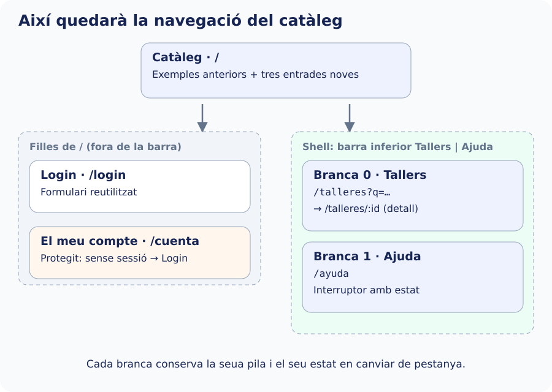

Amb els passos anteriors l’exemple està complet. En esta pàgina reunim el resultat final, relacionem cada concepte amb el fitxer on apareix i proposem un recorregut de comprovació.



## Fitxers de l’exemple

Este és el resultat final. Els fitxers d’esta secció se sumen als del catàleg i del formulari:

```text
lib/
  main.dart                                        repositori, sessió, router i MaterialApp.router
  ui/
    catalogo/ui/catalogo_pantalla.dart             entrades que criden context.go
    core/
      app_router.dart                              el mapa de rutes complet
      ruta_talleres.dart                           /talleres i /talleres/:id
      redireccion_sesion.dart                      la política d’accés
      view_models/sesion_viewmodel.dart            estat de sessió compartit
    inscripcion/ui/
      inscripcion_pantalla.dart                    formulari que avisa amb onLogin i protegix l’eixida
      inscripcion_ejemplo_pantalla.dart            demo antiga amb Navigator.push
      login_ruta_pantalla.dart                     formulari per a la ruta /login
    navegacion_avanzada/
      view_models/talleres_viewmodel.dart
      view_models/detalle_taller_viewmodel.dart
      ui/ayuda_pantalla.dart
      ui/talleres_pantalla.dart
      ui/detalle_taller_pantalla.dart
      ui/secciones_pantalla.dart                   la barra inferior (shell)
      ui/cuenta_pantalla.dart
      ui/ruta_no_encontrada_pantalla.dart
```

## El mapa de rutes final

Este fitxer és el centre de la navegació: reunix totes les rutes i les regles d’accés de la demostració. Esta és la versió final, després del pas 7:

`lib/ui/core/app_router.dart`

```dart
import 'package:flutter/material.dart';
import 'package:go_router/go_router.dart';
import '../../domain/repositories/inscripciones_repository.dart';
import '../catalogo/ui/catalogo_pantalla.dart';
import 'view_models/sesion_viewmodel.dart';
import '../inscripcion/ui/login_ruta_pantalla.dart';
import '../navegacion_avanzada/ui/ayuda_pantalla.dart';
import '../navegacion_avanzada/ui/cuenta_pantalla.dart';
import '../navegacion_avanzada/ui/ruta_no_encontrada_pantalla.dart';
import '../navegacion_avanzada/ui/secciones_pantalla.dart';
import 'redireccion_sesion.dart';
import 'ruta_talleres.dart';

GoRouter crearRouter(
  InscripcionesRepository repository,
  SesionViewModel sesion,
) => GoRouter(
  initialLocation: '/',
  debugLogDiagnostics: true,
  refreshListenable: sesion,
  redirect: (context, state) =>
      redireccionSesion(sesionActiva: sesion.activa, ubicacion: state.uri),
  errorBuilder: (context, state) =>
      RutaNoEncontradaPantalla(ubicacion: state.uri.toString()),
  routes: [
    GoRoute(
      path: '/',
      name: 'catalogo',
      builder: (context, state) => const CatalogoPantalla(),
      routes: [
        GoRoute(
          path: 'login',
          name: 'login',
          builder: (context, state) => LoginRutaPantalla(
            repository: repository,
            onLogin: sesion.iniciarSesion,
          ),
        ),
        GoRoute(
          path: 'cuenta',
          name: 'cuenta',
          builder: (context, state) {
            final acceso = sesion.acceso;
            if (acceso == null) return const SizedBox.shrink();
            return CuentaPantalla(
              acceso: acceso,
              onSalir: sesion.cerrarSesion,
            );
          },
        ),
      ],
    ),
    StatefulShellRoute.indexedStack(
      builder: (context, state, navigationShell) =>
          SeccionesPantalla(navigationShell: navigationShell),
      branches: [
        StatefulShellBranch(routes: [rutaTalleres(repository)]),
        StatefulShellBranch(
          routes: [
            GoRoute(
              path: '/ayuda',
              name: 'ayuda',
              builder: (context, state) => const AyudaPantalla(),
            ),
          ],
        ),
      ],
    ),
  ],
);
```

Llegit de dalt a baix, este fitxer descriu tota la navegació de la demostració:

```text
/                       Catàleg
├── /login              Login          (filla de /: fletxa per a tornar)
└── /cuenta             El meu compte  (protegit per redirect)
Shell amb barra inferior
├── branca 0: /talleres   Tallers
│             └── /talleres/:id   Detall
└── branca 1: /ayuda      Ajuda
```

Les entrades del catàleg queden així, a continuació de les anteriors:

```dart
const Divider(),
const ListTile(title: Text('Navegación con go_router')),
ListTile(
  leading: const Icon(Icons.help_outline),
  title: const Text('Ayuda con go_router'),
  trailing: const Icon(Icons.chevron_right),
  onTap: () => context.go('/ayuda'),
),
ListTile(
  leading: const Icon(Icons.school_outlined),
  title: const Text('Talleres con go_router'),
  trailing: const Icon(Icons.chevron_right),
  onTap: () => context.go('/talleres'),
),
ListTile(
  leading: const Icon(Icons.lock_outline),
  title: const Text('Mi cuenta protegida'),
  trailing: const Icon(Icons.chevron_right),
  onTap: () => context.go('/cuenta'),
),
```

## Cada concepte, al seu lloc

Per a repassar, esta taula relaciona cada concepte de go_router amb el fitxer on l’utilitzem i el pas on s’explica:

| Concepte | On es veu | Pas |
| --- | --- | --- |
| `MaterialApp.router` i `routerConfig` | `main.dart` | 2 |
| Crear el router una sola vegada, abans de `runApp` | `main()` en `main.dart` | 2 |
| `GoRoute`: `path`, `name`, `builder` | `app_router.dart` | 2 |
| `go` substituïx la pila, `push` apila, `pop` retorna | Ajuda (experiments) | 3 |
| Paràmetre de ruta `:id` | `ruta_talleres.dart` → `state.pathParameters` | 4 |
| Paràmetre de consulta `?q=` | `ruta_talleres.dart` → `state.uri.queryParameters` | 4 |
| `goNamed` amb `pathParameters` i `queryParameters` | `talleres_pantalla.dart` | 4 |
| Ruta filla: `go` construïx la pila pare + filla | `/talleres/:id`, `/login`, `/cuenta` | 4 i 6 |
| `GoRouterState.of(context)` | `detalle_taller_pantalla.dart` | 4 |
| `StatefulShellRoute`, branques i `goBranch` | `app_router.dart`, `secciones_pantalla.dart` | 5 |
| `redirect` i `refreshListenable` | `app_router.dart`, `redireccion_sesion.dart` | 6 |
| Conservar la destinació amb `from` | `redireccion_sesion.dart` | 6 |
| `errorBuilder` | `ruta_no_encontrada_pantalla.dart` | 7 |
| `PopScope` i diàleg de descart | `inscripcion_pantalla.dart`, `dialogos.dart` | 8 |
| Enllaços directes | Barra d’adreces en web | 7 |

## Recorregut de comprovació

Des de l’arrel del projecte executa `dart format lib` i `flutter analyze`. Després, `flutter run -d chrome` i comprova:

| Cas | Resultat observable |
| --- | --- |
| `/talleres/20` per URL | Detall de Cerámica, amb fletxa per a tornar al llistat. |
| Buscar `cer` en Tallers | Ubicació `/talleres?q=cer`; només Cerámica. |
| Obrir Cerámica i tornar | El llistat continua filtrat. |
| `/talleres/999` | «No existe el taller 999». |
| `/no-existe` | Pantalla de ruta no trobada, amb eixida al catàleg. |
| Detall → Ajuda → Tallers | Continua el detall; en tornar a Ajuda, l’interruptor conserva el valor. |
| Polsar Tallers estant en Tallers | Torna al llistat. |
| `/cuenta?origen=menu` sense sessió | Login, amb la destinació conservada en `from`. |
| Login amb Ana i `pau@centro.es` | Error de consulta; no s’obri Compte. |
| Login amb Ana, `ana@centro.es` i un taller | `/cuenta?origen=menu` amb la salutació d’Ana García Pérez. |
| Cerrar sesión | Torna a Login. |
| Recarregar la pàgina en `/cuenta` | Login: la sessió simulada no es guarda. |
| `/login?from=https://otra.web` amb sessió | Obri `/cuenta`; mai ix de l’aplicació. |
| Login de demostración (entrada antiga) | Funciona amb `Navigator.push`, sense sessió. |
| Escriure en Login i prémer la fletxa de tornar | Pregunta «Vols descartar els canvis?» abans d’eixir. |

## Per a practicar

Estes propostes et permeten aplicar el que has aprés modificant l’exemple. Cada una practica un concepte diferent:

1. Afig una ruta protegida `/cuenta/editar` com a filla de `cuenta`. Només has d’afegir la ruta al mapa i la seua adreça a `rutasProtegidas`. Comprova que, sense sessió, després del login arribes a la pàgina d’edició.
2. Afig una tercera branca a la barra inferior, per exemple **Favoritos** en `/favoritos`. Recorda mantindre el mateix ordre en `branches` i en `destinations`.
3. Canvia el llistat perquè el filtre també es puga esborrar amb un botó de la capçalera que navegue a `/talleres` sense paràmetres.

Si l’aplicació continua creixent i cada funcionalitat necessita el seu propi repositori, continua amb l’[ampliació: organitzar les dependències](../dependencias/).
