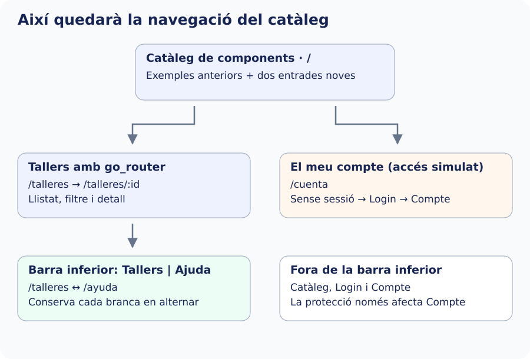

Reunim tot l’anterior en una configuració final: catàleg públic, Tallers i Ajuda amb barra inferior, Login i Compte protegit. Mantín els fitxers dels passos anteriors i les entrades antigues del catàleg. No mescles esta versió del router amb una altra declaració dels mateixos paths.

El mapa mostra el resultat que muntarem en el catàleg: dos entrades noves donen accés als recorreguts d’esta secció. Tallers i Ajuda compartixen barra inferior; Compte utilitza el login quan cal i queda fora d’eixa barra. Les fletxes indiquen recorreguts d’accés, no totes les piles possibles.



## Vista de Compte

Rep `DatosAcceso` des de la sessió: mostra la fitxa obtinguda pel login i exposa un callback d’eixida. No consulta DTO ni crea usuaris. Tancar sessió notifica un canvi; la política del router decidix després la destinació.


`lib/ui/navegacion_avanzada/ui/cuenta_pantalla.dart`

```dart
import 'package:flutter/material.dart';
import '../../../domain/models/datos_acceso.dart';

class CuentaPantalla extends StatelessWidget {
  const CuentaPantalla({
    super.key,
    required this.acceso,
    required this.onSalir,
  });
  final DatosAcceso acceso;
  final VoidCallback onSalir;
  @override
  Widget build(BuildContext context) {
    final usuario = acceso.usuario;
    return Scaffold(
      appBar: AppBar(title: const Text('Mi cuenta')),
      body: ListView(
        padding: const EdgeInsets.all(24),
        children: [
          Text(
            '¡Hola, ${usuario.nombreCompleto}!',
            style: Theme.of(context).textTheme.headlineSmall,
          ),
          Text('Identificador: ${usuario.id}'),
          Text('Correo: ${usuario.correo}'),
          Text('Teléfono: ${usuario.telefono}'),
          Text('Localidad: ${usuario.localidad}'),
          Text('Taller: ${acceso.taller.titulo}'),
          Text(
            acceso.recordatorio
                ? 'Recordatorio simulado: sí'
                : 'Sin recordatorio',
          ),
          const SizedBox(height: 24),
          OutlinedButton(
            onPressed: onSalir,
            child: const Text('Cerrar sesión'),
          ),
        ],
      ),
    );
  }
}
```

## Router complet

Substituïx `app_router.dart` per este fitxer. `/login` i `/cuenta` estan fora de la shell; la barra de les seccions públiques no apareix damunt del formulari. L’accés no nul en `sesion.acceso!` es basa en la redirecció prèvia de `/cuenta`: si no hi ha sessió, no es construïx eixa vista. No reutilitzes eixe accés fora de la ruta protegida.


`lib/app/router/app_router.dart`

```dart
import 'package:go_router/go_router.dart';
import '../../domain/repositories/inscripciones_repository.dart';
import '../../ui/catalogo/ui/catalogo_pantalla.dart';
import '../../ui/core/view_models/sesion_viewmodel.dart';
import '../../ui/inscripcion/ui/login_ruta_pantalla.dart';
import '../../ui/navegacion_avanzada/ui/ayuda_pantalla.dart';
import '../../ui/navegacion_avanzada/ui/cuenta_pantalla.dart';
import '../../ui/navegacion_avanzada/ui/ruta_no_encontrada_pantalla.dart';
import '../../ui/navegacion_avanzada/ui/secciones_pantalla.dart';
import 'redireccion_sesion.dart';
import 'ruta_talleres.dart';

GoRouter crearRouter(
  InscripcionesRepository repository,
  SesionViewModel sesion,
) => GoRouter(
  initialLocation: '/',
  refreshListenable: sesion,
  redirect: (context, state) => redireccionSesion(sesion, state),
  routes: [
    GoRoute(path: '/', builder: (context, state) => const CatalogoPantalla()),
    GoRoute(
      path: '/login',
      builder: (context, state) => LoginRutaPantalla(
        repository: repository,
        onLogin: sesion.iniciarSesion,
      ),
    ),
    GoRoute(
      path: '/cuenta',
      name: 'cuenta',
      builder: (context, state) =>
          CuentaPantalla(acceso: sesion.acceso!, onSalir: sesion.cerrarSesion),
    ),
    StatefulShellRoute.indexedStack(
      builder: (context, state, shell) =>
          SeccionesPantalla(navigationShell: shell),
      branches: [
        StatefulShellBranch(routes: [rutaTalleres(repository)]),
        StatefulShellBranch(
          routes: [
            GoRoute(
              path: '/ayuda',
              name: 'ayuda',
              builder: (context, state) => const AyudaPantalla(),
            ),
          ],
        ),
      ],
    ),
  ],
  errorBuilder: (context, state) => const RutaNoEncontradaPantalla(),
);
```

## Composició i cicle de vida

Substituïx `catalogo_router_app.dart` per este fitxer. L’arrancada és l’únic punt que importa les implementacions de `data`. Crea una sessió compartida i un router una sola vegada. En alliberar l’app, disposa primer el router que escolta la sessió i després la sessió. `main.dart` conserva l’arrancada del pas 2.


`lib/app/catalogo_router_app.dart`

```dart
import 'package:flutter/material.dart';
import 'package:go_router/go_router.dart';
import '../data/repositories/inscripciones_local_repository.dart';
import '../data/services/inscripciones_local_service.dart';
import '../ui/core/view_models/sesion_viewmodel.dart';
import 'router/app_router.dart';

class CatalogoRouterApp extends StatefulWidget {
  const CatalogoRouterApp({super.key});
  @override
  State<CatalogoRouterApp> createState() => _CatalogoRouterAppState();
}

class _CatalogoRouterAppState extends State<CatalogoRouterApp> {
  late final GoRouter _router;
  final _sesion = SesionViewModel();
  @override
  void initState() {
    super.initState();
    final repository = InscripcionesLocalRepository(
      const InscripcionesLocalService(),
    );
    _router = crearRouter(repository, _sesion);
  }

  @override
  void dispose() {
    _router.dispose();
    _sesion.dispose();
    super.dispose();
  }

  @override
  Widget build(BuildContext context) => MaterialApp.router(
    debugShowCheckedModeBanner: false,
    title: 'Catálogo con rutas',
    routerConfig: _router,
  );
}
```

En el `ListView` de `CatalogoPantalla`, conserva les entrades anteriors i afegix estes dos, amb l’import de go_router:


```dart
ListTile(
  title: const Text('Talleres con go_router'),
  onTap: () => context.go('/talleres'),
),
ListTile(
  title: const Text('Mi cuenta protegida'),
  onTap: () => context.go('/cuenta'),
),
```

## Comprovar el recorregut

Des de l’arrel del projecte, executa `dart format lib test` per a formatar, `flutter analyze` per a revisar el codi i `flutter test` per a executar les proves que tinga el catàleg. Després utilitza `flutter run` o `flutter run -d chrome` per a comprovar el comportament.

| Cas | Resultat observable |
| --- | --- |
| `/talleres/20` per URL | Detall de Cerámica obtingut del repositori. |
| `/talleres?q=cer` | Només tallers el títol dels quals coincidix amb el filtre. |
| `/talleres/999` | Missatge de dada inexistent, amb eixida al llistat. |
| `/no-existe` | Pantalla de ruta no trobada, amb eixida al catàleg. |
| Detall → Ajuda → Tallers | Conserva la pila de la branca i l’estat de l’interruptor d’Ajuda. |
| `/cuenta?origen=menu` sense sessió | Login conserva la ubicació sol·licitada. |
| Login amb Ana i pau@centro.es | Error de consulta; no activa sessió ni obri Compte. |
| Login amb Ana i ana@centro.es, triant un taller | Salutació d’Ana García Pérez i dades completes procedents de la font. |
| Limpiar en Login | Buida controls i errors; no modifica la font. |
| Tancar sessió i tornar a demanar `/cuenta` | Torna a demanar l’accés. |
| Recarregar l’app | No conserva la sessió simulada en memòria. |
| `from` extern o apuntant a `/login` | No abandona l’app ni crea un bucle; utilitza Compte com a destinació permesa. |

Les comprovacions automàtiques de referència d’esta secció utilitzen el flux nou amb un catàleg amfitrió mínim. No substituïxen les proves de les entrades anteriors ni la comprovació de l’historial i els enllaços externs en cada plataforma.
