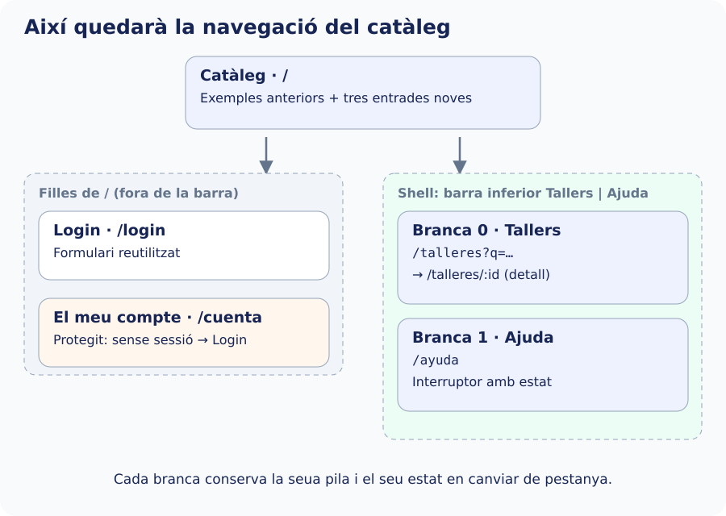
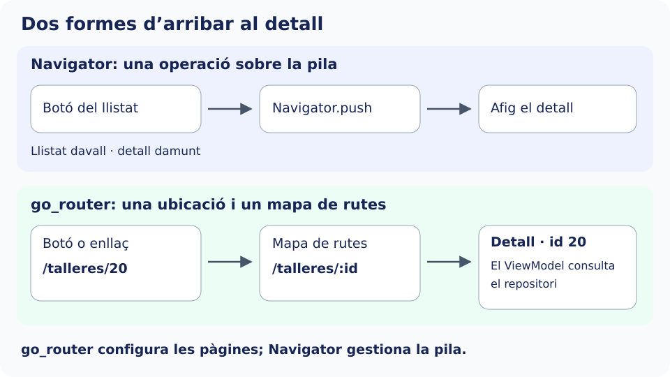

En [Navegació](../navegacion/) obríem pantalles amb `Navigator.push`: el codi d’un botó construïa la pantalla següent i la col·locava damunt de l’actual. En esta secció farem un pas més: cada pantalla tindrà una **adreça** (per exemple, `/talleres/20`) i un únic **mapa de rutes** decidirà què es mostra per a cada adreça. Per a fer-ho utilitzarem el paquet **go_router**.

Treballarem en el projecte **`catalogo_widgets`**, conservant les pantalles i entrades anteriors.

## L’exemple que construirem

Afegirem al catàleg una demostració de **consulta de tallers i accés a una fitxa d’usuari**. Reutilitzarem els tallers i usuaris ficticis del [formulari](../formulario-con-viewmodel/) i la seua arquitectura per capes.

En acabar, el catàleg tindrà tres entrades noves:

1. **Ayuda con go_router**: una pantalla amb un interruptor «Mostrar consejos».
2. **Talleres con go_router**: un llistat amb cercador. En polsar un taller s’obri el detall, amb adreça pròpia com `/talleres/20`. Una barra inferior permet alternar entre **Talleres** i **Ayuda** sense perdre el que hi havia en cada pestanya.
3. **Mi cuenta protegida**: si no hi ha sessió, apareix el formulari de login; amb dades correctes es mostra la fitxa de l’usuari. En tancar la sessió, es torna a demanar l’accés.

Els textos de la demostració estan en castellà perquè el codi és compartit entre les dos llengües.



El construirem en set passos. Al final de cada un l’aplicació compila i es pot provar.

## Navegació imperativa i declarativa

Amb `Navigator` donem **ordres**: «afig esta pantalla», «lleva la de dalt». És navegació **imperativa**. Funciona molt bé per a recorreguts curts, com llistat → detall → tornar.

Però una aplicació real té altres maneres d’arribar a una pantalla: un enllaç compartit, una notificació, la barra d’adreces del navegador web o la tornada després d’iniciar sessió. En tots eixos casos no hi ha cap botó que construïsca la pantalla: l’aplicació rep una adreça i ha de **deduir** quines pantalles mostrar.

go_router ho resol amb navegació **declarativa**: declarem una vegada quina pantalla correspon a cada adreça i, després, per a navegar, només demanem anar a una adreça.



| Necessitat | Amb `Navigator.push` | Amb go_router |
| --- | --- | --- |
| Obrir un detall des d’un botó | Construïm la pantalla i l’apilem. | Demanem anar a `/talleres/20`. |
| Obrir el detall des d’un enllaç | Cal programar a banda com s’interpreta l’enllaç. | El mateix mapa de rutes interpreta l’adreça. |
| Saber quin taller mostrar | Passem l’objecte per constructor. | Llegim `20` de l’adreça i consultem el repositori. |
| Demanar login abans d’entrar en Compte | Cal comprovar-ho en cada botó que obri Compte. | Una única regla (`redirect`) ho comprova per a qualsevol manera d’arribar-hi. |
| Pestanyes amb historial propi | Diversos `Navigator` coordinats a mà. | `StatefulShellRoute` ho organitza. |

go_router no substituïx `Navigator`: el configura per nosaltres. Per davall, Flutter continua utilitzant `Navigator` per a apilar i animar les pantalles. Per a un exemple amb dos pantalles, `Navigator.push` continua sent suficient; go_router compensa quan hi ha enllaços, paràmetres, seccions o accés protegit, com en este exemple.

## Anatomia d’una adreça

En go_router, l’adreça actual s’anomena **ubicació** (*location*) i es representa amb un `Uri`. Té la mateixa forma que una URL web, encara que l’aplicació siga mòbil:

```text
/talleres/20?q=cer
└───┬───┘└┬┘ └─┬─┘
  ruta   id  paràmetre de consulta
```

| Part | Exemple | Per a què la utilitzarem |
| --- | --- | --- |
| **Ruta** (*path*) | `/talleres/20` | Identifica la pantalla. |
| **Paràmetre de ruta** | `20` en el patró `/talleres/:id` | Dada obligatòria que identifica un registre. |
| **Paràmetre de consulta** | `q=cer` després de `?` | Dada opcional, com un filtre. |

Una bona regla: la ubicació ha de contindre **tot el que cal per a reconstruir la pantalla**, i res privat. Per això enviarem identificadors i filtres, però mai la fitxa d’un usuari ni una contrasenya.

## Les peces de go_router

Abans d’escriure codi convé conéixer els noms que apareixeran en tots els passos. Esta taula resumix les peces principals i el paper de cada una:

| Peça | Què és |
| --- | --- |
| `go_router` | El paquet que instal·lem. |
| `GoRouter` | L’objecte que conté el mapa de rutes complet i la configuració global (ubicació inicial, redireccions, pantalla d’error…). Es crea **una sola vegada**. |
| `GoRoute` | Una entrada del mapa: associa un patró de ruta (`path`) amb la pantalla que es construïx (`builder`). |
| `GoRouterState` | La informació de la navegació en curs: ubicació, paràmetres de ruta i de consulta… El `builder` el rep per a construir la pantalla. |
| `MaterialApp.router` | La variant de `MaterialApp` que delega la navegació en un router. |
| `context.go`, `context.push`, `context.pop`… | Mètodes d’extensió sobre `BuildContext` per a navegar des de qualsevol widget. |

## Instal·lar go_router

Des de l’arrel de `catalogo_widgets`, on hi ha `pubspec.yaml`, executa:

```bash
flutter pub add go_router
```

L’ordre afig la dependència a `pubspec.yaml` i descarrega el paquet. A partir d’ací podrem importar-lo amb `import 'package:go_router/go_router.dart';`.

:::caution[Hot reload i rutes]
El router es crea una sola vegada en arrancar. Si canvies el mapa de rutes (afiges un `GoRoute`, canvies un `path`, un `redirect`…), utilitza **hot restart** (`R` en el terminal o el botó de reinici), no hot reload: el hot reload conserva el router antic i no veuràs els canvis.
:::

## Recorregut de la secció

Cada pas afig una peça a l’exemple i acaba amb l’aplicació funcionant. Seguix-los en ordre:

2. [Configurar les rutes](./configurar-rutas/): el primer mapa amb el catàleg i Ajuda.
3. [Navegar entre pantalles](./navegar/): `go`, `push`, `pop` i la pila de pàgines.
4. [Paràmetres i consulta de dades](./parametros-y-datos/): llistat, cercador i detall.
5. [Rutes imbricades i seccions](./secciones/): la barra inferior amb `StatefulShellRoute`.
6. [Accés a rutes protegides](./rutas-protegidas/): sessió, login i `redirect`.
7. [Enllaços directes i errors](./enlaces-y-errores/): rutes desconegudes, web i mòbil.
8. [Exemple integrat i comprovacions](./ejemplo-integrado/): resum final i proves.
9. [Ampliació: organitzar les dependències](./dependencias/): repositoris amb provider quan l’aplicació creix.

Referències: [paquet go_router](https://pub.dev/packages/go_router), [guia de navegació de go_router](https://pub.dev/documentation/go_router/latest/topics/Navigation-topic.html) i [navegació en Flutter](https://docs.flutter.dev/ui/navigation).
