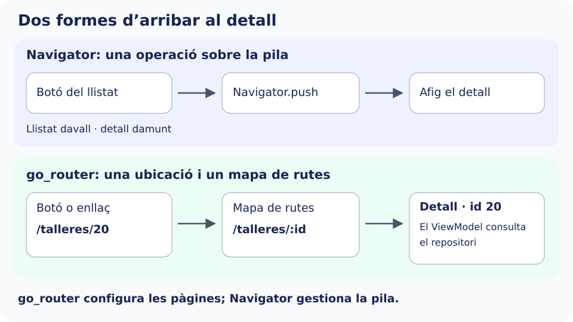

En [Navegació](../navegacion/) obríem pantalles amb `Navigator`. Ara organitzarem destinacions identificables per URL amb **go_router**: per exemple, `/talleres/20` descriu un detall i `/cuenta` una fitxa que només es mostra després de l’accés simulat.

Treballarem en **`catalogo_widgets`**, conservant les pantalles i entrades. A diferència dels exemples bàsics, ací canviarem l’arrancada a `MaterialApp.router`. No crearem un segon `MaterialApp` dins d’una pantalla del catàleg.

## L’exemple que construirem

Afegirem al catàleg una **demostració de consulta de tallers i accés a una fitxa d’usuari**. Imagina que una persona vol consultar activitats com Fotografia o Ceràmica, obrir-ne els detalls i accedir a la seua informació personal. Els tallers i els usuaris seran les dades fictícies que ja utilitzàvem en el formulari.

El recorregut final serà el següent:

1. Des del catàleg, l’entrada **Talleres con go_router** obrirà un llistat. Podrem filtrar-ne els títols i polsar un taller per a veure’n el detall. Cada detall tindrà una adreça pròpia, com `/talleres/20`.
2. Una barra inferior permetrà alternar entre **Tallers** i **Ajuda**. Ajuda mostrarà un interruptor amb consells; ens servirà per a comprovar si conserva el seu estat en canviar de pestanya.
3. Una altra entrada del catàleg, **Mi cuenta protegida**, intentarà obrir la fitxa personal. Sense sessió, apareixerà el formulari de login. Amb dades vàlides, veurem la salutació i les dades completes de l’usuari; en tancar sessió, es tornarà a sol·licitar l’accés.

El construirem per etapes. **Primer només connectarem el catàleg amb Ajuda** per a aprendre a declarar i obrir una ruta. Després afegirem el llistat i el detall, la barra inferior i, finalment, l’accés protegit. No és una aplicació de reserves nova: és un recorregut de pràctica dins del catàleg de components que ja tenim.

## Què és go_router

**go_router és un paquet de navegació per a Flutter**. Permet definir un mapa de rutes: per a cada adreça de l’aplicació, indiquem quina pantalla s’ha de mostrar. Per exemple, `/talleres` representa el llistat i `/talleres/20` el detall del taller amb identificador `20`. Estes adreces també servixen en una aplicació mòbil; no són exclusives d’una web.

Convé distingir tres noms: `go_router` és el paquet que instal·lem; `GoRouter` és la classe amb què configurem el mapa complet; cada `GoRoute` declara una ruta d’eixe mapa. En els pròxims passos crearem estes peces i les connectarem amb `MaterialApp.router`.

## Del botó que obri una pantalla a una adreça que identifica una destinació

Fins ara, el botó del llistat executava `Navigator.push` i construïa el detall passant les dades pel constructor. `Navigator` manté una **pila de pantalles**: `push` n’afegix una i `pop` retira la superior per a tornar a l’anterior. Este procediment resulta clar per a un recorregut com llistat → detall → tornar.

Imagina ara que volem compartir el detall de Ceràmica mitjançant un enllaç, obrir-lo sense passar pel llistat o recuperar eixa destinació després del login. El codi del botó ja no és l’únic punt d’entrada: l’aplicació necessita interpretar una adreça i decidir quines pantalles li corresponen.

Amb go_router declarem una regla com `/talleres/:id`. `:id` representa la part variable: en rebre `/talleres/20`, el router extrau `20`, executa el constructor de pantalla configurat i el nostre ViewModel consulta el taller a través del repositori. La URL identifica la destinació; **el router no obté ni transforma les dades del taller**.



La imatge mostra dos formes d’arribar al mateix detall. En el primer recorregut, el codi demana afegir una pantalla. En el segon, demana anar a una ubicació i el router configura les pàgines associades. Per això parlem de navegació **imperativa** en ordenar operacions com `push` i de configuració **declarativa** en definir què s’ha de mostrar per a cada ruta.

## Què aporta respecte al Navigator que ja coneixem

| Necessitat | Amb `Navigator.push` i `MaterialPageRoute` dels exemples anteriors | Amb go_router |
| --- | --- | --- |
| Obrir un detall des d’un botó | Construïm la pantalla i l’afegim a la pila. | Demanem una ubicació que té una destinació configurada. |
| Obrir el detall des d’un enllaç | Eixe botó, per si mateix, no interpreta enllaços; necessitem configurar-ne la recepció i la navegació corresponent. | El mapa de rutes interpreta la destinació i els paràmetres. Els enllaços externs requerixen també la configuració de la plataforma. |
| Identificar el taller que es consulta | Passem un objecte o identificador al constructor. | Extraiem l’identificador de `/talleres/:id` i consultem el repositori. |
| Demanar login abans d’entrar en Compte | Cal coordinar les comprovacions en els punts d’entrada que implementem. | Una política de redirecció comprova la sessió en resoldre la ruta, també si se sol·licita directament. |
| Mantindre diverses seccions amb historial propi | Podem fer-ho amb diversos navegadors i la seua coordinació. | `StatefulShellRoute` organitza les branques i conserva el seu estat mentre romanen en la shell. |

Estes capacitats es basen en les API `Router` i `Navigator` de Flutter. go_router en facilita la configuració; **Navigator continua sent qui gestiona les piles i presenta les pantalles**. El canvi no consistix únicament a escriure menys línies per a obrir un detall: ens permet reunir les regles de navegació i aplicar-les també quan l’accés comença des d’una URL. [La guia de Flutter](https://docs.flutter.dev/ui/navigation) explica quan convé utilitzar cada enfocament.

Per a un exemple amb dos pantalles i un botó de tornada, `Navigator` continua sent suficient. En esta secció utilitzarem go_router perquè combinarem enllaços directes, paràmetres, seccions i accés protegit. Primer configurarem rutes públiques; després connectarem el login per capes amb l’estat de sessió i les redireccions.

## Instal·lar go_router

Des de l’arrel de `catalogo_widgets`, on està `pubspec.yaml`, executa:

```bash
flutter pub add go_router
```

Este comandament afig go_router a les dependències de `pubspec.yaml` i descarrega el paquet i les seues dependències. Quan acabe, podrem importar-lo i configurar les rutes.

Els identificadors i el codi de demostració es compartixen entre castellà i valencià; l’explicació i els textos alternatius estan traduïts.

## Recorregut de la secció

2. [Configurar les rutes](./configurar-rutas/).
3. [Navegar entre pantalles](./navegar/).
4. [Paràmetres i consulta de dades](./parametros-y-datos/).
5. [Rutes imbricades i seccions](./secciones/).
6. [Accés a rutes protegides](./rutas-protegidas/).
7. [Enllaços directes i errors](./enlaces-y-errores/).
8. [Exemple integrat i comprovacions](./ejemplo-integrado/).

Referència: [paquet go_router](https://pub.dev/packages/go_router) i [guia de navegació](https://pub.dev/documentation/go_router/latest/topics/Navigation-topic.html).
