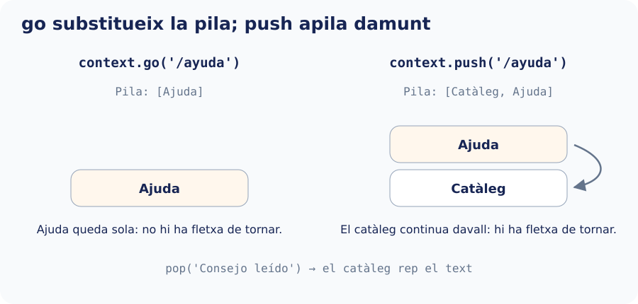

Ja tenim dos rutes. Abans d’afegir-ne més, convé entendre bé **què fa cada operació de navegació amb la pila de pàgines**, perquè és el que decidix si apareix la fletxa de tornar, què passa amb l’estat d’una pantalla i si podem retornar un resultat.

## La pila de pàgines

Recorda que `Navigator` mostra una **pila**: la pàgina de dalt és la visible i, si n’hi ha alguna davall, l’`AppBar` mostra automàticament la fletxa de tornar.

go_router oferix dos maneres de canviar eixa pila:

- **`go`** (anar a una ubicació): el router **substituïx la pila completa** per la que correspon a la nova ubicació segons el mapa. El que hi haguera abans desapareix.
- **`push`** (apilar): el router **afig** la pàgina de la nova ubicació damunt de les que ja hi havia. El que hi ha davall es conserva.

Amb el mapa actual, `/` i `/ayuda` són rutes independents (cap no està dins de l’altra). Per això:

```text
context.go('/ayuda')    →  pila: [Ayuda]              (sense fletxa de tornar)
context.push('/ayuda')  →  pila: [Catálogo, Ayuda]    (amb fletxa de tornar)
```



En el pas 4 veurem que, quan una ruta està imbricada dins d’una altra, `go` construïx també les pàgines pare.

## Experiment 1: `go` substituïx la pila

L’entrada del catàleg utilitza `context.go('/ayuda')`. Obri Ajuda i fixa’t en la capçalera: **no hi ha fletxa de tornar**, perquè el catàleg ja no està davall. Per això hem afegit la icona de la casa amb `context.go('/')`.

Activa l’interruptor, torna al catàleg i obri de nou Ajuda: l’interruptor apareix desactivat. En fer `go('/')`, la pàgina d’Ajuda va eixir de la pila i el seu `State` es va destruir; en tornar, se’n crea un altre de nou.

## Experiment 2: `push` apila i `pop` retorna un resultat

Ara farem que el catàleg òbriga Ajuda **damunt** i espere una resposta. És un canvi temporal: al final del pas el desfarem.

En `catalogo_pantalla.dart`, canvia l’`onTap` d’**Ayuda con go_router** per este:

```dart
onTap: () async {
  final respuesta = await context.push<String>('/ayuda');
  if (!context.mounted || respuesta == null) return;
  ScaffoldMessenger.of(context).showSnackBar(
    SnackBar(content: Text(respuesta)),
  );
},
```

- `push<String>` indica que esperem rebre un `String` quan Ajuda es tanque.
- `await` espera eixe tancament sense bloquejar la interfície. Si Ajuda es tanca amb la fletxa de tornar, sense resposta, rebem `null`.
- `context.mounted` comprova que el catàleg continua en pantalla abans d’utilitzar el seu `context` després de l’espera.

En `ayuda_pantalla.dart`, afig este botó al final dels `children` del `ListView`:

```dart
Padding(
  padding: const EdgeInsets.all(16),
  child: FilledButton(
    onPressed: context.canPop()
        ? () => context.pop('Consejo leído')
        : null,
    child: const Text('He leído el consejo'),
  ),
),
```

- `context.pop('Consejo leído')` lleva Ajuda de la pila i entrega el text a qui va fer `push`.
- `context.canPop()` indica si hi ha una pàgina davall. Si Ajuda s’haguera obert amb `go`, no n’hi hauria, i el botó apareix deshabilitat (`onPressed: null`).

Prova: **catàleg → Ajuda → He leído el consejo**. Tornes al catàleg i apareix «Consejo leído» en una `SnackBar`. Ara la capçalera d’Ajuda sí que mostra la fletxa de tornar, perquè el catàleg continua davall.

`go` mai retorna resultats: com que substituïx la pila, no hi ha ningú esperant davall.

## Resum d’operacions

go_router oferix més operacions que les dos que hem provat. Esta taula les reunix amb el seu efecte sobre la pila, perquè pugues consultar-la quan dubtes quina utilitzar:

| Operació | Efecte en la pila | Retorna resultat? |
| --- | --- | --- |
| `context.go('/ayuda')` | Substituïx la pila per la de `/ayuda`. | No |
| `context.goNamed('ayuda')` | Igual que `go`, utilitzant el `name` de la ruta. | No |
| `context.push('/ayuda')` | Afig Ajuda damunt. | Sí, amb `await` |
| `context.pushNamed('ayuda')` | Igual que `push`, utilitzant el nom. | Sí |
| `context.pop([valor])` | Lleva la pàgina de dalt i entrega `valor`. | — |
| `context.canPop()` | Indica si hi ha pàgina davall. | — |
| `context.replace('/ayuda')` | Substituïx només la pàgina de dalt. | No |

**Quan utilitzar cada una?**

- **`go`** per a la navegació normal entre destinacions: entrades de menú, pestanyes, enllaços, anar a un detall. La pila sempre coincidix amb la ubicació, així que un enllaç directe i un botó produïxen exactament el mateix resultat.
- **`push`** quan la pantalla nova és un pas temporal del qual es torna amb una resposta (triar un valor, confirmar alguna cosa).
- **`pop`** per a tancar la pantalla actual.

En la resta de la secció utilitzarem `go`. Per a diàlegs breus continuem utilitzant `showDialog`, que no necessita ruta.

## Tornar al punt de partida

Desfés l’experiment 2 per a continuar tots des del mateix codi:

1. En `catalogo_pantalla.dart`, l’`onTap` d’Ajuda torna a ser `onTap: () => context.go('/ayuda'),`.
2. En `ayuda_pantalla.dart`, lleva el botó **He leído el consejo**.

Referències: [navegació](https://pub.dev/documentation/go_router/latest/topics/Navigation-topic.html) i [rutes amb nom](https://pub.dev/documentation/go_router/latest/topics/Named%20routes-topic.html).
