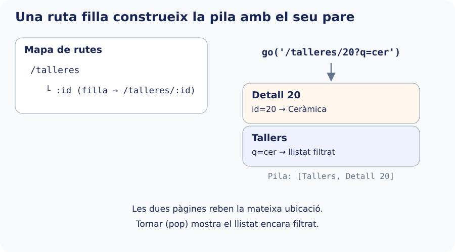

Ara afegim el llistat de tallers amb cercador i el seu detall. Aprendrem tres conceptes:

- **Paràmetres de ruta**: `20` en `/talleres/20` identifica el taller.
- **Paràmetres de consulta**: `q=cer` en `/talleres?q=cer` filtra el llistat.
- **Rutes filles**: el detall es declara *dins* del llistat, i això decidix la pila de pàgines.

Fitxers d’este pas:

```text
lib/
  main.dart                                        ← crea el repositori
  ui/core/
    app_router.dart                                ← rep el repositori
    ruta_talleres.dart                             ← nou
  ui/navegacion_avanzada/
    view_models/talleres_viewmodel.dart            ← nou
    view_models/detalle_taller_viewmodel.dart      ← nou
    ui/talleres_pantalla.dart                      ← nou
    ui/detalle_taller_pantalla.dart                ← nou
```

## La ubicació descriu la pantalla, el repositori aporta les dades

Una idea clau: **el router no transporta les dades del taller**. L’adreça només diu *què* cal mostrar (el taller `20`, els tallers que contenen `cer`); la pantalla obté les dades de la capa `data` mitjançant el seu ViewModel, com en el formulari.

Gràcies a això, `/talleres/20` funciona igual si s’hi arriba polsant en el llistat, escrivint l’adreça en el navegador o des d’un enllaç compartit.

Reutilitzem `Taller`, el contracte `InscripcionesRepository` i la seua implementació local de la unitat de formularis. No copies els tallers dins del router ni de les pantalles.

## 1. Els ViewModels

Reben el contracte del repositori i la dada que arriba en l’adreça. Són classes senzilles amb camps `final`: es creen de nou cada vegada que canvia la ubicació, així que no necessiten `ChangeNotifier`.

`lib/ui/navegacion_avanzada/view_models/talleres_viewmodel.dart`

```dart
import '../../../domain/models/taller.dart';
import '../../../domain/repositories/inscripciones_repository.dart';

class TalleresViewModel {
  TalleresViewModel(InscripcionesRepository repository, {String consulta = ''})
    : consulta = consulta.trim(),
      talleres = List.unmodifiable(
        repository.obtenerTalleres().where(
          (t) => t.titulo.toLowerCase().contains(consulta.trim().toLowerCase()),
        ),
      );

  /// Texto de búsqueda recibido en `?q=`. Vacío si no hay filtro.
  final String consulta;
  final List<Taller> talleres;
}
```

`lib/ui/navegacion_avanzada/view_models/detalle_taller_viewmodel.dart`

```dart
import '../../../domain/models/taller.dart';
import '../../../domain/repositories/inscripciones_repository.dart';

class DetalleTallerViewModel {
  DetalleTallerViewModel(InscripcionesRepository repository, this.id)
    : taller = repository
          .obtenerTalleres()
          .where((t) => t.id == id)
          .firstOrNull;

  /// Identificador recibido en la URL (`/talleres/:id`).
  final String id;

  /// Taller encontrado o `null` si el identificador no existe.
  final Taller? taller;
}
```

`firstOrNull` retorna el primer element que complix la condició o `null` si no n’hi ha cap. Que l’adreça tinga forma de detall no garantix que el taller existisca; eixe cas el representa el ViewModel amb `taller == null`.

## 2. El llistat amb cercador

El llistat mostra els tallers que li entrega el seu ViewModel i un camp per a buscar per títol. El més important és que no guarda la cerca en el seu propi estat: l’escriu en l’adreça i deixa que el router reconstruïsca la pantalla.

`lib/ui/navegacion_avanzada/ui/talleres_pantalla.dart`

```dart
import 'package:flutter/material.dart';
import 'package:go_router/go_router.dart';
import '../view_models/talleres_viewmodel.dart';

class TalleresPantalla extends StatelessWidget {
  const TalleresPantalla({super.key, required this.viewModel});
  final TalleresViewModel viewModel;

  /// Los parámetros de consulta que conservamos al navegar.
  Map<String, String> get _filtro => {
    if (viewModel.consulta.isNotEmpty) 'q': viewModel.consulta,
  };

  void _buscar(BuildContext context, String texto) {
    final consulta = texto.trim();
    context.goNamed(
      'talleres',
      queryParameters: {if (consulta.isNotEmpty) 'q': consulta},
    );
  }

  @override
  Widget build(BuildContext context) => Scaffold(
    appBar: AppBar(
      title: const Text('Talleres'),
      actions: [
        IconButton(
          tooltip: 'Catálogo',
          icon: const Icon(Icons.home_outlined),
          onPressed: () => context.go('/'),
        ),
      ],
    ),
    body: Column(
      children: [
        Padding(
          padding: const EdgeInsets.all(16),
          child: TextFormField(
            key: ValueKey(viewModel.consulta),
            initialValue: viewModel.consulta,
            decoration: const InputDecoration(
              labelText: 'Buscar por título',
              prefixIcon: Icon(Icons.search),
              border: OutlineInputBorder(),
            ),
            textInputAction: TextInputAction.search,
            onFieldSubmitted: (texto) => _buscar(context, texto),
          ),
        ),
        Expanded(
          child: viewModel.talleres.isEmpty
              ? const Center(child: Text('No hay talleres para esta búsqueda'))
              : ListView.builder(
                  itemCount: viewModel.talleres.length,
                  itemBuilder: (context, index) {
                    final taller = viewModel.talleres[index];
                    return ListTile(
                      title: Text(taller.titulo),
                      subtitle: Text('Identificador: ${taller.id}'),
                      trailing: const Icon(Icons.chevron_right),
                      onTap: () => context.goNamed(
                        'taller',
                        pathParameters: {'id': taller.id},
                        queryParameters: _filtro,
                      ),
                    );
                  },
                ),
        ),
      ],
    ),
  );
}
```

Fixa’t en com **la cerca es guarda en l’adreça**:

- En polsar buscar en el teclat, `_buscar` navega a `/talleres?q=text`. No guardem el text en una variable de la pantalla: el router reconstruïx el llistat amb un ViewModel nou que rep la consulta.
- `goNamed` construïx l’adreça a partir del nom de la ruta i dels mapes `pathParameters` i `queryParameters`, i s’encarrega de codificar els caràcters especials (espais, accents…). No concatenes mai l’adreça a mà.
- `key: ValueKey(viewModel.consulta)` fa que el camp es cree de nou quan canvia la consulta, perquè el seu text inicial (`initialValue`) sempre coincidisca amb l’adreça.
- En obrir un taller passem `queryParameters: _filtro`. Així l’adreça del detall és, per exemple, `/talleres/20?q=cer` i el llistat que queda davall conserva el filtre. Ho veurem en declarar les rutes.

## 3. El detall

El detall rep el seu ViewModel ja preparat amb el taller que indica l’adreça. Si el taller no existix, ho diu. El botó de tornar utilitza `pop`, perquè, com veurem en l’apartat següent, el llistat queda davall en la pila.

`lib/ui/navegacion_avanzada/ui/detalle_taller_pantalla.dart`

```dart
import 'package:flutter/material.dart';
import 'package:go_router/go_router.dart';
import '../view_models/detalle_taller_viewmodel.dart';

class DetalleTallerPantalla extends StatelessWidget {
  const DetalleTallerPantalla({super.key, required this.viewModel});
  final DetalleTallerViewModel viewModel;

  @override
  Widget build(BuildContext context) {
    final taller = viewModel.taller;
    final ubicacion = GoRouterState.of(context).uri;
    return Scaffold(
      appBar: AppBar(title: const Text('Detalle del taller')),
      body: ListView(
        padding: const EdgeInsets.all(24),
        children: [
          Text(
            taller?.titulo ?? 'No existe el taller ${viewModel.id}',
            style: Theme.of(context).textTheme.headlineSmall,
          ),
          if (taller != null) Text('Identificador: ${taller.id}'),
          const SizedBox(height: 8),
          Text('Ubicación actual: $ubicacion'),
          const SizedBox(height: 24),
          FilledButton(
            onPressed: () {
              if (context.canPop()) {
                context.pop();
              } else {
                context.go('/talleres');
              }
            },
            child: const Text('Volver al listado'),
          ),
        ],
      ),
    );
  }
}
```

`GoRouterState.of(context)` permet a qualsevol widget consultar l’estat de la navegació de la seua ruta. Ací mostrem la ubicació perquè pugues observar com canvia; en una aplicació real no caldria mostrar-la.

## 4. Declarar les rutes amb paràmetres

Agrupem el llistat i el seu detall en una funció pròpia. Rep el repositori perquè els `builder` el necessiten per a crear els ViewModels.

`lib/ui/core/ruta_talleres.dart`

```dart
import 'package:go_router/go_router.dart';
import '../../domain/repositories/inscripciones_repository.dart';
import '../navegacion_avanzada/ui/detalle_taller_pantalla.dart';
import '../navegacion_avanzada/ui/talleres_pantalla.dart';
import '../navegacion_avanzada/view_models/detalle_taller_viewmodel.dart';
import '../navegacion_avanzada/view_models/talleres_viewmodel.dart';

GoRoute rutaTalleres(InscripcionesRepository repository) => GoRoute(
  path: '/talleres',
  name: 'talleres',
  builder: (context, state) => TalleresPantalla(
    viewModel: TalleresViewModel(
      repository,
      consulta: state.uri.queryParameters['q'] ?? '',
    ),
  ),
  routes: [
    GoRoute(
      path: ':id',
      name: 'taller',
      builder: (context, state) => DetalleTallerPantalla(
        viewModel: DetalleTallerViewModel(
          repository,
          state.pathParameters['id']!,
        ),
      ),
    ),
  ],
);
```

### Paràmetres de ruta: `:id`

Un segment que comença per `:` és un **paràmetre**: coincidix amb qualsevol valor en eixa posició. Amb el patró `/talleres/:id`, la ubicació `/talleres/20` coincidix i `state.pathParameters['id']` val `'20'`.

Utilitzem `!` perquè el patró obliga que el segment existisca: si no hi haguera `id`, la ruta no coincidiria. Els paràmetres sempre arriben com a **text**; si algun dia necessites un número, convertix-lo amb `int.tryParse` i tracta el cas `null`.

### Paràmetres de consulta: `?q=`

Els paràmetres de consulta no formen part del patró: són opcionals. Es llegixen amb `state.uri.queryParameters['q']`, que val `null` si no hi són; per això utilitzem `?? ''`.

### Rutes filles: `routes` dins d’un `GoRoute`

El detall està en la llista `routes` del llistat. Una ruta filla:

- **No comença per `/`**: el seu `path` s’unix al del pare. `':id'` dins de `'/talleres'` forma `/talleres/:id`.
- **Construïx la pila amb el seu pare**. En fer `go('/talleres/20')`, go_router crea **dos pàgines**: el llistat (`/talleres`) i, damunt, el detall. Per això el detall mostra la fletxa de tornar encara que hàgem utilitzat `go`, i `context.canPop()` és `true`.

```text
go('/talleres/20?q=cer')  →  pila: [Talleres (q=cer), Detalle 20]
```



Totes les pàgines de la pila reben la mateixa ubicació completa. Per això el `builder` del llistat llig `q=cer` encara que la ubicació siga la del detall, i en tornar veiem el llistat filtrat. Eixa és la raó de passar `queryParameters: _filtro` en obrir un taller.

## 5. Afegir la ruta al mapa

Perquè el router conega les noves rutes, cal afegir-les a la seua llista `routes`. Com que els `builder` necessiten el repositori, `crearRouter` passa a rebre’l com a paràmetre.

`lib/ui/core/app_router.dart`

```dart
import 'package:go_router/go_router.dart';
import '../../domain/repositories/inscripciones_repository.dart';
import '../catalogo/ui/catalogo_pantalla.dart';
import '../navegacion_avanzada/ui/ayuda_pantalla.dart';
import 'ruta_talleres.dart';

GoRouter crearRouter(InscripcionesRepository repository) => GoRouter(
  initialLocation: '/',
  debugLogDiagnostics: true,
  routes: [
    GoRoute(
      path: '/',
      name: 'catalogo',
      builder: (context, state) => const CatalogoPantalla(),
    ),
    rutaTalleres(repository),
    GoRoute(
      path: '/ayuda',
      name: 'ayuda',
      builder: (context, state) => const AyudaPantalla(),
    ),
  ],
);
```

## 6. Crear el repositori en l’arrancada

La funció `main()` és l’**arrel de composició**: l’únic lloc que coneix les implementacions de `data`. Crea el repositori i el lliura al router. En `main.dart`, afig estos imports i substituïx la funció `main`:

```dart
import 'data/repositories/inscripciones_local_repository.dart';
import 'data/services/inscripciones_local_service.dart';
```

```dart
void main() {
  final repository = InscripcionesLocalRepository(
    const InscripcionesLocalService(),
  );
  final router = crearRouter(repository);
  runApp(
    MaterialApp.router(
      debugShowCheckedModeBanner: false,
      title: 'Catálogo de widgets',
      routerConfig: router,
    ),
  );
}
```

## 7. Entrada en el catàleg

Falta un punt d’entrada des del catàleg. Com que el llistat té adreça pròpia, el botó només ha de demanar anar a `/talleres`.

Afig esta entrada davall de la d’Ajuda:

```dart
ListTile(
  leading: const Icon(Icons.school_outlined),
  title: const Text('Talleres con go_router'),
  trailing: const Icon(Icons.chevron_right),
  onTap: () => context.go('/talleres'),
),
```

## Provar

Amb estes proves comprovaràs que els paràmetres viatgen en l’adreça i que la pila es construïx com hem explicat.

Fes **hot restart** i comprova:

| Acció | Resultat |
| --- | --- |
| Obrir Talleres con go_router | Apareixen tots els tallers. |
| Escriure `cer` i polsar buscar | Només apareix Cerámica; la ubicació és `/talleres?q=cer`. |
| Polsar Cerámica | Detall amb «Ubicación actual: /talleres/20?q=cer». |
| Volver al listado | El llistat continua filtrat per `cer`. |
| Buscar `zzz` | «No hay talleres para esta búsqueda». |

## I `extra`?

go_router també permet adjuntar un objecte a la navegació: `context.go('/talleres/20', extra: taller)`, que la destinació llig amb `state.extra`. Eixe objecte **no forma part de l’adreça**: si la pantalla s’obri des d’un enllaç o es recarrega en el navegador, `extra` arriba buit. Per això, per a reconstruir una destinació, utilitza sempre paràmetres de ruta o de consulta i consulta el repositori, com hem fet. Reserva `extra` per a dades accessòries que la pantalla es puga permetre no rebre.

No poses mai contrasenyes ni dades personals en l’adreça: queda visible, es guarda en l’historial i es pot compartir.

Referències: [paràmetres i navegació](https://pub.dev/documentation/go_router/latest/topics/Navigation-topic.html) i [GoRouterState](https://pub.dev/documentation/go_router/latest/go_router/GoRouterState-class.html).
