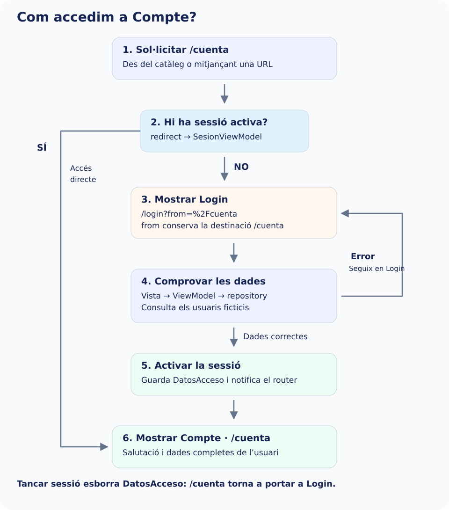

Protegirem `/cuenta`. Tallers, Ajuda i el catàleg continuen sent públics. La protecció s’aplica també en escriure la URL: ocultar el botó no bastaria.

El login manté el recorregut conegut: **vista → InscripcionViewModel → contracte → repositori → servici i DTO → model de domini**. El router no comprova credencials. Quan `login()` troba una fitxa i retorna `DatosAcceso`, la vista comunica el resultat i actualitzem l’estat de sessió.

Abans de programar-lo, seguix el recorregut de la imatge: sense sessió es conserva la destinació en `from` i s’obri Login. Si les dades són vàlides, el formulari comunica `DatosAcceso`, canvia la sessió i el router permet arribar a Compte. Si hi ha errors, no s’activa la sessió. La branca «Sí» representa qui ja havia accedit.



## Estat de sessió de presentació

Crea este ViewModel compartit. Guarda el resultat de la consulta, no contrasenyes ni DTO. És estat en memòria de la demostració, per això es perd en reiniciar. `notifyListeners()` permetrà al router reavaluar la redirecció en entrar i eixir.


`lib/ui/core/view_models/sesion_viewmodel.dart`

```dart
import 'package:flutter/foundation.dart';
import '../../../domain/models/datos_acceso.dart';

class SesionViewModel extends ChangeNotifier {
  DatosAcceso? _acceso;
  DatosAcceso? get acceso => _acceso;
  bool get activa => _acceso != null;
  void iniciarSesion(DatosAcceso acceso) {
    _acceso = acceso;
    notifyListeners();
  }

  void cerrarSesion() {
    _acceso = null;
    notifyListeners();
  }
}
```

## Comunicar l’èxit sense acoblar el formulari al router

En `inscripcion_pantalla.dart`, conserva l’aspecte, Login, Limpiar, els controladors i els validadors. Substituïx l’import de `detalle_usuario_pantalla.dart` per `../../../domain/models/datos_acceso.dart`. Afegix al constructor i a la classe el callback requerit:


```dart
const InscripcionPantalla({
  super.key, required this.viewModel, required this.onLogin,
});
final InscripcionViewModel viewModel;
final ValueChanged<DatosAcceso> onLogin;
```

Substituïx només `_login` per este mètode. Elimina l’antic `Navigator.push`: no han d’executar-se una navegació imperativa i una redirecció per al mateix accés. El callback només es crida amb un resultat vàlid.


```dart
void _login() {
  setState(() => _intentoLogin = true);
  if (!(_formKey.currentState?.validate() ?? false)) return;
  final resultado = widget.viewModel.login();
  if (resultado == null) return;
  widget.onLogin(resultado);
}
```

Per a conservar la demostració antiga del catàleg, en `inscripcion_ejemplo_pantalla.dart` mantín la creació del servici, repositori i ViewModel. Afegix `import 'detalle_usuario_pantalla.dart';` i substituïx només el seu `build`:


```dart
@override
Widget build(BuildContext context) => InscripcionPantalla(
  viewModel: _viewModel,
  onLogin: (resultado) => Navigator.of(context).push<void>(
    MaterialPageRoute<void>(builder: (_) => DetalleUsuarioPantalla(acceso: resultado)),
  ),
);
```

La demostració bàsica conserva així el seu recorregut. La ruta `/login` utilitzarà este nou adaptador: rep el contracte per constructor, crea una sola instància del ViewModel i l’allibera en eixir. No importa cap implementació de `data`.


`lib/ui/inscripcion/ui/login_ruta_pantalla.dart`

```dart
import 'package:flutter/material.dart';
import '../../../domain/models/datos_acceso.dart';
import '../../../domain/repositories/inscripciones_repository.dart';
import '../view_models/inscripcion_viewmodel.dart';
import 'inscripcion_pantalla.dart';

class LoginRutaPantalla extends StatefulWidget {
  const LoginRutaPantalla({
    super.key,
    required this.repository,
    required this.onLogin,
  });
  final InscripcionesRepository repository;
  final ValueChanged<DatosAcceso> onLogin;
  @override
  State<LoginRutaPantalla> createState() => _LoginRutaPantallaState();
}

class _LoginRutaPantallaState extends State<LoginRutaPantalla> {
  late final InscripcionViewModel _viewModel;
  @override
  void initState() {
    super.initState();
    _viewModel = InscripcionViewModel(widget.repository);
  }

  @override
  void dispose() {
    _viewModel.dispose();
    super.dispose();
  }

  @override
  Widget build(BuildContext context) =>
      InscripcionPantalla(viewModel: _viewModel, onLogin: widget.onLogin);
}
```

## Definir la política de redirecció

`redirect` retorna una ubicació si hem de canviar de destinació i `null` si la navegació pot continuar. És una decisió, no un lloc per a cridar `context.go`, crear sessions ni executar el login.

Guardem la destinació sol·licitada en `from` amb `Uri`, per a codificar els paràmetres. Després de l’accés la recuperem. La funció només accepta `/cuenta` com a destinació interna permesa: rebutja URL externes i evita tornar al mateix login en bucle. Si afegixes altres rutes protegides, amplia **tant** la comprovació d’accés com les destinacions permeses.


`lib/app/router/redireccion_sesion.dart`

```dart
import 'package:go_router/go_router.dart';
import '../../ui/core/view_models/sesion_viewmodel.dart';

String destinoTrasLogin(String? valor) {
  final uri = Uri.tryParse(valor ?? '');
  if (uri != null &&
      !uri.hasScheme &&
      !uri.hasAuthority &&
      uri.path == '/cuenta' &&
      uri.fragment.isEmpty) {
    return uri.toString();
  }
  return '/cuenta';
}

String? redireccionSesion(SesionViewModel sesion, GoRouterState state) {
  final enLogin = state.uri.path == '/login';
  final protegida = state.uri.path == '/cuenta';
  if (!sesion.activa && protegida) {
    return Uri(
      path: '/login',
      queryParameters: {'from': state.uri.toString()},
    ).toString();
  }
  if (sesion.activa && enLogin) {
    return destinoTrasLogin(state.uri.queryParameters['from']);
  }
  return null;
}
```

En el `GoRouter` afegirem `refreshListenable: sesion` i `redirect: (context, state) => redireccionSesion(sesion, state)`. El router escolta els canvis; no es crea de nou cada vegada que canvia la sessió. El muntatge complet del pas 8 connecta eixes dependències.

| Situació | Resultat |
| --- | --- |
| Sense sessió i demana `/cuenta?origen=menu` | Obri Login i conserva eixa ubicació en `from`. |
| Dades del formulari incorrectes | Es queda en Login; no s’activa la sessió. |
| Dades correctes | El callback activa la sessió; el router reavalua i obri la destinació conservada. |
| Amb sessió i demana `/login` | Redirigix a Compte; no torna a mostrar accés. |
| Tanca sessió des de Compte | Esborra les dades de sessió i redirigix fora de la ruta protegida. |
| Arrere intenta tornar a Compte sense sessió | La redirecció torna a impedir l’accés. |

El mecanisme protegix destinacions **declarades en este router**. No convertix la demostració anterior del catàleg en autenticació real ni impedix que s’inspeccionen dades incrustades en l’aplicació. En un sistema real, un servidor ha d’autenticar i autoritzar les operacions; si la sessió es restaura de manera asíncrona, convé representar primer un estat de comprovació per a no decidir prematurament que està tancada.

Referència: [redireccions](https://pub.dev/documentation/go_router/latest/topics/Redirection-topic.html) i [refreshListenable](https://pub.dev/documentation/go_router/latest/go_router/GoRouter-class.html).
