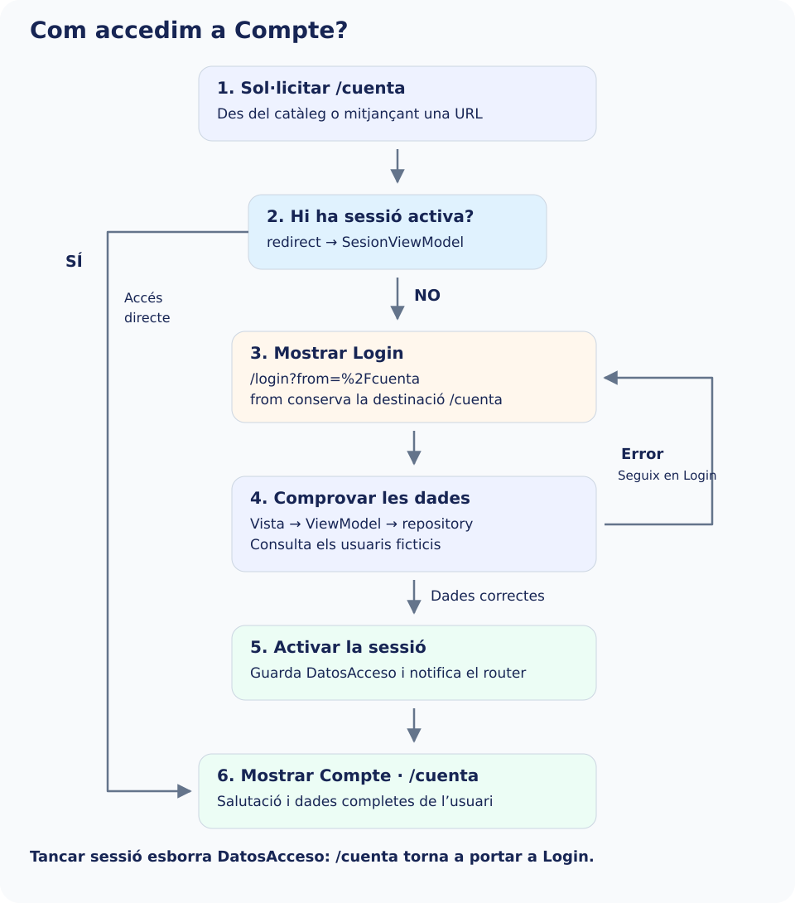

En este pas afegim **El meu compte** (`/cuenta`), una pantalla que només es pot veure després d’iniciar sessió amb el formulari de la unitat anterior. Tallers, Ajuda i el catàleg continuen sent públics.

La protecció ha de funcionar **arribe com arribe** la persona a `/cuenta`: des d’un botó, escrivint l’adreça o tornant arrere en el navegador. Ocultar un botó no basta. Per això la comprovació no estarà en les pantalles, sinó en el router.



Fitxers d’este pas:

```text
lib/
  main.dart                                       ← crea la sessió
  ui/
    core/app_router.dart                          ← login, compte i redirect
    core/redireccion_sesion.dart                  ← nou: la política d’accés
    core/view_models/sesion_viewmodel.dart        ← nou: estat de sessió
    inscripcion/ui/inscripcion_pantalla.dart      ← avisa del login amb un callback
    inscripcion/ui/inscripcion_ejemplo_pantalla.dart ← adapta la demo antiga
    inscripcion/ui/login_ruta_pantalla.dart       ← nou: el formulari com a ruta
    navegacion_avanzada/ui/cuenta_pantalla.dart   ← nou
```

## Com funciona `redirect`

Abans de programar, vegem l’eina que utilitzarem per a protegir Compte i com s’assabenta el router que la sessió ha canviat.

`GoRouter` admet una funció **`redirect`** que s’executa **abans de mostrar qualsevol ubicació**: en arrancar, amb cada `go` o `push`, amb un enllaç directe i amb els botons arrere i avant del navegador.

```dart
redirect: (context, state) {
  // state.uri és la ubicació que es vol mostrar.
  // Retorna una altra ubicació per a desviar la navegació,
  // o null per a deixar-la continuar.
},
```

- Si retorna **`null`**, la navegació continua cap a la ubicació demanada.
- Si retorna **una altra ubicació**, go_router hi navega en el seu lloc (i torna a cridar `redirect` amb la nova ubicació, per si calguera desviar-la una altra vegada).
- Només **decidix**: no ha de cridar `context.go`, ni iniciar sessió, ni consultar el repositori. Rep un estat i retorna una adreça.

Hi ha un problema: `redirect` s’executa en navegar, però la sessió canvia sense navegar (en polsar Login o Cerrar sesión). Per a això existix **`refreshListenable`**: li donem un `Listenable` (el nostre ViewModel de sessió) i, cada vegada que notifica un canvi, el router **torna a avaluar `redirect` sobre la ubicació actual**. Així, en iniciar sessió estant en Login, el router ens porta a Compte; i en tancar sessió estant en Compte, ens trau d’allí.

:::note[redirect global i per ruta]
A més del `redirect` de `GoRouter`, cada `GoRoute` pot tindre el seu, que només s’aplica a eixa ruta i a les seues filles. Utilitzem el global per a tindre tota la política d’accés en un únic lloc.
:::

## 1. L’estat de sessió

El router necessita saber en tot moment si hi ha una sessió activa. Ho guardem en un ViewModel compartit que avisa cada vegada que canvia.

`lib/ui/core/view_models/sesion_viewmodel.dart`

```dart
import 'package:flutter/foundation.dart';
import '../../../domain/models/datos_acceso.dart';

class SesionViewModel extends ChangeNotifier {
  DatosAcceso? _acceso;

  DatosAcceso? get acceso => _acceso;
  bool get activa => _acceso != null;

  void iniciarSesion(DatosAcceso acceso) {
    _acceso = acceso;
    notifyListeners();
  }

  void cerrarSesion() {
    _acceso = null;
    notifyListeners();
  }
}
```

Guarda el resultat del login (`DatosAcceso`), mai el que s’ha escrit en els camps. És estat en memòria: en reiniciar l’aplicació, la sessió desapareix. Està en `ui/core` perquè el compartixen diverses pantalles i el router. `notifyListeners()` és el que escolta `refreshListenable`.

## 2. El formulari avisa del login, no navega

El formulari de la unitat anterior obria el detall amb `Navigator.push` en validar. Ara volem reutilitzar-lo en dos llocs diferents:

- En la demo **Login de demostración** del catàleg, que continua obrint el detall amb `Navigator.push`.
- En la ruta `/login`, on no ha de navegar: després del login, **el router** decidix la destinació.

La solució és que el formulari no decidisca què fer: **avisa** amb un callback i qui l’utilitza decidix.

En `lib/ui/inscripcion/ui/inscripcion_pantalla.dart`:

1. Substituïx l’import de `detalle_usuario_pantalla.dart` per este:

   ```dart
   import '../../../domain/models/datos_acceso.dart';
   ```

2. Substituïx el constructor i els camps d’`InscripcionPantalla`:

   ```dart
   const InscripcionPantalla({
     super.key,
     required this.viewModel,
     required this.onLogin,
   });
   final InscripcionViewModel viewModel;
   final ValueChanged<DatosAcceso> onLogin;
   ```

3. Substituïx el mètode `_login` per este. El callback només es crida amb un resultat vàlid:

   ```dart
   void _login() {
     setState(() => _intentoLogin = true);
     if (!(_formKey.currentState?.validate() ?? false)) return;
     final resultado = widget.viewModel.login();
     if (resultado == null) return;
     widget.onLogin(resultado);
   }
   ```

`ValueChanged<DatosAcceso>` és un tipus de Flutter equivalent a `void Function(DatosAcceso)`.

Perquè la demo antiga continue igual, en `lib/ui/inscripcion/ui/inscripcion_ejemplo_pantalla.dart` afig `import 'detalle_usuario_pantalla.dart';` i substituïx el seu `build`:

```dart
@override
Widget build(BuildContext context) => InscripcionPantalla(
  viewModel: _viewModel,
  onLogin: (resultado) => Navigator.of(context).push<void>(
    MaterialPageRoute<void>(
      builder: (_) => DetalleUsuarioPantalla(acceso: resultado),
    ),
  ),
);
```

## 3. El formulari com a ruta

La ruta `/login` necessita el seu propi adaptador. Igual que `InscripcionEjemploPantalla`, crea el ViewModel una vegada i l’allibera en eixir; la diferència és que **rep** el contracte del repositori i el callback, en lloc de crear-los. Així no coneix cap implementació de `data`.

`lib/ui/inscripcion/ui/login_ruta_pantalla.dart`

```dart
import 'package:flutter/material.dart';
import '../../../domain/models/datos_acceso.dart';
import '../../../domain/repositories/inscripciones_repository.dart';
import '../view_models/inscripcion_viewmodel.dart';
import 'inscripcion_pantalla.dart';

class LoginRutaPantalla extends StatefulWidget {
  const LoginRutaPantalla({
    super.key,
    required this.repository,
    required this.onLogin,
  });
  final InscripcionesRepository repository;
  final ValueChanged<DatosAcceso> onLogin;

  @override
  State<LoginRutaPantalla> createState() => _LoginRutaPantallaState();
}

class _LoginRutaPantallaState extends State<LoginRutaPantalla> {
  late final InscripcionViewModel _viewModel;

  @override
  void initState() {
    super.initState();
    _viewModel = InscripcionViewModel(widget.repository);
  }

  @override
  void dispose() {
    _viewModel.dispose();
    super.dispose();
  }

  @override
  Widget build(BuildContext context) =>
      InscripcionPantalla(viewModel: _viewModel, onLogin: widget.onLogin);
}
```

## 4. La pantalla de Compte

Rep les dades de la sessió i un callback per a eixir. No consulta el repositori ni navega: tancar la sessió només canvia l’estat, i el router reacciona.

`lib/ui/navegacion_avanzada/ui/cuenta_pantalla.dart`

```dart
import 'package:flutter/material.dart';
import '../../../domain/models/datos_acceso.dart';

class CuentaPantalla extends StatelessWidget {
  const CuentaPantalla({
    super.key,
    required this.acceso,
    required this.onSalir,
  });
  final DatosAcceso acceso;
  final VoidCallback onSalir;

  @override
  Widget build(BuildContext context) {
    final usuario = acceso.usuario;
    return Scaffold(
      appBar: AppBar(title: const Text('Mi cuenta')),
      body: ListView(
        padding: const EdgeInsets.all(24),
        children: [
          Text(
            '¡Hola, ${usuario.nombreCompleto}!',
            style: Theme.of(context).textTheme.headlineSmall,
          ),
          const SizedBox(height: 16),
          Text('Identificador: ${usuario.id}'),
          Text('Correo: ${usuario.correo}'),
          Text('Teléfono: ${usuario.telefono}'),
          Text('Localidad: ${usuario.localidad}'),
          Text('Taller: ${acceso.taller.titulo}'),
          Text(
            acceso.recordatorio
                ? 'Recordatorio simulado: sí'
                : 'Sin recordatorio',
          ),
          const SizedBox(height: 24),
          OutlinedButton.icon(
            onPressed: onSalir,
            icon: const Icon(Icons.logout),
            label: const Text('Cerrar sesión'),
          ),
        ],
      ),
    );
  }
}
```

## 5. La política d’accés

Escrivim la decisió de `redirect` com una funció **pura**: rep si hi ha sessió i la ubicació demanada, i retorna la nova ubicació o `null`. No depén de Flutter ni del router, així que és fàcil de llegir i de provar.

`lib/ui/core/redireccion_sesion.dart`

```dart
const rutaLogin = '/login';
const rutaCuenta = '/cuenta';

/// Rutas que exigen sesión. Para proteger otra, basta con añadirla aquí.
const rutasProtegidas = {rutaCuenta};

/// Quita la barra final para que `/cuenta/` y `/cuenta` se traten igual.
String _normalizar(String path) =>
    path.length > 1 && path.endsWith('/')
    ? path.substring(0, path.length - 1)
    : path;

bool esRutaProtegida(Uri ubicacion) =>
    rutasProtegidas.contains(_normalizar(ubicacion.path));

/// Devuelve el destino tras el login. Solo acepta rutas protegidas internas;
/// cualquier otro valor (otra web, el propio login, texto vacío) lleva a Cuenta.
String destinoTrasLogin(String? from) {
  final uri = Uri.tryParse(from ?? '');
  if (uri != null &&
      !uri.hasScheme &&
      !uri.hasAuthority &&
      uri.fragment.isEmpty &&
      esRutaProtegida(uri)) {
    return uri.toString();
  }
  return rutaCuenta;
}

/// Política de acceso: devuelve otra ubicación o `null` para continuar.
String? redireccionSesion({
  required bool sesionActiva,
  required Uri ubicacion,
}) {
  if (!sesionActiva && esRutaProtegida(ubicacion)) {
    return Uri(
      path: rutaLogin,
      queryParameters: {'from': ubicacion.toString()},
    ).toString();
  }
  if (sesionActiva && _normalizar(ubicacion.path) == rutaLogin) {
    return destinoTrasLogin(ubicacion.queryParameters['from']);
  }
  return null;
}
```

Les dos regles, en paraules:

1. **Sense sessió i demanant una ruta protegida** → vés a Login, i guarda en el paràmetre `from` on volies anar. Construïm l’adreça amb `Uri(...)` perquè `from` quede codificat: `/cuenta?origen=menu` es convertix en `/login?from=%2Fcuenta%3Forigen%3Dmenu`.
2. **Amb sessió i en Login** → no té sentit demanar l’accés una altra vegada: vés a la destinació guardada en `from`.

En qualsevol altre cas, `null`: la navegació continua.

`destinoTrasLogin` no es fia de `from`, perquè qualsevol pot escriure’l en l’adreça. Només accepta una ruta interna (sense esquema com `https:` ni domini com `//otra.web`) que, a més, siga protegida. Així un enllaç manipulat no ens pot traure de l’aplicació ni provocar un bucle tornant a `/login`.

## 6. El mapa de rutes amb accés protegit

Amb totes les peces preparades, les connectem en el mapa de rutes: afegim Login i Compte, i la política d’accés.

Substituïx `app_router.dart`:

`lib/ui/core/app_router.dart`

```dart
import 'package:flutter/material.dart';
import 'package:go_router/go_router.dart';
import '../../domain/repositories/inscripciones_repository.dart';
import '../catalogo/ui/catalogo_pantalla.dart';
import 'view_models/sesion_viewmodel.dart';
import '../inscripcion/ui/login_ruta_pantalla.dart';
import '../navegacion_avanzada/ui/ayuda_pantalla.dart';
import '../navegacion_avanzada/ui/cuenta_pantalla.dart';
import '../navegacion_avanzada/ui/secciones_pantalla.dart';
import 'redireccion_sesion.dart';
import 'ruta_talleres.dart';

GoRouter crearRouter(
  InscripcionesRepository repository,
  SesionViewModel sesion,
) => GoRouter(
  initialLocation: '/',
  debugLogDiagnostics: true,
  refreshListenable: sesion,
  redirect: (context, state) =>
      redireccionSesion(sesionActiva: sesion.activa, ubicacion: state.uri),
  routes: [
    GoRoute(
      path: '/',
      name: 'catalogo',
      builder: (context, state) => const CatalogoPantalla(),
      routes: [
        GoRoute(
          path: 'login',
          name: 'login',
          builder: (context, state) => LoginRutaPantalla(
            repository: repository,
            onLogin: sesion.iniciarSesion,
          ),
        ),
        GoRoute(
          path: 'cuenta',
          name: 'cuenta',
          builder: (context, state) {
            final acceso = sesion.acceso;
            if (acceso == null) return const SizedBox.shrink();
            return CuentaPantalla(
              acceso: acceso,
              onSalir: sesion.cerrarSesion,
            );
          },
        ),
      ],
    ),
    StatefulShellRoute.indexedStack(
      builder: (context, state, navigationShell) =>
          SeccionesPantalla(navigationShell: navigationShell),
      branches: [
        StatefulShellBranch(routes: [rutaTalleres(repository)]),
        StatefulShellBranch(
          routes: [
            GoRoute(
              path: '/ayuda',
              name: 'ayuda',
              builder: (context, state) => const AyudaPantalla(),
            ),
          ],
        ),
      ],
    ),
  ],
);
```

Novetats:

- **`refreshListenable: sesion`** i **`redirect`** connecten la política amb l’estat de sessió. El router no es crea de nou quan canvia la sessió: només reavalua la redirecció.
- **`login` i `cuenta` són filles de `/`**. Les seues adreces són `/login` i `/cuenta`, però, com en el pas 4, `go('/cuenta')` construïx la pila `[Catálogo, Cuenta]`: la capçalera mostra la fletxa per a tornar al catàleg. A més queden fora de la shell, així que la barra inferior no apareix damunt del formulari.
- **`onLogin: sesion.iniciarSesion`**: quan el formulari valida, la sessió s’activa i notifica; el router reavalua `redirect` en `/login` i la regla 2 ens porta a Compte.
- **`onSalir: sesion.cerrarSesion`**: en tancar la sessió, el router reavalua `redirect` en `/cuenta` i la regla 1 ens porta a Login. Si tornes a entrar, tornes a Compte.
- El `builder` de Compte comprova que hi haja accés en lloc d’utilitzar `sesion.acceso!`. La redirecció ja impedix arribar-hi sense sessió; esta comprovació evita dependre només d’ella.

## 7. Crear la sessió en l’arrancada

Substituïx `main.dart` per la versió final. La sessió es crea una sola vegada i es compartix amb el router, que l’escolta. Les pantalles no la creen: la reben a través dels callbacks del router.

`lib/main.dart`

```dart
import 'package:flutter/material.dart';
import 'data/repositories/inscripciones_local_repository.dart';
import 'data/services/inscripciones_local_service.dart';
import 'ui/core/app_router.dart';
import 'ui/core/view_models/sesion_viewmodel.dart';

void main() {
  final repository = InscripcionesLocalRepository(
    const InscripcionesLocalService(),
  );
  final sesion = SesionViewModel();
  final router = crearRouter(repository, sesion);
  runApp(
    MaterialApp.router(
      debugShowCheckedModeBanner: false,
      title: 'Catálogo de widgets',
      routerConfig: router,
    ),
  );
}
```

## 8. Entrada en el catàleg

Finalment, afegim l’accés a Compte des del catàleg.

Afig esta entrada davall de la de Tallers:

```dart
ListTile(
  leading: const Icon(Icons.lock_outline),
  title: const Text('Mi cuenta protegida'),
  trailing: const Icon(Icons.chevron_right),
  onTap: () => context.go('/cuenta'),
),
```

El botó no comprova res: demana `/cuenta` i la política decidix.

## Provar

Recorre estes situacions per a comprovar les dos regles de la política d’accés.

Fes **hot restart** i observa en la consola les línies de redirecció de `GoRouter`:

| Situació | Resultat esperat |
| --- | --- |
| Sense sessió, polsar Mi cuenta protegida | S’obri Login; la ubicació és `/login?from=%2Fcuenta`. |
| Login amb Ana i `pau@centro.es` | Error de consulta; continua en Login i no hi ha sessió. |
| Login amb Ana, `ana@centro.es` i un taller | S’obri Mi cuenta amb la salutació d’Ana García Pérez. |
| Fletxa de tornar en Mi cuenta | Torna al catàleg. |
| Polsar una altra vegada Mi cuenta protegida | Obri Compte directament: ja hi ha sessió. |
| Cerrar sesión | Torna a Login. |
| Login de demostración (entrada antiga) | Funciona com en la unitat de formularis i no inicia sessió. |

:::caution[Açò és una demostració]
Esta protecció decidix quines pantalles es mostren en l’aplicació, però no és seguretat real: no hi ha contrasenyes i les dades estan dins de la mateixa app. En un sistema real, és el servidor qui autentica i autoritza cada petició. A més, si la sessió es recuperara de manera asíncrona (per exemple, des d’emmagatzematge), caldria representar un estat «comprovant» per a no enviar a Login abans de saber si hi ha sessió.
:::

Referències: [redireccions](https://pub.dev/documentation/go_router/latest/topics/Redirection-topic.html) i [GoRouter](https://pub.dev/documentation/go_router/latest/go_router/GoRouter-class.html).
