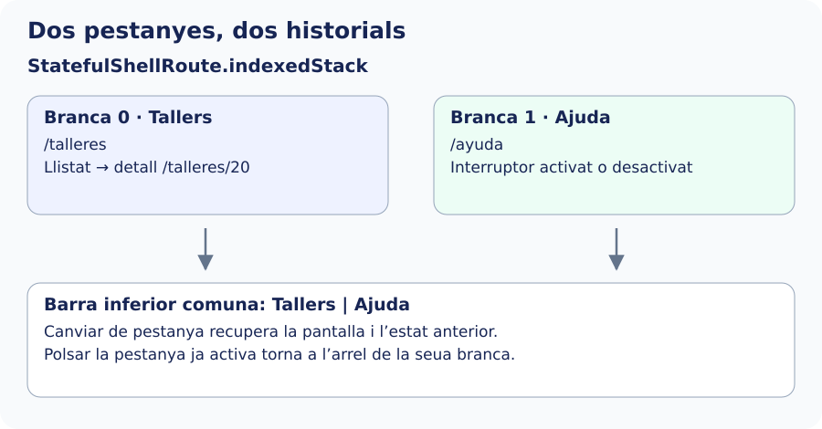

Una ruta filla, com `:id` davall de `/talleres`, expressa una relació entre pàgines. Una **shell** afegix una estructura visual comuna al voltant de les destinacions: per exemple, una barra inferior que continua visible.

| Configuració | Què conserva |
| --- | --- |
| `GoRoute` amb filles | Pàgines pare i filla que corresponen a la ubicació. |
| `ShellRoute` | Una estructura comuna i un navegador per a les destinacions. No crea per si sola una pila independent per a cada pestanya. |
| `StatefulShellRoute.indexedStack` | Un navegador per branca; conserva les branques carregades en canviar entre elles. |

Crearem dos branques públiques: Tallers i Ajuda. L’interruptor d’Ajuda permet comprovar l’estat conservat; el detall d’un taller permet comprovar-ne la pila. Això no és persistència: en tancar l’aplicació no es guarda automàticament eixe estat.

L’esquema separa les dos branques que afegirem. Si obrim Ceràmica, canviem a Ajuda i tornem a Tallers, recuperem el detall. La barra inferior canvia de branca; no crea una altra còpia de la pantalla cada vegada.



## Dibuixar la barra inferior

Crea esta vista. `StatefulNavigationShell` és el contingut administrat pel router; no és una segona còpia de les pantalles. `currentIndex` selecciona la destinació i `goBranch` canvia de branca recuperant la navegació anterior. Quan es polsa la branca ja activa, `initialLocation: true` torna a l’arrel.


`lib/ui/navegacion_avanzada/ui/secciones_pantalla.dart`

```dart
import 'package:flutter/material.dart';
import 'package:go_router/go_router.dart';

class SeccionesPantalla extends StatelessWidget {
  const SeccionesPantalla({super.key, required this.navigationShell});
  final StatefulNavigationShell navigationShell;
  @override
  Widget build(BuildContext context) => Scaffold(
    body: navigationShell,
    bottomNavigationBar: NavigationBar(
      selectedIndex: navigationShell.currentIndex,
      onDestinationSelected: (index) => navigationShell.goBranch(
        index,
        initialLocation: index == navigationShell.currentIndex,
      ),
      destinations: const [
        NavigationDestination(
          icon: Icon(Icons.school_outlined),
          label: 'Talleres',
        ),
        NavigationDestination(icon: Icon(Icons.help_outline), label: 'Ayuda'),
      ],
    ),
  );
}
```

En `app_router.dart`, importa `SeccionesPantalla` i substituïx les entrades separades de Tallers i Ajuda per este bloc dins de `routes`. Conserva la ruta `/` fora de la shell i no declares una altra vegada els mateixos paths en paral·lel:


```dart
StatefulShellRoute.indexedStack(
  builder: (context, state, shell) => SeccionesPantalla(navigationShell: shell),
  branches: [
    StatefulShellBranch(routes: [rutaTalleres(repository)]),
    StatefulShellBranch(
      routes: [
        GoRoute(
          path: '/ayuda',
          name: 'ayuda',
          builder: (context, state) => const AyudaPantalla(),
        ),
      ],
    ),
  ],
),
```

Prova Tallers → detall de Cerámica → Ajuda → activar Mostrar consejos → Tallers. Ha de continuar el detall; en tornar a Ajuda, ha de continuar activat l’interruptor. Polsar una altra vegada Tallers mentre eixa branca està activa torna al llistat.

Cada vista de destinació manté el seu `Scaffold` amb capçalera i contingut; el `Scaffold` de `SeccionesPantalla` aporta la barra comuna. Si després vols una pàgina per damunt de tota la shell, hauràs de triar el navegador adequat amb `parentNavigatorKey`. No mescles eixe cas amb les pàgines que han de continuar dins d’una branca.

Referència: [StatefulShellRoute](https://pub.dev/documentation/go_router/latest/go_router/StatefulShellRoute-class.html) i [ShellRoute](https://pub.dev/documentation/go_router/latest/go_router/ShellRoute-class.html).
