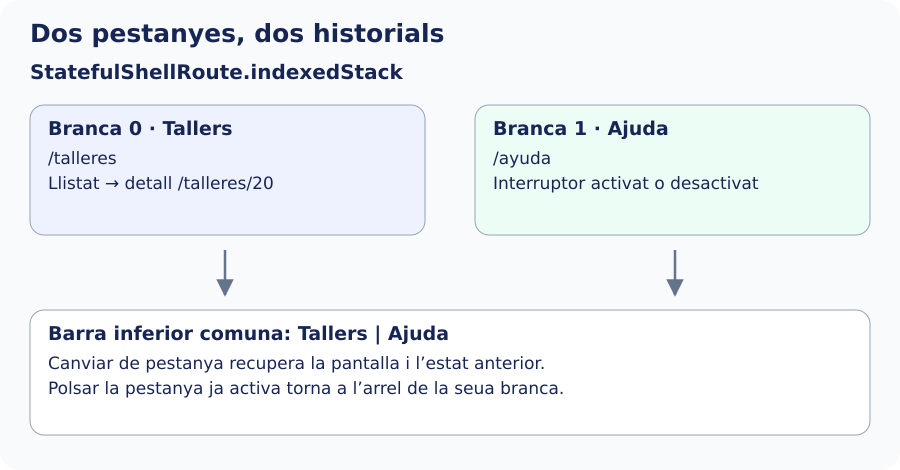

Moltes aplicacions tenen seccions principals accessibles des d’una barra inferior, i cada secció manté el seu propi recorregut: si estàs en un detall de Tallers, vas a Ajuda i tornes, esperes trobar el mateix detall. En este pas aconseguirem exactament això per a **Tallers** i **Ajuda**.



## Rutes filles, shells i branques

Fins ara hem vist rutes de primer nivell i rutes filles. go_router oferix, a més, les **shells** (embolcalls): rutes que dibuixen una estructura comuna, com una barra inferior, *al voltant* de les pantalles de les seues destinacions.

| Configuració | Què aporta | Exemple |
| --- | --- | --- |
| `GoRoute` amb `routes` filles | Relació pare → filla; `go` a la filla apila també el pare. | `/talleres` → `/talleres/20` |
| `ShellRoute` | Una estructura comuna al voltant de les destinacions, amb **un sol** `Navigator` per a totes. En canviar de destinació es perd l’anterior. | Un marc amb menú lateral sense historial per secció. |
| `StatefulShellRoute.indexedStack` | Una estructura comuna i **un `Navigator` per branca**. Cada branca conserva la seua pila i l’estat de les pantalles en canviar de branca. | Barra inferior amb Tallers i Ajuda. |

Utilitzarem `StatefulShellRoute.indexedStack`:

- Cada **branca** (`StatefulShellBranch`) és una secció amb el seu propi `Navigator` i la seua pròpia pila de pàgines.
- `indexedStack` significa que totes les branques visitades es mantenen muntades en un `IndexedStack`, i només es mostra l’activa. Per això el `State` de les seues pantalles (com l’interruptor d’Ajuda) no es destruïx en canviar de pestanya.
- Les branques **no es guarden** en tancar l’aplicació: és estat en memòria, no persistència.

## 1. La pantalla de la shell

La shell és una pantalla normal que dibuixa l’estructura comuna (ací, la barra inferior) i deixa la resta de l’espai a la branca activa. No coneix Tallers ni Ajuda: el router els hi entrega a través de `navigationShell`.

`lib/ui/navegacion_avanzada/ui/secciones_pantalla.dart`

```dart
import 'package:flutter/material.dart';
import 'package:go_router/go_router.dart';

class SeccionesPantalla extends StatelessWidget {
  const SeccionesPantalla({super.key, required this.navigationShell});
  final StatefulNavigationShell navigationShell;

  @override
  Widget build(BuildContext context) => Scaffold(
    body: navigationShell,
    bottomNavigationBar: NavigationBar(
      selectedIndex: navigationShell.currentIndex,
      onDestinationSelected: (index) => navigationShell.goBranch(
        index,
        initialLocation: index == navigationShell.currentIndex,
      ),
      destinations: const [
        NavigationDestination(
          icon: Icon(Icons.school_outlined),
          label: 'Talleres',
        ),
        NavigationDestination(icon: Icon(Icons.help_outline), label: 'Ayuda'),
      ],
    ),
  );
}
```

- **`StatefulNavigationShell`** és el widget que el router entrega a la shell. Conté els `Navigator` de totes les branques; el col·loquem en `body` i ell mostra la branca activa.
- **`currentIndex`** és l’índex de la branca activa. L’utilitzem per a marcar la destinació seleccionada de la barra.
- **`goBranch(index)`** canvia de branca i **recupera l’última ubicació** que tenia. Si estaves en `/talleres/20`, tornes a `/talleres/20`.
- **`initialLocation: true`** fa que la branca torne a la seua ruta inicial. L’activem només quan es polsa la pestanya que ja està activa: és el comportament habitual de «tornar al principi de la secció».
- L’ordre de `destinations` ha de coincidir amb l’ordre de les branques en el router.

Cada pantalla de destinació (Tallers, Detall, Ajuda) conserva el seu propi `Scaffold` amb la seua `AppBar`; el `Scaffold` de la shell només aporta la barra inferior.

## 2. Declarar les branques

Ara indiquem al router quines rutes formen cada branca i quina pantalla fa de shell.

Substituïx `app_router.dart`. Tallers i Ajuda passen a estar dins de la shell; el catàleg continua fora, com a ruta independent.

`lib/ui/core/app_router.dart`

```dart
import 'package:go_router/go_router.dart';
import '../../domain/repositories/inscripciones_repository.dart';
import '../catalogo/ui/catalogo_pantalla.dart';
import '../navegacion_avanzada/ui/ayuda_pantalla.dart';
import '../navegacion_avanzada/ui/secciones_pantalla.dart';
import 'ruta_talleres.dart';

GoRouter crearRouter(InscripcionesRepository repository) => GoRouter(
  initialLocation: '/',
  debugLogDiagnostics: true,
  routes: [
    GoRoute(
      path: '/',
      name: 'catalogo',
      builder: (context, state) => const CatalogoPantalla(),
    ),
    StatefulShellRoute.indexedStack(
      builder: (context, state, navigationShell) =>
          SeccionesPantalla(navigationShell: navigationShell),
      branches: [
        StatefulShellBranch(routes: [rutaTalleres(repository)]),
        StatefulShellBranch(
          routes: [
            GoRoute(
              path: '/ayuda',
              name: 'ayuda',
              builder: (context, state) => const AyudaPantalla(),
            ),
          ],
        ),
      ],
    ),
  ],
);
```

- El `builder` de la shell rep un tercer argument, `navigationShell`, que passem a `SeccionesPantalla`.
- `branches` és la llista de branques, en el mateix ordre que la barra: la 0 és Tallers i la 1 és Ajuda.
- Cada branca té les seues pròpies `routes`. La primera ruta de la branca és la seua **ubicació inicial**.
- Les rutes d’una branca continuen sent de primer nivell: els seus `path` comencen per `/`. Les adreces no canvien (`/talleres`, `/talleres/20`, `/ayuda`), així que les entrades del catàleg continuen funcionant sense tocar-les.
- Cada `path` es declara **una sola vegada**: hem mogut `rutaTalleres` i `/ayuda` dins de la shell, no els hem duplicat.

Què passa en fer `go('/talleres/20')` des del catàleg? go_router troba la ruta dins de la branca 0, construïx la shell amb la barra inferior i, dins d’eixa branca, la pila `[Talleres, Detalle 20]`. El catàleg, que està fora de la shell, deixa de mostrar-se.

## Provar

Estes proves comproven que cada pestanya conserva la seua pila i l’estat de les seues pantalles.

Fes **hot restart** i comprova:

| Recorregut | Resultat esperat |
| --- | --- |
| Catàleg → Talleres con go_router | Apareix la barra inferior amb Talleres seleccionat. |
| Obrir Cerámica → pestanya Ayuda → activar l’interruptor → pestanya Talleres | Continua obert el detall de Cerámica. |
| Pestanya Ayuda una altra vegada | L’interruptor continua activat. |
| En el detall, polsar la pestanya Talleres (ja activa) | Torna al llistat: `initialLocation: true`. |
| Icona de la casa | Torna al catàleg, sense barra inferior. |

Si en el futur necessites que una pàgina s’òbriga **damunt** de la barra inferior (ocupant tota la pantalla), s’indica amb `parentNavigatorKey` el `Navigator` en què s’ha de col·locar. En este exemple ho resolem d’una altra manera: Login i Compte seran rutes fora de la shell.

Referències: [StatefulShellRoute](https://pub.dev/documentation/go_router/latest/go_router/StatefulShellRoute-class.html) i [ShellRoute](https://pub.dev/documentation/go_router/latest/go_router/ShellRoute-class.html).
