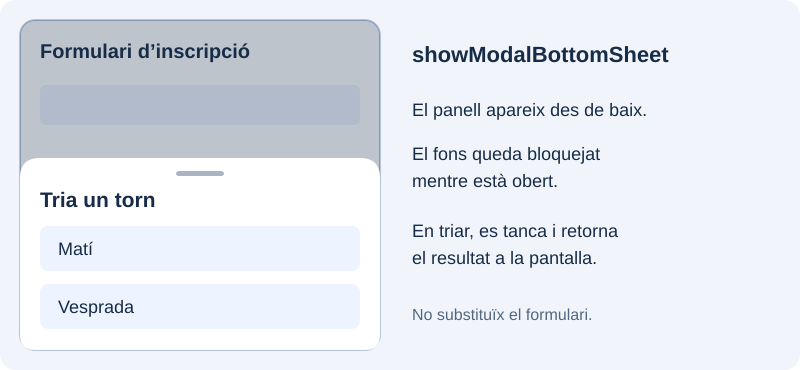

Un diàleg permet demanar una decisió breu sense substituir la pantalla actual. Començarem amb dos botons, després oferirem una llista d’opcions reutilitzarem la validació del formulari i afegirem un panell que apareix des de baix.

## Demanar confirmació

En el projecte `catalogo_widgets`, crea `lib/ui/inscripcion/ui/dialogos.dart`, importa `package:flutter/material.dart` i afig esta funció:

```dart
Future<bool?> confirmar(BuildContext context) {
  return showDialog<bool>(
    context: context,
    builder: (dialogContext) => AlertDialog(
      title: const Text('Continuar?'),
      content: const Text('S’obrirà el formulari d’inscripció.'),
      actions: [
        TextButton(
          onPressed: () => Navigator.of(dialogContext).pop(false),
          child: const Text('Cancel·lar'),
        ),
        FilledButton(
          onPressed: () => Navigator.of(dialogContext).pop(true),
          child: const Text('Continuar'),
        ),
      ],
    ),
  );
}
```

`showDialog` obri la ruta del diàleg i retorna un resultat asíncron. `AlertDialog` organitza el títol, el contingut i les accions. Usem `dialogContext` per a tancar el diàleg des dels botons.

Importa `dialogos.dart` en `inscripcion_pantalla.dart`. Per a provar-lo, afig un botó independent al formulari amb este callback:

```dart
onPressed: () async {
  final aceptado = await confirmar(context);
  if (!context.mounted || aceptado != true) return;
  ScaffoldMessenger.of(context).showSnackBar(
    const SnackBar(content: Text('Has confirmat l’acció')),
  );
},
```

«Continuar» retorna `true`; «Cancel·lar», `false`. Tancar sense triar pot retornar `null`, així que només actuem si el resultat és `true`. Per defecte es permet tancar tocant fora: `barrierDismissible: false` impedix eixe gest, però no garantix per si sol bloquejar totes les formes de retrocés.

## Triar entre diverses opcions

Afig esta funció a `dialogos.dart`:

```dart
Future<String?> elegirSeccion(BuildContext context) {
  return showDialog<String>(
    context: context,
    builder: (dialogContext) => SimpleDialog(
      title: const Text('Tria una secció'),
      children: [
        for (final nombre in ['Text', 'Image', 'Icon'])
          SimpleDialogOption(
            onPressed: () => Navigator.of(dialogContext).pop(nombre),
            child: Text(nombre),
          ),
      ],
    ),
  );
}
```

`SimpleDialogOption` representa cada elecció. Per a provar-la, adapta el callback anterior: espera `elegirSeccion(context)`, comprova `context.mounted` i que el resultat no siga `null`, i mostra la secció rebuda en el missatge.

## Introduir una dada en un diàleg

Crea `lib/ui/inscripcion/ui/nombre_dialogo.dart`. Rebrà el ViewModel que ja usa la pantalla per a reutilitzar la regla del nom; el controlador i la clau són locals al diàleg:

```dart
import 'package:flutter/material.dart';

import '../view_models/inscripcion_viewmodel.dart';

class NombreDialogo extends StatefulWidget {
  const NombreDialogo({super.key, required this.viewModel});
  final InscripcionViewModel viewModel;

  @override
  State<NombreDialogo> createState() => _NombreDialogoState();
}

class _NombreDialogoState extends State<NombreDialogo> {
  final _formKey = GlobalKey<FormState>();
  final _controller = TextEditingController();

  @override
  void dispose() {
    _controller.dispose();
    super.dispose();
  }

  @override
  Widget build(BuildContext context) {
    return Dialog(
      child: SingleChildScrollView(
        padding: const EdgeInsets.all(24),
        child: Form(
          key: _formKey,
          child: Column(
            mainAxisSize: MainAxisSize.min,
            children: [
              Text('Nom per a la inscripció',
                  style: Theme.of(context).textTheme.titleLarge),
              TextFormField(
                controller: _controller,
                decoration: const InputDecoration(labelText: 'Nom'),
                validator: widget.viewModel.validarNombre,
              ),
              const SizedBox(height: 16),
              Wrap(
                spacing: 8,
                children: [
                  TextButton(
                    onPressed: () => Navigator.of(context).pop(),
                    child: const Text('Cancel·lar'),
                  ),
                  FilledButton(
                    onPressed: () {
                      if (_formKey.currentState!.validate()) {
                        Navigator.of(context).pop(_controller.text.trim());
                      }
                    },
                    child: const Text('Acceptar'),
                  ),
                ],
              ),
            ],
          ),
        ),
      ),
    );
  }
}
```

El contingut de `Dialog` es definix amb `child`. `mainAxisSize: MainAxisSize.min` ajusta la columna al contingut i el desplaçament permet accedir-hi si apareix el teclat. «Acceptar» valida i retorna el text; «Cancel·lar» retorna `null`. El diàleg allibera el controlador, però no destruïx el ViewModel rebut.

Importa `nombre_dialogo.dart` en `inscripcion_pantalla.dart` i afig este mètode al `State`:

```dart
// Dins del State d’InscripcionPantalla:
Future<void> _pedirNombre() async {
  final nombre = await showDialog<String>(
    context: context,
    builder: (_) => NombreDialogo(viewModel: widget.viewModel),
  );
  if (!mounted || nombre == null) return;
  ScaffoldMessenger.of(context).showSnackBar(
    SnackBar(content: Text('Nom triat: $nombre')),
  );
}
```

Connecta’l a un botó amb `onPressed: _pedirNombre`. De moment mostrem la resposta en un missatge per a observar el retorn sense modificar el formulari. Pots comparar `Dialog` amb `Dialog.fullscreen` substituint el constructor: este últim ocupa la pantalla completa.

## Mostrar un panell des de baix

Una **bottom sheet** és un panell que entra des de la vora inferior. Servix per a oferir opcions o fer una interacció breu mantenint visible part de la pantalla d’origen. La versió modal s’obri amb `showModalBottomSheet` i bloqueja la interacció amb el fons mentre està oberta.



### Crear el contingut del panell

En `lib/ui/inscripcion/ui/dialogos.dart`, afig esta funció al costat de les anteriors. Mostrarà dos torns i retornarà el que es trie:

```dart
Future<String?> seleccionarTurno(BuildContext context) {
  return showModalBottomSheet<String>(
    context: context,
    showDragHandle: true,
    builder: (sheetContext) => SafeArea(
      top: false,
      child: Padding(
        padding: const EdgeInsets.fromLTRB(16, 0, 16, 16),
        child: Column(
          mainAxisSize: MainAxisSize.min,
          children: [
            Text('Tria un torn',
                style: Theme.of(sheetContext).textTheme.titleLarge),
            ListTile(
              leading: const Icon(Icons.wb_sunny_outlined),
              title: const Text('Matí'),
              onTap: () => Navigator.of(sheetContext).pop('manana'),
            ),
            ListTile(
              leading: const Icon(Icons.nights_stay_outlined),
              title: const Text('Vesprada'),
              onTap: () => Navigator.of(sheetContext).pop('tarde'),
            ),
          ],
        ),
      ),
    ),
  );
}
```

`builder` construïx el contingut del panell. `mainAxisSize: MainAxisSize.min` ajusta l’altura a les opcions i `showDragHandle` mostra l’indicador superior. `SafeArea` protegix el contingut de la zona inferior del dispositiu. Cada opció tanca el panell amb el seu `sheetContext` i retorna un `String`.

### Obrir-lo des del formulari del catàleg

Com que `inscripcion_pantalla.dart` ja importa `dialogos.dart`, afig este botó a `children`, al costat dels botons anteriors:

```dart
FilledButton(
  onPressed: () async {
    final turno = await seleccionarTurno(context);
    if (!context.mounted || turno == null) return;
    ScaffoldMessenger.of(context).showSnackBar(
      SnackBar(content: Text('Torn triat: $turno')),
    );
  },
  child: const Text('Triar torn des de baix'),
),
```

L’`await` espera el tancament. Triar una opció retorna `'manana'` o `'tarde'`; tancar sense triar retorna `null`. Comprovem el context abans de mostrar l’`SnackBar`. Ací només mostrem la resposta per a observar el mecanisme; no afegim un camp Turno al formulari d’inscripció.

Per defecte es pot tancar tocant fora (`isDismissible`) o arrossegant cap avall (`enableDrag`). Són gestos diferents. Per a panells amb contingut llarg pot usar-se `isScrollControlled` i un contingut desplaçable; l’exemple és una llista curta.

Una fulla no modal, creada amb `showBottomSheet`, té un altre propòsit: complementar la pantalla permetent continuar interactuant amb ella. Per a esta elecció puntual usem la modalitat que bloqueja el fons.

Referències: [showModalBottomSheet](https://api.flutter.dev/flutter/material/showModalBottomSheet.html) i [showBottomSheet](https://api.flutter.dev/flutter/material/ScaffoldState/showBottomSheet.html).

## Comprovar els diàlegs i el panell inferior

Prova confirmar, cancel·lar i tancar tocant fora. En el diàleg de nom, un valor buit no ha de tancar-lo en acceptar. Un nom vàlid ha de tornar a la pantalla i mostrar-se en el missatge. Obri també el panell inferior: tria Vesprada i comprova la resposta; després torna a obrir-lo i tanca’l tocant fora. En cancel·lar no ha d’aparéixer un altre missatge de selecció.

Referència: [showDialog](https://api.flutter.dev/flutter/material/showDialog.html), [AlertDialog](https://api.flutter.dev/flutter/material/AlertDialog-class.html), [SimpleDialog](https://api.flutter.dev/flutter/material/SimpleDialog-class.html) i [Dialog](https://api.flutter.dev/flutter/material/Dialog-class.html).
