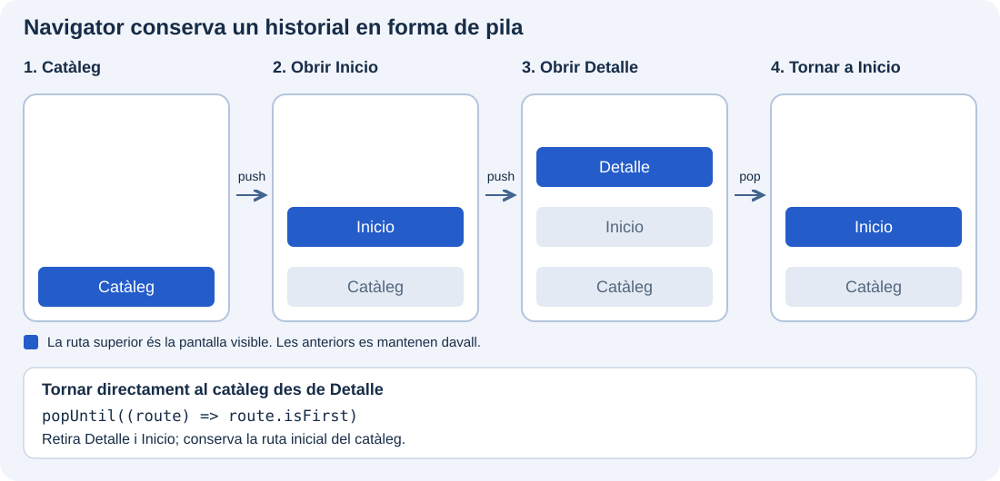
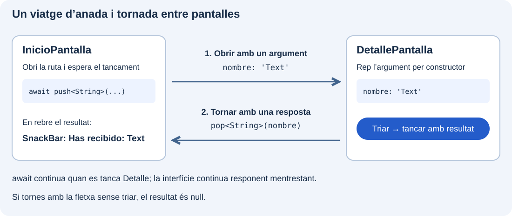

`Navigator` permet obrir pantalles i tornar a les anteriors. L’utilitzarem per a consultar el detall d’un component del catàleg i tornar a la pantalla des de la qual l’hem obert.

Treballarem dins de **`catalogo_widgets`**, conservant l’arrancada i els exemples anteriors. A partir d’esta demostració estudiarem les rutes, les operacions de navegació i l’intercanvi de dades entre pantalles.

:::note[Què construirem]
El catàleg obrirà `InicioPantalla`, i esta obrirà `DetallePantalla`. El detall rebrà un nom pel constructor i podrà retornar l’elecció a Inicio, on la mostrarem en un `SnackBar`.
:::

## Preparar dos pantalles

Crea `lib/ui/navegacion/ui/inicio_pantalla.dart` amb esta pantalla:

```dart
import 'package:flutter/material.dart';

import 'detalle_pantalla.dart';

class InicioPantalla extends StatelessWidget {
  const InicioPantalla({super.key});

  @override
  Widget build(BuildContext context) {
    return Scaffold(
      appBar: AppBar(title: const Text('Navegación: inicio')),
      body: Center(
        child: FilledButton(
          onPressed: () {
            Navigator.of(context).push<void>(
              MaterialPageRoute<void>(
                builder: (_) => const DetallePantalla(nombre: 'Text'),
              ),
            );
          },
          child: const Text('Abrir Text'),
        ),
      ),
    );
  }
}

```

Crea en la mateixa carpeta `detalle_pantalla.dart`:

```dart
import 'package:flutter/material.dart';

class DetallePantalla extends StatelessWidget {
  const DetallePantalla({super.key, required this.nombre});
  final String nombre;

  @override
  Widget build(BuildContext context) {
    return Scaffold(
      appBar: AppBar(title: Text(nombre)),
      body: Center(
        child: FilledButton(
          onPressed: () => Navigator.of(context).pop(),
          child: const Text('Volver'),
        ),
      ),
    );
  }
}
```

En `lib/ui/catalogo/ui/catalogo_pantalla.dart`, afig l’import i esta entrada a la llista, conservant les anteriors:

```dart
// Junto a los imports existentes:
import '../../navegacion/ui/inicio_pantalla.dart';

// En children del ListView:
ListTile(
  leading: const Icon(Icons.route_outlined),
  title: const Text('Navegación entre pantallas'),
  onTap: () {
    Navigator.of(context).push(
      MaterialPageRoute<void>(builder: (_) => const InicioPantalla()),
    );
  },
),
```

Conserva `main.dart`: el `MaterialApp` del catàleg ja proporciona el `Navigator`.

Executa `flutter run`, obri «Navegación entre pantallas» en el catàleg i prem «Abrir Text» i després «Volver». El botó de retrocés d’`AppBar` també permet tornar quan existix una ruta anterior.

## Navigator i les seues operacions

El `Navigator` manté una pila d’objectes **`Route`**. `DetallePantalla` és el widget que mostrem; `MaterialPageRoute` és la ruta que el conté i proporciona la transició adaptada a la plataforma. El seu `builder` construïx el widget de destinació.

En `Navigator.of(context).push(...)`, `Navigator.of(context)` obté l’estat del `Navigator` antecessor més pròxim. Per això usem el context d’una pantalla situada dins del `MaterialApp` del catàleg. `push` rep una ruta, no directament un widget.

Este ús és **imperatiu**: cada pulsació sol·licita afegir o retirar una ruta. L’esquema mostra com eixes operacions canvien la pila del catàleg. Consulta les API de [Navigator.of](https://api.flutter.dev/flutter/widgets/Navigator/of.html) i [MaterialPageRoute](https://api.flutter.dev/flutter/material/MaterialPageRoute-class.html).

### La pila de rutes



Cada columna representa l’historial en un moment diferent. Llig les rutes de baix cap amunt: l’última que s’ha afegit és la que veiem. En fer `pop`, no creem la pantalla anterior; retirem l’actual per a tornar a mostrar la que estava davall.

Obrir una altra vegada Inicio amb `push` crearia una pantalla nova damunt del detall, en lloc de tornar a l’existent. Per a tornar directament al llistat del catàleg des de qualsevol pantalla d’esta demostració, retirem rutes fins a la primera:

```dart
Navigator.of(context).popUntil((route) => route.isFirst);
```

### Principals accions

Estos mètodes es criden sobre l’objecte que obtenim amb `Navigator.of(context)`:

| Operació | Què fa | Exemple d’ús en el catàleg |
| --- | --- | --- |
| `push(ruta)` | Afig una ruta damunt de l’actual. | Obrir Detalle i conservar Inicio davall. |
| `pushNamed(nombre, arguments: ...)` | Afig una ruta identificada per un nom registrat; permet passar arguments. | Obrir `'/detalle'` si s’ha declarat en la configuració de [rutes amb nom](#reconéixer-altres-formes-de-definir-rutes). |
| `pop()` | Retira la ruta superior. | Tancar Detalle i tornar a Inicio. |
| `pop(resultado)` | Retira la ruta i retorna un valor al codi que l’ha oberta. | Tancar Detalle retornant `'Text'`. |
| `canPop()` | Consulta si la pila permet retirar una ruta; no canvia la pantalla. | Comprovar si hi ha una ruta anterior abans d’oferir «Volver». |
| `maybePop()` | Tramita una petició de retrocés segons les regles de la ruta actual. | Respondre a una acció «Volver» que haja de respectar eixes regles. |
| `popUntil(condició)` | Retira rutes fins a trobar-ne una que complisca la condició; la conserva. | Tornar al catàleg amb `(route) => route.isFirst`. |
| `pushReplacement(ruta)` | Obri una ruta nova i substituïx l’actual, conservant les anteriors. | Passar d’Inicio a Detalle sense deixar Inicio en l’historial. |
| `pushAndRemoveUntil(ruta, condició)` | Obri una ruta i elimina les anteriors fins a trobar-ne una que conservar. | Obrir un Inicio nou i llevar els passos intermedis, mantenint el catàleg. |

`canPop()` no consulta totes les restriccions de retrocés de la ruta. `maybePop()` sí que tramita eixa petició i retorna un `Future<bool>` que indica si s’ha atés: `true` **no garantix que la ruta s’haja tancat**, perquè també pot haver-se atés bloquejant l’eixida. Consulta’n la [referència](https://api.flutter.dev/flutter/widgets/NavigatorState/maybePop.html).

## Passar dades a la destinació

En l’exemple, `nombre: 'Text'` passa una dada al constructor. `final String nombre` la conserva i `Text(nombre)` la mostra. Canvia `'Text'` per `'Image'` i comprova el títol del detall. No necessitem variables globals per a comunicar eixa dada.

## Rebre una resposta

Obrirem Detalle des d’Inicio i permetrem que retorne el nom triat. Hi ha dos parts: **Detalle envia el valor en tancar-se; Inicio l’arreplega quan acaba l’`await`**.



### En Detalle: tancar i enviar la dada

En `lib/ui/navegacion/ui/detalle_pantalla.dart`, substituïx el botó «Volver» per este:

```dart
FilledButton(
  onPressed: () {
    Navigator.of(context).pop<String>(nombre);
  },
  child: const Text('Elegir'),
)
```

En passar `nombre` com a argument de `pop<String>`, l’enviem com a **resultat de la ruta** al codi que ha obert el detall. En este exemple es retorna `'Text'`.

### En Inicio: arreplegar la resposta en una variable

En `lib/ui/navegacion/ui/inicio_pantalla.dart`, afig este mètode **dins d’`InicioPantalla`, abans de `build`**. No cal convertir la pantalla en un `StatefulWidget`, perquè usarem la resposta en un missatge temporal:

```dart
Future<void> _abrirDetalle(BuildContext context) async {
  // 1. Abrimos el detalle y esperamos a que se cierre.
  final String? elegido = await Navigator.of(context).push<String>(
    MaterialPageRoute<String>(
      builder: (_) => const DetallePantalla(nombre: 'Text'),
    ),
  );

  // 2. Aquí ya hemos vuelto: elegido contiene la respuesta del pop.
  if (!context.mounted) return;

  // 3. Si se cerró sin elegir, no procesamos ningún dato.
  if (elegido == null) return;

  // 4. Usamos el dato recibido en la pantalla de origen.
  ScaffoldMessenger.of(context).showSnackBar(
    SnackBar(content: Text('Has recibido: $elegido')),
  );
}
```

**La variable `elegido` arreplega la dada retornada.** `push<String>` retorna un `Future<String?>`: en tancar-se Detalle, `await` obté el resultat i l’assigna a eixa variable.

La funció queda pendent durant la visita al detall, però la interfície continua responent. En tornar, el codi continua en la línia que seguix l’`await`. Comprovem `context.mounted` abans d’usar el context i descartem `null`, que rebríem si l’usuari tornara amb la fletxa sense prémer «Elegir».

### Connectar el mètode al botó d’Inicio

En el `build` d’`InicioPantalla`, substituïx el botó «Abrir Text» per este. Este mètode reemplaça el `push` anterior; no mantingues les dos crides:

```dart
FilledButton(
  onPressed: () => _abrirDetalle(context),
  child: const Text('Abrir Text'),
)
```

En provar-ho, «Elegir» ha de mostrar «Has recibido: Text» en Inicio; tornar amb la fletxa no ha de mostrar cap missatge.

## Reconéixer altres formes de definir rutes

Fins ara cada botó construïx la ruta amb `MaterialPageRoute`. Una altra possibilitat és **registrar una destinació amb un nom** i demanar a `Navigator` que l’òbriga usant eixe nom. Per exemple, `'/detalle'` pot identificar la pantalla `DetallePantalla`.

El nom és una clau triada per nosaltres: no és el nom de l’arxiu ni crea automàticament una adreça web. La pantalla continua formant part de la pila de `Navigator`.

### Registrar la destinació

La propietat `routes` pertany al **`MaterialApp` que ja està en `lib/main.dart`**, dins del mètode `build` de `CatalogoApp`. Es col·loca al mateix nivell que `home`, `title` i `debugShowCheckedModeBanner`; no va en `CatalogoPantalla` ni dins d’un botó.

Per a provar esta alternativa en el mateix catàleg, afig l’import de `DetallePantalla` i la propietat `routes`. Partint de l’arrancada base del curs, `lib/main.dart` quedaria així:

```dart
import 'package:flutter/material.dart';

import 'ui/catalogo/ui/catalogo_pantalla.dart';
import 'ui/navegacion/ui/detalle_pantalla.dart';

void main() => runApp(const CatalogoApp());

class CatalogoApp extends StatelessWidget {
  const CatalogoApp({super.key});

  @override
  Widget build(BuildContext context) {
    return MaterialApp(
      debugShowCheckedModeBanner: false,
      title: 'Catálogo de widgets',
      home: const CatalogoPantalla(),
      routes: {
        '/detalle': (_) => const DetallePantalla(nombre: 'Text'),
      },
    );
  }
}
```

Fixa’t en els canvis respecte de l’arrancada inicial:

- **Import nou:** `ui/navegacion/ui/detalle_pantalla.dart` permet construir la destinació des d’este arxiu.
- **`MaterialApp` sense `const`:** el mapa conté una funció que construïx la pantalla. Conservem `const` en `CatalogoPantalla` i en el widget de destinació.
- **`home` es conserva:** el llistat del catàleg continua sent la pantalla inicial.
- **`routes` s’afig al costat de `home`:** la clau `'/detalle'` identifica la destinació i la funció retorna `DetallePantalla(nombre: 'Text')` quan se sol·licita.

Si el teu `MaterialApp` ja té un tema o altres propietats, conserva’ls i afig únicament esta configuració. Si ja té `routes`, incorpora `'/detalle'` a eixe mateix mapa; no declares un altre `routes` ni un altre `MaterialApp`. Si has afegit o canviat la configuració de rutes, reinicia l’aplicació abans de provar-la.

Este registre prepara la destinació; encara no l’obri. L’obertura es fa des del botó amb `pushNamed`, com es mostra a continuació.

### Obrir la ruta i tornar

Si eixe nom està registrat, un botó pot usar:

```dart
onPressed: () {
  Navigator.of(context).pushNamed('/detalle');
},
```

`pushNamed` busca `'/detalle'` en la configuració, construïx la destinació i afig la ruta a la pila. No li passem un `MaterialPageRoute` perquè eixa construcció es resol des de la configuració.

Per a tornar continuem usant `pop()`. També podem esperar un resultat amb `await pushNamed<String>(...)`, igual que amb el `push<String>` anterior. El nom usat ha de coincidir exactament amb el registrat; una cadena desconeguda necessita un mecanisme de resolució de rutes que la gestione.
