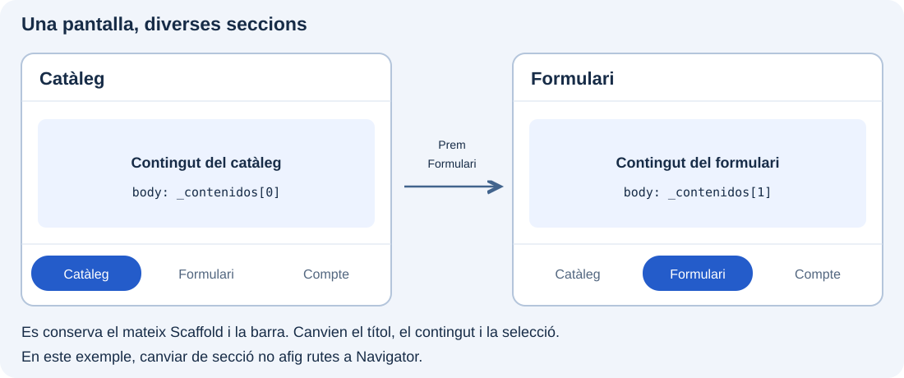
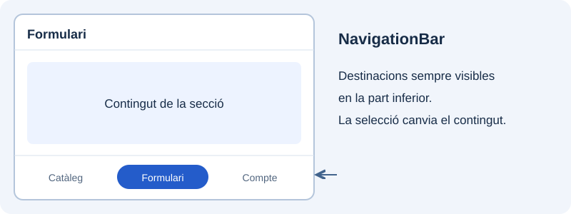
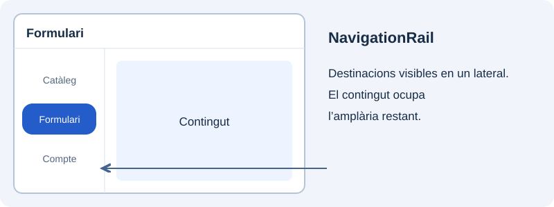
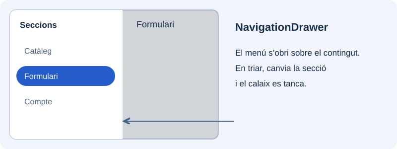
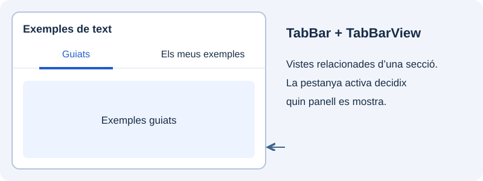

Una aplicació sol agrupar les funcions en seccions que l’usuari necessita consultar amb freqüència: per exemple, **Catàleg**, **Formulari** i **Compte**. La navegació entre seccions permet triar una d’eixes àrees i saber en quina estem, sense haver de tornar al menú cada vegada.

En l’apartat anterior obríem una pantalla de detall amb `Navigator.push`. Ací resoldrem una altra necessitat: **canviar el contingut principal d’una mateixa pantalla**. En la demostració, en triar Formulari es mostrarà el contingut i es marcarà eixa destinació en la barra; en triar Catàleg es recuperarà el contingut d’eixa secció.



Crearem quatre demostracions independents dins de `catalogo_widgets`, cadascuna en el seu fitxer i amb una entrada en el menú del catàleg. Conservarem `SeccionesPantalla` per a la barra inferior i afegirem `SeccionesRailPantalla`, `SeccionesDrawerPantalla` i `SeccionesTabsPantalla`. En obrir-ne qualsevol des del menú sí que afegirem una ruta; **una vegada dins, canviar entre les seccions no apilarà més rutes**. El botó de retrocés permetrà eixir de la demostració i tornar al catàleg.

Començarem amb `NavigationBar`, situada davall, i provarem després altres presentacions: `NavigationRail` en un lateral i `NavigationDrawer` en un calaix. Finalment veurem les pestanyes, que servixen per a agrupar continguts relacionats dins d’una secció. Els textos provisionals ens permetran observar la selecció abans d’integrar continguts reals.

## Canviar de secció amb NavigationBar

**`NavigationBar` manté visibles les destinacions principals en la part inferior.** Cada opció combina una icona i una etiqueta, i l’opció activa queda ressaltada. És una forma de passar amb rapidesa entre les àrees principals, especialment en una disposició de mòbil.

En la demostració, prémer Formulari actualitzarà l’índex seleccionat, el títol i el `body`. La barra continuarà al seu lloc per a poder triar després Catàleg o Compte.



Afegirem una altra demostració al mateix catàleg. Crea `lib/ui/navegacion/ui/secciones_pantalla.dart` amb este codi. La barra organitzarà el contingut dins d’eixa pantalla; no substituïx el menú principal del projecte:

```dart
import 'package:flutter/material.dart';

class SeccionesPantalla extends StatefulWidget {
  const SeccionesPantalla({super.key});

  @override
  State<SeccionesPantalla> createState() => _SeccionesPantallaState();
}

class _SeccionesPantallaState extends State<SeccionesPantalla> {
  int _indice = 0;
  static const _titulos = ['Catàleg', 'Formulari', 'Compte'];
  static const _contenidos = [
    Center(child: Text('Contingut del catàleg')),
    Center(child: Text('Contingut del formulari')),
    Center(child: Text('Contingut del compte')),
  ];

  @override
  Widget build(BuildContext context) {
    return Scaffold(
      appBar: AppBar(title: Text(_titulos[_indice])),
      body: _contenidos[_indice],
      bottomNavigationBar: NavigationBar(
        selectedIndex: _indice,
        onDestinationSelected: (indice) {
          setState(() => _indice = indice);
        },
        destinations: const [
          NavigationDestination(icon: Icon(Icons.widgets), label: 'Catàleg'),
          NavigationDestination(icon: Icon(Icons.edit), label: 'Formulari'),
          NavigationDestination(icon: Icon(Icons.person), label: 'Compte'),
        ],
      ),
    );
  }
}
```

En `catalogo_pantalla.dart`, afig l’import i una entrada nova:

```dart
// Al costat dels imports existents:
import '../../navegacion/ui/secciones_pantalla.dart';

// En children del ListView:
ListTile(
  leading: const Icon(Icons.view_quilt_outlined),
  title: const Text('Seccions: barra inferior'),
  onTap: () {
    Navigator.of(context).push(
      MaterialPageRoute<void>(builder: (_) => const SeccionesPantalla()),
    );
  },
),
```

Executa el catàleg i obri «Seccions: barra inferior». Podràs canviar les destinacions i tornar al llistat amb la fletxa de la barra superior. Conserva este fitxer i la seua entrada: els exemples següents s’afegiran sense modificar esta pantalla.

`selectedIndex` indica la destinació activa. `onDestinationSelected` rep l’índex triat i `setState` reconstruïx la pantalla amb el títol i contingut corresponents. Els textos de demostració permeten observar quina secció està activa.

## Col·locar la navegació en un lateral

**`NavigationRail` col·loca les destinacions en una franja lateral que es manté visible.** Complix la mateixa funció de selecció principal que la barra inferior, però deixa lliure la part baixa i usa espai horitzontal. Encaixa en una disposició ampla, com una finestra d’escriptori o una tauleta.

El rail i el contingut es col·loquen en una `Row`. El rail ocupa la seua amplària i `Expanded` reserva l’espai restant per a la secció triada. Canvia la distribució, però conservem el mateix índex i les mateixes destinacions.



Crea `lib/ui/navegacion/ui/secciones_rail_pantalla.dart` amb el codi complet següent. És una pantalla nova; conserva els exemples anteriors:

```dart
import 'package:flutter/material.dart';

class SeccionesRailPantalla extends StatefulWidget {
  const SeccionesRailPantalla({super.key});

  @override
  State<SeccionesRailPantalla> createState() => _SeccionesRailPantallaState();
}

class _SeccionesRailPantallaState extends State<SeccionesRailPantalla> {
  int _indice = 0;
  static const _titulos = ['Catàleg', 'Formulari', 'Compte'];
  static const _contenidos = [
    Center(child: Text('Contingut del catàleg')),
    Center(child: Text('Contingut del formulari')),
    Center(child: Text('Contingut del compte')),
  ];

  @override
  Widget build(BuildContext context) {
    return Scaffold(
      appBar: AppBar(title: Text(_titulos[_indice])),
      body: Row(
        children: [
          NavigationRail(
            selectedIndex: _indice,
            onDestinationSelected: (indice) {
              setState(() => _indice = indice);
            },
            labelType: NavigationRailLabelType.all,
            destinations: const [
              NavigationRailDestination(
                icon: Icon(Icons.widgets), label: Text('Catàleg')),
              NavigationRailDestination(
                icon: Icon(Icons.edit), label: Text('Formulari')),
              NavigationRailDestination(
                icon: Icon(Icons.person), label: Text('Compte')),
            ],
          ),
          const VerticalDivider(width: 1),
          Expanded(child: _contenidos[_indice]),
        ],
      ),
    );
  }
}
```

En `catalogo_pantalla.dart`, afig este import i una altra entrada al mateix llistat, mantenint les anteriors:

```dart
// Al costat dels imports existents:
import '../../navegacion/ui/secciones_rail_pantalla.dart';

// Afig un altre ListTile a children del ListView:
ListTile(
  leading: const Icon(Icons.view_sidebar_outlined),
  title: const Text('Seccions: rail lateral'),
  onTap: () {
    Navigator.of(context).push<void>(
      MaterialPageRoute<void>(builder: (_) => const SeccionesRailPantalla()),
    );
  },
),
```

`Expanded` deixa que el contingut ocupe l’espai restant. El rail és una presentació lateral adequada per a disposicions amples. En este exercici provem les dos presentacions per separat.

## Obrir un calaix de navegació

**`NavigationDrawer` presenta les seccions dins d’un panell que s’obri des d’un lateral.** En este exemple es manté tancat fins que l’usuari prem el botó de menú d’`AppBar`. En obrir-se, ocupa part de la pantalla i enfosquix el contingut que queda darrere.

Permet dedicar més espai a les etiquetes sense deixar el panell sempre visible, encara que accedir a una destinació requerix obrir-lo primer. En triar una secció actualitzarem el contingut i tancarem el calaix. Eixe tancament no significa tornar a la secció anterior.



Crea `lib/ui/navegacion/ui/secciones_drawer_pantalla.dart` amb el codi complet següent. És una pantalla nova; conserva els exemples anteriors:

```dart
import 'package:flutter/material.dart';

class SeccionesDrawerPantalla extends StatefulWidget {
  const SeccionesDrawerPantalla({super.key});

  @override
  State<SeccionesDrawerPantalla> createState() => _SeccionesDrawerPantallaState();
}

class _SeccionesDrawerPantallaState extends State<SeccionesDrawerPantalla> {
  int _indice = 0;
  static const _titulos = ['Catàleg', 'Formulari', 'Compte'];
  static const _contenidos = [
    Center(child: Text('Contingut del catàleg')),
    Center(child: Text('Contingut del formulari')),
    Center(child: Text('Contingut del compte')),
  ];

  @override
  Widget build(BuildContext context) {
    return Scaffold(
      appBar: AppBar(title: Text(_titulos[_indice])),
      body: _contenidos[_indice],
      drawer: NavigationDrawer(
        selectedIndex: _indice,
        onDestinationSelected: (indice) {
          setState(() => _indice = indice);
          Navigator.of(context).pop();
        },
        children: const [
          NavigationDrawerDestination(
            icon: Icon(Icons.widgets), label: Text('Catàleg')),
          NavigationDrawerDestination(
            icon: Icon(Icons.edit), label: Text('Formulari')),
          NavigationDrawerDestination(
            icon: Icon(Icons.person), label: Text('Compte')),
        ],
      ),
    );
  }
}
```

En `catalogo_pantalla.dart`, afig este import i una altra entrada al mateix llistat, mantenint les anteriors:

```dart
// Al costat dels imports existents:
import '../../navegacion/ui/secciones_drawer_pantalla.dart';

// Afig un altre ListTile a children del ListView:
ListTile(
  leading: const Icon(Icons.menu),
  title: const Text('Seccions: calaix'),
  onTap: () {
    Navigator.of(context).push<void>(
      MaterialPageRoute<void>(builder: (_) => const SeccionesDrawerPantalla()),
    );
  },
),
```

L’`AppBar` mostra el botó que obri el calaix. En triar una destinació actualitzem l’índex i tanquem el calaix amb `pop()`. `Drawer` és el contenidor general; `NavigationDrawer` proporciona les destinacions amb estil Material 3. 

## Organitzar contingut amb pestanyes

**Les pestanyes permeten alternar entre continguts relacionats dins d’una secció.** Per exemple, en «Exemples de text» podem separar els exemples guiats dels que afig l’alumne. La selecció ja no representa Catàleg, Formulari o Compte, sinó dos vistes del mateix tema.

`TabBar` mostra les pestanyes i assenyala l’activa; `TabBarView` presenta el panell corresponent. `DefaultTabController` manté sincronitzades les dos parts. L’usuari pot prémer una pestanya o desplaçar-se horitzontalment entre els panells.



Crea `lib/ui/navegacion/ui/secciones_tabs_pantalla.dart` amb el codi complet següent. És una pantalla nova; conserva els exemples anteriors:

```dart
import 'package:flutter/material.dart';

class SeccionesTabsPantalla extends StatelessWidget {
  const SeccionesTabsPantalla({super.key});

  @override
  Widget build(BuildContext context) {
    return DefaultTabController(
      length: 2,
      child: Scaffold(
        appBar: AppBar(
          title: const Text('Exemples de text'),
          bottom: const TabBar(
            tabs: [Tab(text: 'Guiats'), Tab(text: 'Els meus exemples')],
          ),
        ),
        body: const TabBarView(
          children: [
            Center(child: Text('Exemples guiats')),
            Center(child: Text('Exemples de l’alumne')),
          ],
        ),
      ),
    );
  }
}
```

En `catalogo_pantalla.dart`, afig este import i una altra entrada al mateix llistat, mantenint les anteriors:

```dart
// Al costat dels imports existents:
import '../../navegacion/ui/secciones_tabs_pantalla.dart';

// Afig un altre ListTile a children del ListView:
ListTile(
  leading: const Icon(Icons.tab),
  title: const Text('Seccions: pestanyes'),
  onTap: () {
    Navigator.of(context).push<void>(
      MaterialPageRoute<void>(builder: (_) => const SeccionesTabsPantalla()),
    );
  },
),
```

`DefaultTabController` coordina `TabBar` i `TabBarView`. El seu `length`, el nombre de pestanyes i el nombre de continguts han de coincidir. Prova tant el clic en les pestanyes com el desplaçament horitzontal.

El catàleg conserva ara quatre entrades: barra inferior, rail lateral, calaix i pestanyes. Pots obrir-ne qualsevol i tornar al llistat per a comparar els exemples. Dins de cada pantalla, seleccionar una destinació o una pestanya canvia el contingut sense apilar rutes de detall.

Referències: [NavigationBar](https://api.flutter.dev/flutter/material/NavigationBar-class.html), [NavigationRail](https://api.flutter.dev/flutter/material/NavigationRail-class.html), [NavigationDrawer](https://api.flutter.dev/flutter/material/NavigationDrawer-class.html) i [DefaultTabController](https://api.flutter.dev/flutter/material/DefaultTabController-class.html).
