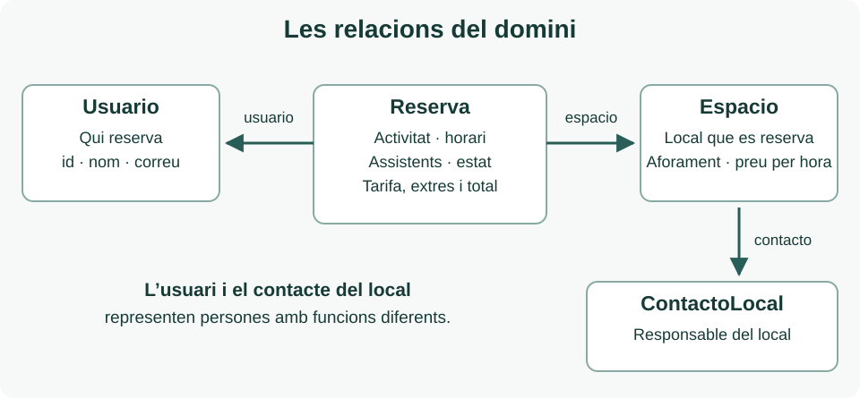

Abans de començar, repassa [Exemple amb dades](../../../widgets/ejemplo-con-datos/), especialment [Models relacionats](../../../widgets/ejemplo-con-datos/modelos/) i [Servici local i repositori](../../../widgets/ejemplo-con-datos/datos-locales/). Utilitzarem la mateixa separació de responsabilitats, adaptada a les reserves d’espais.

## Què representa el domini

El domini reunix els conceptes amb què parlem de l’aplicació: espais, reserves, usuaris i persones de contacte. Una pantalla pot canviar la distribució sense que canvie què significa una reserva. Per això estes classes viuen en `lib/domain/models/`, no importen Flutter i no contenen colors, widgets ni codi de navegació.



Els identificadors permeten reconéixer la mateixa entitat en diferents pantalles. La reserva conté un `Espacio` i un `Usuario`, no els seus noms copiats en cadenes independents. Per a accedir a la persona responsable del local, la vista utilitza `reserva.espacio.contacto`. Eixe contacte **no és qui reserva**: representa l’interlocutor del local.

Els camps següents són mínims. Usa camps `final` i paràmetres amb nom `required`; afig un constructor `const` quan siga possible. `final` impedix reassignar un camp, però no impedix modificar els elements d’una llista: pots protegir les col·leccions amb `List.unmodifiable`. Els identificadors del codi es compartixen entre les dos versions lingüístiques per a mantindre compatibles fitxers i imports; els textos de la interfície els pots adaptar a l’idioma de la teua aplicació.

## ContactoLocal i Usuario tenen funcions diferents

`ContactoLocal` permet mostrar una persona amb qui consultar les condicions de l’espai. Guarda l’identificador, el nom, el telèfon i el correu. El telèfon és text: pot contindre prefix internacional, espais o zeros inicials. Usa sempre dades fictícies. Este és un fitxer complet de referència, `lib/domain/models/contacto_local.dart`:

```dart
class ContactoLocal {
  const ContactoLocal({
    required this.id,
    required this.nombre,
    required this.telefono,
    required this.correo,
  });

  final String id;
  final String nombre;
  final String telefono;
  final String correo;
}
```

`Usuario`, en `lib/domain/models/usuario.dart`, representa qui utilitza la demostració i fa les reserves. Necessita `String id`, `String nombre` i `String correo`. No guarda contrasenyes ni informació real de comptes socials. El login normal i els botons socials poden retornar el mateix usuari fictici. Implementa el constructor seguint el patró anterior.

## Espacio descriu el local que es pot reservar

`Espacio`, en `lib/domain/models/espacio.dart`, alimenta tant les targetes del catàleg com la fitxa de detall i el resum d’una nova reserva. Agrupa estes dades perquè les tres pantalles consulten la mateixa informació:

| Camps mínims | Tipus | Per a què s’utilitzen |
| --- | --- | --- |
| `id`, `nombre`, `descripcion` | `String` | Identificar l’espai i presentar-ne el contingut. |
| `ubicacion`, `horario`, `condicionesUso` | `String` | Explicar on està i com es pot utilitzar. |
| `aforo` | `int` | Indicar la capacitat i comprovar els exemples de reserva. |
| `imagenAsset`, `imagenesAssets` | `String`, `List<String>` | Imatge de portada i galeria, amb almenys tres rutes locals per espai. |
| `sitioWeb` | `String?` | Web opcional del local; `null` significa que no en té. |
| `serviciosDisponibles` | `List<ServicioExtra>` | Servicis addicionals que es poden contractar, separats de l’equipament inclòs. |
| `actividades`, `equipamiento` | `List<String>` | Descriure usos admesos i equipament inclòs mitjançant col·leccions. |
| `precioHoraCentimos` | `int` | Representar la tarifa final per una hora, amb IVA inclòs. |
| `moneda` | `String` | Identificar la moneda; en esta entrega, `EUR`. |
| `contacto` | `ContactoLocal` | Accedir al nom, telèfon i correu del responsable. |

Una vegada declarats els camps i el constructor, pots afegir una consulta que expresse una pregunta del domini. El **fragment següent va dins d’`Espacio`** i utilitza el camp `actividades` de la taula:

```dart
bool admiteActividad(String actividad) {
  return actividades.contains(actividad);
}
```

Si l’espai conté l’activitat sol·licitada, retorna `true`. Utilitza noms d’activitat coherents en les dades fictícies, ja que `contains` compara els textos tal com estan escrits. Este mètode no obri cap pantalla ni modifica l’espai.

## Reserva relaciona les dades d’una sol·licitud

`Reserva`, en `lib/domain/models/reserva.dart`, representa una reserva precarregada de la demostració. La vista utilitza les seues relacions per a mostrar l’espai, la persona que reserva i el contacte del local. Conserva també l’import acordat per a eixa reserva:

| Camps mínims | Tipus | Significat |
| --- | --- | --- |
| `id` | `String` | Identificador únic de la reserva. |
| `espacio`, `usuario` | `Espacio`, `Usuario` | Objectes relacionats; no DTO ni textos duplicats. |
| `actividad` | `String` | Ús sol·licitat, admés per eixe espai. |
| `inicio`, `fin` | `DateTime` | Data i hora d’inici i fi del mateix interval. |
| `asistentes` | `int` | Persones previstes; més de zero i dins de l’aforament. |
| `estado` | `EstadoReserva` | Estat que la interfície representarà amb text i aparença. |
| `serviciosContratados` | `List<ServicioContratado>` | Servicis seleccionats i els seus preus en el moment de reservar; pot estar buida. |
| `tarifaHoraCentimos`, `precioTotalCentimos` | `int` | Tarifa aplicada i import total d’eixa reserva. |
| `moneda` | `String` | Moneda de l’import; ha de coincidir amb la de l’espai. |

Declara este enum fora de la classe, en el mateix fitxer. Un enum limita els valors possibles i evita escriure estats diferents per una errada:

```dart
enum EstadoReserva { confirmada, pendiente, cancelada }
```

El model guarda `EstadoReserva.confirmada`; la vista el convertix en una etiqueta com «Confirmada» i tria el color. Per a calcular la duració pots afegir este **fragment dins de `Reserva`**, després de declarar `inicio` i `fin`:

```dart
Duration get duracion => fin.difference(inicio);
```

`get` permet consultar `reserva.duracion` com una propietat calculada. `Duration` conserva l’interval sense truncar-lo; evita guardar una duració que podria contradir les dates. El model usa tipus de Dart i no necessita `TimeOfDay`, que pertany a Flutter.

## Com representar i comprovar el preu

Guarda els diners en cèntims enters: `3000` representa 30,00 €. Així pots multiplicar quantitats enteres sense guardar el símbol de moneda dins del número. La vista és responsable de mostrar els decimals i el símbol; el model conserva l’import i `EUR`.

Utilitza hores completes i dates del mateix dia per als exemples d’esta entrega. El **fragment de comprovació següent** suposa que ja disposes d’una `Reserva reserva`. No implementa un formulari ni modifica reserves:

```dart
final minutos = reserva.duracion.inMinutes;
if (minutos <= 0 || minutos % 60 != 0) {
  throw StateError('Intervalo de ejemplo no valido');
}
final horas = minutos ~/ 60;
final totalEsperado =
    reserva.tarifaHoraCentimos * horas + reserva.totalServiciosCentimos;
if (reserva.precioTotalCentimos != totalEsperado) {
  throw StateError('El precio no coincide con la duracion');
}
```

La comprovació rebutja intervals de zero minuts, negatius o que no siguen hores completes abans d’usar la divisió entera `~/`. Per a les hores completes, precarrega dates sense segons ni fraccions de segon. Una reserva de 10:00 a 12:00 amb tarifa `3000` i sense extres ha de contindre total `6000`. Mantín eixe total en mostrar la sol·licitud, la confirmació i la reserva d’exemple.

La tarifa actual d’`Espacio` i la tarifa aplicada en `Reserva` tenen funcions diferents. En els exemples inicials poden coincidir, però la reserva conserva l’import encara que després canvie el preu del catàleg. No recalcules una reserva històrica utilitzant sempre la tarifa actual de l’espai.

## Servicis addicionals i preu de la reserva

L’equipament inclòs, com Wi-Fi o una pissarra, forma part de la tarifa de l’espai. Els servicis addicionals, com neteja, decoració o una pausa de café, es trien expressament i es cobren **una sola vegada per reserva**, sense quantitats ni càrrecs per persona en esta entrega.

Implementa `ServicioExtra` en `servicio_extra.dart`, amb `String id`, `String nombre`, `String descripcion` i `int precioCentimos`. Cada espai oferix la seua llista `serviciosDisponibles`; no es pot contractar un servici d’un altre espai. Tots els imports utilitzen la moneda de l’espai i són finals amb IVA inclòs.

`ServicioContratado`, en `servicio_contratado.dart`, conserva `String servicioId`, `String nombre` i `int precioCentimos`. És la còpia del nom i preu aplicats en eixa reserva. Així una modificació futura de l’oferta no canvia l’import històric. No guardes únicament els identificadors ni calcules sempre el preu d’una reserva antiga amb l’oferta actual.

Este **fragment dins de `Reserva`**, una vegada declarat `serviciosContratados`, obté el cost dels extres:

```dart
int get totalServiciosCentimos => serviciosContratados.fold<int>(
  0,
  (total, servicio) => total + servicio.precioCentimos,
);
```

`fold` partix de zero i acumula el preu de cada servici; una llista buida retorna zero. El total de la reserva és **tarifa per hora × hores + servicis contractats**. Per exemple, `r1` costa 6000 cèntims per dos hores de sala i 1500 per neteja: total **7500 cèntims (75,00 €)**. Un extra gratuït, amb preu zero, s’ha de distingir d’un no seleccionat.

## Comentaris i valoracions

`Comentario`, en `comentario.dart`, conté `String id`, `String espacioId`, `Usuario autor`, `int puntuacion`, `String texto` i `DateTime fecha`. Relaciona l’opinió amb un espai i un autor existent, sense duplicar-ne els noms. La puntuació és un enter d’**1 a 5**, els dos inclosos; el text ha de contindre alguna cosa més que espais en blanc.

Els comentaris es consulten per espai, en lloc d’incloure tota la col·lecció en cada `Espacio`. La mitjana es calcula amb els comentaris que realment es mostren: suma de puntuacions dividida pel seu nombre. Si no hi ha comentaris, representa la mitjana amb `null` i mostra «Sense valoracions», no una puntuació de zero. Dos valoracions de 5 i 4 produïxen una mitjana de 4,5.

En esta entrega les opinions del servici són precarregades. L’usuari podrà afegir una opinió de prova en el detall, que es conservarà únicament mentre romanga en eixa pantalla. No s’exigix persistència, autenticació real ni sincronització entre pantalles.

## Disponibilitat de set dies

`DisponibilidadDia`, en `disponibilidad_dia.dart`, conté `String espacioId`, `DateTime fecha` i `List<FranjaDisponibilidad> franjas`. `fecha` representa el dia local a mitjanit. `FranjaDisponibilidad`, en `franja_disponibilidad.dart`, conté `DateTime inicio`, `DateTime fin` i `bool disponible`. Una franja lliure té `disponible == true`; una ocupada utilitza `false`.

La font proporciona **hui i els sis dies següents**, amb tres franges per dia: 10:00–12:00, 13:00–15:00 i 17:00–19:00. Han de pertànyer al dia indicat, no solapar-se i tindre fi posterior a l’inici. La disponibilitat es genera en arrancar amb una única data de referència, utilitzant `DateTime(any, mes, dia + desplaçament)` per a avançar per dies de calendari.

És una simulació independent de les reserves d’exemple, que conserven dates fixes. No calcules disponibilitat real, no bloqueges intervals en confirmar i no presentes els resultats com una garantia de reserva. La pantalla ha d’indicar «Disponibilitat simulada».

## Treball que has de completar

Implementa els models descrits i els seus constructors, amb les relacions indicades. Crea exemples amb dos espais diferents i comprova que les seues reserves mostren el contacte i el preu correctes. Has de poder explicar quines dades guarda cada classe i quins aspectes visuals corresponen a la presentació. En la [capa de dades](../datos/) transformaràs els DTO per a construir estos objectes.
