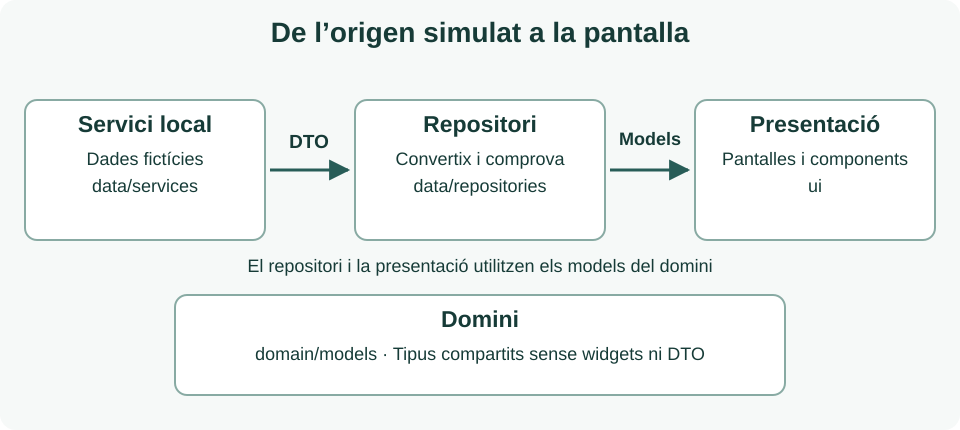

Abans de començar l’entrega, repassa [Exemple amb dades dels apunts](../../widgets/ejemplo-con-datos/). Revisa com relaciona els models i com el servici i el repositori transformen els DTO abans que arriben a la interfície. És la referència de partida per a les subseccions de domini i dades.

## Introducció

Desenvoluparàs una aplicació mòbil que permeta consultar i reservar espais per a reunions, celebracions, tallers i altres activitats. El projecte creixerà mitjançant diferents entregues i servirà per a aplicar i relacionar els coneixements de l’assignatura.

En esta primera entrega construiràs **almenys set pantalles completes**, connectades mitjançant navegació, amb informació fictícia coherent. El resultat s’ha de poder executar i ha de permetre recórrer el procés des de l’accés fins a la confirmació d’una reserva de prova.

### Què has de demostrar

- Aplicar Dart per a representar espais, usuaris i reserves mitjançant classes, col·leccions i paràmetres.
- Compondre interfícies amb widgets, distribuir el contingut i reutilitzar components propis.
- Organitzar el projecte en presentació, domini i dades, seguint les rutes dels apunts.
- Implementar la navegació entre les pantalles i comunicar quin espai s’està consultant o reservant.

### Abast de la primera entrega

Fins ara hem treballat Introducció a Flutter i Dart, i Widgets. La navegació bàsica serà obligatòria en esta entrega. Pots recolzar-te en els exemples de `Navigator` i `MaterialPageRoute` de l’apartat [Obrir pantalles i tornar](../../formularis-i-navegacio/navegacion/entre-pantallas/). Els formularis complets, la gestió compartida de l’estat i la persistència es desenvoluparan progressivament. La selecció d’extres, el carrusel i l’opinió de prova utilitzen únicament estat local amb `setState`, com en els exemples de widgets.

L’accés i les reserves seran simulats. Pots mostrar valors precarregats en els controls i confirmar una reserva d’exemple sense guardar-la. Indica clarament este comportament en l’aplicació. No s’exigix autenticació real, consulta de disponibilitat, emmagatzematge ni servicis externs.

Has d’incloure les set pantalles mínimes descrites en la capa de presentació. **Pots afegir més pantalles** si aporten valor a la proposta i mantenen l’abast de l’entrega. EspaiReserva és un nom orientatiu: pots triar un altre nom, identitat visual i distribució. Els mockups són exemples, no plantilles obligatòries; allò exigible són les dades, les accions i els recorreguts indicats en els requisits.

## Arquitectura proposada

Organitza el projecte en tres àmbits de responsabilitat: ui per a presentació, domain per als models i data per a l’accés i la gestió de les dades. Esta organització seguix l’arbre previst en els apunts del catàleg. La interfície s’agrupa per funcionalitat i les dades per responsabilitat.

```text
lib/
├── main.dart
├── ui/
│   ├── core/
│   │   └── ui/
│   │       ├── espacio_tarjeta.dart
│   │       └── reserva_tarjeta.dart
│   ├── acceso/ui/
│   │   ├── login_screen.dart
│   │   └── registro_screen.dart
│   ├── espacios/ui/
│   │   ├── espacios_screen.dart
│   │   └── espacio_detalle_screen.dart
│   ├── reservas/ui/
│   │   ├── nueva_reserva_screen.dart
│   │   └── mis_reservas_screen.dart
│   └── perfil/ui/perfil_screen.dart
├── domain/models/
│   ├── espacio.dart
│   ├── reserva.dart
│   ├── usuario.dart
│   ├── contacto_local.dart
│   ├── servicio_extra.dart
│   ├── servicio_contratado.dart
│   ├── comentario.dart
│   ├── disponibilidad_dia.dart
│   └── franja_disponibilidad.dart
└── data/
    ├── models/
    │   ├── espacio_dto.dart
    │   ├── reserva_dto.dart
    │   ├── usuario_dto.dart
    │   ├── contacto_local_dto.dart
    │   ├── servicio_extra_dto.dart
    │   ├── servicio_contratado_dto.dart
    │   ├── comentario_dto.dart
    │   ├── disponibilidad_dia_dto.dart
    │   └── franja_disponibilidad_dto.dart
    ├── repositories/
    │   ├── espacios_repository.dart
    │   ├── usuarios_repository.dart
    │   ├── reservas_repository.dart
    │   ├── comentarios_repository.dart
    │   └── disponibilidad_repository.dart
    └── services/
        ├── datos_demo.dart
        └── datos_simulados_service.dart
assets/images/
README.md
pubspec.yaml
```

Tota pantalla i component visual es guarda en una subcarpeta ui: dins de la seua funcionalitat o en `ui/core/ui` si es compartix. `main.dart` inicia l’aplicació, configura `MaterialApp` i connecta les dependències.

Per a esta entrega n’hi ha prou amb un servici local que retorne DTO amb dades d’exemple i repositoris senzills que els transformen en models de domini, sense operacions asíncrones. Pots injectar les dades mitjançant constructors. Evita repetir el catàleg en diferents pantalles o escriure tota l’aplicació en `main.dart`.

Més avant afegirem ui/&lt;funcionalidad&gt;/view_models/ per a l’estat de presentació i altres servicis quan canvie la font de dades. No s’exigix crear estes carpetes buides ni implementar casos d’ús en esta entrega.

## Com treballar les tres capes

L’arquitectura separa allò que es mostra, la informació que utilitza l’aplicació i la manera d’obtindre-la. Cada capa té la seua subsecció en esta entrega:

- [Capa de domini](./dominio/): classes, relacions i regles de coherència de les dades, inclosos els preus i el contacte del local.
- [Capa de dades](./datos/): DTO, servici local i repositoris que transformen la font simulada.
- [Capa de presentació](./presentacion/): components, criteris visuals, navegació i requisits de les pantalles.



Les fletxes representen el recorregut de les dades. `domain/models` definix els tipus que compartixen la presentació i el repositori; no conté widgets ni importa la capa de dades. La presentació rep models de domini, mai DTO. `main.dart` connecta les peces mitjançant constructors.

Pots començar pels models, continuar amb les dades simulades i acabar component les pantalles. En separar estes responsabilitats podràs modificar l’aspecte d’una targeta sense canviar el servici, o ampliar les dades sense repetir-les en cada pantalla.

## Convencions de noms

| Element | Convenció i exemple |
| --- | --- |
| Projecte, carpetes i fitxers | `lowercase_with_underscores`: reserva_espacios, nueva_reserva_screen.dart |
| Classes i enumeracions | `UpperCamelCase`: `Espacio`, `NuevaReservaScreen`, `EstadoReserva` |
| Variables, mètodes i paràmetres | `lowerCamelCase`: espacioSeleccionado, cargarEspacios() |
| Constants i valors d’enum | `lowerCamelCase`: aforoMaximo, `EstadoReserva`.confirmada |
| Privats de biblioteca | Guió baix inicial quan corresponga: _crearResumen() |
| Recursos d’imatges | Noms descriptius: sala_agora.jpg; declarar-los en `pubspec.yaml` |

Usa identificadors sense espais ni accents i mantín un idioma coherent. En este projecte s’adopta el sufix Screen per a les pantalles; és una convenció del projecte. Les regles de majúscules i minúscules provenen d’Effective Dart. Aplica dart format i conserva els lints de Flutter.

## Entrega i comprovació

Entrega el projecte Flutter complet amb el codi font, `pubspec.yaml`, els recursos locals i un `README` que permeta executar-lo. Exclou les carpetes generades build/ i .dart_tool/. Inclou captures de les set pantalles mínimes i de les addicionals que hages creat i documenta quines accions són simulades.

### Llista de comprovació

- S’inclouen almenys les set pantalles mínimes; les addicionals mantenen l’estil i la navegació del conjunt.
- L’aplicació s’inicia sense errors i totes les pantalles són accessibles mitjançant controls visibles.
- El recorregut de registre i tornada al login, accés normal i social simulat, catàleg, detall, nova reserva, confirmació i les meues reserves funciona; el tancament de sessió neteja la navegació.
- El detall mostra galeria, web opcional, opinions i disponibilitat simulada de set dies.
- Es poden seleccionar i desmarcar extres, i el total i la confirmació conserven el desglossament correcte.
- Les opinions noves són locals al detall i desapareixen en tancar-lo.
- Les dades es mantenen coherents en obrir diferents espais i confirmar-ne els exemples de reserva.
- S’han extret els patrons visuals repetits a components propis, com en el catàleg, i es respecten les rutes ui, domain i data.
- Totes les pantalles compartixen criteris de color, tipografia, espaiat i ús de botons.
- Les imatges locals estan declarades i no depenen d’una connexió a Internet.
- Els textos i botons es lligen en un mòbil de referència de 360 píxels lògics d’amplària; no hi ha desbordaments i el contingut llarg permet desplaçar-se.
- El `README` identifica la versió de Flutter utilitzada, els passos d’execució, les dades de demostració, les limitacions i les fonts dels recursos.
- Des de l’arrel del projecte, executa `dart format lib` per a aplicar el format estàndard i `flutter analyze` per a detectar problemes en el codi. Corregix els errors i explica qualsevol avís pendent. Si inclous proves, executa `flutter test` des de la mateixa carpeta i revisa’n el resultat.

Es revisarà la cobertura dels requisits, la coherència del recorregut, la composició i reutilització de widgets, l’organització del codi i la teua capacitat per a explicar les decisions preses. No es fixen en este document dates, modalitat d’agrupació ni ponderacions.

### Preparació per a les entregues següents

Conserva els identificadors dels models i evita dependre de valors escrits directament en les vistes. Així podràs substituir l’origen simulat, incorporar ViewModels i mantindre les pantalles a mesura que avances en l’assignatura.

## Possibles ampliacions

Les ampliacions són opcionals i s’han d’incorporar després de completar els requisits mínims. Totes es resolen amb Dart i els widgets treballats fins ara, usant dades simulades. Tria propostes que pugues explicar i comprovar.

| Ampliació | Possible evolució del projecte |
| --- | --- |
| Disseny adaptable | Adapta el catàleg a mòbil i tauleta amb els widgets de distribució estudiats. Mostra una llista o una quadrícula segons l’amplària disponible i comprova que no es produïxen desbordaments. |
| Components amb variants | Amplia `EspacioTarjeta` i `ReservaTarjeta` amb variants seleccionades mitjançant paràmetres, com destacada, compacta o estat. Reutilitza-les amb diferents dades d’exemple. |
| Catàleg més complet | Afig espais i activitats nous mitjançant classes i col·leccions de Dart. Representa aforaments, equipament i activitats amb components reutilitzables, icones i textos coherents. |
| Galeria d’imatges locals | Inclou diverses imatges per espai mitjançant els widgets de llistes o desplaçament estudiats. Declara els recursos en `pubspec.yaml` i evita dependre d’imatges en Internet. |
| Casos visuals alternatius | Dissenya variants amb dades simulades per a una llista de reserves buida, noms llargs o un espai sense imatge. Permet triar el cas mitjançant paràmetres o dades d’exemple, sense afegir gestió compartida de l’estat. |
| Llegibilitat i composició | Millora la jerarquia visual, el contrast, els espaiats i la grandària dels controls. Acompanya les icones i els colors amb textos i identifica els estats de reserva de manera comprensible. |

### Referències

Arquitectura i organització del curs: El projecte del catàleg, apartat Què afegirem quan apareguen altres responsabilitats. S’adopta la seua estructura ui, domain i data, i la subcarpeta ui per a les peces visuals.

[El projecte del catàleg i la seua arquitectura](../../widgets/configuracion-de-un-asistente-de-ia/el-proyecto-del-catalogo/)

Convencions de noms i format de Dart: Effective Dart, Style.

[Effective Dart Style](https://dart.dev/effective-dart/style)

Organització de referència de Flutter: Architecture case study. La convenció del curs usa ui per a la subcarpeta visual de cada funcionalitat.

[Cas pràctic d’arquitectura de Flutter](https://docs.flutter.dev/app-architecture/case-study)
