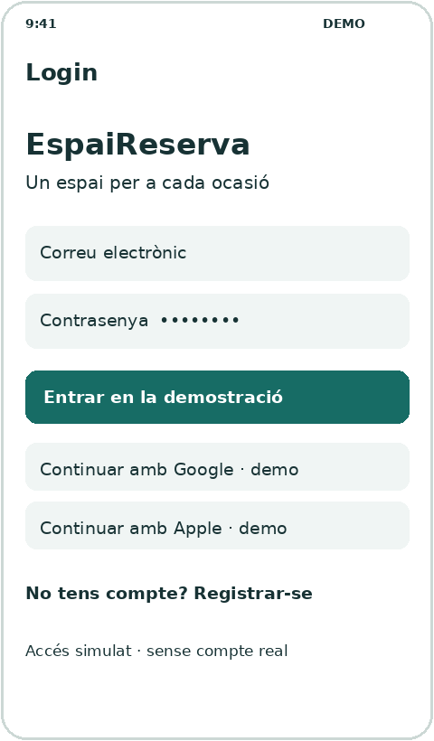
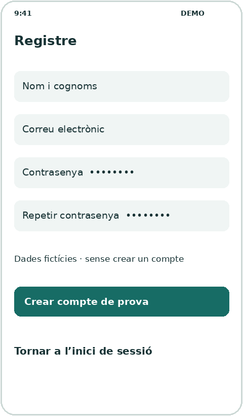
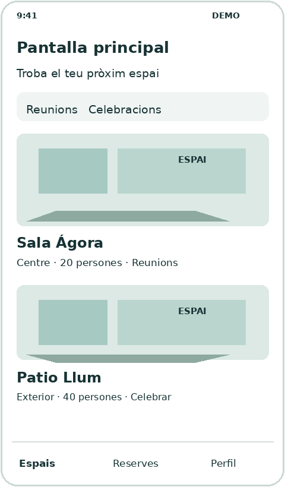
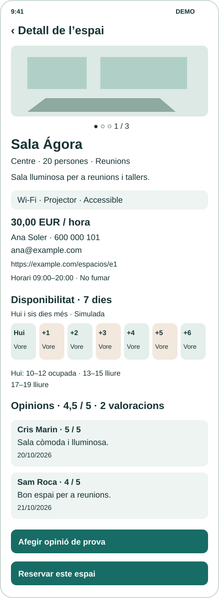
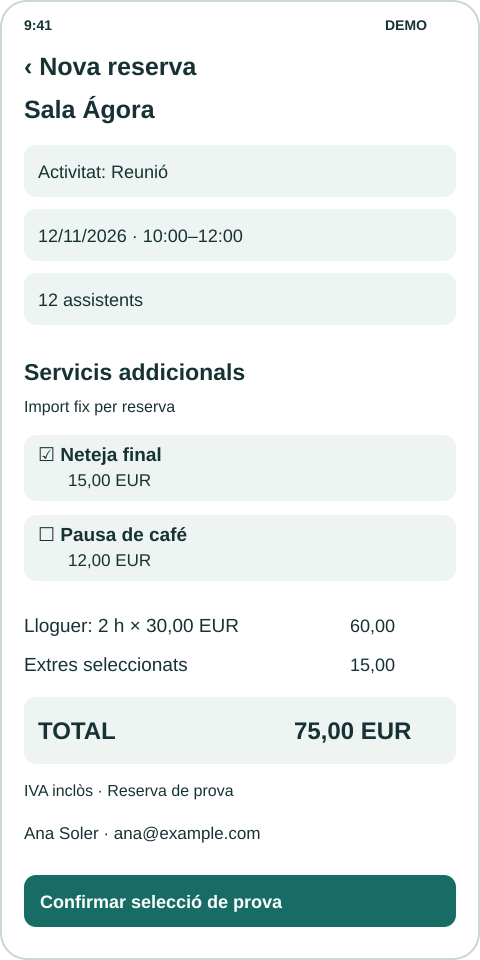
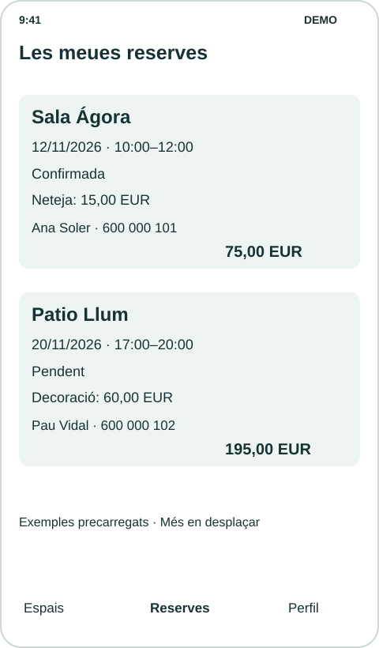
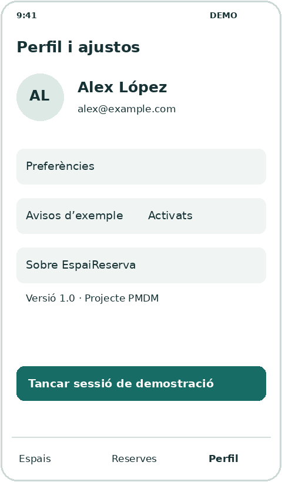

La capa de presentació viu en `lib/ui/`. Les pantalles mostren models de domini, comuniquen accions i permeten recórrer l’aplicació. Els components visuals s’agrupen per funcionalitat o es compartixen en `lib/ui/core/ui/`.

## Llibertat de disseny i pantalles mínimes

Has d’implementar **almenys set pantalles**: login, registre, principal, detall d’un espai, nova reserva, les meues reserves i perfil amb ajustos. Pots afegir-ne altres, com una confirmació independent, sempre que les set mínimes continuen sent identificables i complisquen els requisits.

**Els mockups i les propostes de distribució són orientatius.** Pots dissenyar les pantalles com consideres, triar una altra identitat i canviar-ne la composició. Mantín les dades mínimes, les accions i la navegació exigits. No s’avaluarà que l’aplicació copie els dibuixos, sinó que resolga el recorregut i siga llegible i coherent.

## Un estil coherent en tota l’aplicació

Abans d’implementar les pantalles, acorda uns criteris visuals senzills i anota’ls en el `README`. S’han d’aplicar també a les pantalles que afiges. Com a punt de partida:

- Tria una paleta reduïda amb un color principal, colors de fons i text i colors per als estats. Mantín el mateix significat en tota l’aplicació i acompanya els estats amb text.
- Definix una jerarquia de textos: títol de pantalla, títol de secció, text normal i text secundari. Repetix les grandàries i els pesos triats per a cada funció.
- Utilitza una escala menuda de separacions, per exemple 8, 16 i 24 píxels lògics. Mantín marges i alineacions consistents.
- Dona el mateix aspecte a les accions equivalents. El botó principal ha de destacar de la mateixa manera; els secundaris i les accions de tornar han de resultar recognoscibles.
- Conserva criteris comuns per a targetes, vores, cantons, icones i imatges. Comprova el contrast, la lectura de textos llargs i el desplaçament en pantalles menudes.

Estes són pautes de coherència per a esta entrega. **Quan aprenguem a gestionar els estils de Flutter de manera adequada, en centralitzarem la configuració.** Ara aplica els criteris triats en els components; no s’exigix implementar encara un sistema global de temes ni paquets d’estils.

## Crear els components que es repetixen

Si detectes un patró reutilitzable, **has d’extraure’l a un component propi**, igual que estem fent en el [catàleg de components](../../../widgets/configuracion-de-un-asistente-de-ia/el-proyecto-del-catalogo/). No et limites a les targetes proposades: revisa també els botons, els tipus de text, els camps amb una aparença comuna o les files d’icona i etiqueta.

Per exemple, un `BotonPrincipal` pot rebre el text i l’acció, un `TituloSeccion` el text que ha de mostrar, i `EspacioTarjeta` les dades de l’espai i l’acció d’obrir-lo. Utilitza paràmetres per a expressar les variants de contingut, aspecte i comportament; evita crear una classe diferent per a cada text o color. Reutilitzar significa utilitzar eixe mateix component en els llocs on es repetix el patró.

- Guarda els components compartits en `lib/ui/core/ui/` i els específics en `lib/ui/<funcionalidad>/ui/`.
- Separa el contingut de l’aspecte: el text o l’espai rebut no han de quedar fixats dins d’una peça reutilitzable.
- Fes que les pantalles componguen eixos components, en lloc de copiar-ne l’arbre de widgets en diversos fitxers.
- Comprova les variants amb dades diferents, com en el catàleg: textos llargs, botons principals i secundaris, estats de reserva i targetes amb informació diferent.

L’extracció de components ja permet aplicar les mateixes decisions visuals en diversos llocs. És compatible amb centralitzar els estils més avant.

## Recorregut obligatori

Login ↔ Registre; Login → Principal → Detall → Nova reserva → confirmació simulada → Les meues reserves. Des de Principal, Les meues reserves i Perfil s’ha de poder canviar entre estes tres seccions mitjançant una navegació coherent. Pots usar NavigationBar, Drawer o un menú equivalent.

Usa Navigator i MaterialPageRoute o una solució equivalent que pugues explicar. Detall i Nova reserva han de permetre tornar. Després d’entrar, Arrere no ha de tornar al login; en tancar sessió ha de tornar al login i netejar les pantalles anteriors. L’espai seleccionat s’ha de conservar durant el recorregut.

## Login

Accés simulat a l’aplicació.



Exemple orientatiu amb dades simulades

### Requisits mínims

- Mostra el nom o logotip, un missatge de benvinguda, els camps de correu i contrasenya i un botó d’accés. La contrasenya ha d’aparéixer oculta.
- Inclou almenys dos botons d’accés social, per exemple Google i Apple. En polsar-los s’accedix amb l’usuari fictici i s’identifica l’accés com a simulat; no es connecten comptes externs.
- Permet accedir amb dades de demostració sense comprovar credencials ni connectar-se a un servidor. Identifica l’accés com a simulat.
- El botó obri la pantalla principal. Configura la navegació perquè Arrere no torne a esta pantalla després de l’accés.
- Inclou un enllaç Registrar-se que òbriga la pantalla de registre i permeta tornar al login.
- Adapta el contingut al teclat i a l’alçària disponible mitjançant desplaçament quan calga.

Comprovació: Polsa Entrar i comprova que s’obri el catàleg. Torna al login des de Tancar sessió i revisa que pots accedir una altra vegada.

## Registre

Presentació d’una alta d’usuari fictícia.



Exemple orientatiu amb dades simulades

### Requisits mínims

- Mostra nom i cognoms, correu, contrasenya i repetició de contrasenya amb etiquetes visibles. Els camps de contrasenya han d’ocultar el text.
- Pots precarregar els camps; no s’exigix validació, guardar les dades ni crear un compte real. Identifica el registre com una simulació.
- Crear compte de prova mostra una confirmació simulada i permet tornar al login. Entrar en l’aplicació continua fent-se des del login.
- Inclou Tornar a l’inici de sessió i permet tornar mitjançant Arrere. No guardes contrasenyes en Usuario ni en el seu DTO.

Comprovació: Obri Registre des de Login, activa la confirmació i torna a l’accés. Comprova també el botó Arrere.

## Pantalla principal

Catàleg d’espais disponibles en la demostració.



Exemple orientatiu amb dades simulades

### Requisits mínims

- Mostra almenys sis espais diferents mitjançant una llista o quadrícula desplaçable, amb dades procedents dels models.
- Cada targeta inclou imatge, nom, ubicació, aforament i almenys una activitat admesa. Reutilitza un component EspacioTarjeta.
- La pulsació sobre qualsevol targeta obri el detall d’eixe espai. Comprova també una targeta situada al final de la llista.
- Oferix accés visible a Les meues reserves i Perfil. Si afiges categories o un cercador decoratiu, indica-ho com a vista d’exemple; els filtres funcionals són una ampliació.

Comprovació: Obri dos espais diferents i comprova que els detalls canvien. Revisa el desplaçament fins a l’últim element.

## Detall d’un espai

Informació completa de l’espai seleccionat.



Exemple orientatiu amb dades simulades

### Requisits mínims

- Mostra nom, descripció, ubicació, aforament i activitats admeses. Substituïx la imatge única per un carrusel amb almenys tres imatges de l’espai rebut, desplaçable horitzontalment i amb indicador de posició.
- Inclou almenys tres elements d’equipament o servicis, representats mitjançant icones i text.
- Mostra la tarifa per hora amb moneda i la persona de contacte del local amb nom, telèfon i correu. Usa dades fictícies.
- Presenta condicions i horari d’ús. Mostra la web del local si existix i «Sense lloc web» si és `null`; n’hi ha prou amb mostrar-la com a text, sense incorporar paquets per a obrir enllaços.
- Mostra la disponibilitat de hui i els sis dies següents, amb data i franges lliures o ocupades. Usa text a més del color i indica «Disponibilitat simulada»; no s’exigix bloquejar franges ni enllaçar-les amb una reserva real.
- Mostra les opinions amb autor, data, comentari i puntuació d’1 a 5; inclou mitjana i nombre de valoracions, o «Sense valoracions». Permet afegir una opinió de prova amb text i puntuació, utilitzant estat local.
- El botó Reservar obri Nova reserva amb el mateix espai. L’acció de tornar retorna al catàleg.

Comprovació: Obri dos espais. Canvien la galeria, els comentaris, la mitjana, la web i la disponibilitat. En Jardin Brisa ha d’aparéixer «Sense valoracions». Afig una opinió de prova i comprova que desapareix en eixir i tornar a obrir el detall. Reserva Patio Llum i comprova que es conserva eixe espai.

## Nova reserva

Presentació d’una sol·licitud de reserva de prova.



Exemple orientatiu amb dades simulades

### Requisits mínims

- Identifica l’espai triat i inclou activitat, data, hora d’inici, hora de fi i nombre d’assistents.
- Presenta activitat, data, horari i assistents mitjançant controls amb etiquetes visibles. Pots precarregar-los sense edició. La selecció de servicis addicionals sí que ha de respondre a les pulsacions; no s’exigix validació completa de formularis.
- L’exemple ha de ser coherent: activitat admesa, assistents dins de l’aforament i hora de fi posterior a la d’inici. Pots generar l’exemple a partir de l’espai rebut.
- Mostra els servicis que oferix eixe espai mitjançant opcions seleccionables amb nom i preu final per reserva. Permet triar-ne cap, un o diversos; no confongues els extres amb l’equipament inclòs.
- Mostra duració, tarifa per hora, subtotal de lloguer, subtotal d’extres, total i moneda, a més del contacte del local. Actualitza els imports amb cada selecció: total = tarifa × hores + extres.
- La confirmació ha de conservar el mateix espai, els servicis seleccionats i el desglossament de preu; no afig una reserva a la font simulada.
- Confirmar mostra un diàleg o pantalla amb el resum, inclòs el preu total, i el missatge Reserva de prova. Des d’eixa confirmació permet obrir Les meues reserves.
- Explica que no es guarda la sol·licitud i que Les meues reserves conté exemples precarregats. Tornar ha de permetre retornar al detall del mateix espai.

Comprovació: En Sala Ágora, dos hores costen 60,00 €. Seleccionar neteja suma 15,00 €, seleccionar també café suma 12,00 € més i desmarcar-los retorna el total a 60,00 €. La confirmació conserva les seleccions i Les meues reserves continua mostrant les dades precarregades.

## Les meues reserves

Consulta de reserves fictícies precarregades.



Exemple orientatiu amb dades simulades

### Requisits mínims

- Mostra almenys dos reserves amb nom de l’espai, activitat, data, horari, assistents, estat i preu total amb moneda. Inclou els servicis contractats i el cost, o «Sense extres».
- Diferencia visualment almenys dos estats, com Confirmada i Pendent. Acompanya el color amb text llegible.
- Inclou el nom i almenys un mitjà de contacte de la persona responsable del local, accessibles en la targeta o en un detall de la reserva.
- Reutilitza un component ReservaTarjeta. Les dades han d’estar relacionades amb espais existents del catàleg.
- Inclou navegació cap a Espais i Perfil. No s’exigix cancel·lar o modificar reserves; si afiges estos botons, han d’explicar el comportament simulat.

Comprovació: Comprova que les dos reserves es lligen completes i que els estats es distingixen sense dependre exclusivament del color.

## Perfil i ajustos

Informació de l’usuari i de l’aplicació.



Exemple orientatiu amb dades simulades

### Requisits mínims

- Mostra avatar o inicials, nom i correu d’un usuari fictici coherent en tota l’aplicació.
- Inclou una secció de preferències i una altra amb nom de l’aplicació, versió i descripció breu del projecte.
- Pots representar una preferència amb un valor fix identificat com a exemple. En esta entrega n’hi ha prou amb mostrar eixe valor d’exemple.
- El botó Tancar sessió torna al login i elimina les rutes anteriors. Després d’eixir, Arrere no ha de reobrir el perfil ni el catàleg.
- Inclou accés a Espais i Les meues reserves amb el mateix patró de navegació que la resta de seccions principals.

Comprovació: Tanca sessió i polsa Arrere. Comprova que les pantalles de la sessió tancada no queden accessibles.

## Com resoldre les interaccions noves

Estes interaccions usen **estat local d’una pantalla**, com els exemples amb `StatefulWidget` i `setState` del catàleg. No s’exigix encara una solució d’estat compartit. Revisa [Gestos i actualització](../../../widgets/otros/gestos-y-actualizacion/) si necessites recordar com reconstruir la interfície en canviar un valor.

### Carrusel amb PageView

`PageView` permet desplaçar-se per pàgines de manera horitzontal. Dins d’una pantalla amb desplaçament vertical necessita una alçària limitada. Este **fragment per al cos del detall** pressuposa un `Espacio espacio` i les imatges declarades en `pubspec.yaml`:

```dart
SizedBox(
  height: 220,
  child: PageView.builder(
    itemCount: espacio.imagenesAssets.length,
    itemBuilder: (context, indice) => Image.asset(
      espacio.imagenesAssets[indice],
      fit: BoxFit.cover,
    ),
  ),
)
```

L’índex selecciona una ruta d’`imagenesAssets`. Afig `onPageChanged` per a guardar la pàgina actual amb `setState` i mostrar una etiqueta com «1 / 3». La llista d’imatges ha d’estar completa i no buida; mentre incorpores recursos pots substituir cada imatge per un `Placeholder`.

### Seleccionar servicis i recalcular el resum

En el `State` de Nova reserva pots conservar un conjunt d’identificadors. `CheckboxListTile` combina una casella i un text; la propietat `value` indica si està marcada i `onChanged` rep el valor nou. Este **fragment va dins del State**:

```dart
final _serviciosSeleccionados = <String>{};

void _cambiarServicio(ServicioExtra servicio, bool seleccionado) {
  setState(() {
    if (seleccionado) {
      _serviciosSeleccionados.add(servicio.id);
    } else {
      _serviciosSeleccionados.remove(servicio.id);
    }
  });
}
```

El `Set` evita identificadors duplicats. Per a dibuixar cada opció, este **fragment de widget** pressuposa un `ServicioExtra servicio` de la llista de l’espai:

```dart
CheckboxListTile(
  title: Text(servicio.nombre),
  subtitle: Text('${(servicio.precioCentimos / 100).toStringAsFixed(2)} EUR'),
  value: _serviciosSeleccionados.contains(servicio.id),
  onChanged: (valor) => _cambiarServicio(servicio, valor ?? false),
)
```

Dins de `build`, obtín els servicis amb identificador seleccionat i suma’n els preus amb `fold`, com en el domini. El subtotal de lloguer s’obté de l’interval de prova. Passa una còpia dels servicis triats i els imports al resum de confirmació. L’estat d’esta pantalla es descarta en eixir; el repositori no es modifica.

### Afegir una opinió de prova

Mostra els comentaris precarregats i conserva els nous en una llista local del detall. Un camp de text, una selecció senzilla d’1 a 5 i un botó són suficients. Explica eixos controls en la interfície i comprova en polsar que `texto.trim()` no estiga buit i que la puntuació estiga dins de l’interval. Mostra un missatge si en falta algun; no s’exigix utilitzar `Form` ni validadors.

En acceptar, utilitza l’usuari de demostració com a autor i `DateTime.now()` com a data, incorpora l’opinió a la llista visible i recalcula’n la mitjana i el comptador amb `setState`. La col·lecció del servici queda intacta. Allibera el controlador de text en `dispose` si n’utilitzes un. En tancar el detall i obrir-lo de nou només han de quedar les opinions precarregades.

### Mostrar la setmana simulada

Consulta `DisponibilidadRepository.obtenerSieteDias(espacio.id, fechaReferencia)`. Rep `fechaReferencia` per constructor des de l’arrancada, amb el valor de `fechaReferenciaDemo`; no importes el fitxer de dades fictícies en la pantalla. Pots utilitzar una llista horitzontal o blocs amb data i franges; limita’n l’alçària si la nies en un altre desplaçament. S’han de poder consultar els set dies, encara que no càpien simultàniament en pantalla. «Lliure» i «Ocupada» han de continuar sent comprensibles sense dependre del color.
