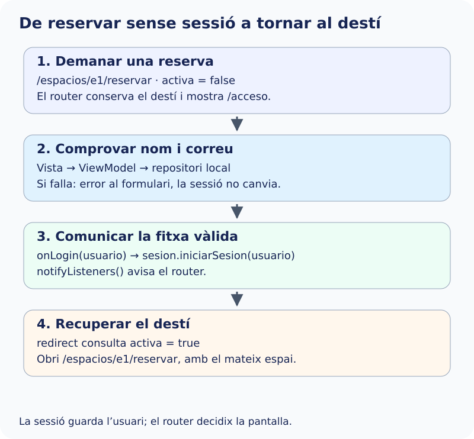

En esta part configuraràs la navegació de l’aplicació amb `go_router`, definint quina pantalla correspon a cada ruta i com s’hi pot arribar. El recorregut ha de funcionar tant en polsar els botons de la interfície com en obrir directament una adreça de l’aplicació. Per exemple, `/espacios/:id` permetrà consultar un espai concret a partir del seu identificador, sense dependre d’haver passat abans pel catàleg.

També organitzaràs la navegació entre Espais, Les meues reserves i Perfil, conservant l’estat de cada secció en alternar entre elles. Distingiràs les pantalles públiques de les que requerixen iniciar sessió i comprovaràs que cada usuari només puga consultar les seues reserves. Quan no es complisquen les condicions d’accés, l’aplicació haurà de respondre segons el cas: sol·licitar l’accés, mostrar que la reserva no està disponible o presentar una pantalla de «Pàgina no trobada» si la ruta no existix.

Els apartats següents concreten les rutes que has de crear i el comportament esperat en cada pantalla. Per a implementar la sessió i les redireccions, utilitza l’exemple d’[Accés a rutes protegides dels apunts](../../../formularis-i-navegacio/navegacion-avanzada/rutas-protegidas/), adaptant-lo a les destinacions i permisos d’esta aplicació.

## Mapa de rutes i paràmetres

Utilitza un únic `MaterialApp.router`. Les adreces són orientatives; s’avalua el comportament.

| Ruta | Accés | Destinació |
| --- | --- | --- |
| `/acceso` | Públic | Formulari d’accés. |
| `/registro` | Públic | Formulari de registre i creació d’usuari. |
| `/espacios` | Públic | Catàleg. |
| `/espacios/:id` | Públic | Detall per identificador. |
| `/espacios/:id/reservar` | Protegit | Formulari de l’espai indicat. |
| `/espacios/:id/reservar/revision` | Protegit | Revisió de l’esborrany del mateix espai. |
| `/reservas` | Protegit | Reserves de l’usuari actual. |
| `/reservas/:id` | Protegit | Confirmació o detall d’una reserva pròpia. |
| `/perfil` | Protegit | Perfil i tancament de sessió. |

Una ruta desconeguda mostra una pantalla pròpia de «Pàgina no trobada», amb una composició visual cuidada i coherent amb la identitat de l’aplicació. Inclou un títol clar, un missatge breu i una il·lustració o un recurs gràfic que acompanye l’estat.

Prova destinacions directes iniciant l’aplicació en eixes ubicacions amb un mecanisme de desenvolupament que documentes. No s’exigix configurar enllaços externs d’Android o iOS.

## Navegació entre seccions

Permet navegar entre Espais, Les meues reserves i Perfil amb el tipus de navegació que preferisques: barra inferior, menú lateral, pestanyes o una altra solució coherent amb el disseny de l’aplicació. Conserva almenys el desplaçament del catàleg i la navegació de cada secció en alternar. Els filtres són una ampliació.

Com a suggeriment, pots utilitzar `StatefulShellRoute.indexedStack`, estudiada als apunts, per a mantindre l’estat i la navegació de les seccions.

## Comportament de l’accés i dels permisos

Una ruta **protegida** requerix una sessió activa. A més, consultar una reserva requerix que pertanga a l’usuari de sessió: haver accedit no dona permís per a veure totes les reserves. Aplica les comprovacions tant des dels botons com en obrir directament una ruta.

### Accés — `/acceso`

| Tipus d’accés o situació | Comportament esperat |
| --- | --- |
| Sense sessió | Mostra el formulari d’accés. |
| Camps buits o mal formats | Mostra els errors al costat dels camps i permet corregir-los. |
| Nom o correu incorrectes | Es queda en esta pantalla i mostra «Les dades d’accés no són correctes». No inicia sessió ni perd la destinació pendent. |
| Dades correctes | Inicia sessió i recupera la destinació interna pendent; si no n’hi ha, obri `/espacios`. La destinació comprova també els permisos sobre les dades. |
| Amb sessió activa | Continua a la destinació interna pendent o, si no n’hi ha, a `/espacios`, sense demanar de nou les dades d’accés. |

### Registre — `/registro`

| Tipus d’accés o situació | Comportament esperat |
| --- | --- |
| Sense sessió | Permet completar el registre. Si les dades són vàlides i el correu no està registrat, crea l’usuari i torna a Accés amb nom i correu precarregats, sense iniciar sessió. Conserva la destinació pendent. |
| Amb sessió activa | Redirigix a `/espacios`; no substituïx l’usuari actual ni crea una altra sessió. |
| Dades incorrectes o correu ja registrat | Es queda en Registre, mostra els errors i no crea cap usuari. |

### Catàleg — `/espacios`

| Tipus d’accés o situació | Comportament esperat |
| --- | --- |
| Sense sessió o amb sessió activa | Mostra els espais i permet obrir els detalls. No exigix accés per a consultar el catàleg. |

### Detall d’un espai — `/espacios/:id`

| Tipus d’accés o situació | Comportament esperat |
| --- | --- |
| Espai existent, sense sessió o amb sessió | Mostra la informació de l’espai. |
| Espai inexistent | Mostra «Espai no trobat» i no permet iniciar-ne la reserva. |
| Polsa Reservar sense sessió | Obri `/acceso` conservant com a destinació el formulari de reserva d’eixe espai. |
| Polsa Reservar amb sessió | Obri el formulari de reserva del mateix espai. |

### Nova reserva — `/espacios/:id/reservar`

| Tipus d’accés o situació | Comportament esperat |
| --- | --- |
| Sense sessió | Redirigix a `/acceso` i conserva la destinació. No mostra el formulari protegit. |
| Amb sessió i espai existent | Permet completar el formulari. L’esborrany correspon a l’espai i l’usuari actuals. |
| Amb sessió i espai inexistent | Mostra «Espai no trobat» i no permet crear una reserva. |
| Amb sessió d’un usuari diferent del de l’esborrany conservat | Descarta l’esborrany anterior i obri un formulari nou per a l’usuari actual. |

### Revisió — `/espacios/:id/reservar/revision`

| Tipus d’accés o situació | Comportament esperat |
| --- | --- |
| Sense sessió | Redirigix a `/acceso` conservant la destinació, sense mostrar l’esborrany. |
| Amb sessió i esborrany vàlid del mateix espai i usuari | Mostra el resum i permet tornar a editar o confirmar. En confirmar, assigna la reserva a l’usuari de sessió, mai a un identificador de la URL o d’un camp editable. |
| Amb sessió, sense esborrany vàlid o amb esborrany d’un altre espai o usuari | Torna al formulari de l’espai sol·licitat sense crear cap reserva ni mostrar dades de l’esborrany alié. |
| Amb sessió i espai inexistent | Mostra «Espai no trobat». |
| Confirmació completada correctament | Obri `/reservas/:id` amb l’identificador de la reserva creada. Des d’eixa pantalla, el botó «Veure les meues reserves» porta a `/reservas`. Arrere no torna a la revisió per a repetir l’enviament. |

### Les meues reserves — `/reservas`

| Tipus d’accés o situació | Comportament esperat |
| --- | --- |
| Sense sessió | Redirigix a `/acceso` i conserva la destinació, sense mostrar reserves. |
| Amb sessió i reserves pròpies | Mostra només les reserves de l’usuari actual. |
| Amb sessió, sense reserves pròpies | Mostra una llista buida amb un missatge explicatiu; no és un error d’accés. |
| Accedix després de canviar d’usuari | Recarrega les reserves del nou usuari sense mostrar les de l’anterior. |

### Detall o confirmació de reserva — `/reservas/:id`

| Tipus d’accés o situació | Comportament esperat |
| --- | --- |
| Sense sessió | Redirigix a `/acceso` i conserva la destinació, sense mostrar dades de la reserva. |
| Amb sessió i reserva pròpia existent | Mostra els detalls d’eixa reserva. |
| Amb sessió i reserva d’un altre usuari | Mostra «Reserva no disponible», sense titular, espai, dates, imports ni accions sobre la reserva. Manté la sessió actual i no torna a demanar accés. |
| Amb sessió i reserva inexistent | Mostra el mateix estat «Reserva no disponible», sense dades ni accions de reserva. |

### Perfil — `/perfil`

| Tipus d’accés o situació | Comportament esperat |
| --- | --- |
| Sense sessió | Redirigix a `/acceso` i conserva la destinació, sense mostrar dades personals. |
| Amb sessió | Mostra només el perfil de l’usuari actual. |
| Sol·licita tancar sessió i cancel·la | Manté la sessió i la pantalla actual. |
| Confirma tancar sessió | Neteja sessió, esborranys i branques privades i torna a Accés. Arrere no recupera informació privada. |

### Pàgina no trobada — ruta desconeguda

| Tipus d’accés o situació | Comportament esperat |
| --- | --- |
| Sense sessió o amb sessió activa | Mostra la pantalla pròpia de «Pàgina no trobada», amb el disseny indicat al mapa de rutes. No inicia ni tanca sessió. |

### Criteris comuns

Utilitza el mateix missatge per a una reserva inexistent o aliena, sense revelar si pertany a una altra persona. Mis reserves consulta exclusivament les reserves de l’usuari actual. En confirmar-ne una de nova, l’autor és l’usuari de sessió, mai un identificador rebut des de la URL o d’un camp editable.

Conserva només destinacions internes conegudes com a retorn després de l’accés. Evita redireccions en bucle. Si la destinació era una reserva aliena, un accés correcte conduïx a «Reserva no disponible»; no substituïxes la sessió per la del propietari.

