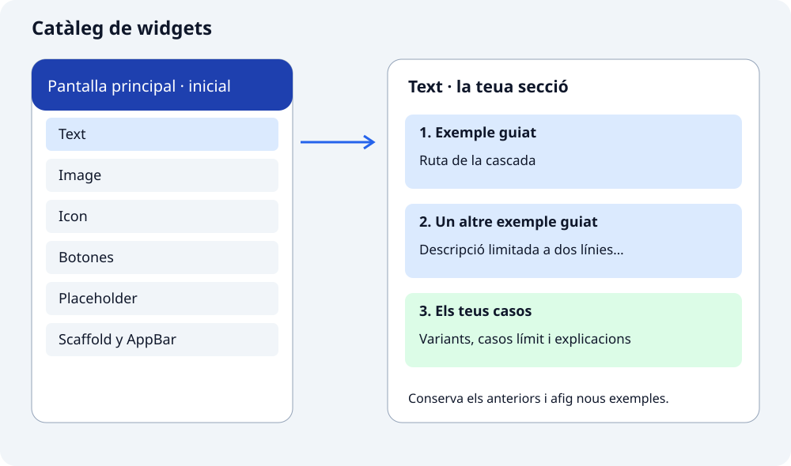

## De quin projecte partim

Crearem **`catalogo_widgets`** amb una pantalla principal i un llistat de famílies de widgets. En este apartat tens el codi inicial complet: copiaràs la base i prepararàs una pantalla buida per a cada família. Després les completaràs durant els tutorials.

La teua tasca serà convertir les seccions buides en un **catàleg d’exemples executables**. No has de construir el menú ni programar el pas entre pantalles. Eixe mecanisme ja està preparat i l’estudiarem en navegació. Ara centra’t en el contingut de cada secció.

## Així serà el catàleg



L’esquerra representa la pantalla que posaràs en marxa amb el codi d’este apartat. La dreta mostra el treball que completaràs. Cada família tindrà exemples guiats i, al final, els casos que afegisques tu. La fletxa relaciona l’entrada del llistat amb la seua secció; encara no necessitem estudiar-ne la implementació.

Cada demostració inclourà un títol identificable, el widget real i una explicació breu del canvi que volem observar. En `Text` compararem un títol amb estil, una descripció limitada i una frase amb diversos estils. Després afegiràs casos nous com a activitat.

## 1. Crea i obri el projecte

En la carpeta on guardes les pràctiques, executa estes ordres una a una. Si ja tens `catalogo_widgets` dels apartats anteriors, conserva’l i continua amb el pas 2; no el tornes a crear.

```bash
flutter create catalogo_widgets
cd catalogo_widgets
flutter pub get
```

Obri en VS Code la carpeta que conté `pubspec.yaml`. Conserva les instruccions i skills que ja has preparat.

## 2. Prepara les pantalles buides

Crea `lib/view/` i els sis fitxers de la taula. Copia la plantilla següent en cadascun: canvia **les dos aparicions del nom de classe** i el títol d’`AppBar` segons la fila. No canvies la resta.

| Fitxer dins de `lib/view/` | Classe i constructor | Títol |
| --- | --- | --- |
| `text_ejemplos_pantalla.dart` | `TextEjemplosPantalla` | `Ejemplos de Text` |
| `image_ejemplos_pantalla.dart` | `ImageEjemplosPantalla` | `Ejemplos de Image` |
| `icon_ejemplos_pantalla.dart` | `IconEjemplosPantalla` | `Ejemplos de Icon` |
| `botones_ejemplos_pantalla.dart` | `BotonesEjemplosPantalla` | `Ejemplos de Botones` |
| `placeholder_ejemplos_pantalla.dart` | `PlaceholderEjemplosPantalla` | `Ejemplos de Placeholder` |
| `scaffold_ejemplos_pantalla.dart` | `ScaffoldEjemplosPantalla` | `Ejemplos de Scaffold y AppBar` |

```dart
import 'package:flutter/material.dart';

class TextEjemplosPantalla extends StatelessWidget {
  const TextEjemplosPantalla({super.key});

  @override
  Widget build(BuildContext context) {
    return Scaffold(
      appBar: AppBar(title: const Text('Ejemplos de Text')),
      body: ListView(
        padding: const EdgeInsets.all(16),
        children: [
          // Aquí añadiremos los ejemplos del tutorial.
        ],
      ),
    );
  }
}
```

`children` queda buit a propòsit: ahí afegiràs els exemples. `ListView` és el suport per a posar-los en vertical i poder desplaçar-te si no caben. Cada tutorial indicarà quin fitxer has de modificar.

## 3. Copia el punt de partida en main.dart

Substituïx tot `lib/main.dart` pel codi següent. Inclou l’aplicació i el llistat complet. El mecanisme que relaciona cada entrada amb la pantalla ja està resolt; l’estudiarem més avant. Ara no cal analitzar eixa part per a treballar els widgets.

```dart
import 'package:flutter/material.dart';

import 'view/text_ejemplos_pantalla.dart';
import 'view/image_ejemplos_pantalla.dart';
import 'view/icon_ejemplos_pantalla.dart';
import 'view/botones_ejemplos_pantalla.dart';
import 'view/placeholder_ejemplos_pantalla.dart';
import 'view/scaffold_ejemplos_pantalla.dart';

void main() => runApp(const CatalogoApp());

class CatalogoApp extends StatelessWidget {
  const CatalogoApp({super.key});

  @override
  Widget build(BuildContext context) {
    return const MaterialApp(
      debugShowCheckedModeBanner: false,
      title: 'Catálogo de widgets',
      home: CatalogoPantalla(),
    );
  }
}

class CatalogoPantalla extends StatelessWidget {
  const CatalogoPantalla({super.key});

  @override
  Widget build(BuildContext context) {
    return Scaffold(
      appBar: AppBar(title: const Text('Catálogo de widgets')),
      body: ListView(
        children: [
          ListTile(
            leading: const Icon(Icons.text_fields),
            title: const Text('Text'),
            trailing: const Icon(Icons.chevron_right),
            onTap: () {
              Navigator.of(context).push(
                MaterialPageRoute<void>(
                  builder: (context) => const TextEjemplosPantalla(),
                ),
              );
            },
          ),
          ListTile(
            leading: const Icon(Icons.image_outlined),
            title: const Text('Image'),
            trailing: const Icon(Icons.chevron_right),
            onTap: () {
              Navigator.of(context).push(
                MaterialPageRoute<void>(
                  builder: (context) => const ImageEjemplosPantalla(),
                ),
              );
            },
          ),
          ListTile(
            leading: const Icon(Icons.star_outline),
            title: const Text('Icon'),
            trailing: const Icon(Icons.chevron_right),
            onTap: () {
              Navigator.of(context).push(
                MaterialPageRoute<void>(
                  builder: (context) => const IconEjemplosPantalla(),
                ),
              );
            },
          ),
          ListTile(
            leading: const Icon(Icons.smart_button_outlined),
            title: const Text('Botones'),
            trailing: const Icon(Icons.chevron_right),
            onTap: () {
              Navigator.of(context).push(
                MaterialPageRoute<void>(
                  builder: (context) => const BotonesEjemplosPantalla(),
                ),
              );
            },
          ),
          ListTile(
            leading: const Icon(Icons.crop_square),
            title: const Text('Placeholder'),
            trailing: const Icon(Icons.chevron_right),
            onTap: () {
              Navigator.of(context).push(
                MaterialPageRoute<void>(
                  builder: (context) => const PlaceholderEjemplosPantalla(),
                ),
              );
            },
          ),
          ListTile(
            leading: const Icon(Icons.web_asset),
            title: const Text('Scaffold y AppBar'),
            trailing: const Icon(Icons.chevron_right),
            onTap: () {
              Navigator.of(context).push(
                MaterialPageRoute<void>(
                  builder: (context) => const ScaffoldEjemplosPantalla(),
                ),
              );
            },
          ),
        ],
      ),
    );
  }
}
```

## 4. Comprova el punt de partida

Guarda els set fitxers i executa des de l’arrel del projecte:

```bash
dart format lib
flutter run
```

`dart format lib` aplica el format estàndard de Dart a tots els fitxers `.dart` de la carpeta `lib` i les subcarpetes. Ajusta la indentació, els espais i els salts de línia, i guarda els canvis en eixos fitxers. No executa l’aplicació ni comprova el comportament. Després, `flutter run` inicia l’aplicació per a revisar el resultat en pantalla.

Has de veure les sis entrades. Obri cadascuna i comprova el títol i el cos buit; torna al llistat amb el control de la barra. Si un import falla, revisa que el nom del fitxer i el de classe coincidisquen amb la taula.

Per a comprovar este punt de partida, pots demanar a `test-widget` que prepare `test/widget_test.dart` i verifique que `CatalogoApp` mostra el títol i les sis etiquetes. Executa `flutter analyze` per a detectar problemes en el codi i `flutter test` per a executar les proves, sense estudiar encara el mecanisme entre pantalles.

## Com avançarem en cada apartat

1. Comprén per a què servix el widget i prova’n l’exemple mínim.
2. Estudia les propietats principals i els exemples; identifica també els widgets auxiliars que utilitzen.
3. Implementa els components proposats en fitxers propis de `lib/componentes/`, amb variants seleccionades per paràmetres.
4. Importa’ls des de la pantalla corresponent i mostra diverses configuracions de cadascun en el catàleg.
5. Comprova els requisits i utilitza les skills per a revisar codi i generar proves concretes.

La pantalla és el lloc on mostrem els casos; el component és la peça reutilitzable que rep dades. No cal modificar el llistat principal. Comença per [Variants d’un component](../../basicos/estilo-y-variantes/), on prepararem una primera peça reutilitzable abans d’estudiar cada widget bàsic.
