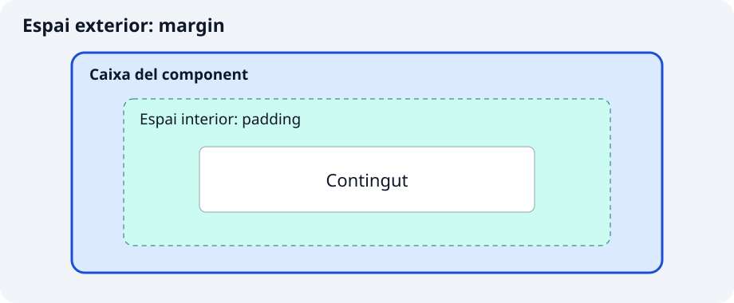

**`Container` reunix grandària, espai i decoració al voltant d’un fill.** És útil per a construir una caixa d’informació o destacar una zona. Si només necessites separar elements o limitar dimensions, `SizedBox` i `Padding` expressen la intenció amb menys opcions.

```dart
Container(color: Colors.teal.shade50, child: const Text('Próxima salida'))
```

`Text` és el fill que mostra el contingut. La caixa rep les restriccions del pare: indicar una grandària no significa que sempre puga imposar-la.



## 🔧 Propietats principals

### 1. `width` i `height`: reservar una zona

Són útils per a comparar peces amb dimensions conegudes. La grandària ha de cabre dins dels límits rebuts.

```dart
Center(
  child: Container(
    width: 240,
    height: 100,
    color: Colors.teal.shade50,
    child: const Text('Zona reservada'),
  ),
)
```

`Center` centra la caixa i permet que no ocupe tota l’amplària de la llista. Dins d’un pare que exigix una grandària exacta, un `SizedBox` menut no pot ignorar-la.

### 2. `padding` i `margin`: espai interior i exterior

`padding` separa el contingut de la vora; `margin` separa la caixa del que l’envolta. Permeten donar espai al missatge sense confondre caixa i separació exterior.

```dart
Container(
  margin: const EdgeInsets.symmetric(vertical: 12),
  padding: const EdgeInsets.all(16),
  color: Colors.teal.shade50,
  child: const Text('Salida a las 9:00'),
)
```

`EdgeInsets` descriu mesures, no dibuixa un widget. `all` aplica el mateix valor als quatre costats; `symmetric` separa horitzontal i vertical; `only(left: 8)` configura un costat. `EdgeInsetsDirectional.only(start: 8)` respecta la direcció de lectura.

### 3. `decoration`: fons, vora i ombra

Permet que diversos senyals visuals pertanguen a la mateixa caixa. És útil per a targetes informatives o avisos amb vora.

```dart
Container(
  padding: const EdgeInsets.all(16),
  decoration: BoxDecoration(
    color: Colors.amber.shade50,
    border: Border.all(color: Colors.amber.shade800, width: 2),
    borderRadius: BorderRadius.circular(12),
    boxShadow: const [
      BoxShadow(color: Colors.black12, blurRadius: 6, offset: Offset(0, 3)),
    ],
  ),
  child: const Text('Lleva agua suficiente'),
)
```

`BoxDecoration`, `Border`, `BorderRadius` i `BoxShadow` són configuració. `Offset` indica el desplaçament de l’ombra. Amb `decoration`, posa el color dins: no combines `Container.color` i `Container.decoration`. Arredonir la decoració no retalla automàticament el fill.

### 4. `alignment`, Center i Align: col·locar un fill

L’alineació interessa quan la caixa té més espai que el contingut. `Center` tria el centre i `Align` permet altres posicions.

```dart
const SizedBox(
  height: 100,
  child: Align(
    alignment: Alignment.centerRight,
    child: Icon(Icons.hiking, size: 40),
  ),
)
```

`SizedBox` reserva altura, `Align` col·loca el fill i `Icon` dibuixa un símbol. Pots utilitzar `Container(alignment: Alignment.center, ...)` si necessites altres opcions de la caixa.

### 5. SizedBox i Padding: una responsabilitat

`SizedBox` reserva dimensions o un buit; `Padding` afig espai interior a qualsevol fill. No cal decorar una caixa per a separar elements.

```dart
const Padding(
  padding: EdgeInsets.all(12),
  child: SizedBox(
    height: 60,
    child: Center(child: Text('Punto de encuentro')),
  ),
)
```

`Padding` no afig color ni marge exterior. Un `SizedBox(height: 16)` sense fill pot separar dos exemples.

## ✍️ Activitat: crea components amb variants

Implementa els dos components en fitxers de `lib/ui/core/ui/`. Cada classe rep la configuració amb paràmetres amb nom i camps `final`; utilitza `StatelessWidget` i constructor `const` quan siga possible. Els paràmetres sense valor predeterminat són obligatoris (`required`), encara que admeten `null`. Les variants decidixen la presentació sense duplicar la classe.

### 1. `PanelAviso`

`lib/ui/core/ui/panel_aviso.dart`

Paràmetres: `String mensaje`, `bool importante = false`, `bool compacto = false`.

Tria fons i vora segons la importància; tria espai interior segons el mode compacte. El missatge no canvia. Mostra les quatre combinacions.

### 2. `ZonaAlineada`

`lib/ui/core/ui/zona_alineada.dart`

Paràmetres: `Widget contenido`, `bool alFinal = false`, `double alto = 100`.

Reserva una altura positiva i col·loca el contingut a l’inici o al final amb `AlignmentDirectional`. No modifiques el fill rebut.

## 🧩 Mostra les variants en el catàleg

En `lib/ui/catalogo/ui/contenedores_ejemplos_pantalla.dart`, importa els fitxers dels components al principi:

```dart
import 'package:catalogo_widgets/ui/core/ui/panel_aviso.dart';
import 'package:catalogo_widgets/ui/core/ui/zona_alineada.dart';
```

Després d’implementar-los, estos usos poden formar part de la llista d’exemples:

```dart
const PanelAviso(mensaje: 'Lleva agua'),
const PanelAviso(mensaje: 'Lleva agua', importante: true, compacto: true),
const ZonaAlineada(contenido: Icon(Icons.hiking), alFinal: true),
```

Prova un missatge llarg i una amplària reduïda. Explica què afecta l’interior i què l’exterior. Comprova que no combines `color` i `decoration` en el mateix `Container`.

Completa les variants que falten amb títols i explicacions pròpies. Utilitza `create-component` per a revisar el teu intent i `test-widget` per a comprovar requisits concrets. Executa `dart format lib test`, `flutter analyze` i les proves. Revisa també el resultat visual: una prova superada no garantix que el text es llija bé.

Referències: [Container](https://api.flutter.dev/flutter/widgets/Container-class.html) · [SizedBox](https://api.flutter.dev/flutter/widgets/SizedBox-class.html) · [Padding](https://api.flutter.dev/flutter/widgets/Padding-class.html).
