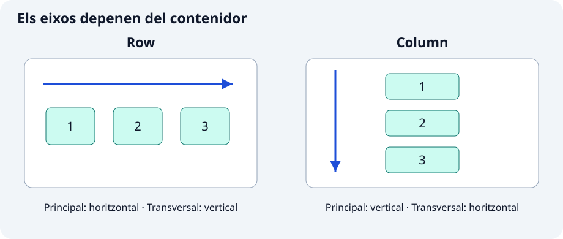

**`Row` col·loca fills en horitzontal i `Column`, en vertical.** Servixen per a compondre una fitxa amb icones, textos i accions. Cap afig desplaçament ni canvia automàticament de línia: per a això utilitzarem `Wrap`.

```dart
const Row(children: [Icon(Icons.hiking), Text('Ruta del río')])
```

`children` és una llista de widgets. `Icon` aporta el símbol i `Text`, l’etiqueta. En una columna s’apilarien en vertical.



## 🔧 Propietats principals

### 1. Eix principal, `mainAxisAlignment` i `mainAxisSize`

En `Row` l’eix principal és horitzontal; en `Column`, vertical. L’alineació principal repartix l’espai sobrant: permet separar accions sense mesurar cada buit.

```dart
const SizedBox(
  height: 120,
  child: Column(
    mainAxisAlignment: MainAxisAlignment.spaceEvenly,
    children: [Text('Inicio'), Text('Mirador'), Text('Llegada')],
  ),
)
```

`SizedBox` aporta altura finita amb espai per a repartir. Altres opcions són `start`, `center`, `end` i `spaceBetween`. `mainAxisSize: MainAxisSize.min` reduïx l’extensió al contingut; amb menys espai sobrant, la distribució pot deixar de veure’s.

### 2. `crossAxisAlignment`: alinear en l’altre eix

Permet alinear textos i símbols de grandàries diferents. L’eix transversal és vertical en una fila i horitzontal en una columna.

```dart
const Row(
  crossAxisAlignment: CrossAxisAlignment.start,
  children: [
    Icon(Icons.terrain, size: 56),
    SizedBox(width: 12),
    Text('Nivel fácil'),
  ],
)
```

`start` alinea dalt en esta fila i `center` centraria verticalment. `SizedBox` reserva el buit horitzontal. En una columna pots utilitzar `stretch` si l’amplària està limitada.

### 3. Expanded i `flex`: assignar l’espai restant

`Expanded` obliga el fill a ocupar la part assignada de l’espai restant. És útil perquè un text llarg no expulse la icona d’una fila o per a repartir panells proporcionalment.

```dart
const Row(
  children: [
    Expanded(
      flex: 2,
      child: Text('Un nombre de ruta largo', maxLines: 1, overflow: TextOverflow.ellipsis),
    ),
    SizedBox(width: 12),
    Expanded(flex: 1, child: Text('8 km')),
  ],
)
```

Després del buit fix, l’espai flexible es repartix 2:1. `flex` expressa proporcions, no píxels. `Expanded` ha de pertànyer a un `Row`, `Column` o `Flex`, no directament al `ListView`. En una columna dins d’un desplaçament vertical cal limitar primer l’altura.

### 4. Flexible i Spacer: deixar llibertat o reservar buit

`Flexible` amb `FlexFit.loose` permet ocupar menys de l’espai assignat; `Spacer` ocupa espai flexible sense contingut. Són útils per a etiquetes curtes i barres amb accions als extrems.

```dart
const Row(
  children: [
    Flexible(fit: FlexFit.loose, child: Text('Inicio')),
    Spacer(flex: 2),
    Icon(Icons.flag),
  ],
)
```

El text no ha d’omplir tota l’assignació. El buit absorbix espai sobrant. Amb `Spacer`, no esperes que `spaceBetween` repartisca també el mateix espai. Cal un eix acotat, igual que amb `Expanded`.

### 5. Wrap: `spacing`, `runSpacing` i `alignment`

`Wrap` passa elements a una altra línia quan no caben. És útil per a etiquetes amb nombre o longitud variables i evita forçar una fila que desborda.

```dart
const Wrap(
  spacing: 8,
  runSpacing: 12,
  alignment: WrapAlignment.start,
  children: [
    Chip(label: Text('Bosque')),
    Chip(label: Text('Río')),
    Chip(label: Text('Mirador')),
    Chip(label: Text('Ruta circular')),
  ],
)
```

`Chip` és una etiqueta Material compacta amb el text en `label`; ací no és seleccionable. `spacing` separa veïns d’una línia i `runSpacing`, línies. Reduïx l’amplària per a observar el salt.

## ✍️ Activitat: crea components amb variants

Implementa els dos components en fitxers de `lib/ui/core/ui/`. Cada classe rep la configuració amb paràmetres amb nom i camps `final`; utilitza `StatelessWidget` i constructor `const` quan siga possible. Els paràmetres sense valor predeterminat són obligatoris (`required`), encara que admeten `null`. Les variants decidixen la presentació sense duplicar la classe.

### 1. `FichaRecorrido`

`lib/ui/core/ui/ficha_recorrido.dart`

Paràmetres: `String nombre`, `String distancia`, `bool vertical = false`.

Organitza nom i distància en fila o columna. En horitzontal limita el text perquè no desborde. Conserva el contingut.

### 2. `GrupoEtiquetas`

`lib/ui/core/ui/grupo_etiquetas.dart`

Paràmetres: `List<String> etiquetas`, `bool compacto = false`, `bool centrado = false`.

Utilitza `Wrap` amb separacions segons el mode. Cada dada produïx un `Chip`; la llista buida no ha de causar errors.

## 🧩 Mostra les variants en el catàleg

En `lib/ui/catalogo/ui/contenedores_ejemplos_pantalla.dart`, importa els fitxers dels components al principi:

```dart
import 'package:catalogo_widgets/ui/core/ui/ficha_recorrido.dart';
import 'package:catalogo_widgets/ui/core/ui/grupo_etiquetas.dart';
```

Després d’implementar-los, estos usos poden formar part de la llista d’exemples:

```dart
const FichaRecorrido(nombre: 'Ruta del río', distancia: '8 km'),
const FichaRecorrido(nombre: 'Ruta del río', distancia: '8 km', vertical: true),
const GrupoEtiquetas(etiquetas: ['Bosque', 'Río', 'Mirador'], compacto: true),
```

Compara les dos orientacions a 280 i 600 píxels d’amplària. Afig etiquetes llargues i comprova les línies noves sense franges de desbordament.

Completa les variants que falten amb títols i explicacions pròpies. Utilitza `create-component` per a revisar el teu intent i `test-widget` per a comprovar requisits concrets. Executa `dart format lib test`, `flutter analyze` i les proves. Revisa també el resultat visual: una prova superada no garantix que el text es llija bé.

Referències: [Row](https://api.flutter.dev/flutter/widgets/Row-class.html) · [Column](https://api.flutter.dev/flutter/widgets/Column-class.html) · [Flexible](https://api.flutter.dev/flutter/widgets/Flexible-class.html) · [Wrap](https://api.flutter.dev/flutter/widgets/Wrap-class.html).
