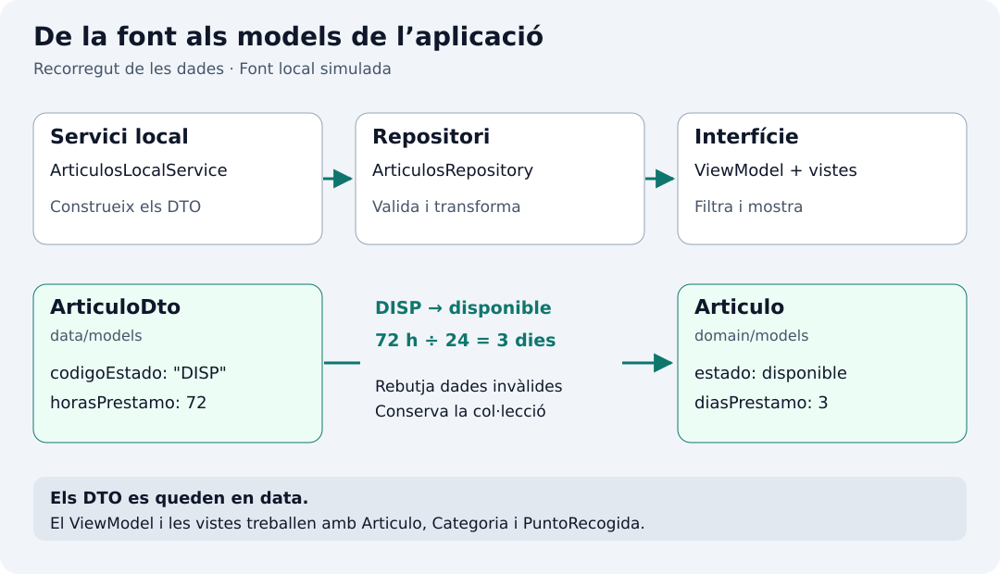

## Per a què serveix la capa de dades

Esta capa permet que la interfície consulte articles sense conéixer com s’obtenen. Repartirem el treball entre un servici que coneix la font i un repositori que ofereix les dades amb les garanties que necessita l’aplicació. El ViewModel consultarà el repositori; no haurà de construir articles ni validar els identificadors.



### Servici: accedir a l’origen

`ArticulosLocalService` reuneix les dades fictícies i retorna models de la font (`ArticuloDto`). No decideix quins articles ha de mostrar el filtre ni quina pantalla s’obri. Si després utilitzem un fitxer o una API, l’accés a eixe origen es resoldrà ací i s’adaptarà el repositori per a consumir-lo; les targetes podran continuar rebent `Articulo`.

### Repositori: oferir una col·lecció vàlida

`ArticulosRepository` és el punt de consulta dels articles per al ViewModel. En este exemple llig el servici una vegada, rebutja identificadors duplicats, transforma els DTO en models de domini i conserva la col·lecció immutable. Així, qualsevol consumidor rep dades amb les mateixes garanties. La disponibilitat és una dada de l’article; triar mostrar només disponibles és una decisió de presentació que resoldrà el ViewModel.

El servici coneix l’origen: en este cas construeix les dades en Dart. El repositori ofereix eixes dades a la resta de l’aplicació i comprova una regla: cada article ha de tindre un identificador diferent.

La lectura és immediata i síncrona. No necessitem `Future`, esperes artificials ni indicadors de càrrega per a dades que ja estan en memòria. El repositori carrega una vegada en construir-se i conserva una col·lecció de només lectura.

## Models de la font: el contracte d’entrada

Un DTO (*Data Transfer Object*) representa l’estructura que entrega una font. En `data/models` respectem eixe contracte; en `domain/models` definim el que necessita l’aplicació. Cap dels dos importa Flutter. Els DTO només circulen entre servici i repositori; el ViewModel i les vistes reben models de domini.

Simularem una font local que entrega l’estat com a codi (`DISP`, `PREST`, `MANT`) i el termini en hores. L’aplicació treballa amb `EstadoArticulo` i dies complets. Per exemple, el trepant arriba amb `DISP` i `72`, i el repositori el converteix en `EstadoArticulo.disponible` i `3` dies. Així la diferència entre els dos models té una utilitat concreta.

| Font: `ArticuloDto` | Aplicació: `Articulo` |
| --- | --- |
| `codigoEstado`: codi de text del proveïdor. | `estado`: valor d’`EstadoArticulo`. |
| `horasPrestamo`: termini en hores. | `diasPrestamo`: termini en dies complets. |
| `CategoriaDto` i `PuntoRecogidaDto`: objectes de la font. | `Categoria` i `PuntoRecogida`: objectes del domini. |

Els agrupem en un fitxer per a este exemple menut. Els DTO tenen camps `final` i constructors `const`, però no hereten dels models de domini: poden evolucionar de manera independent. Si la font canvia els codis, adaptarem la conversió sense canviar el filtre o el detall.

## 1. Crea els models de la font

`lib/data/models/articulo_dto.dart`

```dart
class CategoriaDto {
  const CategoriaDto({required this.id, required this.nombre, required this.siglas});
  final String id;
  final String nombre;
  final String siglas;
}

class PuntoRecogidaDto {
  const PuntoRecogidaDto({
    required this.id,
    required this.nombre,
    required this.direccion,
    required this.horario,
  });
  final String id;
  final String nombre;
  final String direccion;
  final String horario;
}

class ArticuloDto {
  const ArticuloDto({
    required this.id,
    required this.nombre,
    required this.descripcion,
    required this.categoria,
    required this.puntoRecogida,
    required this.codigoEstado,
    required this.horasPrestamo,
    required this.recomendaciones,
  });
  final String id;
  final String nombre;
  final String descripcion;
  final CategoriaDto categoria;
  final PuntoRecogidaDto puntoRecogida;
  final String codigoEstado;
  final int horasPrestamo;
  final String recomendaciones;
}
```

La font se simula amb objectes Dart, sense llegir JSON ni consultar una API. Per això no necessitem `fromJson` encara. Quan incorporem JSON, el servici el descodificarà a DTO i el repositori continuarà entregant models de domini. La separació és útil quan els formats difereixen; no exigeix duplicar cada classe en totes les aplicacions.

## 2. Crea el servici local


`lib/data/services/articulos_local_service.dart`

```dart
import '../models/articulo_dto.dart';

class ArticulosLocalService {
  const ArticulosLocalService();

  List<ArticuloDto> leer() {
    const bricolaje = CategoriaDto(id: 'c1', nombre: 'Bricolaje', siglas: 'BR');
    const hogar = CategoriaDto(id: 'c2', nombre: 'Hogar', siglas: 'HO');
    const ocio = CategoriaDto(id: 'c3', nombre: 'Ocio', siglas: 'OC');
    const centro = PuntoRecogidaDto(
      id: 'p1', nombre: 'Centro vecinal La Plaza',
      direccion: 'Calle Mayor, 12', horario: 'Lunes a viernes, de 17 a 20 h',
    );
    const biblioteca = PuntoRecogidaDto(
      id: 'p2', nombre: 'Biblioteca del Parque',
      direccion: 'Avenida del Parque, 8', horario: 'Sábados, de 10 a 13 h',
    );
    return const [
      ArticuloDto(
        id: 'a1', nombre: 'Taladro percutor',
        descripcion: 'Taladro con maletín y juego de brocas para pequeñas reparaciones.',
        categoria: bricolaje, puntoRecogida: centro,
        codigoEstado: 'DISP', horasPrestamo: 72,
        recomendaciones: 'Usar gafas de protección y devolver las brocas en su estuche.',
      ),
      ArticuloDto(
        id: 'a2', nombre: 'Máquina de coser',
        descripcion: 'Máquina portátil para arreglos de ropa y proyectos sencillos.',
        categoria: hogar, puntoRecogida: centro,
        codigoEstado: 'PREST', horasPrestamo: 168,
        recomendaciones: 'Incluye pedal y manual. Devolver sin hilos en la bobina.',
      ),
      ArticuloDto(
        id: 'a3', nombre: 'Proyector',
        descripcion: 'Proyector con conexión HDMI para una sesión de cine en grupo.',
        categoria: ocio, puntoRecogida: biblioteca,
        codigoEstado: 'DISP', horasPrestamo: 48,
        recomendaciones: 'Transportar en su funda y dejar enfriar antes de guardarlo.',
      ),
      ArticuloDto(
        id: 'a4', nombre: 'Tienda de campaña',
        descripcion: 'Tienda para dos personas con doble techo y bolsa de transporte.',
        categoria: ocio, puntoRecogida: biblioteca,
        codigoEstado: 'MANT', horasPrestamo: 120,
        recomendaciones: 'Devolver limpia y completamente seca, con todas las piquetas.',
      ),
    ];
  }
}
```

## 3. Converteix a domini en el repositori

La conversió queda en `_aDominio`, un mètode privat del repositori. Construeix també la categoria i el punt d’arreplega del domini. En esta versió els articles conserven els mateixos identificadors de categoria i centre, encara que es creen instàncies diferents en convertir cada article; la identitat de negoci depén d’`id`, no de compartir instància en memòria.

`lib/data/repositories/articulos_repository.dart`

```dart
import '../../domain/models/articulo.dart';
import '../../domain/models/categoria.dart';
import '../../domain/models/punto_recogida.dart';
import '../models/articulo_dto.dart';
import '../services/articulos_local_service.dart';

class ArticulosRepository {
  ArticulosRepository({required ArticulosLocalService service}) {
    final datos = service.leer();
    final ids = datos.map((articulo) => articulo.id).toSet();
    if (ids.length != datos.length) {
      throw StateError('Hay identificadores de artículo duplicados');
    }
    _articulos = List<Articulo>.unmodifiable(datos.map(_aDominio));
  }

  late final List<Articulo> _articulos;
  List<Articulo> obtenerTodos() => _articulos;

  static Articulo _aDominio(ArticuloDto dto) {
    final estado = switch (dto.codigoEstado) {
      'DISP' => EstadoArticulo.disponible,
      'PREST' => EstadoArticulo.prestado,
      'MANT' => EstadoArticulo.mantenimiento,
      _ => throw FormatException('Estado desconocido: ${dto.codigoEstado}'),
    };
    if (dto.horasPrestamo <= 0 || dto.horasPrestamo % 24 != 0) {
      throw FormatException('El plazo debe ser un número positivo de días completos');
    }
    return Articulo(
      id: dto.id,
      nombre: dto.nombre,
      descripcion: dto.descripcion,
      categoria: Categoria(
        id: dto.categoria.id,
        nombre: dto.categoria.nombre,
        siglas: dto.categoria.siglas,
      ),
      puntoRecogida: PuntoRecogida(
        id: dto.puntoRecogida.id,
        nombre: dto.puntoRecogida.nombre,
        direccion: dto.puntoRecogida.direccion,
        horario: dto.puntoRecogida.horario,
      ),
      estado: estado,
      diasPrestamo: dto.horasPrestamo ~/ 24,
      recomendaciones: dto.recomendaciones,
    );
  }
}
```

`map` obté els identificadors i `toSet` elimina repeticions. Si queden menys identificadors que articles, hi ha duplicats i `StateError` deté la creació. És una fallada de les dades d’exemple que hem de corregir.

### `late final`: inicialitzar després de validar

```dart
late final List<Articulo> _articulos;
```

`_articulos` guarda la col·lecció de cada repositori. `List<Articulo>` no admet `null`; el prefix `_` fa que el nom siga privat de la biblioteca Dart, que ací correspon a este fitxer.

`late` permet assignar el camp després de declarar-lo. Ací ho fem en el cos del constructor, després de llegir la font i comprovar els identificadors:

```dart
_articulos = List<Articulo>.unmodifiable(datos.map(_aDominio));
```

`final` permet assignar-lo una sola vegada. No fa immutable una llista per si mateix: eixa protecció l’aporta `List.unmodifiable`, que impedeix afegir, llevar o substituir elements.

En este exemple `late` no implica esperar a la primera consulta ni carregar de manera asíncrona. L’assignació ocorre durant la construcció. Llegir el camp abans d’assignar-lo o intentar assignar-lo una altra vegada provoca un error d’inicialització en execució. Si la validació o la conversió falla, el constructor llança l’excepció i no entrega un repositori utilitzable.

Referència: [variables `late` i `final` en Dart](https://dart.dev/language/variables#late-variables).

### `obtenerTodos`: consultar la col·lecció guardada

```dart
List<Articulo> obtenerTodos() => _articulos;
```

És un mètode d’instància: es crida sobre un repositori, per exemple `repository.obtenerTodos()`. La sintaxi `=>` retorna el resultat d’una única expressió; equival a escriure este mètode en lloc de l’anterior:

```dart
List<Articulo> obtenerTodos() {
  return _articulos;
}
```

Retorna la col·lecció ja preparada, sense tornar a llegir el servici, convertir DTO ni crear una altra llista. Cada repositori conserva la seua pròpia col·lecció. El consumidor pot consultar-la, però no modificar-la gràcies a `List.unmodifiable`.

### `static`: una conversió que no usa l’estat del repositori

```dart
static Articulo _aDominio(ArticuloDto dto)
```

Esta signatura indica que el mètode rep un `ArticuloDto` i retorna un `Articulo`. `_aDominio` és privat de la biblioteca pel prefix `_`.

`static` fa que el mètode pertanga a la classe, en lloc d’una instància concreta. No disposa de `this` ni pot accedir directament a camps d’instància com `_articulos`. Ací encaixa perquè la conversió només necessita el paràmetre `dto`: construeix un article sense consultar ni modificar la col·lecció del repositori. `static` no significa que s’execute una sola vegada ni que guarde el resultat.

Dins de la classe podem referir-nos a ell com `_aDominio` o `ArticulosRepository._aDominio`. En `datos.map(_aDominio)` passem la funció com a argument; equival a `datos.map((dto) => _aDominio(dto))`. La conversió s’executa per a cada DTO quan `List.unmodifiable` recorre eixe resultat i guarda els articles.

També podríem usar un mètode d’instància o una funció auxiliar; triem `static` per a expressar que esta transformació no depén de l’estat d’un repositori concret.

Referència: [mètodes estàtics en Dart](https://dart.dev/language/classes#static-methods).

### Què fa la conversió, pas a pas

1. `final estado = switch (...)` obté l’enum corresponent al codi de la font. En esta expressió, `_` cobreix qualsevol codi no reconegut i `throw` interromp la conversió amb `FormatException`.
2. L’`if` rebutja un termini no positiu o que no siga múltiple de 24. `||` significa «o» i `%` calcula el residu. Així evitem convertir 25 hores en un dia perdent informació.
3. `return Articulo(...)` construeix el model de domini. Copia les dades compatibles i crea també `Categoria` i `PuntoRecogida` a partir dels seus DTO. El resultat no conté objectes DTO.
4. `estado: estado` assigna l’enum calculat i `diasPrestamo: dto.horasPrestamo ~/ 24` transforma les hores en dies amb divisió entera. Un DTO amb `DISP` i 72 hores produeix un article disponible amb un termini de 3 dies.

El paràmetre `service` és injecció de dependències per constructor: el repositori rep el seu col·laborador en lloc de fabricar-lo. No requereix cap paquet. En proves podem passar una subclasse d’`ArticulosLocalService` que sobreescriga `leer` i proporcione altres DTO mitjançant `List<ArticuloDto> leer()`.

## Resultat esperat

La font retorna quatre articles, tres categories i dos centres. Dos articles estan disponibles, un prestat i un altre en manteniment. `Proyector` i `Tienda de campaña` comparteixen categoria i centre. Reiniciar l’aplicació produeix les mateixes dades; no hi ha escriptura en disc ni canvis de disponibilitat.
