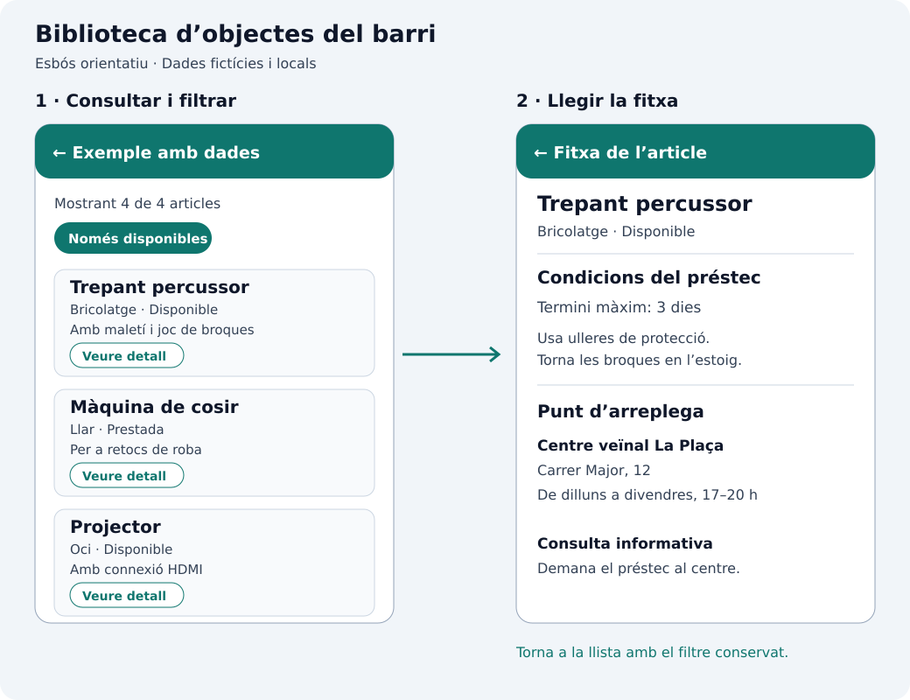

## Una biblioteca d’objectes del barri

Ampliarem `catalogo_widgets` amb **Exemple amb dades**, una miniaplicació per a consultar una biblioteca d’objectes: un servici veïnal que presta ferramentes, material d’oci i aparells menuts que usem de manera ocasional.

El seu propòsit és ajudar una persona a **trobar un objecte que necessita, comprovar si està disponible i saber on arreplegar-lo**. Per exemple, algú que vol muntar una prestatgeria podrà localitzar un trepant, consultar-ne les condicions de préstec i veure l’adreça del centre on s’arreplega.

## Què farà l’aplicació

En obrir l’entrada del catàleg veurem una llista d’articles: un trepant, una màquina de cosir, un projector i una tenda de campanya. Cada targeta mostrarà la categoria, una descripció breu i l’estat. La capçalera indicarà quants articles s’estan mostrant. El botó **Solo disponibles** permetrà ocultar els que estiguen prestats o en manteniment.

Cada targeta tindrà un botó **Ver detalle**. En polsar-lo s’obrirà la fitxa de l’article seleccionat, amb la descripció, categoria, estat, termini màxim de préstec, recomanacions d’ús i punt d’arreplega amb adreça i horari. Des de la fletxa de la barra tornarem a la llista conservant el filtre que havíem triat.



La imatge és un **esbós del recorregut i la informació**, no una captura de Flutter. Implementarem la interfície amb els widgets Material que ja coneixem; l’aparença concreta dependrà del tema de l’aplicació.

Les dades seran fictícies i estaran definides en Dart. L’aplicació funcionarà sense xarxa, API, base de dades ni paquets addicionals. Serà una consulta del catàleg: no tramitarà reserves ni modificarà la disponibilitat. El filtre només canvia el que veiem i es reinicia en eixir d’esta miniaplicació i tornar-la a obrir des del catàleg.

## Què practicarem

Combinarem `Scaffold`, `AppBar`, `ListView`, `Card`, `Text`, `Row`, `Column`, `CircleAvatar`, `Divider` i botons en una interfície amb una utilitat concreta. El mateix article apareixerà resumit en la llista i ampliat en la fitxa: no copiarem les dades en una altra llista ni crearem una pantalla diferent per a cada objecte.

Fins ara hem passat textos i callbacks a components. Ara necessitem relacionar dades i mantindre una selecció. Desenvoluparem el que preveiérem en [Què afegirem quan apareguen altres responsabilitats](../configuracion-de-un-asistente-de-ia/el-proyecto-del-catalogo/#-què-afegirem-quan-apareguen-altres-responsabilitats).

L’arquitectura s’organitza en dos capes principals: **dades** (servici i repositori) i **interfície** (ViewModel i vistes). Els DTO representen la font i els models de domini representen la informació de l’aplicació. No hi ha una capa diferent per cada carpeta: separarem responsabilitats dins de cada capa i explicarem el seu propòsit abans d’implementar cada peça.

| Peça | Responsabilitat en esta miniaplicació |
| --- | --- |
| Models de domini | Representar els articles, categories i centres que usa l’aplicació. |
| Models de dades (DTO) | Representar el format de la font, amb codis d’estat i terminis en hores. |
| Servici local | Proporcionar els quatre articles ficticis com a DTO de la font. |
| Repositori | Convertir els DTO a domini, validar les dades i oferir una col·lecció immutable. |
| ViewModel | Mantindre el filtre de disponibilitat i calcular la llista visible. |
| Vistes | Mostrar el llistat i la fitxa; comunicar accions i obrir el detall. |

El recorregut de lectura serà **vista → ViewModel → repositori → servici**. El servici retorna DTO; el repositori els converteix en models de domini per al ViewModel i les vistes. En filtrar, el ViewModel canvia la selecció i avisa la vista. En obrir una fitxa, la vista entrega l’article seleccionat a la pantalla de detall mitjançant el constructor.

## Estructura que afegirem

```text
lib/
├── domain/models/
│   ├── articulo.dart
│   ├── categoria.dart
│   └── punto_recogida.dart
├── data/
│   ├── models/articulo_dto.dart
│   ├── services/articulos_local_service.dart
│   └── repositories/articulos_repository.dart
└── ui/prestamos/
    ├── view_models/prestamos_view_model.dart
    └── ui/
        ├── ejemplo_datos_pantalla.dart
        ├── tarjeta_articulo.dart
        └── articulo_detalle_pantalla.dart
```

Conserva `lib/ui/catalogo/ui/` i totes les entrades. La funcionalitat `prestamos` tindrà les seues vistes i el seu ViewModel, seguint les rutes del projecte. El detall rebrà un model immutable i no necessitarà un segon ViewModel perquè no té estat ni operacions propis.

El servici local serà síncron. Afegirem `data/models` per a representar el contracte d’una font simulada diferent del domini. No necessitem casos d’ús per a estes operacions senzilles. Apliquem les responsabilitats de la [guia d’arquitectura de Flutter](https://docs.flutter.dev/app-architecture/guide) a un exemple menut.

## Apartats

1. [Models relacionats](./modelos/).
2. [Servici local i repositori](./datos-locales/).
3. [ViewModel, pantalla i catàleg](./pantalla-y-estado/).
4. [Fitxa de detall i comprovacions](./detalle/).
