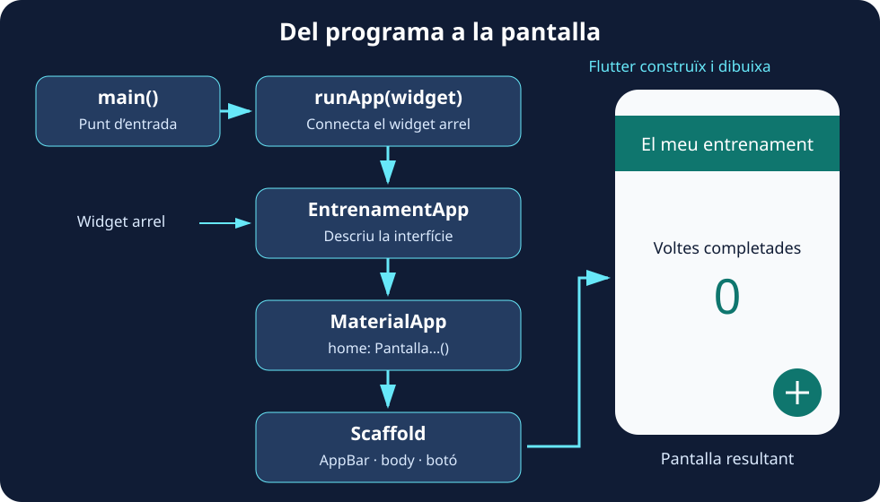

Reemplaça **tot `lib/main.dart`** per este programa:

```dart
import 'package:flutter/material.dart';

void main() {
  runApp(
    const Text(
      'Anem a entrenar!',
      textDirection: TextDirection.ltr,
    ),
  );
}
```

El programa és menut, però ja conté tres peces importants:

| Peça | Què fa |
| --- | --- |
| `import` | Permet utilitzar els components que exporta la biblioteca Material de Flutter. |
| `main` | És el punt d’entrada del programa Dart. |
| `runApp` | Rep un widget i l’establix com a arrel de la interfície. |

`Text` rep la cadena com a argument posicional. `textDirection` és un argument amb nom: `TextDirection.ltr` indica lectura d’esquerra a dreta. **En este exemple encara no hi ha un widget antecessor que proporcione la direcció**, per això la indiquem explícitament. Més avant, `MaterialApp` aportarà eixe context.

La salutació apareix sense l’estructura ni els estils habituals d’una pantalla Material i pot coincidir amb zones del sistema. És un primer experiment per a entendre l’arrancada, no la pantalla final. Pots consultar el comportament d’arrancada en la [referència de `runApp`](https://api.flutter.dev/flutter/widgets/runApp.html).

### Què fa runApp?

**`runApp` connecta el widget que li entreguem amb la vista de l’aplicació i posa en marxa la construcció de la interfície.** A partir d’eixe widget arrel, Flutter incorpora els descendents a l’arbre, calcula l’espai que necessiten i dibuixa el resultat en pantalla. En este primer programa l’arrel és `Text`; quan creem la nostra classe, serà `EntrenamentApp`.

Podem distingir les responsabilitats: **`main` inicia el programa Dart, `runApp` connecta la interfície amb Flutter i `build` descriu el contingut de cada widget propi**. `runApp` rep una instància de widget: en `runApp(const EntrenamentApp())`, `EntrenamentApp()` crida el constructor i el seu resultat s’entrega a la funció.

El següent esquema anticipa l’estructura que construirem en els pròxims passos. Les fletxes mostren l’arrancada i la composició de la interfície; no són crides a `runApp` en cada nivell.



:::note[Es crida en arrancar, no en polsar el botó]
En esta aplicació cridem `runApp` una vegada, des de `main`. Per a actualitzar el comptador utilitzarem `setState`: Flutter reconstruïx la part corresponent de l’arbre. **No necessitem tornar a cridar `runApp` per a mostrar cada valor nou.** Tampoc necessitem cridar manualment `build`; Flutter gestiona eixes crides.
:::

### Centra el text

Mantín l’`import` i substituïx `main` per:

```dart
void main() {
  runApp(
    const Center(
      child: Text(
        'Anem a entrenar!',
        textDirection: TextDirection.ltr,
      ),
    ),
  );
}
```

Ara `Center` és el pare del text i el col·loca al centre de l’espai disponible. **No canviem el text per a centrar-lo: el combinem amb un altre widget que resol la posició.**

:::tip[Què significa const 💡]
`const` crea una configuració constant quan el constructor i els arguments ho permeten. Dins de `const Center(...)`, el `Text` ja està en un context constant i no necessita repetir la paraula. Flutter pot reutilitzar eixes instàncies i evitar treball d’actualització, però això **no congela la pantalla ni impedix qualsevol reconstrucció**. Un `StatefulWidget` creat amb `const` també pot tindre un `State` mutable.
:::
