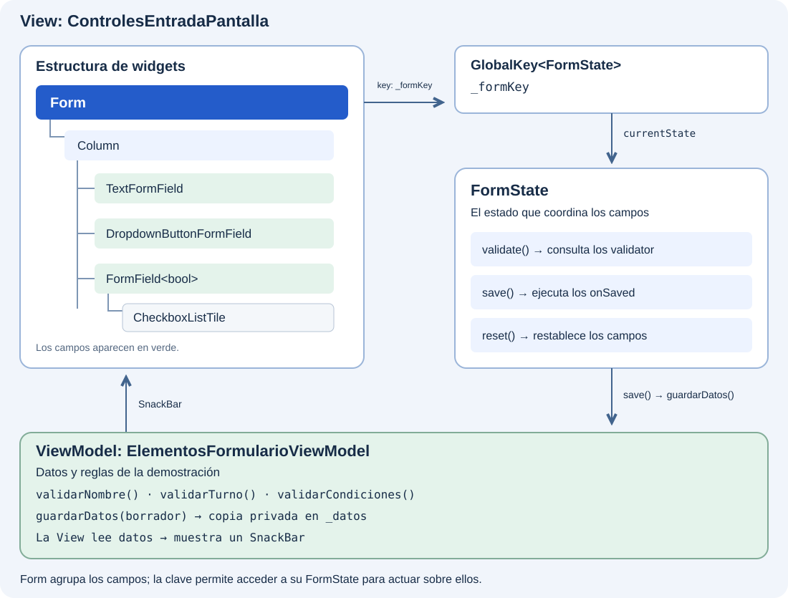

Un formulario reúne campos, reglas de validación y acciones para trabajar con los datos introducidos. Antes de construir la inscripción del catálogo, vamos a conocer sus elementos y entender cómo colaboran: qué agrupa los campos, quién coordina sus operaciones y cómo se define cada entrada.

## Las cuatro piezas del formulario

Un formulario de Flutter se apoya en **cuatro piezas** que permiten agrupar los campos y trabajar con sus valores:

| Pieza | Qué aporta |
| --- | --- |
| **`Form`** | Es el widget contenedor que agrupa campos para operar sobre ellos conjuntamente. |
| **`FormState`** | Es el estado asociado a `Form`. Ofrece `validate()`, `save()` y `reset()`. Accederemos a él mediante una `GlobalKey<FormState>`. |
| **`FormField<T>`** | Es el widget base de un campo participante: mantiene su valor, su validación y sus errores. Se registra en el `Form` antecesor más cercano cuando lo hay. |
| **Campos concretos** | `TextFormField`, `DropdownButtonFormField` y otras implementaciones de `FormField` proporcionan el control visual listo para usar. |

## Cómo encajan



Puedes colocar una `Column` dentro de `Form` y, dentro de ella, los campos del formulario. Aunque haya widgets intermedios que los organicen o añadan espacio, esos campos siguen perteneciendo al formulario.

Para que `Form` pueda validar un control, este debe ser un `FormField` o una implementación como `TextFormField`. Un `TextField` o un `Checkbox` por sí solos no participan en esa validación, aunque estén dentro de `Form`. Para una casilla, veremos cómo envolverla en un `FormField<bool>`.

## 🎯 Qué aprenderás

- Diferenciar el contenedor `Form`, su `FormState` y el estado de cada campo.
- Elegir campos concretos para texto y selecciones.
- Interpretar `validator`, `onSaved`, `initialValue` y `onChanged`.
- Integrar un control propio con `FormField<T>` y `didChange`.
- Reconocer qué aporta el autocompletado al introducir datos.

## El formulario que vamos a construir

Añadiremos al catálogo una pequeña ficha para **indicar un nombre, elegir un turno y aceptar las condiciones**. Nos servirá para observar cómo se comportan distintos tipos de campo dentro del mismo formulario.

| Elemento en pantalla | Qué pediremos al usuario | Cómo lo construiremos |
| --- | --- | --- |
| **Nombre** | Escribir al menos dos caracteres, sin contar espacios exteriores. | `TextFormField`. |
| **Turno** | Elegir Mañana o Tarde; al principio no habrá ninguna opción seleccionada. | `DropdownButtonFormField<String>`. |
| **Acepto las condiciones** | Marcar la casilla; al principio estará desmarcada. | `CheckboxListTile` dentro de `FormField<bool>`. |

Debajo habrá dos botones:

- **Comprobar y recoger** revisará los tres campos. Si falta algún dato, veremos el error junto al campo correspondiente. Si todo es válido, mostrará los valores que el ViewModel conserva tras recibir el borrador.
- **Reiniciar campos** dejará Nombre vacío, Turno sin selección y la casilla desmarcada. También vaciará `_borrador`.

Por ejemplo, si escribes «Ana» y eliges «Tarde» pero no aceptas las condiciones, aparecerá el error de la casilla. Al aceptarlas y volver a pulsar el botón, se recogerán los tres valores: `nombre: Ana`, `turno: tarde` y `condiciones: true`.

Construiremos esta ficha por partes: primero el contenedor y los botones, después Nombre y, por último, el desplegable y la casilla. El autocompletado se probará como un ejemplo complementario fuera de estos tres campos.

## View y ViewModel en esta demostración

Las cuatro piezas de Flutter pertenecen a la **View**: construyen los campos, gestionan su edición y coordinan `validate()`, `save()` y `reset()`. El **ViewModel** define las reglas que consultan los validadores y conserva los datos recogidos.

La View utiliza `_borrador` como un mapa temporal: cada `onSaved` copia allí el valor de su campo. Cuando termina `save()`, la View entrega ese mapa a `guardarDatos()`. El ViewModel hace una copia privada en `_datos`. Después, la View lee `datos` y los muestra en un `SnackBar`. La clave, los controladores y `FormState` no se pasan al ViewModel.

## Preparar el ViewModel en el catálogo

Conserva `catalogo_widgets` y su `main.dart`. Crea `lib/ui/catalogo/view_models/elementos_formulario_viewmodel.dart`:

```dart
import 'package:flutter/foundation.dart';

class ElementosFormularioViewModel extends ChangeNotifier {
  Map<String, Object?> _datos = {};
  Map<String, Object?> get datos => Map.unmodifiable(_datos);

  String? validarNombre(String? valor) => (valor ?? '').trim().length < 2
      ? 'Escribe al menos dos caracteres'
      : null;

  String? validarTurno(String? valor) =>
      valor == null ? 'Elige un turno' : null;

  String? validarCondiciones(bool? valor) =>
      valor == true ? null : 'Acepta las condiciones';

  void guardarDatos(Map<String, Object?> valores) {
    _datos = Map.of(valores);
    notifyListeners();
  }

  void reiniciar() {
    _datos = {};
    notifyListeners();
  }
}
```

El getter `datos` permite consultar el resultado sin modificar el mapa del ViewModel. `guardarDatos` copia el borrador; así, vaciarlo después en la View no borra accidentalmente el resultado. Estas operaciones trabajan en memoria.

## Preparar la View

Crea o sustituye `lib/ui/catalogo/ui/controles_entrada_pantalla.dart` con esta base. Los campos se añadirán en los siguientes apartados. Al terminar `_recogerDatos()`, la View muestra los valores en un `SnackBar`, un mensaje temporal en la parte inferior. No necesitamos reconstruir una zona de resultados en la pantalla:

```dart
import 'package:flutter/material.dart';

import '../view_models/elementos_formulario_viewmodel.dart';

class ControlesEntradaPantalla extends StatefulWidget {
  const ControlesEntradaPantalla({super.key, required this.viewModel});
  final ElementosFormularioViewModel viewModel;

  @override
  State<ControlesEntradaPantalla> createState() =>
      _ControlesEntradaPantallaState();
}

class _ControlesEntradaPantallaState extends State<ControlesEntradaPantalla> {
  final _formKey = GlobalKey<FormState>();
  final _borrador = <String, Object?>{};

  void _recogerDatos() {
    final formulario = _formKey.currentState;
    if (formulario == null || !formulario.validate()) return;
    _borrador.clear();
    formulario.save();
    widget.viewModel.guardarDatos(_borrador);
    ScaffoldMessenger.of(context)
      ..hideCurrentSnackBar()
      ..showSnackBar(
        SnackBar(content: Text('Valores recogidos: ${widget.viewModel.datos}')),
      );
  }

  void _reiniciar() {
    _formKey.currentState?.reset();
    _borrador.clear();
    widget.viewModel.reiniciar();
    ScaffoldMessenger.of(context).hideCurrentSnackBar();
  }

  @override
  Widget build(BuildContext context) {
    return Scaffold(
      appBar: AppBar(title: const Text('Elementos de un formulario')),
      body: SingleChildScrollView(
        padding: const EdgeInsets.all(24),
        child: Column(
          children: [
            Form(
              key: _formKey,
              child: Column(
                children: [
                  // Añade aquí TextFormField, dropdown y FormField.
                ],
              ),
            ),
            const SizedBox(height: 16),
            FilledButton(
              onPressed: _recogerDatos,
              child: const Text('Comprobar y recoger'),
            ),
            TextButton(
              onPressed: _reiniciar,
              child: const Text('Reiniciar campos'),
            ),
            // Añade aquí los ejemplos complementarios.
          ],
        ),
      ),
    );
  }
}
```

## Abrir el ejemplo desde el catálogo

Crea `lib/ui/catalogo/ui/elementos_formulario_ejemplo.dart`. Este widget crea el ViewModel una vez, lo entrega a la View y lo libera al abandonar el ejemplo:

```dart
import 'package:flutter/material.dart';

import '../view_models/elementos_formulario_viewmodel.dart';
import 'controles_entrada_pantalla.dart';

class ElementosFormularioEjemplo extends StatefulWidget {
  const ElementosFormularioEjemplo({super.key});

  @override
  State<ElementosFormularioEjemplo> createState() =>
      _ElementosFormularioEjemploState();
}

class _ElementosFormularioEjemploState
    extends State<ElementosFormularioEjemplo> {
  final _viewModel = ElementosFormularioViewModel();

  @override
  void dispose() {
    _viewModel.dispose();
    super.dispose();
  }

  @override
  Widget build(BuildContext context) {
    return ControlesEntradaPantalla(viewModel: _viewModel);
  }
}
```

En `catalogo_pantalla.dart`, sustituye el import directo de `controles_entrada_pantalla.dart` por `elementos_formulario_ejemplo.dart`. Añade o actualiza una única entrada:

```dart
ListTile(
  leading: const Icon(Icons.input),
  title: const Text('Elementos de un formulario'),
  onTap: () {
    Navigator.of(context).push(
      MaterialPageRoute<void>(
        builder: (_) => const ElementosFormularioEjemplo(),
      ),
    );
  },
),
```
