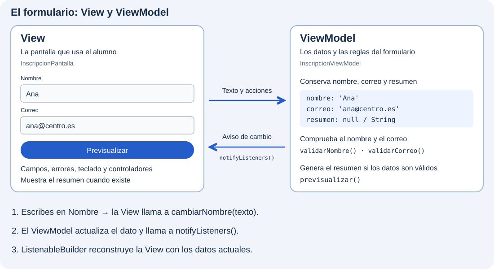

Aplicaremos lo aprendido en [Elementos de un formulario](../controles-de-entrada/) para construir una inscripción con Nombre y Correo. Conservamos `Form`, su clave y los campos con validación; aquí nos centraremos en conectar la edición con el ViewModel, mantener un resumen actualizado y gestionar el foco.

Trabajaremos en **`catalogo_widgets`**, el mismo proyecto que hemos ido ampliando. Añadiremos la inscripción como una entrada del menú. Cada paso amplía los archivos del anterior; `main.dart` seguirá arrancando el catálogo.

## Dos partes del mismo formulario

La View será `InscripcionPantalla` y su ViewModel, `InscripcionViewModel`. En este ejemplo, el nombre y el correo se actualizarán **mientras se editan**, en lugar de recogerlos en un borrador mediante `onSaved`.



Por ejemplo, al escribir «Ana», la pantalla comunica el texto mediante `cambiarNombre`. El ViewModel guarda el valor y avisa del cambio. Más adelante conectaremos ese aviso con `ListenableBuilder`, para que la pantalla muestre el resultado actualizado.

Al pulsar «Previsualizar», la pantalla pide validar los campos usando las reglas del ViewModel. Si son correctos, llama a `previsualizar()` y muestra el resumen que este genera.

## 🎯 Qué aprenderás

- Construir una pantalla con campos de nombre y correo.
- Recoger el texto introducido y comprobar si los datos son válidos.
- Mostrar errores y generar una previsualización mediante un botón.
- Leer y modificar campos con controladores y gestionar el foco del teclado.

Abre la carpeta de `catalogo_widgets` que contiene `pubspec.yaml`. No necesitas crear otro proyecto ni instalar paquetes.

```text
lib/
├── main.dart
└── ui/
    └── inscripcion/
        ├── ui/
        │   └── inscripcion_pantalla.dart
        └── view_models/
            └── inscripcion_viewmodel.dart
```

Seguimos la convención del curso: las piezas visuales van en `ui`, y el ViewModel en `view_models`, dentro de la misma funcionalidad.

## Pasos del formulario

1. [Preparar la pantalla](./preparar-la-pantalla/).
2. [Recoger el nombre y el correo](./recoger-los-datos/).
3. [Comprobar los datos](./validar-los-datos/).
4. [Añadir el botón y el resultado](./boton-y-resultado/).
5. [Leer y modificar los campos](./controladores-y-cambios/).
6. [Gestionar el foco](./gestionar-el-foco/).
7. [Completar la pantalla](./completar-la-pantalla/).
8. [Probar el formulario](./probar-el-formulario/).
