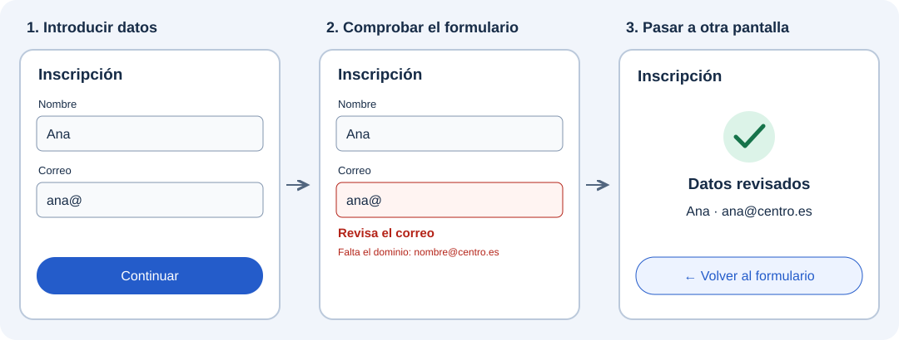

En una aplicación no basta con mostrar información: también necesitamos que las personas puedan escribir datos, elegir opciones y desplazarse entre pantallas. Piensa en una inscripción: introduces tu nombre y correo, corriges los errores que aparecen y continúas para revisar los datos.

En esta unidad aprenderás a construir esas interacciones con Flutter.

:::tip[Dos conceptos que trabajan juntos]
Los **formularios** permiten recoger y comprobar la información; la **navegación** permite organizar las pantallas y moverse entre ellas.
:::

El esquema muestra un posible recorrido de una aplicación. Primero trabajaremos la entrada y la comprobación de datos; después aprenderemos a abrir otras pantallas y volver a la anterior.

## 🎯 Qué aprenderás

- Elegir controles para introducir texto y seleccionar opciones.
- Construir un formulario y mostrar mensajes que ayuden a corregir sus datos.
- Conectar pantallas, intercambiar información y organizar secciones y diálogos.

## Cómo vamos a trabajar

1. **[Elementos de un formulario](./controles-de-entrada/).** Conocerás el contenedor, el estado y los campos que componen un formulario, y cómo se relacionan.
2. **[Crear un formulario](./formulario-con-viewmodel/).** Construirás una inscripción paso a paso: preparar la pantalla, recoger nombre y correo, validar los campos y mostrar un resultado.
3. **[Navegación](./navegacion/).** Conectarás pantallas, pasarás datos entre ellas y utilizarás barras, pestañas y diálogos. Al final integrarás lo aprendido en el catálogo.

:::note[El punto de partida]
Partiremos de los widgets que ya conoces e incorporaremos cada concepto cuando haga falta en el ejemplo.
:::

Empieza por la introducción a los [elementos de un formulario](./controles-de-entrada/).
