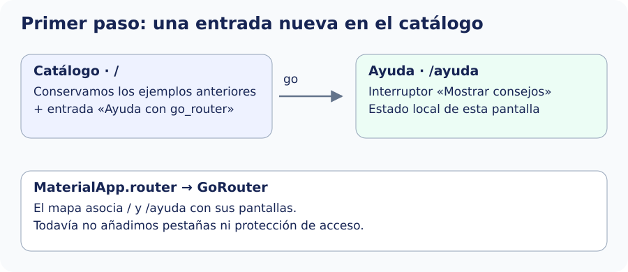

En este paso crearemos el primer mapa de rutas con dos destinos: el catálogo (`/`) y una pantalla de Ayuda (`/ayuda`). Al terminar, la entrada **Ayuda con go_router** del catálogo abrirá Ayuda mediante su dirección.



Crearemos o modificaremos estos archivos:

```text
lib/
  main.dart                                   ← crea el router y usa MaterialApp.router
  ui/
    core/app_router.dart                      ← nuevo: el mapa de rutas
    catalogo/ui/catalogo_pantalla.dart        ← nueva entrada
    navegacion_avanzada/ui/ayuda_pantalla.dart ← nueva pantalla
```

## 1. La pantalla de destino

Ayuda es un `StatefulWidget` con un interruptor. Ese estado local nos servirá más adelante para comprobar cuándo se conserva una pantalla y cuándo se crea de nuevo. El botón de la cabecera vuelve al catálogo con `context.go('/')`; en el paso siguiente veremos por qué lo necesitamos.

`lib/ui/navegacion_avanzada/ui/ayuda_pantalla.dart`

```dart
import 'package:flutter/material.dart';
import 'package:go_router/go_router.dart';

class AyudaPantalla extends StatefulWidget {
  const AyudaPantalla({super.key});

  @override
  State<AyudaPantalla> createState() => _AyudaPantallaState();
}

class _AyudaPantallaState extends State<AyudaPantalla> {
  bool _mostrar = false;

  @override
  Widget build(BuildContext context) => Scaffold(
    appBar: AppBar(
      title: const Text('Ayuda'),
      actions: [
        IconButton(
          tooltip: 'Catálogo',
          icon: const Icon(Icons.home_outlined),
          onPressed: () => context.go('/'),
        ),
      ],
    ),
    body: ListView(
      children: [
        SwitchListTile(
          title: const Text('Mostrar consejos'),
          value: _mostrar,
          onChanged: (valor) => setState(() => _mostrar = valor),
        ),
        if (_mostrar)
          const Padding(
            padding: EdgeInsets.all(16),
            child: Text('Elige un taller para consultar su detalle.'),
          ),
      ],
    ),
  );
}
```

## 2. El mapa de rutas

Guardamos la configuración de la navegación en `lib/ui/core/`, junto a las piezas compartidas por toda la interfaz.

`lib/ui/core/app_router.dart`

```dart
import 'package:go_router/go_router.dart';
import '../catalogo/ui/catalogo_pantalla.dart';
import '../navegacion_avanzada/ui/ayuda_pantalla.dart';

GoRouter crearRouter() => GoRouter(
  initialLocation: '/',
  debugLogDiagnostics: true,
  routes: [
    GoRoute(
      path: '/',
      name: 'catalogo',
      builder: (context, state) => const CatalogoPantalla(),
    ),
    GoRoute(
      path: '/ayuda',
      name: 'ayuda',
      builder: (context, state) => const AyudaPantalla(),
    ),
  ],
);
```

Analicemos cada parte:

- **`GoRouter`** reúne toda la configuración. Lo creamos dentro de una función (`crearRouter`) para poder pasarle dependencias en los próximos pasos.
- **`initialLocation`** es la ubicación con la que arranca la aplicación cuando nadie pide otra (por ejemplo, un enlace o la barra de direcciones del navegador).
- **`debugLogDiagnostics: true`** escribe en la consola de depuración cada navegación: qué ubicación se pide, qué ruta coincide y, más adelante, qué redirecciones se aplican. Es muy útil mientras aprendemos; en una versión publicada se quita.
- **`routes`** es la lista de rutas de primer nivel. go_router recorre la lista y elige la primera cuyo patrón coincide con la ubicación.
- **`path`** es el patrón de la ruta. Las rutas de primer nivel **empiezan siempre por `/`**.
- **`name`** es un nombre único y opcional. Permite navegar con `context.goNamed('ayuda')` sin escribir la dirección literal; si un día cambiamos `/ayuda` por `/soporte`, los botones que usan el nombre siguen funcionando.
- **`builder`** recibe el `BuildContext` y el `GoRouterState` de la navegación y devuelve el widget de la pantalla. Todavía no usamos `state`; en el paso 4 leeremos de él los parámetros.

:::note[builder y pageBuilder]
`builder` usa la transición por defecto de la plataforma. Si algún día necesitas una animación propia (por ejemplo, un fundido), `GoRoute` también admite `pageBuilder`, que devuelve una `Page` como `CustomTransitionPage`. En esta sección no la necesitamos.
:::

## 3. Crear el router en el arranque

Hasta ahora, `main.dart` arrancaba un `MaterialApp` que abría el catálogo con `home`. Sustituye el archivo por esta versión, que crea el router y se lo entrega a `MaterialApp.router`:

`lib/main.dart`

```dart
import 'package:flutter/material.dart';
import 'ui/core/app_router.dart';

void main() {
  final router = crearRouter();
  runApp(
    MaterialApp.router(
      debugShowCheckedModeBanner: false,
      title: 'Catálogo de widgets',
      routerConfig: router,
    ),
  );
}
```

- **`MaterialApp.router`** sustituye a `MaterialApp`. En lugar de `home` o de la tabla `routes` de `MaterialApp`, recibe **`routerConfig`**: el router decide qué pantallas se muestran. No combines `routerConfig` con `home` ni con `routes`.
- Creamos el router **una sola vez**, en `main()`, antes de `runApp`. Nunca lo crees dentro del `build` de un widget: `build` se puede ejecutar muchas veces, y un router nuevo en cada una reiniciaría la navegación.
- El router vive mientras dura la aplicación, así que no hace falta liberarlo.

Si tu `MaterialApp` anterior tenía `theme`, cópialo también a `MaterialApp.router`.

El catálogo ya no lo abre `home`: lo abre la ruta `/`, que es la `initialLocation`.

## 4. Añadir la entrada al catálogo

En `lib/ui/catalogo/ui/catalogo_pantalla.dart`, añade el import de go_router y, al final de la lista del `ListView`, esta entrada. Conserva las anteriores:

```dart
import 'package:go_router/go_router.dart';
```

```dart
const Divider(),
const ListTile(title: Text('Navegación con go_router')),
ListTile(
  leading: const Icon(Icons.help_outline),
  title: const Text('Ayuda con go_router'),
  trailing: const Icon(Icons.chevron_right),
  onTap: () => context.go('/ayuda'),
),
```

`context.go('/ayuda')` pide al router la ubicación `/ayuda`. El router busca en su mapa la ruta que coincide y construye `AyudaPantalla`.

## Probar

Ejecuta `flutter run` (o haz **hot restart** si ya estaba en marcha). Abre **Ayuda con go_router**, activa el interruptor y vuelve con el icono de la casa. Observa la consola de depuración: verás líneas de `GoRouter` indicando cada ubicación solicitada.

Las entradas antiguas del catálogo que usan `Navigator.push` siguen funcionando: `MaterialApp.router` también crea un `Navigator`, y `push` apila la pantalla encima del catálogo como antes. La diferencia es que esas pantallas no tienen dirección propia.

Referencias: [GoRouter](https://pub.dev/documentation/go_router/latest/go_router/GoRouter-class.html) y [GoRoute](https://pub.dev/documentation/go_router/latest/go_router/GoRoute-class.html).
