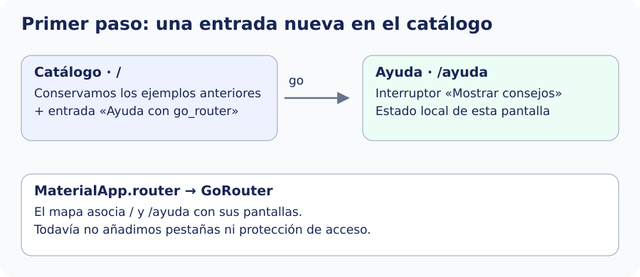

En este paso construiremos la primera parte del ejemplo: desde el catálogo, pulsaremos **Ayuda con go_router** y veremos una pantalla con el interruptor **Mostrar consejos**. Al activarlo, aparecerá un texto de ayuda. El objetivo es comprobar cómo una entrada del catálogo abre una pantalla mediante una ruta declarada. Todavía no implementaremos la consulta de talleres ni el login.

Empezaremos con dos rutas públicas: `/` conserva el catálogo y `/ayuda` abre una nueva pantalla. `GoRouter` define la tabla de rutas, cada `GoRoute` asocia un `path` a un destino y `builder` construye ese destino. El `state` que recibe contiene información de la URL.

Este es el resultado de este primer paso: una entrada del catálogo abre Ayuda. El resto de ejemplos se conserva. Más adelante ampliaremos este mapa.



## Preparar una pantalla de destino

Crea este archivo completo. El interruptor conserva estado local y nos servirá para observar después qué ocurre al cambiar de sección.


`lib/ui/navegacion_avanzada/ui/ayuda_pantalla.dart`

```dart
import 'package:flutter/material.dart';

class AyudaPantalla extends StatefulWidget {
  const AyudaPantalla({super.key});
  @override
  State<AyudaPantalla> createState() => _AyudaPantallaState();
}

class _AyudaPantallaState extends State<AyudaPantalla> {
  bool _mostrar = false;
  @override
  Widget build(BuildContext context) => Scaffold(
    appBar: AppBar(title: const Text('Ayuda')),
    body: ListView(
      children: [
        SwitchListTile(
          title: const Text('Mostrar consejos'),
          value: _mostrar,
          onChanged: (valor) => setState(() => _mostrar = valor),
        ),
        if (_mostrar)
          const Padding(
            padding: EdgeInsets.all(16),
            child: Text('Elige un taller para consultar su detalle.'),
          ),
      ],
    ),
  );
}
```

## Declarar las rutas

Crea `lib/app/router/app_router.dart` con este código. `initialLocation` es la ubicación inicial cuando no llega otra desde la plataforma. Los `path` de primer nivel empiezan por `/`; `name` es un identificador único para navegar sin repetir esa ruta literal.


```dart
import 'package:go_router/go_router.dart';
import '../../ui/catalogo/ui/catalogo_pantalla.dart';
import '../../ui/navegacion_avanzada/ui/ayuda_pantalla.dart';

GoRouter crearRouter() => GoRouter(
  initialLocation: '/',
  routes: [
    GoRoute(path: '/', builder: (context, state) => const CatalogoPantalla()),
    GoRoute(path: '/ayuda', name: 'ayuda',
      builder: (context, state) => const AyudaPantalla()),
  ],
);
```

## Conectar el router en el arranque

Crea `lib/app/catalogo_router_app.dart` con esta versión inicial. El router se crea una vez en `initState`, no dentro de `build`: reconstruir el widget no debe reiniciar la configuración de navegación. `routerConfig` conecta `MaterialApp.router` con él. No se combina con `home` ni con la tabla `routes` de `MaterialApp`.


```dart
import 'package:flutter/material.dart';
import 'package:go_router/go_router.dart';
import 'router/app_router.dart';

class CatalogoRouterApp extends StatefulWidget {
  const CatalogoRouterApp({super.key});
  @override
  State<CatalogoRouterApp> createState() => _CatalogoRouterAppState();
}
class _CatalogoRouterAppState extends State<CatalogoRouterApp> {
  late final GoRouter _router;
  @override
  void initState() { super.initState(); _router = crearRouter(); }
  @override
  void dispose() { _router.dispose(); super.dispose(); }
  @override
  Widget build(BuildContext context) => MaterialApp.router(
    debugShowCheckedModeBanner: false,
    title: 'Catálogo con rutas',
    routerConfig: _router,
  );
}
```

Abre el archivo **`lib/main.dart`**. Añade el import de `catalogo_router_app.dart` que aparece a continuación y cambia la función `main()` para que `runApp` reciba `CatalogoRouterApp`. Así, al iniciar la aplicación, se utilizará el mapa de rutas que acabamos de configurar.

El siguiente bloque muestra los imports necesarios y la nueva función `main()`. Conserva cualquier otro código del archivo que siga utilizando tu proyecto:

```dart
import 'package:flutter/material.dart';
import 'app/catalogo_router_app.dart';

void main() => runApp(const CatalogoRouterApp());
```

En `catalogo_pantalla.dart`, conserva sus entradas y añade `import 'package:go_router/go_router.dart';` y esta entrada a su lista:


```dart
ListTile(
  title: const Text('Ayuda con go_router'),
  onTap: () => context.go('/ayuda'),
),
```

Desde la raíz del proyecto ejecuta `flutter run`, abre esa entrada y observa Ayuda. Las demostraciones anteriores que utilizan `Navigator.push` siguen funcionando, pero esas rutas imperativas no tienen una URL propia declarada y no son destinos de enlace directo. `go` puede sustituirlas al reconstruir la pila de una ubicación.

Referencia: [GoRouter](https://pub.dev/documentation/go_router/latest/go_router/GoRouter-class.html).
