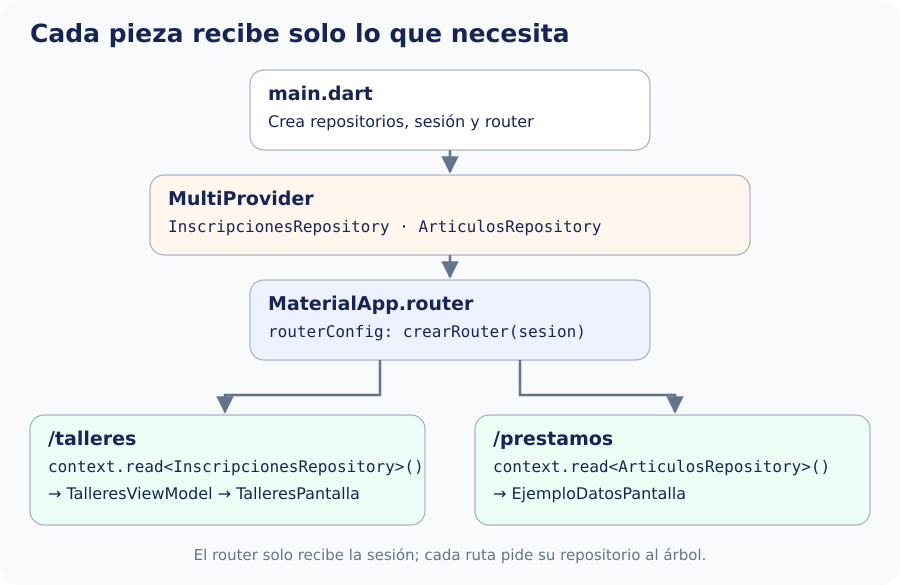

En el ejemplo, `crearRouter` recibe el repositorio de inscripciones y la sesión, porque sus rutas los necesitan para crear los ViewModels. Con dos dependencias funciona, pero en una aplicación real cada funcionalidad trae su propio repositorio: talleres, préstamos, reservas, usuarios… Si todos pasan por `crearRouter`, el router acaba conociendo todas las piezas de la aplicación, aunque él solo se encarga de decidir qué pantalla mostrar.

En esta ampliación separaremos dos responsabilidades: **quién crea** las dependencias (el arranque) y **quién las usa** (cada ruta). Usaremos el paquete **provider**, el que recomienda el equipo de Flutter en su [guía de arquitectura](https://docs.flutter.dev/app-architecture/case-study/dependency-injection) para inyectar dependencias.

## El problema: un router que lo conoce todo

Imagina que la aplicación sigue creciendo y cada nueva pantalla necesita un repositorio distinto. La firma de `crearRouter` crecería así:

```dart
GoRouter crearRouter(
  InscripcionesRepository inscripciones,
  ArticulosRepository articulos,
  ReservasRepository reservas,
  UsuariosRepository usuarios,
  SesionViewModel sesion,
) => GoRouter(/* ... */);
```

Cada funcionalidad nueva obliga a modificar `crearRouter`, `main.dart` y todas las funciones de rutas intermedias que reenvían los repositorios. Además, el router recibe objetos que no usa: solo los pasa a los `builder`.

## La idea: las dependencias viven en el árbol de widgets

Recuerda que el `context` de un widget permite buscar información **en los widgets que tiene por encima**: así funcionan `Theme.of(context)` o `GoRouterState.of(context)`. provider aprovecha el mismo mecanismo para cualquier objeto:

1. En `main.dart` colocamos los repositorios **por encima** de `MaterialApp.router`, envueltos en un `MultiProvider`.
2. Todas las pantallas de la aplicación quedan por debajo. En el `builder` de cada ruta, `context.read<T>()` busca hacia arriba el objeto de tipo `T` y lo devuelve.
3. El router solo recibe lo que necesita para **decidir**: la sesión, para `redirect` y `refreshListenable`.



## 1. Instalar provider

provider es un paquete externo, así que primero lo añadimos al proyecto. Desde la raíz de `catalogo_widgets`, ejecuta:

```bash
flutter pub add provider
```

## 2. Registrar los repositorios en el arranque

El arranque sigue siendo la **raíz de composición**: el único lugar que conoce las implementaciones de `data`. La diferencia es que, en lugar de pasar los repositorios al router, los entrega al árbol de widgets. Sustituye `main.dart`:

`lib/main.dart`

```dart
import 'package:flutter/material.dart';
import 'package:provider/provider.dart';
import 'data/repositories/inscripciones_local_repository.dart';
import 'data/services/inscripciones_local_service.dart';
import 'domain/repositories/inscripciones_repository.dart';
import 'ui/core/app_router.dart';
import 'ui/core/view_models/sesion_viewmodel.dart';

void main() {
  final sesion = SesionViewModel();
  final router = crearRouter(sesion);
  runApp(
    MultiProvider(
      providers: [
        Provider<InscripcionesRepository>(
          create: (_) => InscripcionesLocalRepository(
            const InscripcionesLocalService(),
          ),
        ),
      ],
      child: MaterialApp.router(
        debugShowCheckedModeBanner: false,
        title: 'Catálogo de widgets',
        routerConfig: router,
      ),
    ),
  );
}
```

- **`MultiProvider`** agrupa varios proveedores en un solo widget. Lo ponemos por encima de `MaterialApp.router` para que todas las pantallas que construya el router puedan encontrarlos.
- **`Provider<InscripcionesRepository>`** registra el objeto **con el tipo del contrato**, no con el de la implementación. Las rutas pedirán un `InscripcionesRepository` sin saber que es local. El día que exista `InscripcionesRemoteRepository`, solo cambiará esta línea.
- **`create`** se ejecuta una sola vez, la primera vez que alguien pide el repositorio. A partir de ahí, todas las rutas comparten la misma instancia.
- **`crearRouter(sesion)`** ya no recibe repositorios. La sesión sí, porque el router la usa directamente en `redirect` y `refreshListenable`.

## 3. Pedir las dependencias en cada ruta

Cada ruta obtiene ahora sus dependencias del árbol, en el momento de construir su pantalla. Lo hace con `context.read<T>()`, que busca el objeto del tipo indicado en los widgets superiores.

Sustituye `ruta_talleres.dart`. La función ya no recibe parámetros:

`lib/ui/core/ruta_talleres.dart`

```dart
import 'package:go_router/go_router.dart';
import 'package:provider/provider.dart';
import '../../domain/repositories/inscripciones_repository.dart';
import '../navegacion_avanzada/ui/detalle_taller_pantalla.dart';
import '../navegacion_avanzada/ui/talleres_pantalla.dart';
import '../navegacion_avanzada/view_models/detalle_taller_viewmodel.dart';
import '../navegacion_avanzada/view_models/talleres_viewmodel.dart';

GoRoute rutaTalleres() => GoRoute(
  path: '/talleres',
  name: 'talleres',
  builder: (context, state) => TalleresPantalla(
    viewModel: TalleresViewModel(
      context.read<InscripcionesRepository>(),
      consulta: state.uri.queryParameters['q'] ?? '',
    ),
  ),
  routes: [
    GoRoute(
      path: ':id',
      name: 'taller',
      builder: (context, state) => DetalleTallerPantalla(
        viewModel: DetalleTallerViewModel(
          context.read<InscripcionesRepository>(),
          state.pathParameters['id']!,
        ),
      ),
    ),
  ],
);
```

En `app_router.dart` hay que hacer tres cambios:

1. Añade este import:

   ```dart
   import 'package:provider/provider.dart';
   ```

2. Cambia la firma para que solo reciba la sesión:

   ```dart
   GoRouter crearRouter(SesionViewModel sesion) => GoRouter(
   ```

3. En la ruta `login`, pide el repositorio al árbol, y en la rama de Talleres llama a `rutaTalleres()` sin argumentos:

   ```dart
   builder: (context, state) => LoginRutaPantalla(
     repository: context.read<InscripcionesRepository>(),
     onLogin: sesion.iniciarSesion,
   ),
   ```

   ```dart
   StatefulShellBranch(routes: [rutaTalleres()]),
   ```

### `context.read` y `context.watch`

provider ofrece dos formas de obtener un objeto:

| Método | Qué hace | Cuándo usarlo |
| --- | --- | --- |
| `context.read<T>()` | Devuelve el objeto una vez, sin escuchar cambios. | Para obtener dependencias que no cambian, como un repositorio. Es lo que usamos en los `builder` de las rutas. |
| `context.watch<T>()` | Devuelve el objeto y reconstruye el widget cada vez que notifica un cambio. | Para mostrar en pantalla un estado que cambia. En este curso lo hacemos con `ListenableBuilder` y el ViewModel. |

Una regla que mantiene el código ordenado: **solo los `builder` de las rutas llaman a `context.read`**. Las pantallas y los ViewModels siguen recibiendo sus dependencias por constructor, como hasta ahora; así no dependen de provider y se pueden reutilizar en cualquier sitio.

## 4. Añadir una funcionalidad con otro repositorio

Ahora vemos la ventaja: añadir una funcionalidad con su propio repositorio no obliga a tocar la firma de `crearRouter`. Como ejemplo, convertiremos en ruta la miniaplicación de préstamos del [ejemplo con datos](../../../widgets/ejemplo-con-datos/), que usa `ArticulosRepository`.

Primero registramos el nuevo repositorio en `main.dart`. Añade estos imports y el proveedor a la lista `providers`, después del de inscripciones:

```dart
import 'data/repositories/articulos_repository.dart';
import 'data/services/articulos_local_service.dart';
```

```dart
Provider<ArticulosRepository>(
  create: (_) => ArticulosRepository(
    service: const ArticulosLocalService(),
  ),
),
```

Después declaramos su ruta en un archivo propio. Será hija de `/`, como Login y Cuenta, para que la cabecera muestre la flecha de volver al catálogo:

`lib/ui/core/ruta_prestamos.dart`

```dart
import 'package:go_router/go_router.dart';
import 'package:provider/provider.dart';
import '../../data/repositories/articulos_repository.dart';
import '../prestamos/ui/ejemplo_datos_pantalla.dart';

GoRoute rutaPrestamos() => GoRoute(
  path: 'prestamos',
  name: 'prestamos',
  builder: (context, state) => EjemploDatosPantalla(
    repository: context.read<ArticulosRepository>(),
  ),
);
```

En `app_router.dart`, importa `ruta_prestamos.dart` y añade `rutaPrestamos()` a la lista `routes` de la ruta `/`, junto a `login` y `cuenta`:

```dart
routes: [
  GoRoute(path: 'login', /* ... */),
  GoRoute(path: 'cuenta', /* ... */),
  rutaPrestamos(),
],
```

Por último, en el catálogo, cambia el `onTap` de la entrada **Ejemplo con datos** para que navegue por su dirección:

```dart
onTap: () => context.go('/prestamos'),
```

Fíjate en lo que **no** ha cambiado: la firma de `crearRouter`, la de `rutaTalleres` y la pantalla `EjemploDatosPantalla`. Cada funcionalidad nueva se resuelve con un proveedor en `main.dart` y una función de rutas propia.

## 5. Reunir los proveedores en un archivo

Con dos repositorios, `main.dart` ya mezcla dos tareas: arrancar la aplicación y crear todas sus dependencias. Cada funcionalidad nueva añadiría imports de `data` y un proveedor más a ese archivo. Para que `main.dart` se quede corto y legible, llevamos la lista de proveedores a un archivo propio, junto a él.

Crea este archivo. Contiene todos los imports de `data` y una lista con los proveedores:

`lib/dependencias.dart`

```dart
import 'package:provider/provider.dart';
import 'package:provider/single_child_widget.dart';
import 'data/repositories/articulos_repository.dart';
import 'data/repositories/inscripciones_local_repository.dart';
import 'data/services/articulos_local_service.dart';
import 'data/services/inscripciones_local_service.dart';
import 'domain/repositories/inscripciones_repository.dart';

/// Repositorios que la aplicación pone a disposición de las rutas.
/// Para añadir uno nuevo, solo hay que modificar esta lista.
List<SingleChildWidget> get dependencias => [
  Provider<InscripcionesRepository>(
    create: (_) => InscripcionesLocalRepository(
      const InscripcionesLocalService(),
    ),
  ),
  Provider<ArticulosRepository>(
    create: (_) => ArticulosRepository(
      service: const ArticulosLocalService(),
    ),
  ),
];
```

- **`SingleChildWidget`** es el tipo que espera `providers` de `MultiProvider`: cada `Provider` es un widget que envuelve a uno solo, su hijo. Se importa desde `package:provider/single_child_widget.dart`.
- **`get dependencias`** es un *getter*: se lee como una variable (`dependencias`), pero construye la lista en el momento de usarla. Los objetos no se crean aquí: cada `create` se ejecuta la primera vez que una ruta pide su repositorio.

Ahora `main.dart` solo arranca la aplicación. Sustitúyelo por esta versión, que ya no importa nada de `data`:

`lib/main.dart`

```dart
import 'package:flutter/material.dart';
import 'package:provider/provider.dart';
import 'dependencias.dart';
import 'ui/core/app_router.dart';
import 'ui/core/view_models/sesion_viewmodel.dart';

void main() {
  final sesion = SesionViewModel();
  final router = crearRouter(sesion);
  runApp(
    MultiProvider(
      providers: dependencias,
      child: MaterialApp.router(
        debugShowCheckedModeBanner: false,
        title: 'Catálogo de widgets',
        routerConfig: router,
      ),
    ),
  );
}
```

A partir de aquí, añadir una funcionalidad con un repositorio nuevo consiste en añadir su proveedor a `dependencias.dart` y su función de rutas a `app_router.dart`. `main.dart` no vuelve a cambiar. La aplicación de ejemplo de la guía de arquitectura de Flutter sigue la misma organización, con sus proveedores en un archivo aparte.

## 6. ¿Dónde se crea cada ViewModel?

Las dependencias ya están resueltas, pero falta decidir dónde se crean los ViewModels. Depende de si tienen estado que cambia y deben liberarse con `dispose`:

| Tipo de ViewModel | Dónde se crea | Ejemplo |
| --- | --- | --- |
| Sin estado que cambie (solo datos `final`) | Directamente en el `builder` de la ruta. Si el router reconstruye la página, se crea otro igual y no hay nada que liberar. | `TalleresViewModel`, `DetalleTallerViewModel` |
| Con `ChangeNotifier` (estado que cambia) | En el `initState` de un `StatefulWidget` que lo libera en `dispose`. La ruta solo le pasa el repositorio. | `LoginRutaPantalla`, `EjemploDatosPantalla` |

El segundo caso es importante: si un `ChangeNotifier` se creara en el `builder`, cada reconstrucción crearía uno nuevo, se perdería el estado (lo escrito en un formulario, un filtro…) y el anterior nunca se liberaría. Por eso `LoginRutaPantalla` y `EjemploDatosPantalla` reciben el repositorio y crean ellos mismos su ViewModel una sola vez.

:::note[Otra opción: ChangeNotifierProvider]
provider también puede crear y liberar un ViewModel por nosotros: `ChangeNotifierProvider(create: (context) => MiViewModel(context.read()), child: ...)` llama automáticamente a `dispose` cuando la pantalla desaparece. Es útil cuando varias pantallas comparten el mismo ViewModel. En este curso seguimos con `initState` y `dispose`, que ya conocemos.
:::

## Qué conoce cada pieza

Con esta organización, cada parte de la aplicación conoce solo lo que necesita:

| Pieza | Qué conoce |
| --- | --- |
| `dependencias.dart` | Las implementaciones de `data`. Las registra como proveedores. |
| `main.dart` | La sesión, el router y la lista de dependencias. Solo arranca la aplicación. |
| `crearRouter` | La sesión, para decidir el acceso. Ningún repositorio. |
| Funciones de rutas (`rutaTalleres`, `rutaPrestamos`…) | Los contratos que necesitan sus pantallas, que piden con `context.read`. |
| Pantallas y ViewModels | Lo que reciben por constructor. No saben que existe provider. |

## Otras alternativas

provider no es la única forma de resolver el problema. Estas son las opciones más habituales y por qué elegimos la tercera:

| Opción | Ventaja | Inconveniente |
| --- | --- | --- |
| Pasar todos los repositorios a `crearRouter` | No necesita paquetes. | La firma crece con cada funcionalidad. |
| Una clase `Dependencias` con todos los repositorios, que se pasa al router | Un único parámetro. | El router sigue recibiendo todo, y cualquier ruta puede usar cualquier repositorio. |
| **provider** (`MultiProvider` + `context.read`) | Cada ruta pide solo lo que usa; es la opción recomendada en la guía de arquitectura de Flutter. | Añade un paquete. |
| Un localizador de servicios global, como `get_it` | Se accede desde cualquier sitio, sin `context`. | Las dependencias quedan ocultas: mirando una clase no se ve qué necesita. |

## Probar

Ejecuta `flutter pub get` si tu editor no lo ha hecho, haz **hot restart** y comprueba que todo sigue funcionando igual:

| Acción | Resultado |
| --- | --- |
| Talleres con go_router, buscar y abrir un detalle | Igual que antes: el repositorio llega desde `main.dart`. |
| Mi cuenta protegida y login con Ana | Igual que antes. |
| Ejemplo con datos | Se abre en `/prestamos` con flecha para volver al catálogo. |
| Escribir `/prestamos` en la barra del navegador (web) | Abre directamente los préstamos. |
| Buscar `context.read` en el proyecto | Solo aparece en los archivos de rutas de `lib/ui/core/`. |
| Buscar imports de `data/` en `main.dart` | No hay ninguno: están en `dependencias.dart`. |

Referencias: [inyección de dependencias en la guía de arquitectura de Flutter](https://docs.flutter.dev/app-architecture/case-study/dependency-injection) y [paquete provider](https://pub.dev/packages/provider).
