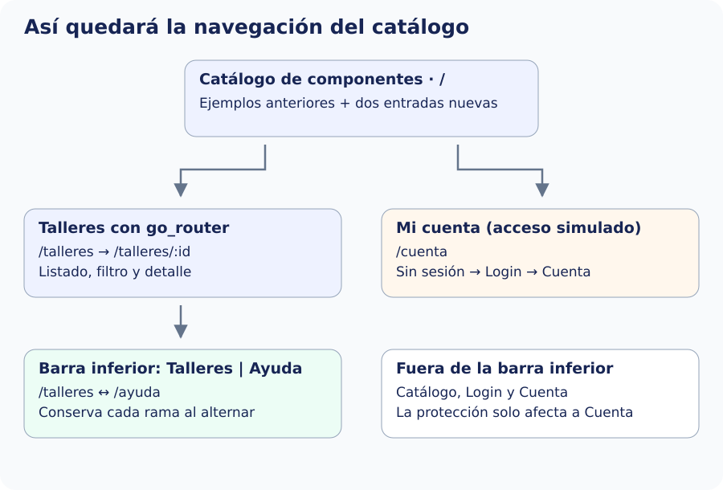

Reunimos lo anterior en una configuración final: catálogo público, Talleres y Ayuda con barra inferior, Login y Cuenta protegida. Mantén los archivos de los pasos anteriores y las entradas antiguas del catálogo. No mezcles esta versión del router con otra declaración de los mismos paths.

El mapa muestra el resultado que montaremos en el catálogo: dos entradas nuevas dan acceso a los recorridos de esta sección. Talleres y Ayuda comparten barra inferior; Cuenta utiliza el login cuando hace falta y queda fuera de esa barra. Las flechas indican recorridos de acceso, no todas las pilas posibles.



## Vista de Cuenta

Recibe `DatosAcceso` desde la sesión: muestra la ficha obtenida por el login y expone un callback de salida. No consulta DTO ni crea usuarios. Cerrar sesión notifica un cambio; la política del router decide después el destino.


`lib/ui/navegacion_avanzada/ui/cuenta_pantalla.dart`

```dart
import 'package:flutter/material.dart';
import '../../../domain/models/datos_acceso.dart';

class CuentaPantalla extends StatelessWidget {
  const CuentaPantalla({
    super.key,
    required this.acceso,
    required this.onSalir,
  });
  final DatosAcceso acceso;
  final VoidCallback onSalir;
  @override
  Widget build(BuildContext context) {
    final usuario = acceso.usuario;
    return Scaffold(
      appBar: AppBar(title: const Text('Mi cuenta')),
      body: ListView(
        padding: const EdgeInsets.all(24),
        children: [
          Text(
            '¡Hola, ${usuario.nombreCompleto}!',
            style: Theme.of(context).textTheme.headlineSmall,
          ),
          Text('Identificador: ${usuario.id}'),
          Text('Correo: ${usuario.correo}'),
          Text('Teléfono: ${usuario.telefono}'),
          Text('Localidad: ${usuario.localidad}'),
          Text('Taller: ${acceso.taller.titulo}'),
          Text(
            acceso.recordatorio
                ? 'Recordatorio simulado: sí'
                : 'Sin recordatorio',
          ),
          const SizedBox(height: 24),
          OutlinedButton(
            onPressed: onSalir,
            child: const Text('Cerrar sesión'),
          ),
        ],
      ),
    );
  }
}
```

## Router completo

Sustituye `app_router.dart` por este archivo. `/login` y `/cuenta` están fuera de la shell; la barra de las secciones públicas no aparece encima del formulario. El acceso no nulo en `sesion.acceso!` se apoya en la redirección previa de `/cuenta`: si no hay sesión, no se construye esa vista. No reutilices ese acceso fuera de la ruta protegida.


`lib/app/router/app_router.dart`

```dart
import 'package:go_router/go_router.dart';
import '../../domain/repositories/inscripciones_repository.dart';
import '../../ui/catalogo/ui/catalogo_pantalla.dart';
import '../../ui/core/view_models/sesion_viewmodel.dart';
import '../../ui/inscripcion/ui/login_ruta_pantalla.dart';
import '../../ui/navegacion_avanzada/ui/ayuda_pantalla.dart';
import '../../ui/navegacion_avanzada/ui/cuenta_pantalla.dart';
import '../../ui/navegacion_avanzada/ui/ruta_no_encontrada_pantalla.dart';
import '../../ui/navegacion_avanzada/ui/secciones_pantalla.dart';
import 'redireccion_sesion.dart';
import 'ruta_talleres.dart';

GoRouter crearRouter(
  InscripcionesRepository repository,
  SesionViewModel sesion,
) => GoRouter(
  initialLocation: '/',
  refreshListenable: sesion,
  redirect: (context, state) => redireccionSesion(sesion, state),
  routes: [
    GoRoute(path: '/', builder: (context, state) => const CatalogoPantalla()),
    GoRoute(
      path: '/login',
      builder: (context, state) => LoginRutaPantalla(
        repository: repository,
        onLogin: sesion.iniciarSesion,
      ),
    ),
    GoRoute(
      path: '/cuenta',
      name: 'cuenta',
      builder: (context, state) =>
          CuentaPantalla(acceso: sesion.acceso!, onSalir: sesion.cerrarSesion),
    ),
    StatefulShellRoute.indexedStack(
      builder: (context, state, shell) =>
          SeccionesPantalla(navigationShell: shell),
      branches: [
        StatefulShellBranch(routes: [rutaTalleres(repository)]),
        StatefulShellBranch(
          routes: [
            GoRoute(
              path: '/ayuda',
              name: 'ayuda',
              builder: (context, state) => const AyudaPantalla(),
            ),
          ],
        ),
      ],
    ),
  ],
  errorBuilder: (context, state) => const RutaNoEncontradaPantalla(),
);
```

## Composición y ciclo de vida

Sustituye `catalogo_router_app.dart` por este archivo. El arranque es el único punto que importa las implementaciones de `data`. Crea una sesión compartida y un router una sola vez. Al liberar la app, dispone primero el router que escucha la sesión y después la sesión. `main.dart` conserva el arranque del paso 2.


`lib/app/catalogo_router_app.dart`

```dart
import 'package:flutter/material.dart';
import 'package:go_router/go_router.dart';
import '../data/repositories/inscripciones_local_repository.dart';
import '../data/services/inscripciones_local_service.dart';
import '../ui/core/view_models/sesion_viewmodel.dart';
import 'router/app_router.dart';

class CatalogoRouterApp extends StatefulWidget {
  const CatalogoRouterApp({super.key});
  @override
  State<CatalogoRouterApp> createState() => _CatalogoRouterAppState();
}

class _CatalogoRouterAppState extends State<CatalogoRouterApp> {
  late final GoRouter _router;
  final _sesion = SesionViewModel();
  @override
  void initState() {
    super.initState();
    final repository = InscripcionesLocalRepository(
      const InscripcionesLocalService(),
    );
    _router = crearRouter(repository, _sesion);
  }

  @override
  void dispose() {
    _router.dispose();
    _sesion.dispose();
    super.dispose();
  }

  @override
  Widget build(BuildContext context) => MaterialApp.router(
    debugShowCheckedModeBanner: false,
    title: 'Catálogo con rutas',
    routerConfig: _router,
  );
}
```

En el `ListView` de `CatalogoPantalla`, conserva las entradas anteriores y añade estas dos, con el import de go_router:


```dart
ListTile(
  title: const Text('Talleres con go_router'),
  onTap: () => context.go('/talleres'),
),
ListTile(
  title: const Text('Mi cuenta protegida'),
  onTap: () => context.go('/cuenta'),
),
```

## Comprobar el recorrido

Desde la raíz del proyecto, ejecuta `dart format lib test` para formatear, `flutter analyze` para revisar el código y `flutter test` para ejecutar las pruebas que tenga tu catálogo. Después usa `flutter run` o `flutter run -d chrome` para comprobar el comportamiento.

| Caso | Resultado observable |
| --- | --- |
| `/talleres/20` por URL | Detalle de Cerámica obtenido del repositorio. |
| `/talleres?q=cer` | Solo talleres cuyo título coincide con el filtro. |
| `/talleres/999` | Mensaje de dato inexistente, con salida al listado. |
| `/no-existe` | Pantalla de ruta no encontrada, con salida al catálogo. |
| Detalle → Ayuda → Talleres | Conserva la pila de la rama y el estado del interruptor de Ayuda. |
| `/cuenta?origen=menu` sin sesión | Login conserva la ubicación solicitada. |
| Login con Ana y pau@centro.es | Error de consulta; no activa sesión ni abre Cuenta. |
| Login con Ana y ana@centro.es, eligiendo un taller | Saludo de Ana García Pérez y datos completos procedentes de la fuente. |
| Limpiar en Login | Vacía controles y errores; no modifica la fuente. |
| Cerrar sesión y volver a pedir `/cuenta` | Vuelve a solicitar el acceso. |
| Recargar la app | No conserva la sesión simulada en memoria. |
| `from` externo o apuntando a `/login` | No abandona la app ni crea un bucle; utiliza Cuenta como destino permitido. |

Las comprobaciones automáticas de referencia de esta sección utilizan el flujo nuevo con un catálogo anfitrión mínimo. No sustituyen las pruebas de tus entradas anteriores ni la comprobación del historial y enlaces externos en cada plataforma.
