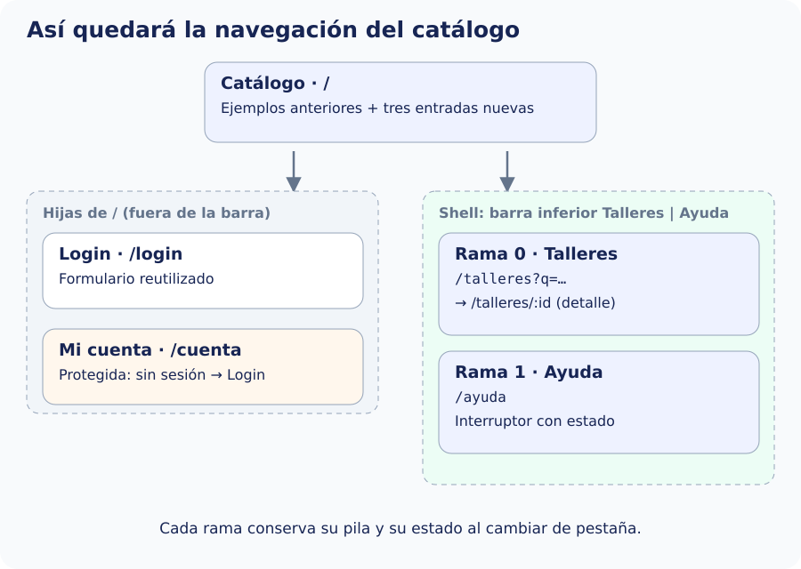

Con los pasos anteriores el ejemplo está completo. En esta página reunimos el resultado final, relacionamos cada concepto con el archivo donde aparece y proponemos un recorrido de comprobación.



## Archivos del ejemplo

Este es el resultado final. Los archivos de esta sección se suman a los del catálogo y del formulario:

```text
lib/
  main.dart                                        repositorio, sesión, router y MaterialApp.router
  ui/
    catalogo/ui/catalogo_pantalla.dart             entradas que llaman a context.go
    core/
      app_router.dart                              el mapa de rutas completo
      ruta_talleres.dart                           /talleres y /talleres/:id
      redireccion_sesion.dart                      la política de acceso
      view_models/sesion_viewmodel.dart            estado de sesión compartido
    inscripcion/ui/
      inscripcion_pantalla.dart                    formulario que avisa con onLogin
      inscripcion_ejemplo_pantalla.dart            demo antigua con Navigator.push
      login_ruta_pantalla.dart                     formulario para la ruta /login
    navegacion_avanzada/
      view_models/talleres_viewmodel.dart
      view_models/detalle_taller_viewmodel.dart
      ui/ayuda_pantalla.dart
      ui/talleres_pantalla.dart
      ui/detalle_taller_pantalla.dart
      ui/secciones_pantalla.dart                   la barra inferior (shell)
      ui/cuenta_pantalla.dart
      ui/ruta_no_encontrada_pantalla.dart
```

## El mapa de rutas final

Este archivo es el centro de la navegación: reúne todas las rutas y las reglas de acceso de la demostración. Esta es su versión final, después del paso 7:

`lib/ui/core/app_router.dart`

```dart
import 'package:flutter/material.dart';
import 'package:go_router/go_router.dart';
import '../../domain/repositories/inscripciones_repository.dart';
import '../catalogo/ui/catalogo_pantalla.dart';
import 'view_models/sesion_viewmodel.dart';
import '../inscripcion/ui/login_ruta_pantalla.dart';
import '../navegacion_avanzada/ui/ayuda_pantalla.dart';
import '../navegacion_avanzada/ui/cuenta_pantalla.dart';
import '../navegacion_avanzada/ui/ruta_no_encontrada_pantalla.dart';
import '../navegacion_avanzada/ui/secciones_pantalla.dart';
import 'redireccion_sesion.dart';
import 'ruta_talleres.dart';

GoRouter crearRouter(
  InscripcionesRepository repository,
  SesionViewModel sesion,
) => GoRouter(
  initialLocation: '/',
  debugLogDiagnostics: true,
  refreshListenable: sesion,
  redirect: (context, state) =>
      redireccionSesion(sesionActiva: sesion.activa, ubicacion: state.uri),
  errorBuilder: (context, state) =>
      RutaNoEncontradaPantalla(ubicacion: state.uri.toString()),
  routes: [
    GoRoute(
      path: '/',
      name: 'catalogo',
      builder: (context, state) => const CatalogoPantalla(),
      routes: [
        GoRoute(
          path: 'login',
          name: 'login',
          builder: (context, state) => LoginRutaPantalla(
            repository: repository,
            onLogin: sesion.iniciarSesion,
          ),
        ),
        GoRoute(
          path: 'cuenta',
          name: 'cuenta',
          builder: (context, state) {
            final acceso = sesion.acceso;
            if (acceso == null) return const SizedBox.shrink();
            return CuentaPantalla(
              acceso: acceso,
              onSalir: sesion.cerrarSesion,
            );
          },
        ),
      ],
    ),
    StatefulShellRoute.indexedStack(
      builder: (context, state, navigationShell) =>
          SeccionesPantalla(navigationShell: navigationShell),
      branches: [
        StatefulShellBranch(routes: [rutaTalleres(repository)]),
        StatefulShellBranch(
          routes: [
            GoRoute(
              path: '/ayuda',
              name: 'ayuda',
              builder: (context, state) => const AyudaPantalla(),
            ),
          ],
        ),
      ],
    ),
  ],
);
```

Leído de arriba abajo, este archivo describe toda la navegación de la demostración:

```text
/                       Catálogo
├── /login              Login          (hija de /: flecha para volver)
└── /cuenta             Mi cuenta      (protegida por redirect)
Shell con barra inferior
├── rama 0: /talleres   Talleres
│           └── /talleres/:id   Detalle
└── rama 1: /ayuda      Ayuda
```

Las entradas del catálogo quedan así, a continuación de las anteriores:

```dart
const Divider(),
const ListTile(title: Text('Navegación con go_router')),
ListTile(
  leading: const Icon(Icons.help_outline),
  title: const Text('Ayuda con go_router'),
  trailing: const Icon(Icons.chevron_right),
  onTap: () => context.go('/ayuda'),
),
ListTile(
  leading: const Icon(Icons.school_outlined),
  title: const Text('Talleres con go_router'),
  trailing: const Icon(Icons.chevron_right),
  onTap: () => context.go('/talleres'),
),
ListTile(
  leading: const Icon(Icons.lock_outline),
  title: const Text('Mi cuenta protegida'),
  trailing: const Icon(Icons.chevron_right),
  onTap: () => context.go('/cuenta'),
),
```

## Cada concepto, en su sitio

Para repasar, esta tabla relaciona cada concepto de go_router con el archivo donde lo usamos y el paso donde se explica:

| Concepto | Dónde se ve | Paso |
| --- | --- | --- |
| `MaterialApp.router` y `routerConfig` | `main.dart` | 2 |
| Crear el router una sola vez, antes de `runApp` | `main()` en `main.dart` | 2 |
| `GoRoute`: `path`, `name`, `builder` | `app_router.dart` | 2 |
| `go` sustituye la pila, `push` apila, `pop` devuelve | Ayuda (experimentos) | 3 |
| Parámetro de ruta `:id` | `ruta_talleres.dart` → `state.pathParameters` | 4 |
| Parámetro de consulta `?q=` | `ruta_talleres.dart` → `state.uri.queryParameters` | 4 |
| `goNamed` con `pathParameters` y `queryParameters` | `talleres_pantalla.dart` | 4 |
| Ruta hija: `go` construye la pila padre + hija | `/talleres/:id`, `/login`, `/cuenta` | 4 y 6 |
| `GoRouterState.of(context)` | `detalle_taller_pantalla.dart` | 4 |
| `StatefulShellRoute`, ramas y `goBranch` | `app_router.dart`, `secciones_pantalla.dart` | 5 |
| `redirect` y `refreshListenable` | `app_router.dart`, `redireccion_sesion.dart` | 6 |
| Conservar el destino con `from` | `redireccion_sesion.dart` | 6 |
| `errorBuilder` | `ruta_no_encontrada_pantalla.dart` | 7 |
| Enlaces directos | Barra de direcciones en web | 7 |

## Recorrido de comprobación

Desde la raíz del proyecto ejecuta `dart format lib` y `flutter analyze`. Después, `flutter run -d chrome` y comprueba:

| Caso | Resultado observable |
| --- | --- |
| `/talleres/20` por URL | Detalle de Cerámica, con flecha para volver al listado. |
| Buscar `cer` en Talleres | Ubicación `/talleres?q=cer`; solo Cerámica. |
| Abrir Cerámica y volver | El listado sigue filtrado. |
| `/talleres/999` | «No existe el taller 999». |
| `/no-existe` | Pantalla de ruta no encontrada, con salida al catálogo. |
| Detalle → Ayuda → Talleres | Sigue el detalle; al volver a Ayuda, el interruptor conserva su valor. |
| Pulsar Talleres estando en Talleres | Vuelve al listado. |
| `/cuenta?origen=menu` sin sesión | Login, con el destino conservado en `from`. |
| Login con Ana y `pau@centro.es` | Error de consulta; no se abre Cuenta. |
| Login con Ana, `ana@centro.es` y un taller | `/cuenta?origen=menu` con el saludo de Ana García Pérez. |
| Cerrar sesión | Vuelve a Login. |
| Recargar la página en `/cuenta` | Login: la sesión simulada no se guarda. |
| `/login?from=https://otra.web` con sesión | Abre `/cuenta`; nunca sale de la aplicación. |
| Login de demostración (entrada antigua) | Funciona con `Navigator.push`, sin sesión. |

## Para practicar

Estas propuestas te permiten aplicar lo aprendido modificando el ejemplo. Cada una practica un concepto distinto:

1. Añade una ruta protegida `/cuenta/editar` como hija de `cuenta`. Solo tienes que añadir la ruta al mapa y su dirección a `rutasProtegidas`. Comprueba que, sin sesión, después del login llegas a la página de edición.
2. Añade una tercera rama a la barra inferior, por ejemplo **Favoritos** en `/favoritos`. Recuerda mantener el mismo orden en `branches` y en `destinations`.
3. Cambia el listado para que el filtro también se pueda borrar con un botón de la cabecera que navegue a `/talleres` sin parámetros.

Si la aplicación sigue creciendo y cada funcionalidad necesita su propio repositorio, continúa con la [ampliación: organizar las dependencias](../dependencias/).
