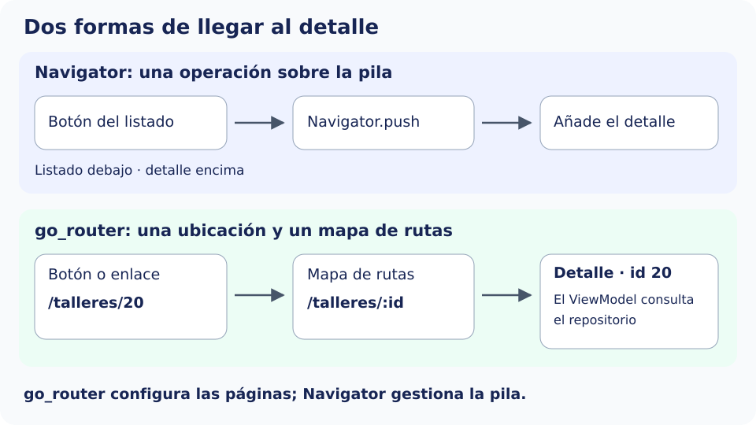

En [Navegación](../navegacion/) abríamos pantallas con `Navigator`. Ahora organizaremos destinos identificables por URL con **go_router**: por ejemplo, `/talleres/20` describe un detalle y `/cuenta` una ficha que solo se muestra después del acceso simulado.

Trabajaremos en **`catalogo_widgets`**, conservando sus pantallas y entradas. A diferencia de los ejemplos básicos, aquí cambiaremos su arranque a `MaterialApp.router`. No crearemos un segundo `MaterialApp` dentro de una pantalla del catálogo.

## El ejemplo que vamos a construir

Añadiremos al catálogo una **demostración de consulta de talleres y acceso a una ficha de usuario**. Imagina que una persona quiere consultar actividades como Fotografía o Cerámica, abrir sus detalles y acceder a su información personal. Los talleres y los usuarios serán los datos ficticios que ya utilizamos en el formulario.

El recorrido final será el siguiente:

1. Desde el catálogo, la entrada **Talleres con go_router** abrirá un listado. Podremos filtrar sus títulos y pulsar un taller para ver su detalle. Cada detalle tendrá una dirección propia, como `/talleres/20`.
2. Una barra inferior permitirá alternar entre **Talleres** y **Ayuda**. Ayuda mostrará un interruptor con consejos; nos servirá para comprobar si conserva su estado al cambiar de pestaña.
3. Otra entrada del catálogo, **Mi cuenta protegida**, intentará abrir la ficha personal. Sin sesión, aparecerá el formulario de login. Con datos válidos, veremos el saludo y los datos completos del usuario; al cerrar sesión, se volverá a solicitar el acceso.

Lo construiremos por etapas. **Primero solo conectaremos el catálogo con Ayuda** para aprender a declarar y abrir una ruta. Después añadiremos el listado y el detalle, la barra inferior y, finalmente, el acceso protegido. No es una aplicación de reservas nueva: es un recorrido de práctica dentro del catálogo de componentes que ya tenemos.

## Qué es go_router

**go_router es un paquete de navegación para Flutter**. Permite definir un mapa de rutas: para cada dirección de la aplicación, indicamos qué pantalla debe mostrarse. Por ejemplo, `/talleres` representa el listado y `/talleres/20` el detalle del taller con identificador `20`. Estas direcciones también sirven en una aplicación móvil; no son exclusivas de una web.

Conviene distinguir tres nombres: `go_router` es el paquete que instalamos; `GoRouter` es la clase con la que configuramos el mapa completo; cada `GoRoute` declara una ruta de ese mapa. En los próximos pasos crearemos esas piezas y las conectaremos con `MaterialApp.router`.

## Del botón que abre una pantalla a una dirección que identifica un destino

Hasta ahora, el botón del listado ejecutaba `Navigator.push` y construía el detalle pasando sus datos por constructor. `Navigator` mantiene una **pila de pantallas**: `push` añade una y `pop` retira la superior para volver a la anterior. Este procedimiento resulta claro para un recorrido como listado → detalle → volver.

Imagina ahora que queremos compartir el detalle de Cerámica mediante un enlace, abrirlo sin pasar por el listado o recuperar ese destino después del login. El código del botón ya no es el único punto de entrada: la aplicación necesita interpretar una dirección y decidir qué pantallas corresponden a ella.

Con go_router declaramos una regla como `/talleres/:id`. `:id` representa la parte variable: al recibir `/talleres/20`, el router extrae `20`, ejecuta el constructor de pantalla configurado y nuestro ViewModel consulta el taller a través del repositorio. La URL identifica el destino; **el router no obtiene ni transforma los datos del taller**.



La imagen muestra dos formas de llegar al mismo detalle. En el primer recorrido, el código pide añadir una pantalla. En el segundo, pide ir a una ubicación y el router configura las páginas asociadas. Por eso hablamos de navegación **imperativa** al ordenar operaciones como `push` y de configuración **declarativa** al definir qué debe mostrarse para cada ruta.

## Qué aporta respecto al Navigator que ya conocemos

| Necesidad | Con `Navigator.push` y `MaterialPageRoute` de los ejemplos anteriores | Con go_router |
| --- | --- | --- |
| Abrir un detalle desde un botón | Construimos la pantalla y la añadimos a la pila. | Pedimos una ubicación que tiene un destino configurado. |
| Abrir el detalle desde un enlace | Ese botón, por sí solo, no interpreta enlaces; necesitamos configurar su recepción y la navegación correspondiente. | El mapa de rutas interpreta el destino y sus parámetros. Los enlaces externos requieren además la configuración de la plataforma. |
| Identificar el taller que se consulta | Pasamos un objeto o identificador al constructor. | Extraemos el identificador de `/talleres/:id` y consultamos el repositorio. |
| Pedir login antes de entrar en Cuenta | Hay que coordinar las comprobaciones en los puntos de entrada que implementemos. | Una política de redirección comprueba la sesión al resolver la ruta, también si se solicita directamente. |
| Mantener varias secciones con historial propio | Podemos hacerlo con varios navegadores y su coordinación. | `StatefulShellRoute` organiza las ramas y conserva su estado mientras permanecen en la shell. |

Estas capacidades se apoyan en las API `Router` y `Navigator` de Flutter. go_router facilita su configuración; **Navigator sigue siendo quien gestiona las pilas y presenta las pantallas**. El cambio no consiste únicamente en escribir menos líneas para abrir un detalle: nos permite reunir las reglas de navegación y aplicarlas también cuando el acceso comienza desde una URL. [La guía de Flutter](https://docs.flutter.dev/ui/navigation) explica cuándo conviene utilizar cada enfoque.

Para un ejemplo con dos pantallas y un botón de vuelta, `Navigator` sigue siendo suficiente. En esta sección usaremos go_router porque combinaremos enlaces directos, parámetros, secciones y acceso protegido. Primero configuraremos rutas públicas; después conectaremos el login por capas con el estado de sesión y las redirecciones.

## Instalar go_router

Desde la raíz de `catalogo_widgets`, donde está `pubspec.yaml`, ejecuta:

```bash
flutter pub add go_router
```

Este comando añade go_router a las dependencias de `pubspec.yaml` y descarga el paquete y sus dependencias. Cuando termine, podremos importarlo y configurar las rutas.

Los identificadores y el código de demostración se comparten entre castellano y valenciano; la explicación y los textos alternativos están traducidos.

## Recorrido de la sección

2. [Configurar las rutas](./configurar-rutas/).
3. [Navegar entre pantallas](./navegar/).
4. [Parámetros y consulta de datos](./parametros-y-datos/).
5. [Rutas anidadas y secciones](./secciones/).
6. [Acceso a rutas protegidas](./rutas-protegidas/).
7. [Enlaces directos y errores](./enlaces-y-errores/).
8. [Ejemplo integrado y comprobaciones](./ejemplo-integrado/).

Referencia: [paquete go_router](https://pub.dev/packages/go_router) y [guía de navegación](https://pub.dev/documentation/go_router/latest/topics/Navigation-topic.html).
