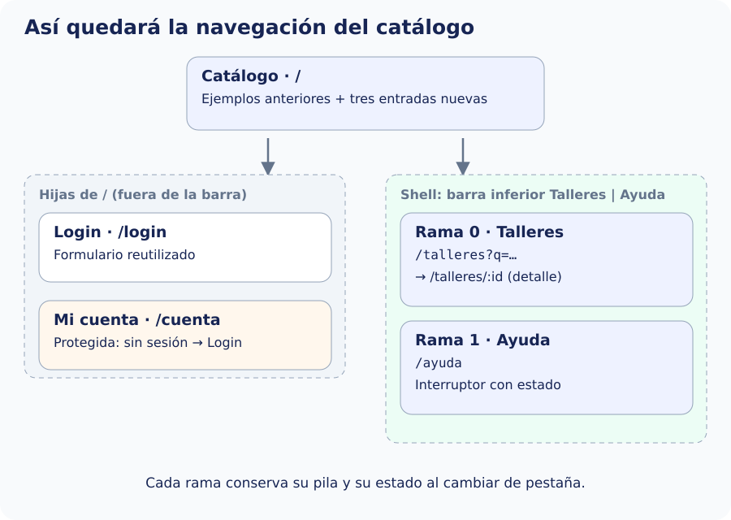
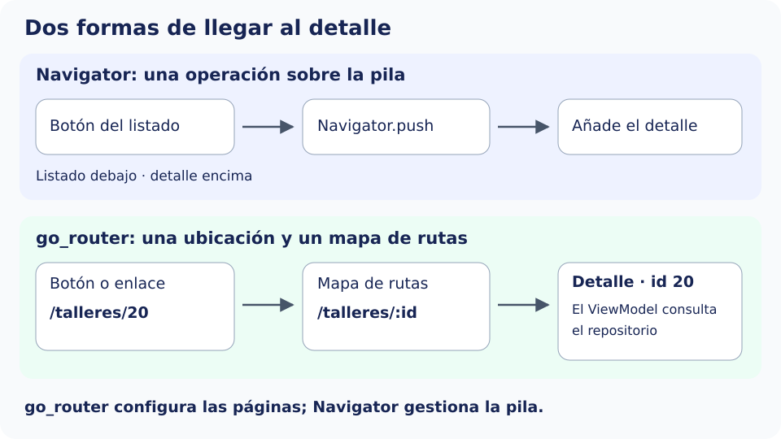

En [Navegación](../navegacion/) abríamos pantallas con `Navigator.push`: el código de un botón construía la pantalla siguiente y la colocaba encima de la actual. En esta sección daremos un paso más: cada pantalla tendrá una **dirección** (por ejemplo, `/talleres/20`) y un único **mapa de rutas** decidirá qué se muestra para cada dirección. Para ello usaremos el paquete **go_router**.

Trabajaremos en el proyecto **`catalogo_widgets`**, conservando sus pantallas y entradas anteriores.

## El ejemplo que vamos a construir

Añadiremos al catálogo una demostración de **consulta de talleres y acceso a una ficha de usuario**. Reutilizaremos los talleres y usuarios ficticios del [formulario](../formulario-con-viewmodel/) y su arquitectura por capas.

Al terminar, el catálogo tendrá tres entradas nuevas:

1. **Ayuda con go_router**: una pantalla con un interruptor «Mostrar consejos».
2. **Talleres con go_router**: un listado con buscador. Al pulsar un taller se abre su detalle, con dirección propia como `/talleres/20`. Una barra inferior permite alternar entre **Talleres** y **Ayuda** sin perder lo que había en cada pestaña.
3. **Mi cuenta protegida**: si no hay sesión, aparece el formulario de login; con datos correctos se muestra la ficha del usuario. Al cerrar sesión, se vuelve a pedir el acceso.



Lo construiremos en siete pasos. Al final de cada uno la aplicación compila y se puede probar.

## Navegación imperativa y declarativa

Con `Navigator` damos **órdenes**: «añade esta pantalla», «quita la de arriba». Es navegación **imperativa**. Funciona muy bien para recorridos cortos, como listado → detalle → volver.

Pero una aplicación real tiene otras formas de llegar a una pantalla: un enlace compartido, una notificación, la barra de direcciones del navegador web o la vuelta después de iniciar sesión. En todos esos casos no hay ningún botón que construya la pantalla: la aplicación recibe una dirección y tiene que **deducir** qué pantallas mostrar.

go_router resuelve esto con navegación **declarativa**: declaramos una vez qué pantalla corresponde a cada dirección, y después, para navegar, solo pedimos ir a una dirección.



| Necesidad | Con `Navigator.push` | Con go_router |
| --- | --- | --- |
| Abrir un detalle desde un botón | Construimos la pantalla y la apilamos. | Pedimos ir a `/talleres/20`. |
| Abrir el detalle desde un enlace | Hay que programar aparte cómo se interpreta el enlace. | El mismo mapa de rutas interpreta la dirección. |
| Saber qué taller mostrar | Pasamos el objeto por constructor. | Leemos `20` de la dirección y consultamos el repositorio. |
| Pedir login antes de entrar en Cuenta | Hay que comprobarlo en cada botón que abra Cuenta. | Una única regla (`redirect`) lo comprueba para cualquier forma de llegar. |
| Pestañas con historial propio | Varios `Navigator` coordinados a mano. | `StatefulShellRoute` lo organiza. |

go_router no sustituye a `Navigator`: lo configura por nosotros. Por debajo, Flutter sigue usando `Navigator` para apilar y animar las pantallas. Para un ejemplo con dos pantallas, `Navigator.push` sigue siendo suficiente; go_router compensa cuando hay enlaces, parámetros, secciones o acceso protegido, como en este ejemplo.

## Anatomía de una dirección

En go_router, la dirección actual se llama **ubicación** (*location*) y se representa con un `Uri`. Tiene la misma forma que una URL web, aunque la aplicación sea móvil:

```text
/talleres/20?q=cer
└───┬───┘└┬┘ └─┬─┘
  ruta   id  parámetro de consulta
```

| Parte | Ejemplo | Para qué la usaremos |
| --- | --- | --- |
| **Ruta** (*path*) | `/talleres/20` | Identifica la pantalla. |
| **Parámetro de ruta** | `20` en el patrón `/talleres/:id` | Dato obligatorio que identifica un registro. |
| **Parámetro de consulta** | `q=cer` tras `?` | Dato opcional, como un filtro. |

Una buena regla: la ubicación debe contener **todo lo necesario para reconstruir la pantalla**, y nada privado. Por eso enviaremos identificadores y filtros, pero nunca la ficha de un usuario ni una contraseña.

## Las piezas de go_router

Antes de escribir código conviene conocer los nombres que aparecerán en todos los pasos. Esta tabla resume las piezas principales y el papel de cada una:

| Pieza | Qué es |
| --- | --- |
| `go_router` | El paquete que instalamos. |
| `GoRouter` | El objeto que contiene el mapa de rutas completo y la configuración global (ubicación inicial, redirecciones, pantalla de error…). Se crea **una sola vez**. |
| `GoRoute` | Una entrada del mapa: asocia un patrón de ruta (`path`) con la pantalla que se construye (`builder`). |
| `GoRouterState` | La información de la navegación en curso: ubicación, parámetros de ruta y de consulta… El `builder` lo recibe para construir la pantalla. |
| `MaterialApp.router` | La variante de `MaterialApp` que delega la navegación en un router. |
| `context.go`, `context.push`, `context.pop`… | Métodos de extensión sobre `BuildContext` para navegar desde cualquier widget. |

## Instalar go_router

Desde la raíz de `catalogo_widgets`, donde está `pubspec.yaml`, ejecuta:

```bash
flutter pub add go_router
```

El comando añade la dependencia a `pubspec.yaml` y descarga el paquete. A partir de aquí podremos importarlo con `import 'package:go_router/go_router.dart';`.

:::caution[Hot reload y rutas]
El router se crea una sola vez al arrancar. Si cambias el mapa de rutas (añades un `GoRoute`, cambias un `path`, un `redirect`…), usa **hot restart** (`R` en la terminal o el botón de reinicio), no hot reload: el hot reload conserva el router antiguo y no verás los cambios.
:::

## Recorrido de la sección

Cada paso añade una pieza al ejemplo y termina con la aplicación funcionando. Síguelos en orden:

2. [Configurar las rutas](./configurar-rutas/): el primer mapa con el catálogo y Ayuda.
3. [Navegar entre pantallas](./navegar/): `go`, `push`, `pop` y la pila de páginas.
4. [Parámetros y consulta de datos](./parametros-y-datos/): listado, buscador y detalle.
5. [Rutas anidadas y secciones](./secciones/): la barra inferior con `StatefulShellRoute`.
6. [Acceso a rutas protegidas](./rutas-protegidas/): sesión, login y `redirect`.
7. [Enlaces directos y errores](./enlaces-y-errores/): rutas desconocidas, web y móvil.
8. [Ejemplo integrado y comprobaciones](./ejemplo-integrado/): resumen final y pruebas.
9. [Ampliación: organizar las dependencias](./dependencias/): repositorios con provider cuando la aplicación crece.

Referencias: [paquete go_router](https://pub.dev/packages/go_router), [guía de navegación de go_router](https://pub.dev/documentation/go_router/latest/topics/Navigation-topic.html) y [navegación en Flutter](https://docs.flutter.dev/ui/navigation).
