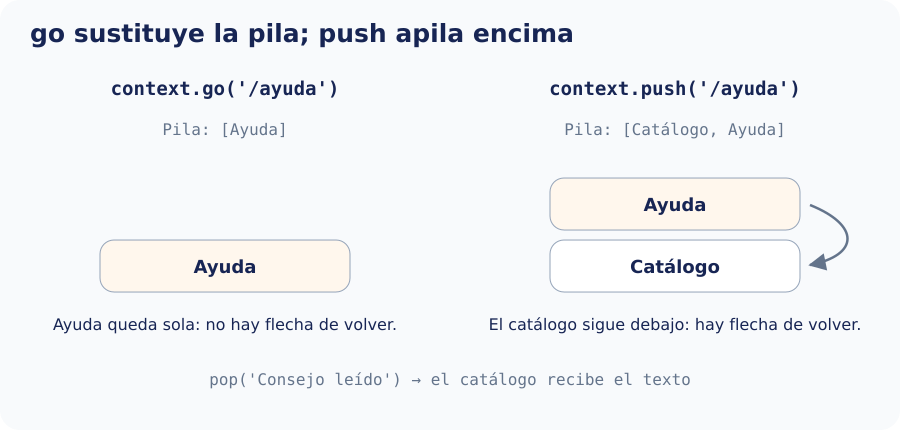

Ya tenemos dos rutas. Antes de añadir más, conviene entender bien **qué hace cada operación de navegación con la pila de páginas**, porque es lo que decide si aparece la flecha de volver, qué pasa con el estado de una pantalla y si podemos devolver un resultado.

## La pila de páginas

Recuerda que `Navigator` muestra una **pila**: la página de arriba es la visible y, si hay alguna debajo, la `AppBar` muestra automáticamente la flecha de volver.

go_router ofrece dos formas de cambiar esa pila:

- **`go`** (ir a una ubicación): el router **sustituye la pila completa** por la que corresponde a la nueva ubicación según el mapa. Lo que hubiera antes desaparece.
- **`push`** (apilar): el router **añade** la página de la nueva ubicación encima de las que ya había. Lo de debajo se conserva.

Con el mapa actual, `/` y `/ayuda` son rutas independientes (ninguna está dentro de otra). Por eso:

```text
context.go('/ayuda')    →  pila: [Ayuda]              (sin flecha de volver)
context.push('/ayuda')  →  pila: [Catálogo, Ayuda]    (con flecha de volver)
```



En el paso 4 veremos que, cuando una ruta está anidada dentro de otra, `go` construye también las páginas padre.

## Experimento 1: `go` sustituye la pila

La entrada del catálogo usa `context.go('/ayuda')`. Abre Ayuda y fíjate en la cabecera: **no hay flecha de volver**, porque el catálogo ya no está debajo. Por eso añadimos el icono de la casa con `context.go('/')`.

Activa el interruptor, vuelve al catálogo y abre de nuevo Ayuda: el interruptor aparece desactivado. Al hacer `go('/')`, la página de Ayuda salió de la pila y su `State` se destruyó; al volver, se crea otra nueva.

## Experimento 2: `push` apila y `pop` devuelve un resultado

Ahora haremos que el catálogo abra Ayuda **encima** y espere una respuesta. Es un cambio temporal: al final del paso lo desharemos.

En `catalogo_pantalla.dart`, cambia el `onTap` de **Ayuda con go_router** por este:

```dart
onTap: () async {
  final respuesta = await context.push<String>('/ayuda');
  if (!context.mounted || respuesta == null) return;
  ScaffoldMessenger.of(context).showSnackBar(
    SnackBar(content: Text(respuesta)),
  );
},
```

- `push<String>` indica que esperamos recibir un `String` cuando Ayuda se cierre.
- `await` espera a ese cierre sin bloquear la interfaz. Si Ayuda se cierra con la flecha de volver, sin respuesta, recibimos `null`.
- `context.mounted` comprueba que el catálogo sigue en pantalla antes de usar su `context` después de la espera.

En `ayuda_pantalla.dart`, añade este botón al final de los `children` del `ListView`:

```dart
Padding(
  padding: const EdgeInsets.all(16),
  child: FilledButton(
    onPressed: context.canPop()
        ? () => context.pop('Consejo leído')
        : null,
    child: const Text('He leído el consejo'),
  ),
),
```

- `context.pop('Consejo leído')` quita Ayuda de la pila y entrega el texto a quien hizo `push`.
- `context.canPop()` indica si hay una página debajo. Si Ayuda se hubiera abierto con `go`, no la habría, y el botón aparece deshabilitado (`onPressed: null`).

Prueba: **catálogo → Ayuda → He leído el consejo**. Vuelves al catálogo y aparece «Consejo leído» en una `SnackBar`. Ahora la cabecera de Ayuda sí muestra la flecha de volver, porque el catálogo sigue debajo.

`go` nunca devuelve resultados: como sustituye la pila, no hay nadie esperando debajo.

## Resumen de operaciones

go_router ofrece más operaciones que las dos que hemos probado. Esta tabla las reúne con su efecto sobre la pila, para que puedas consultarla cuando dudes cuál usar:

| Operación | Efecto en la pila | ¿Devuelve resultado? |
| --- | --- | --- |
| `context.go('/ayuda')` | Sustituye la pila por la de `/ayuda`. | No |
| `context.goNamed('ayuda')` | Igual que `go`, usando el `name` de la ruta. | No |
| `context.push('/ayuda')` | Añade Ayuda encima. | Sí, con `await` |
| `context.pushNamed('ayuda')` | Igual que `push`, usando el nombre. | Sí |
| `context.pop([valor])` | Quita la página de arriba y entrega `valor`. | — |
| `context.canPop()` | Indica si hay página debajo. | — |
| `context.replace('/ayuda')` | Sustituye solo la página de arriba. | No |

**¿Cuándo usar cada una?**

- **`go`** para la navegación normal entre destinos: entradas de menú, pestañas, enlaces, ir a un detalle. La pila siempre coincide con la ubicación, así que un enlace directo y un botón producen exactamente el mismo resultado.
- **`push`** cuando la pantalla nueva es un paso temporal del que se vuelve con una respuesta (elegir un valor, confirmar algo).
- **`pop`** para cerrar la pantalla actual.

En el resto de la sección usaremos `go`. Para diálogos breves seguimos usando `showDialog`, que no necesita ruta.

## Volver al punto de partida

Deshaz el experimento 2 para continuar todos desde el mismo código:

1. En `catalogo_pantalla.dart`, el `onTap` de Ayuda vuelve a ser `onTap: () => context.go('/ayuda'),`.
2. En `ayuda_pantalla.dart`, quita el botón **He leído el consejo**.

Referencias: [navegación](https://pub.dev/documentation/go_router/latest/topics/Navigation-topic.html) y [rutas con nombre](https://pub.dev/documentation/go_router/latest/topics/Named%20routes-topic.html).
