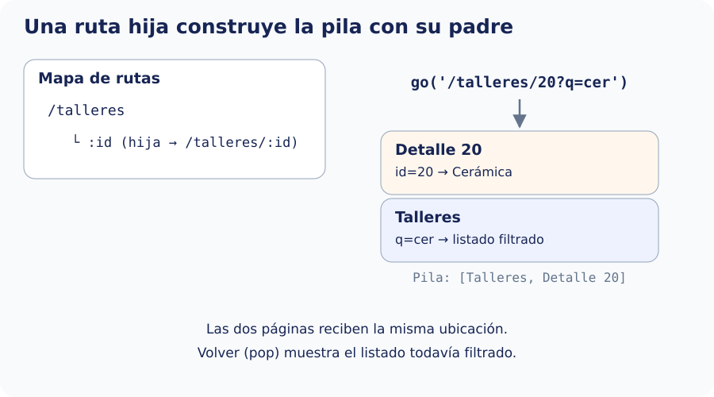

Ahora añadimos el listado de talleres con buscador y su detalle. Aprenderemos tres conceptos:

- **Parámetros de ruta**: `20` en `/talleres/20` identifica el taller.
- **Parámetros de consulta**: `q=cer` en `/talleres?q=cer` filtra el listado.
- **Rutas hijas**: el detalle se declara *dentro* del listado, y eso decide la pila de páginas.

Archivos de este paso:

```text
lib/
  main.dart                                        ← crea el repositorio
  ui/core/
    app_router.dart                                ← recibe el repositorio
    ruta_talleres.dart                             ← nuevo
  ui/navegacion_avanzada/
    view_models/talleres_viewmodel.dart            ← nuevo
    view_models/detalle_taller_viewmodel.dart      ← nuevo
    ui/talleres_pantalla.dart                      ← nuevo
    ui/detalle_taller_pantalla.dart                ← nuevo
```

## La ubicación describe la pantalla, el repositorio aporta los datos

Una idea clave: **el router no transporta los datos del taller**. La dirección solo dice *qué* mostrar (el taller `20`, los talleres que contienen `cer`); la pantalla obtiene los datos de la capa `data` mediante su ViewModel, como en el formulario.

Gracias a eso, `/talleres/20` funciona igual si se llega pulsando en el listado, escribiendo la dirección en el navegador o desde un enlace compartido.

Reutilizamos `Taller`, el contrato `InscripcionesRepository` y su implementación local de la unidad de formularios. No copies los talleres dentro del router ni de las pantallas.

## 1. Los ViewModels

Reciben el contrato del repositorio y el dato que llega en la dirección. Son clases sencillas con campos `final`: se crean de nuevo cada vez que cambia la ubicación, así que no necesitan `ChangeNotifier`.

`lib/ui/navegacion_avanzada/view_models/talleres_viewmodel.dart`

```dart
import '../../../domain/models/taller.dart';
import '../../../domain/repositories/inscripciones_repository.dart';

class TalleresViewModel {
  TalleresViewModel(InscripcionesRepository repository, {String consulta = ''})
    : consulta = consulta.trim(),
      talleres = List.unmodifiable(
        repository.obtenerTalleres().where(
          (t) => t.titulo.toLowerCase().contains(consulta.trim().toLowerCase()),
        ),
      );

  /// Texto de búsqueda recibido en `?q=`. Vacío si no hay filtro.
  final String consulta;
  final List<Taller> talleres;
}
```

`lib/ui/navegacion_avanzada/view_models/detalle_taller_viewmodel.dart`

```dart
import '../../../domain/models/taller.dart';
import '../../../domain/repositories/inscripciones_repository.dart';

class DetalleTallerViewModel {
  DetalleTallerViewModel(InscripcionesRepository repository, this.id)
    : taller = repository
          .obtenerTalleres()
          .where((t) => t.id == id)
          .firstOrNull;

  /// Identificador recibido en la URL (`/talleres/:id`).
  final String id;

  /// Taller encontrado o `null` si el identificador no existe.
  final Taller? taller;
}
```

`firstOrNull` devuelve el primer elemento que cumple la condición o `null` si no hay ninguno. Que la dirección tenga forma de detalle no garantiza que el taller exista; ese caso lo representa el ViewModel con `taller == null`.

## 2. El listado con buscador

El listado muestra los talleres que le entrega su ViewModel y un campo para buscar por título. Lo importante es que no guarda la búsqueda en su propio estado: la escribe en la dirección y deja que el router reconstruya la pantalla.

`lib/ui/navegacion_avanzada/ui/talleres_pantalla.dart`

```dart
import 'package:flutter/material.dart';
import 'package:go_router/go_router.dart';
import '../view_models/talleres_viewmodel.dart';

class TalleresPantalla extends StatelessWidget {
  const TalleresPantalla({super.key, required this.viewModel});
  final TalleresViewModel viewModel;

  /// Los parámetros de consulta que conservamos al navegar.
  Map<String, String> get _filtro => {
    if (viewModel.consulta.isNotEmpty) 'q': viewModel.consulta,
  };

  void _buscar(BuildContext context, String texto) {
    final consulta = texto.trim();
    context.goNamed(
      'talleres',
      queryParameters: {if (consulta.isNotEmpty) 'q': consulta},
    );
  }

  @override
  Widget build(BuildContext context) => Scaffold(
    appBar: AppBar(
      title: const Text('Talleres'),
      actions: [
        IconButton(
          tooltip: 'Catálogo',
          icon: const Icon(Icons.home_outlined),
          onPressed: () => context.go('/'),
        ),
      ],
    ),
    body: Column(
      children: [
        Padding(
          padding: const EdgeInsets.all(16),
          child: TextFormField(
            key: ValueKey(viewModel.consulta),
            initialValue: viewModel.consulta,
            decoration: const InputDecoration(
              labelText: 'Buscar por título',
              prefixIcon: Icon(Icons.search),
              border: OutlineInputBorder(),
            ),
            textInputAction: TextInputAction.search,
            onFieldSubmitted: (texto) => _buscar(context, texto),
          ),
        ),
        Expanded(
          child: viewModel.talleres.isEmpty
              ? const Center(child: Text('No hay talleres para esta búsqueda'))
              : ListView.builder(
                  itemCount: viewModel.talleres.length,
                  itemBuilder: (context, index) {
                    final taller = viewModel.talleres[index];
                    return ListTile(
                      title: Text(taller.titulo),
                      subtitle: Text('Identificador: ${taller.id}'),
                      trailing: const Icon(Icons.chevron_right),
                      onTap: () => context.goNamed(
                        'taller',
                        pathParameters: {'id': taller.id},
                        queryParameters: _filtro,
                      ),
                    );
                  },
                ),
        ),
      ],
    ),
  );
}
```

Fíjate en cómo **la búsqueda se guarda en la dirección**:

- Al pulsar buscar en el teclado, `_buscar` navega a `/talleres?q=texto`. No guardamos el texto en una variable de la pantalla: el router reconstruye el listado con un ViewModel nuevo que recibe la consulta.
- `goNamed` construye la dirección a partir del nombre de la ruta y de los mapas `pathParameters` y `queryParameters`, y se encarga de codificar los caracteres especiales (espacios, acentos…). Nunca concatenes la dirección a mano.
- `key: ValueKey(viewModel.consulta)` hace que el campo se cree de nuevo cuando cambia la consulta, para que su texto inicial (`initialValue`) siempre coincida con la dirección.
- Al abrir un taller pasamos `queryParameters: _filtro`. Así la dirección del detalle es, por ejemplo, `/talleres/20?q=cer` y el listado que queda debajo conserva el filtro. Lo veremos al declarar las rutas.

## 3. El detalle

El detalle recibe su ViewModel ya preparado con el taller que indica la dirección. Si el taller no existe, lo dice. El botón de volver usa `pop`, porque, como veremos en el apartado siguiente, el listado queda debajo en la pila.

`lib/ui/navegacion_avanzada/ui/detalle_taller_pantalla.dart`

```dart
import 'package:flutter/material.dart';
import 'package:go_router/go_router.dart';
import '../view_models/detalle_taller_viewmodel.dart';

class DetalleTallerPantalla extends StatelessWidget {
  const DetalleTallerPantalla({super.key, required this.viewModel});
  final DetalleTallerViewModel viewModel;

  @override
  Widget build(BuildContext context) {
    final taller = viewModel.taller;
    final ubicacion = GoRouterState.of(context).uri;
    return Scaffold(
      appBar: AppBar(title: const Text('Detalle del taller')),
      body: ListView(
        padding: const EdgeInsets.all(24),
        children: [
          Text(
            taller?.titulo ?? 'No existe el taller ${viewModel.id}',
            style: Theme.of(context).textTheme.headlineSmall,
          ),
          if (taller != null) Text('Identificador: ${taller.id}'),
          const SizedBox(height: 8),
          Text('Ubicación actual: $ubicacion'),
          const SizedBox(height: 24),
          FilledButton(
            onPressed: () {
              if (context.canPop()) {
                context.pop();
              } else {
                context.go('/talleres');
              }
            },
            child: const Text('Volver al listado'),
          ),
        ],
      ),
    );
  }
}
```

`GoRouterState.of(context)` permite a cualquier widget consultar el estado de la navegación de su ruta. Aquí mostramos la ubicación para que puedas observar cómo cambia; en una aplicación real no haría falta enseñarla.

## 4. Declarar las rutas con parámetros

Agrupamos el listado y su detalle en una función propia. Recibe el repositorio porque los `builder` lo necesitan para crear los ViewModels.

`lib/ui/core/ruta_talleres.dart`

```dart
import 'package:go_router/go_router.dart';
import '../../domain/repositories/inscripciones_repository.dart';
import '../navegacion_avanzada/ui/detalle_taller_pantalla.dart';
import '../navegacion_avanzada/ui/talleres_pantalla.dart';
import '../navegacion_avanzada/view_models/detalle_taller_viewmodel.dart';
import '../navegacion_avanzada/view_models/talleres_viewmodel.dart';

GoRoute rutaTalleres(InscripcionesRepository repository) => GoRoute(
  path: '/talleres',
  name: 'talleres',
  builder: (context, state) => TalleresPantalla(
    viewModel: TalleresViewModel(
      repository,
      consulta: state.uri.queryParameters['q'] ?? '',
    ),
  ),
  routes: [
    GoRoute(
      path: ':id',
      name: 'taller',
      builder: (context, state) => DetalleTallerPantalla(
        viewModel: DetalleTallerViewModel(
          repository,
          state.pathParameters['id']!,
        ),
      ),
    ),
  ],
);
```

### Parámetros de ruta: `:id`

Un segmento que empieza por `:` es un **parámetro**: coincide con cualquier valor en esa posición. Con el patrón `/talleres/:id`, la ubicación `/talleres/20` coincide y `state.pathParameters['id']` vale `'20'`.

Usamos `!` porque el patrón obliga a que el segmento exista: si no hubiera `id`, la ruta no coincidiría. Los parámetros siempre llegan como **texto**; si algún día necesitas un número, conviértelo con `int.tryParse` y trata el caso `null`.

### Parámetros de consulta: `?q=`

Los parámetros de consulta no forman parte del patrón: son opcionales. Se leen con `state.uri.queryParameters['q']`, que vale `null` si no vienen; por eso usamos `?? ''`.

### Rutas hijas: `routes` dentro de un `GoRoute`

El detalle está en la lista `routes` del listado. Una ruta hija:

- **No empieza por `/`**: su `path` se une al del padre. `':id'` dentro de `'/talleres'` forma `/talleres/:id`.
- **Construye la pila con su padre**. Al hacer `go('/talleres/20')`, go_router crea **dos páginas**: el listado (`/talleres`) y, encima, el detalle. Por eso el detalle muestra la flecha de volver aunque hayamos usado `go`, y `context.canPop()` es `true`.

```text
go('/talleres/20?q=cer')  →  pila: [Talleres (q=cer), Detalle 20]
```



Todas las páginas de la pila reciben la misma ubicación completa. Por eso el `builder` del listado lee `q=cer` aunque la ubicación sea la del detalle, y al volver vemos el listado filtrado. Esa es la razón de pasar `queryParameters: _filtro` al abrir un taller.

## 5. Añadir la ruta al mapa

Para que el router conozca las nuevas rutas, hay que añadirlas a su lista `routes`. Como los `builder` necesitan el repositorio, `crearRouter` pasa a recibirlo como parámetro.

`lib/ui/core/app_router.dart`

```dart
import 'package:go_router/go_router.dart';
import '../../domain/repositories/inscripciones_repository.dart';
import '../catalogo/ui/catalogo_pantalla.dart';
import '../navegacion_avanzada/ui/ayuda_pantalla.dart';
import 'ruta_talleres.dart';

GoRouter crearRouter(InscripcionesRepository repository) => GoRouter(
  initialLocation: '/',
  debugLogDiagnostics: true,
  routes: [
    GoRoute(
      path: '/',
      name: 'catalogo',
      builder: (context, state) => const CatalogoPantalla(),
    ),
    rutaTalleres(repository),
    GoRoute(
      path: '/ayuda',
      name: 'ayuda',
      builder: (context, state) => const AyudaPantalla(),
    ),
  ],
);
```

## 6. Crear el repositorio en el arranque

La función `main()` es la **raíz de composición**: el único lugar que conoce las implementaciones de `data`. Crea el repositorio y lo entrega al router. En `main.dart`, añade estos imports y sustituye la función `main`:

```dart
import 'data/repositories/inscripciones_local_repository.dart';
import 'data/services/inscripciones_local_service.dart';
```

```dart
void main() {
  final repository = InscripcionesLocalRepository(
    const InscripcionesLocalService(),
  );
  final router = crearRouter(repository);
  runApp(
    MaterialApp.router(
      debugShowCheckedModeBanner: false,
      title: 'Catálogo de widgets',
      routerConfig: router,
    ),
  );
}
```

## 7. Entrada en el catálogo

Falta un punto de entrada desde el catálogo. Como el listado tiene dirección propia, el botón solo tiene que pedir ir a `/talleres`.

Añade esta entrada debajo de la de Ayuda:

```dart
ListTile(
  leading: const Icon(Icons.school_outlined),
  title: const Text('Talleres con go_router'),
  trailing: const Icon(Icons.chevron_right),
  onTap: () => context.go('/talleres'),
),
```

## Probar

Con estas pruebas comprobarás que los parámetros viajan en la dirección y que la pila se construye como hemos explicado.

Haz **hot restart** y comprueba:

| Acción | Resultado |
| --- | --- |
| Abrir Talleres con go_router | Aparecen todos los talleres. |
| Escribir `cer` y pulsar buscar | Solo aparece Cerámica; la ubicación es `/talleres?q=cer`. |
| Pulsar Cerámica | Detalle con «Ubicación actual: /talleres/20?q=cer». |
| Volver al listado | El listado sigue filtrado por `cer`. |
| Buscar `zzz` | «No hay talleres para esta búsqueda». |

## ¿Y `extra`?

go_router también permite adjuntar un objeto a la navegación: `context.go('/talleres/20', extra: taller)`, que el destino lee con `state.extra`. Ese objeto **no forma parte de la dirección**: si la pantalla se abre desde un enlace o se recarga en el navegador, `extra` llega vacío. Por eso, para reconstruir un destino, usa siempre parámetros de ruta o de consulta y consulta el repositorio, como hemos hecho. Reserva `extra` para datos accesorios que la pantalla pueda permitirse no recibir.

Nunca pongas contraseñas ni datos personales en la dirección: queda visible, se guarda en el historial y se puede compartir.

Referencias: [parámetros y navegación](https://pub.dev/documentation/go_router/latest/topics/Navigation-topic.html) y [GoRouterState](https://pub.dev/documentation/go_router/latest/go_router/GoRouterState-class.html).
