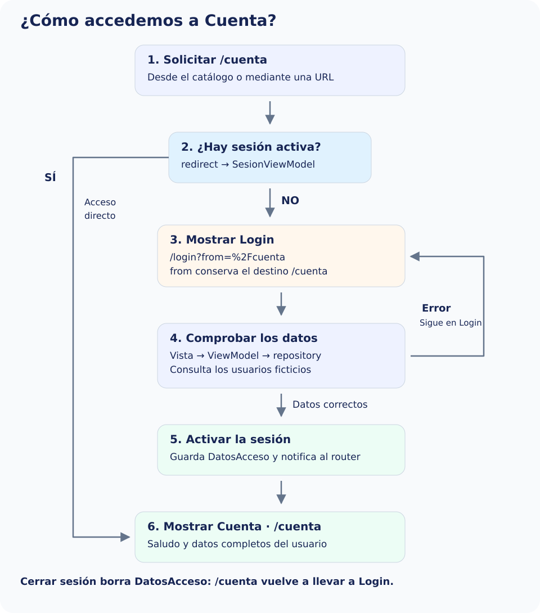

En este paso añadimos **Mi cuenta** (`/cuenta`), una pantalla que solo se puede ver después de iniciar sesión con el formulario de la unidad anterior. Talleres, Ayuda y el catálogo siguen siendo públicos.

La protección tiene que funcionar **llegue como llegue** la persona a `/cuenta`: desde un botón, escribiendo la dirección o volviendo atrás en el navegador. Ocultar un botón no basta. Por eso la comprobación no estará en las pantallas, sino en el router.



Archivos de este paso:

```text
lib/
  main.dart                                       ← crea la sesión
  ui/
    core/app_router.dart                          ← login, cuenta y redirect
    core/redireccion_sesion.dart                  ← nuevo: la política de acceso
    core/view_models/sesion_viewmodel.dart        ← nuevo: estado de sesión
    inscripcion/ui/inscripcion_pantalla.dart      ← avisa del login con un callback
    inscripcion/ui/inscripcion_ejemplo_pantalla.dart ← adapta la demo antigua
    inscripcion/ui/login_ruta_pantalla.dart       ← nuevo: el formulario como ruta
    navegacion_avanzada/ui/cuenta_pantalla.dart   ← nuevo
```

## Cómo funciona `redirect`

Antes de programar, veamos la herramienta que usaremos para proteger Cuenta y cómo se entera el router de que la sesión ha cambiado.

`GoRouter` admite una función **`redirect`** que se ejecuta **antes de mostrar cualquier ubicación**: al arrancar, con cada `go` o `push`, con un enlace directo y con los botones atrás y adelante del navegador.

```dart
redirect: (context, state) {
  // state.uri es la ubicación que se quiere mostrar.
  // Devuelve otra ubicación para desviar la navegación,
  // o null para dejarla continuar.
},
```

- Si devuelve **`null`**, la navegación sigue hacia la ubicación pedida.
- Si devuelve **otra ubicación**, go_router navega allí en su lugar (y vuelve a llamar a `redirect` con la nueva ubicación, por si hubiera que desviarla otra vez).
- Solo **decide**: no debe llamar a `context.go`, ni iniciar sesión, ni consultar el repositorio. Recibe un estado y devuelve una dirección.

Hay un problema: `redirect` se ejecuta al navegar, pero la sesión cambia sin navegar (al pulsar Login o Cerrar sesión). Para eso existe **`refreshListenable`**: le damos un `Listenable` (nuestro ViewModel de sesión) y, cada vez que notifica un cambio, el router **vuelve a evaluar `redirect` sobre la ubicación actual**. Así, al iniciar sesión estando en Login, el router nos lleva a Cuenta; y al cerrar sesión estando en Cuenta, nos saca de ella.

:::note[redirect global y por ruta]
Además del `redirect` de `GoRouter`, cada `GoRoute` puede tener el suyo, que solo se aplica a esa ruta y sus hijas. Usamos el global para tener toda la política de acceso en un único sitio.
:::

## 1. El estado de sesión

El router necesita saber en todo momento si hay una sesión activa. Lo guardamos en un ViewModel compartido que avisa cada vez que cambia.

`lib/ui/core/view_models/sesion_viewmodel.dart`

```dart
import 'package:flutter/foundation.dart';
import '../../../domain/models/datos_acceso.dart';

class SesionViewModel extends ChangeNotifier {
  DatosAcceso? _acceso;

  DatosAcceso? get acceso => _acceso;
  bool get activa => _acceso != null;

  void iniciarSesion(DatosAcceso acceso) {
    _acceso = acceso;
    notifyListeners();
  }

  void cerrarSesion() {
    _acceso = null;
    notifyListeners();
  }
}
```

Guarda el resultado del login (`DatosAcceso`), nunca lo que se escribió en los campos. Es estado en memoria: al reiniciar la aplicación, la sesión desaparece. Está en `ui/core` porque lo comparten varias pantallas y el router. `notifyListeners()` es lo que escucha `refreshListenable`.

## 2. El formulario avisa del login, no navega

El formulario de la unidad anterior abría el detalle con `Navigator.push` al validar. Ahora queremos reutilizarlo en dos sitios distintos:

- En la demo **Login de demostración** del catálogo, que sigue abriendo el detalle con `Navigator.push`.
- En la ruta `/login`, donde no debe navegar: tras el login, **el router** decide el destino.

La solución es que el formulario no decida qué hacer: **avisa** con un callback y quien lo usa decide.

En `lib/ui/inscripcion/ui/inscripcion_pantalla.dart`:

1. Sustituye el import de `detalle_usuario_pantalla.dart` por este:

   ```dart
   import '../../../domain/models/datos_acceso.dart';
   ```

2. Sustituye el constructor y los campos de `InscripcionPantalla`:

   ```dart
   const InscripcionPantalla({
     super.key,
     required this.viewModel,
     required this.onLogin,
   });
   final InscripcionViewModel viewModel;
   final ValueChanged<DatosAcceso> onLogin;
   ```

3. Sustituye el método `_login` por este. El callback solo se llama con un resultado válido:

   ```dart
   void _login() {
     setState(() => _intentoLogin = true);
     if (!(_formKey.currentState?.validate() ?? false)) return;
     final resultado = widget.viewModel.login();
     if (resultado == null) return;
     widget.onLogin(resultado);
   }
   ```

`ValueChanged<DatosAcceso>` es un tipo de Flutter equivalente a `void Function(DatosAcceso)`.

Para que la demo antigua siga igual, en `lib/ui/inscripcion/ui/inscripcion_ejemplo_pantalla.dart` añade `import 'detalle_usuario_pantalla.dart';` y sustituye su `build`:

```dart
@override
Widget build(BuildContext context) => InscripcionPantalla(
  viewModel: _viewModel,
  onLogin: (resultado) => Navigator.of(context).push<void>(
    MaterialPageRoute<void>(
      builder: (_) => DetalleUsuarioPantalla(acceso: resultado),
    ),
  ),
);
```

## 3. El formulario como ruta

La ruta `/login` necesita su propio adaptador. Igual que `InscripcionEjemploPantalla`, crea el ViewModel una vez y lo libera al salir; la diferencia es que **recibe** el contrato del repositorio y el callback, en lugar de crearlos. Así no conoce ninguna implementación de `data`.

`lib/ui/inscripcion/ui/login_ruta_pantalla.dart`

```dart
import 'package:flutter/material.dart';
import '../../../domain/models/datos_acceso.dart';
import '../../../domain/repositories/inscripciones_repository.dart';
import '../view_models/inscripcion_viewmodel.dart';
import 'inscripcion_pantalla.dart';

class LoginRutaPantalla extends StatefulWidget {
  const LoginRutaPantalla({
    super.key,
    required this.repository,
    required this.onLogin,
  });
  final InscripcionesRepository repository;
  final ValueChanged<DatosAcceso> onLogin;

  @override
  State<LoginRutaPantalla> createState() => _LoginRutaPantallaState();
}

class _LoginRutaPantallaState extends State<LoginRutaPantalla> {
  late final InscripcionViewModel _viewModel;

  @override
  void initState() {
    super.initState();
    _viewModel = InscripcionViewModel(widget.repository);
  }

  @override
  void dispose() {
    _viewModel.dispose();
    super.dispose();
  }

  @override
  Widget build(BuildContext context) =>
      InscripcionPantalla(viewModel: _viewModel, onLogin: widget.onLogin);
}
```

## 4. La pantalla de Cuenta

Recibe los datos de la sesión y un callback para salir. No consulta el repositorio ni navega: cerrar sesión solo cambia el estado, y el router reacciona.

`lib/ui/navegacion_avanzada/ui/cuenta_pantalla.dart`

```dart
import 'package:flutter/material.dart';
import '../../../domain/models/datos_acceso.dart';

class CuentaPantalla extends StatelessWidget {
  const CuentaPantalla({
    super.key,
    required this.acceso,
    required this.onSalir,
  });
  final DatosAcceso acceso;
  final VoidCallback onSalir;

  @override
  Widget build(BuildContext context) {
    final usuario = acceso.usuario;
    return Scaffold(
      appBar: AppBar(title: const Text('Mi cuenta')),
      body: ListView(
        padding: const EdgeInsets.all(24),
        children: [
          Text(
            '¡Hola, ${usuario.nombreCompleto}!',
            style: Theme.of(context).textTheme.headlineSmall,
          ),
          const SizedBox(height: 16),
          Text('Identificador: ${usuario.id}'),
          Text('Correo: ${usuario.correo}'),
          Text('Teléfono: ${usuario.telefono}'),
          Text('Localidad: ${usuario.localidad}'),
          Text('Taller: ${acceso.taller.titulo}'),
          Text(
            acceso.recordatorio
                ? 'Recordatorio simulado: sí'
                : 'Sin recordatorio',
          ),
          const SizedBox(height: 24),
          OutlinedButton.icon(
            onPressed: onSalir,
            icon: const Icon(Icons.logout),
            label: const Text('Cerrar sesión'),
          ),
        ],
      ),
    );
  }
}
```

## 5. La política de acceso

Escribimos la decisión de `redirect` como una función **pura**: recibe si hay sesión y la ubicación pedida, y devuelve la nueva ubicación o `null`. No depende de Flutter ni del router, así que es fácil de leer y de probar.

`lib/ui/core/redireccion_sesion.dart`

```dart
const rutaLogin = '/login';
const rutaCuenta = '/cuenta';

/// Rutas que exigen sesión. Para proteger otra, basta con añadirla aquí.
const rutasProtegidas = {rutaCuenta};

/// Quita la barra final para que `/cuenta/` y `/cuenta` se traten igual.
String _normalizar(String path) =>
    path.length > 1 && path.endsWith('/')
    ? path.substring(0, path.length - 1)
    : path;

bool esRutaProtegida(Uri ubicacion) =>
    rutasProtegidas.contains(_normalizar(ubicacion.path));

/// Devuelve el destino tras el login. Solo acepta rutas protegidas internas;
/// cualquier otro valor (otra web, el propio login, texto vacío) lleva a Cuenta.
String destinoTrasLogin(String? from) {
  final uri = Uri.tryParse(from ?? '');
  if (uri != null &&
      !uri.hasScheme &&
      !uri.hasAuthority &&
      uri.fragment.isEmpty &&
      esRutaProtegida(uri)) {
    return uri.toString();
  }
  return rutaCuenta;
}

/// Política de acceso: devuelve otra ubicación o `null` para continuar.
String? redireccionSesion({
  required bool sesionActiva,
  required Uri ubicacion,
}) {
  if (!sesionActiva && esRutaProtegida(ubicacion)) {
    return Uri(
      path: rutaLogin,
      queryParameters: {'from': ubicacion.toString()},
    ).toString();
  }
  if (sesionActiva && _normalizar(ubicacion.path) == rutaLogin) {
    return destinoTrasLogin(ubicacion.queryParameters['from']);
  }
  return null;
}
```

Las dos reglas, en palabras:

1. **Sin sesión y pidiendo una ruta protegida** → ve a Login, y guarda en el parámetro `from` adónde querías ir. Construimos la dirección con `Uri(...)` para que `from` quede codificado: `/cuenta?origen=menu` se convierte en `/login?from=%2Fcuenta%3Forigen%3Dmenu`.
2. **Con sesión y en Login** → no tiene sentido pedir el acceso otra vez: ve al destino guardado en `from`.

En cualquier otro caso, `null`: la navegación continúa.

`destinoTrasLogin` no se fía de `from`, porque cualquiera puede escribirlo en la dirección. Solo acepta una ruta interna (sin esquema como `https:` ni dominio como `//otra.web`) que además sea protegida. Así un enlace manipulado no puede sacarnos de la aplicación ni provocar un bucle volviendo a `/login`.

## 6. El mapa de rutas con acceso protegido

Con todas las piezas preparadas, las conectamos en el mapa de rutas: añadimos Login y Cuenta, y la política de acceso.

Sustituye `app_router.dart`:

`lib/ui/core/app_router.dart`

```dart
import 'package:flutter/material.dart';
import 'package:go_router/go_router.dart';
import '../../domain/repositories/inscripciones_repository.dart';
import '../catalogo/ui/catalogo_pantalla.dart';
import 'view_models/sesion_viewmodel.dart';
import '../inscripcion/ui/login_ruta_pantalla.dart';
import '../navegacion_avanzada/ui/ayuda_pantalla.dart';
import '../navegacion_avanzada/ui/cuenta_pantalla.dart';
import '../navegacion_avanzada/ui/secciones_pantalla.dart';
import 'redireccion_sesion.dart';
import 'ruta_talleres.dart';

GoRouter crearRouter(
  InscripcionesRepository repository,
  SesionViewModel sesion,
) => GoRouter(
  initialLocation: '/',
  debugLogDiagnostics: true,
  refreshListenable: sesion,
  redirect: (context, state) =>
      redireccionSesion(sesionActiva: sesion.activa, ubicacion: state.uri),
  routes: [
    GoRoute(
      path: '/',
      name: 'catalogo',
      builder: (context, state) => const CatalogoPantalla(),
      routes: [
        GoRoute(
          path: 'login',
          name: 'login',
          builder: (context, state) => LoginRutaPantalla(
            repository: repository,
            onLogin: sesion.iniciarSesion,
          ),
        ),
        GoRoute(
          path: 'cuenta',
          name: 'cuenta',
          builder: (context, state) {
            final acceso = sesion.acceso;
            if (acceso == null) return const SizedBox.shrink();
            return CuentaPantalla(
              acceso: acceso,
              onSalir: sesion.cerrarSesion,
            );
          },
        ),
      ],
    ),
    StatefulShellRoute.indexedStack(
      builder: (context, state, navigationShell) =>
          SeccionesPantalla(navigationShell: navigationShell),
      branches: [
        StatefulShellBranch(routes: [rutaTalleres(repository)]),
        StatefulShellBranch(
          routes: [
            GoRoute(
              path: '/ayuda',
              name: 'ayuda',
              builder: (context, state) => const AyudaPantalla(),
            ),
          ],
        ),
      ],
    ),
  ],
);
```

Novedades:

- **`refreshListenable: sesion`** y **`redirect`** conectan la política con el estado de sesión. El router no se crea de nuevo cuando cambia la sesión: solo reevalúa la redirección.
- **`login` y `cuenta` son hijas de `/`**. Sus direcciones son `/login` y `/cuenta`, pero, como en el paso 4, `go('/cuenta')` construye la pila `[Catálogo, Cuenta]`: la cabecera muestra la flecha para volver al catálogo. Además quedan fuera de la shell, así que la barra inferior no aparece encima del formulario.
- **`onLogin: sesion.iniciarSesion`**: cuando el formulario valida, la sesión se activa y notifica; el router reevalúa `redirect` en `/login` y la regla 2 nos lleva a Cuenta.
- **`onSalir: sesion.cerrarSesion`**: al cerrar sesión, el router reevalúa `redirect` en `/cuenta` y la regla 1 nos lleva a Login. Si vuelves a entrar, regresas a Cuenta.
- El `builder` de Cuenta comprueba que haya acceso en lugar de usar `sesion.acceso!`. La redirección ya impide llegar sin sesión; esta comprobación evita depender solo de ella.

## 7. Crear la sesión en el arranque

Sustituye `main.dart` por su versión final. La sesión se crea una sola vez y se comparte con el router, que la escucha. Las pantallas no la crean: la reciben a través de los callbacks del router.

`lib/main.dart`

```dart
import 'package:flutter/material.dart';
import 'data/repositories/inscripciones_local_repository.dart';
import 'data/services/inscripciones_local_service.dart';
import 'ui/core/app_router.dart';
import 'ui/core/view_models/sesion_viewmodel.dart';

void main() {
  final repository = InscripcionesLocalRepository(
    const InscripcionesLocalService(),
  );
  final sesion = SesionViewModel();
  final router = crearRouter(repository, sesion);
  runApp(
    MaterialApp.router(
      debugShowCheckedModeBanner: false,
      title: 'Catálogo de widgets',
      routerConfig: router,
    ),
  );
}
```

## 8. Entrada en el catálogo

Por último, añadimos el acceso a Cuenta desde el catálogo.

Añade esta entrada debajo de la de Talleres:

```dart
ListTile(
  leading: const Icon(Icons.lock_outline),
  title: const Text('Mi cuenta protegida'),
  trailing: const Icon(Icons.chevron_right),
  onTap: () => context.go('/cuenta'),
),
```

El botón no comprueba nada: pide `/cuenta` y la política decide.

## Probar

Recorre estas situaciones para comprobar las dos reglas de la política de acceso.

Haz **hot restart** y observa en la consola las líneas de redirección de `GoRouter`:

| Situación | Resultado esperado |
| --- | --- |
| Sin sesión, pulsar Mi cuenta protegida | Se abre Login; la ubicación es `/login?from=%2Fcuenta`. |
| Login con Ana y `pau@centro.es` | Error de consulta; sigue en Login y no hay sesión. |
| Login con Ana, `ana@centro.es` y un taller | Se abre Mi cuenta con el saludo de Ana García Pérez. |
| Flecha de volver en Mi cuenta | Vuelve al catálogo. |
| Pulsar otra vez Mi cuenta protegida | Abre Cuenta directamente: ya hay sesión. |
| Cerrar sesión | Vuelve a Login. |
| Login de demostración (entrada antigua) | Funciona como en la unidad de formularios y no inicia sesión. |

:::caution[Esto es una demostración]
Esta protección decide qué pantallas se muestran en la aplicación, pero no es seguridad real: no hay contraseñas y los datos están dentro de la propia app. En un sistema real, es el servidor quien autentica y autoriza cada petición. Además, si la sesión se recuperase de forma asíncrona (por ejemplo, desde almacenamiento), habría que representar un estado «comprobando» para no enviar a Login antes de saber si hay sesión.
:::

Referencias: [redirecciones](https://pub.dev/documentation/go_router/latest/topics/Redirection-topic.html) y [GoRouter](https://pub.dev/documentation/go_router/latest/go_router/GoRouter-class.html).
