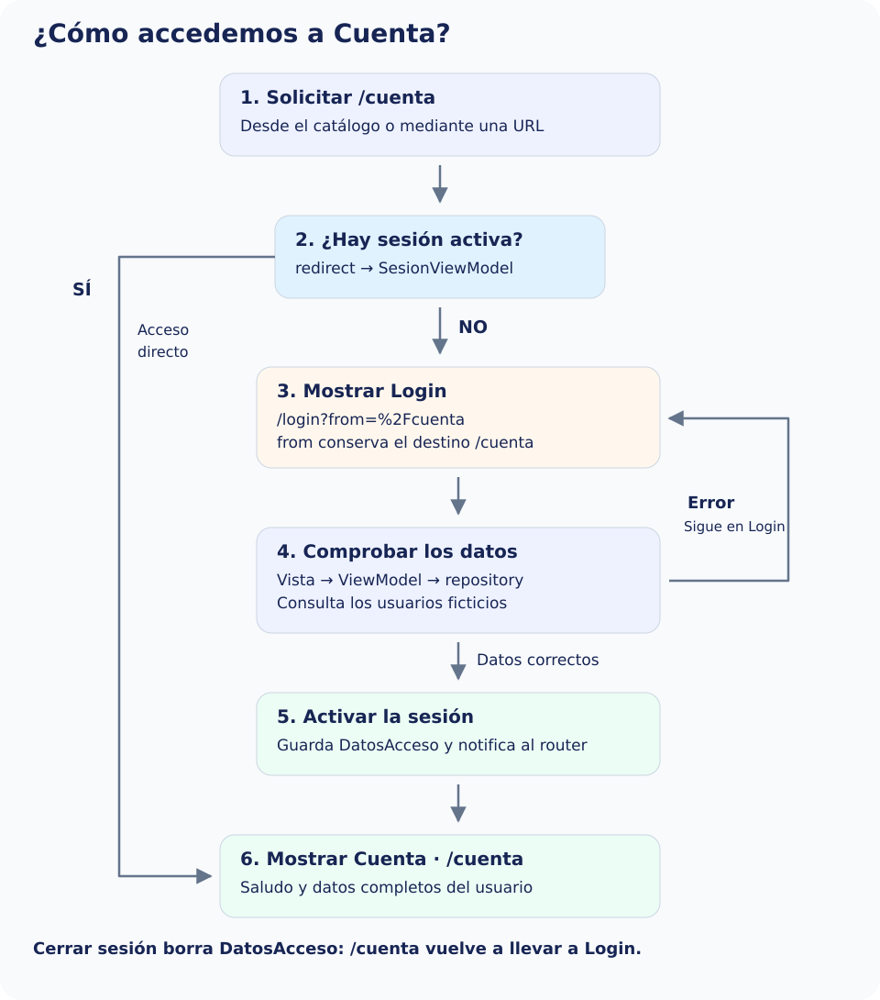

Protegeremos `/cuenta`. Talleres, Ayuda y el catálogo siguen siendo públicos. La protección se aplica también al escribir la URL: ocultar el botón no bastaría.

El login mantiene el recorrido conocido: **vista → InscripcionViewModel → contrato → repositorio → servicio y DTO → modelo de dominio**. El router no comprueba credenciales. Cuando `login()` encuentra una ficha y devuelve `DatosAcceso`, la vista comunica el resultado y actualizamos el estado de sesión.

Antes de programarlo, sigue el recorrido de la imagen: sin sesión se conserva el destino en `from` y se abre Login. Si los datos son válidos, el formulario comunica `DatosAcceso`, cambia la sesión y el router permite llegar a Cuenta. Si hay errores, no se activa la sesión. La rama «Sí» representa a quien ya había accedido.



## Estado de sesión de presentación

Crea este ViewModel compartido. Guarda el resultado de la consulta, no contraseñas ni DTO. Es estado en memoria de la demostración, por eso se pierde al reiniciar. `notifyListeners()` permitirá al router reevaluar la redirección al entrar y salir.


`lib/ui/core/view_models/sesion_viewmodel.dart`

```dart
import 'package:flutter/foundation.dart';
import '../../../domain/models/datos_acceso.dart';

class SesionViewModel extends ChangeNotifier {
  DatosAcceso? _acceso;
  DatosAcceso? get acceso => _acceso;
  bool get activa => _acceso != null;
  void iniciarSesion(DatosAcceso acceso) {
    _acceso = acceso;
    notifyListeners();
  }

  void cerrarSesion() {
    _acceso = null;
    notifyListeners();
  }
}
```

## Comunicar el éxito sin acoplar el formulario al router

En `inscripcion_pantalla.dart`, conserva el aspecto, Login, Limpiar, los controladores y sus validadores. Sustituye el import de `detalle_usuario_pantalla.dart` por `../../../domain/models/datos_acceso.dart`. Añade al constructor y a la clase el callback requerido:


```dart
const InscripcionPantalla({
  super.key, required this.viewModel, required this.onLogin,
});
final InscripcionViewModel viewModel;
final ValueChanged<DatosAcceso> onLogin;
```

Sustituye solo `_login` por este método. Elimina su antiguo `Navigator.push`: no deben ejecutarse una navegación imperativa y una redirección para el mismo acceso. El callback solo se llama con un resultado válido.


```dart
void _login() {
  setState(() => _intentoLogin = true);
  if (!(_formKey.currentState?.validate() ?? false)) return;
  final resultado = widget.viewModel.login();
  if (resultado == null) return;
  widget.onLogin(resultado);
}
```

Para conservar la demostración antigua del catálogo, en `inscripcion_ejemplo_pantalla.dart` mantén su creación del servicio, repositorio y ViewModel. Añade `import 'detalle_usuario_pantalla.dart';` y sustituye solo su `build`:


```dart
@override
Widget build(BuildContext context) => InscripcionPantalla(
  viewModel: _viewModel,
  onLogin: (resultado) => Navigator.of(context).push<void>(
    MaterialPageRoute<void>(builder: (_) => DetalleUsuarioPantalla(acceso: resultado)),
  ),
);
```

La demostración básica conserva así su recorrido. La ruta `/login` utilizará este nuevo adaptador: recibe el contrato por constructor, crea una sola instancia del ViewModel y la libera al salir. No importa ninguna implementación de `data`.


`lib/ui/inscripcion/ui/login_ruta_pantalla.dart`

```dart
import 'package:flutter/material.dart';
import '../../../domain/models/datos_acceso.dart';
import '../../../domain/repositories/inscripciones_repository.dart';
import '../view_models/inscripcion_viewmodel.dart';
import 'inscripcion_pantalla.dart';

class LoginRutaPantalla extends StatefulWidget {
  const LoginRutaPantalla({
    super.key,
    required this.repository,
    required this.onLogin,
  });
  final InscripcionesRepository repository;
  final ValueChanged<DatosAcceso> onLogin;
  @override
  State<LoginRutaPantalla> createState() => _LoginRutaPantallaState();
}

class _LoginRutaPantallaState extends State<LoginRutaPantalla> {
  late final InscripcionViewModel _viewModel;
  @override
  void initState() {
    super.initState();
    _viewModel = InscripcionViewModel(widget.repository);
  }

  @override
  void dispose() {
    _viewModel.dispose();
    super.dispose();
  }

  @override
  Widget build(BuildContext context) =>
      InscripcionPantalla(viewModel: _viewModel, onLogin: widget.onLogin);
}
```

## Definir la política de redirección

`redirect` devuelve una ubicación si debemos cambiar de destino y `null` si la navegación puede continuar. Es una decisión, no un lugar para llamar a `context.go`, crear sesiones ni ejecutar el login.

Guardamos el destino solicitado en `from` mediante `Uri`, para codificar sus parámetros. Tras el acceso lo recuperamos. La función solo acepta `/cuenta` como destino interno permitido: rechaza URLs externas y evita regresar al propio login en bucle. Si añades otras rutas protegidas, amplía **tanto** la comprobación de acceso como los destinos permitidos.


`lib/app/router/redireccion_sesion.dart`

```dart
import 'package:go_router/go_router.dart';
import '../../ui/core/view_models/sesion_viewmodel.dart';

String destinoTrasLogin(String? valor) {
  final uri = Uri.tryParse(valor ?? '');
  if (uri != null &&
      !uri.hasScheme &&
      !uri.hasAuthority &&
      uri.path == '/cuenta' &&
      uri.fragment.isEmpty) {
    return uri.toString();
  }
  return '/cuenta';
}

String? redireccionSesion(SesionViewModel sesion, GoRouterState state) {
  final enLogin = state.uri.path == '/login';
  final protegida = state.uri.path == '/cuenta';
  if (!sesion.activa && protegida) {
    return Uri(
      path: '/login',
      queryParameters: {'from': state.uri.toString()},
    ).toString();
  }
  if (sesion.activa && enLogin) {
    return destinoTrasLogin(state.uri.queryParameters['from']);
  }
  return null;
}
```

En el `GoRouter` añadiremos `refreshListenable: sesion` y `redirect: (context, state) => redireccionSesion(sesion, state)`. El router escucha los cambios; no se crea de nuevo cada vez que cambia la sesión. El montaje completo del paso 8 conecta esas dependencias.

| Situación | Resultado |
| --- | --- |
| Sin sesión y solicita `/cuenta?origen=menu` | Abre Login y conserva esa ubicación en `from`. |
| Datos de formulario incorrectos | Permanece en Login; no se activa la sesión. |
| Datos correctos | El callback activa la sesión; el router reevalúa y abre el destino conservado. |
| Con sesión y solicita `/login` | Redirige a Cuenta; no vuelve a mostrar acceso. |
| Cierra sesión desde Cuenta | Borra los datos de sesión y redirige fuera de la ruta protegida. |
| Atrás intenta volver a Cuenta sin sesión | La redirección vuelve a impedir el acceso. |

El mecanismo protege destinos **declarados en este router**. No convierte la demostración anterior del catálogo en autenticación real ni impide que se inspeccionen datos incrustados en la aplicación. En un sistema real, un servidor debe autenticar y autorizar las operaciones; si la sesión se restaura de forma asíncrona, conviene representar primero un estado de comprobación para no decidir prematuramente que está cerrada.

Referencia: [redirecciones](https://pub.dev/documentation/go_router/latest/topics/Redirection-topic.html) y [refreshListenable](https://pub.dev/documentation/go_router/latest/go_router/GoRouter-class.html).
