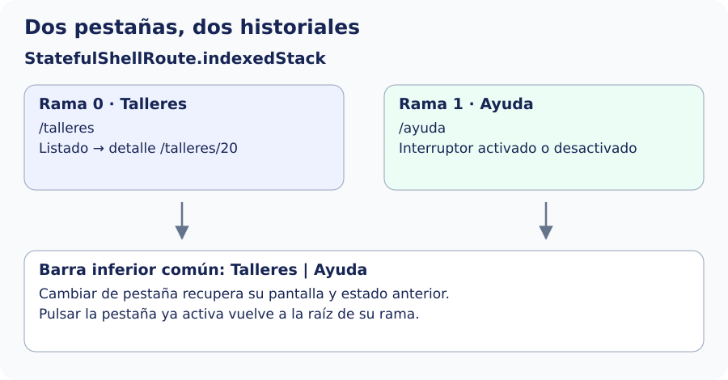

Muchas aplicaciones tienen secciones principales accesibles desde una barra inferior, y cada sección mantiene su propio recorrido: si estás en un detalle de Talleres, vas a Ayuda y vuelves, esperas encontrar el mismo detalle. En este paso conseguiremos exactamente eso para **Talleres** y **Ayuda**.



## Rutas hijas, shells y ramas

Hasta ahora hemos visto rutas de primer nivel y rutas hijas. go_router ofrece además las **shells** (envoltorios): rutas que dibujan una estructura común, como una barra inferior, *alrededor* de las pantallas de sus destinos.

| Configuración | Qué aporta | Ejemplo |
| --- | --- | --- |
| `GoRoute` con `routes` hijas | Relación padre → hija; `go` a la hija apila también al padre. | `/talleres` → `/talleres/20` |
| `ShellRoute` | Una estructura común alrededor de sus destinos, con **un solo** `Navigator` para todos. Al cambiar de destino se pierde lo anterior. | Un marco con menú lateral sin historial por sección. |
| `StatefulShellRoute.indexedStack` | Una estructura común y **un `Navigator` por rama**. Cada rama conserva su pila y el estado de sus pantallas al cambiar de rama. | Barra inferior con Talleres y Ayuda. |

Usaremos `StatefulShellRoute.indexedStack`:

- Cada **rama** (`StatefulShellBranch`) es una sección con su propio `Navigator` y su propia pila de páginas.
- `indexedStack` significa que todas las ramas visitadas se mantienen montadas en un `IndexedStack`, y solo se muestra la activa. Por eso el `State` de sus pantallas (como el interruptor de Ayuda) no se destruye al cambiar de pestaña.
- Las ramas **no se guardan** al cerrar la aplicación: es estado en memoria, no persistencia.

## 1. La pantalla de la shell

La shell es una pantalla normal que dibuja la estructura común (aquí, la barra inferior) y deja el resto del espacio a la rama activa. No conoce Talleres ni Ayuda: el router se los entrega a través de `navigationShell`.

`lib/ui/navegacion_avanzada/ui/secciones_pantalla.dart`

```dart
import 'package:flutter/material.dart';
import 'package:go_router/go_router.dart';

class SeccionesPantalla extends StatelessWidget {
  const SeccionesPantalla({super.key, required this.navigationShell});
  final StatefulNavigationShell navigationShell;

  @override
  Widget build(BuildContext context) => Scaffold(
    body: navigationShell,
    bottomNavigationBar: NavigationBar(
      selectedIndex: navigationShell.currentIndex,
      onDestinationSelected: (index) => navigationShell.goBranch(
        index,
        initialLocation: index == navigationShell.currentIndex,
      ),
      destinations: const [
        NavigationDestination(
          icon: Icon(Icons.school_outlined),
          label: 'Talleres',
        ),
        NavigationDestination(icon: Icon(Icons.help_outline), label: 'Ayuda'),
      ],
    ),
  );
}
```

- **`StatefulNavigationShell`** es el widget que el router entrega a la shell. Contiene los `Navigator` de todas las ramas; lo colocamos en `body` y él muestra la rama activa.
- **`currentIndex`** es el índice de la rama activa. Lo usamos para marcar el destino seleccionado de la barra.
- **`goBranch(index)`** cambia de rama y **recupera la última ubicación** que tenía. Si estabas en `/talleres/20`, vuelves a `/talleres/20`.
- **`initialLocation: true`** hace que la rama vuelva a su ruta inicial. Lo activamos solo cuando se pulsa la pestaña que ya está activa: es el comportamiento habitual de «volver al principio de la sección».
- El orden de `destinations` debe coincidir con el orden de las ramas en el router.

Cada pantalla de destino (Talleres, Detalle, Ayuda) conserva su propio `Scaffold` con su `AppBar`; el `Scaffold` de la shell solo aporta la barra inferior.

## 2. Declarar las ramas

Ahora indicamos al router qué rutas forman cada rama y qué pantalla hace de shell.

Sustituye `app_router.dart`. Talleres y Ayuda pasan a estar dentro de la shell; el catálogo sigue fuera, como ruta independiente.

`lib/ui/core/app_router.dart`

```dart
import 'package:go_router/go_router.dart';
import '../../domain/repositories/inscripciones_repository.dart';
import '../catalogo/ui/catalogo_pantalla.dart';
import '../navegacion_avanzada/ui/ayuda_pantalla.dart';
import '../navegacion_avanzada/ui/secciones_pantalla.dart';
import 'ruta_talleres.dart';

GoRouter crearRouter(InscripcionesRepository repository) => GoRouter(
  initialLocation: '/',
  debugLogDiagnostics: true,
  routes: [
    GoRoute(
      path: '/',
      name: 'catalogo',
      builder: (context, state) => const CatalogoPantalla(),
    ),
    StatefulShellRoute.indexedStack(
      builder: (context, state, navigationShell) =>
          SeccionesPantalla(navigationShell: navigationShell),
      branches: [
        StatefulShellBranch(routes: [rutaTalleres(repository)]),
        StatefulShellBranch(
          routes: [
            GoRoute(
              path: '/ayuda',
              name: 'ayuda',
              builder: (context, state) => const AyudaPantalla(),
            ),
          ],
        ),
      ],
    ),
  ],
);
```

- El `builder` de la shell recibe un tercer argumento, `navigationShell`, que pasamos a `SeccionesPantalla`.
- `branches` es la lista de ramas, en el mismo orden que la barra: la 0 es Talleres y la 1 es Ayuda.
- Cada rama tiene sus propias `routes`. La primera ruta de la rama es su **ubicación inicial**.
- Las rutas de una rama siguen siendo de primer nivel: sus `path` empiezan por `/`. Las direcciones no cambian (`/talleres`, `/talleres/20`, `/ayuda`), así que las entradas del catálogo siguen funcionando sin tocarlas.
- Cada `path` se declara **una sola vez**: hemos movido `rutaTalleres` y `/ayuda` dentro de la shell, no los hemos duplicado.

¿Qué pasa al hacer `go('/talleres/20')` desde el catálogo? go_router encuentra la ruta dentro de la rama 0, construye la shell con la barra inferior y, dentro de esa rama, la pila `[Talleres, Detalle 20]`. El catálogo, que está fuera de la shell, deja de mostrarse.

## Probar

Estas pruebas comprueban que cada pestaña conserva su pila y el estado de sus pantallas.

Haz **hot restart** y comprueba:

| Recorrido | Resultado esperado |
| --- | --- |
| Catálogo → Talleres con go_router | Aparece la barra inferior con Talleres seleccionado. |
| Abrir Cerámica → pestaña Ayuda → activar el interruptor → pestaña Talleres | Sigue abierto el detalle de Cerámica. |
| Pestaña Ayuda otra vez | El interruptor sigue activado. |
| En el detalle, pulsar la pestaña Talleres (ya activa) | Vuelve al listado: `initialLocation: true`. |
| Icono de la casa | Vuelve al catálogo, sin barra inferior. |

Si en el futuro necesitas que una página se abra **por encima** de la barra inferior (ocupando toda la pantalla), se indica con `parentNavigatorKey` el `Navigator` en el que debe colocarse. En este ejemplo lo resolvemos de otra forma: Login y Cuenta serán rutas fuera de la shell.

Referencias: [StatefulShellRoute](https://pub.dev/documentation/go_router/latest/go_router/StatefulShellRoute-class.html) y [ShellRoute](https://pub.dev/documentation/go_router/latest/go_router/ShellRoute-class.html).
