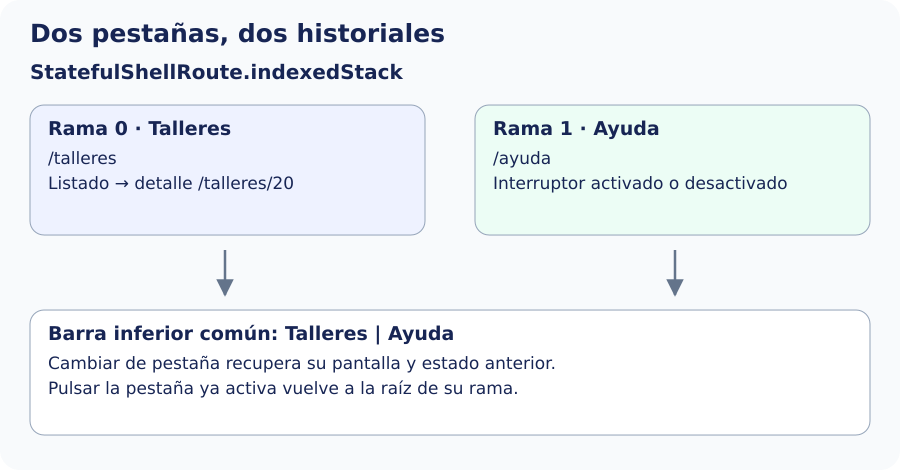

Una ruta hija, como `:id` bajo `/talleres`, expresa una relación entre páginas. Una **shell** añade una estructura visual común alrededor de sus destinos: por ejemplo, una barra inferior que permanece visible.

| Configuración | Qué conserva |
| --- | --- |
| `GoRoute` con hijas | Páginas padre e hija que corresponden a la ubicación. |
| `ShellRoute` | Una estructura común y un navegador para sus destinos. No crea por sí sola una pila independiente para cada pestaña. |
| `StatefulShellRoute.indexedStack` | Un navegador por rama; conserva las ramas cargadas al cambiar entre ellas. |

Crearemos dos ramas públicas: Talleres y Ayuda. El interruptor de Ayuda permite comprobar el estado conservado; el detalle de un taller permite comprobar su pila. Esto no es persistencia: al cerrar la aplicación no se guarda automáticamente ese estado.

El esquema separa las dos ramas que vamos a añadir. Si abrimos Cerámica, cambiamos a Ayuda y regresamos a Talleres, recuperamos el detalle. La barra inferior cambia de rama; no crea otra copia de la pantalla cada vez.



## Dibujar la barra inferior

Crea esta vista. `StatefulNavigationShell` es el contenido administrado por el router; no es una segunda copia de las pantallas. `currentIndex` selecciona el destino y `goBranch` cambia de rama recuperando su navegación anterior. Cuando se pulsa la rama ya activa, `initialLocation: true` vuelve a su raíz.


`lib/ui/navegacion_avanzada/ui/secciones_pantalla.dart`

```dart
import 'package:flutter/material.dart';
import 'package:go_router/go_router.dart';

class SeccionesPantalla extends StatelessWidget {
  const SeccionesPantalla({super.key, required this.navigationShell});
  final StatefulNavigationShell navigationShell;
  @override
  Widget build(BuildContext context) => Scaffold(
    body: navigationShell,
    bottomNavigationBar: NavigationBar(
      selectedIndex: navigationShell.currentIndex,
      onDestinationSelected: (index) => navigationShell.goBranch(
        index,
        initialLocation: index == navigationShell.currentIndex,
      ),
      destinations: const [
        NavigationDestination(
          icon: Icon(Icons.school_outlined),
          label: 'Talleres',
        ),
        NavigationDestination(icon: Icon(Icons.help_outline), label: 'Ayuda'),
      ],
    ),
  );
}
```

En `app_router.dart`, importa `SeccionesPantalla` y sustituye las entradas separadas de Talleres y Ayuda por este bloque dentro de `routes`. Conserva la ruta `/` fuera de la shell y no declares otra vez los mismos paths en paralelo:


```dart
StatefulShellRoute.indexedStack(
  builder: (context, state, shell) => SeccionesPantalla(navigationShell: shell),
  branches: [
    StatefulShellBranch(routes: [rutaTalleres(repository)]),
    StatefulShellBranch(
      routes: [
        GoRoute(
          path: '/ayuda',
          name: 'ayuda',
          builder: (context, state) => const AyudaPantalla(),
        ),
      ],
    ),
  ],
),
```

Prueba Talleres → detalle de Cerámica → Ayuda → activar Mostrar consejos → Talleres. Debe seguir el detalle; al volver a Ayuda, debe seguir activado el interruptor. Pulsar otra vez Talleres mientras esa rama está activa vuelve al listado.

Cada vista de destino mantiene su `Scaffold` con cabecera y contenido; el `Scaffold` de `SeccionesPantalla` aporta la barra común. Si después quieres una página por encima de toda la shell, tendrás que elegir el navegador adecuado mediante `parentNavigatorKey`. No mezcles ese caso con las páginas que deben permanecer dentro de una rama.

Referencia: [StatefulShellRoute](https://pub.dev/documentation/go_router/latest/go_router/StatefulShellRoute-class.html) y [ShellRoute](https://pub.dev/documentation/go_router/latest/go_router/ShellRoute-class.html).
