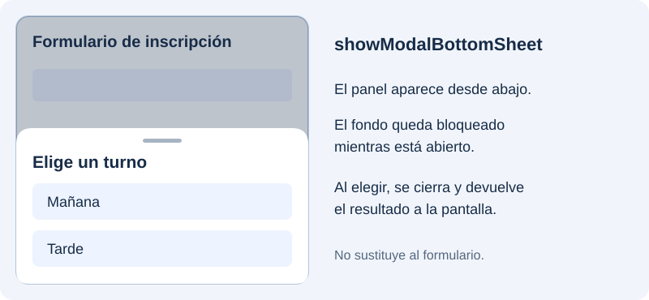

Un diálogo permite pedir una decisión breve sin sustituir la pantalla actual. Vamos a empezar con dos botones, después ofreceremos una lista de opciones reutilizaremos la validación del formulario y añadiremos un panel que aparece desde abajo.

## Pedir confirmación

En el proyecto `catalogo_widgets`, crea `lib/ui/inscripcion/ui/dialogos.dart`, importa `package:flutter/material.dart` y añade esta función:

```dart
Future<bool?> confirmar(BuildContext context) {
  return showDialog<bool>(
    context: context,
    builder: (dialogContext) => AlertDialog(
      title: const Text('¿Continuar?'),
      content: const Text('Se abrirá el formulario de inscripción.'),
      actions: [
        TextButton(
          onPressed: () => Navigator.of(dialogContext).pop(false),
          child: const Text('Cancelar'),
        ),
        FilledButton(
          onPressed: () => Navigator.of(dialogContext).pop(true),
          child: const Text('Continuar'),
        ),
      ],
    ),
  );
}
```

`showDialog` abre la ruta del diálogo y devuelve un resultado asíncrono. `AlertDialog` organiza el título, el contenido y las acciones. Usamos `dialogContext` para cerrar el diálogo desde sus botones.

Importa `dialogos.dart` en `inscripcion_pantalla.dart`. Para probarlo, añade un botón independiente al formulario con este callback:

```dart
onPressed: () async {
  final aceptado = await confirmar(context);
  if (!context.mounted || aceptado != true) return;
  ScaffoldMessenger.of(context).showSnackBar(
    const SnackBar(content: Text('Has confirmado la acción')),
  );
},
```

«Continuar» devuelve `true`; «Cancelar», `false`. Cerrar sin elegir puede devolver `null`, por lo que solo actuamos si el resultado es `true`. Por defecto se permite cerrar tocando fuera: `barrierDismissible: false` impide ese gesto, pero no garantiza por sí solo bloquear todas las formas de retroceso.

## Elegir entre varias opciones

Añade esta función a `dialogos.dart`:

```dart
Future<String?> elegirSeccion(BuildContext context) {
  return showDialog<String>(
    context: context,
    builder: (dialogContext) => SimpleDialog(
      title: const Text('Elige una sección'),
      children: [
        for (final nombre in ['Text', 'Image', 'Icon'])
          SimpleDialogOption(
            onPressed: () => Navigator.of(dialogContext).pop(nombre),
            child: Text(nombre),
          ),
      ],
    ),
  );
}
```

`SimpleDialogOption` representa cada elección. Para probarla, adapta el callback anterior: espera `elegirSeccion(context)`, comprueba `context.mounted` y que el resultado no sea `null`, y muestra la sección recibida en el mensaje.

## Introducir un dato en un diálogo

Crea `lib/ui/inscripcion/ui/nombre_dialogo.dart`. Recibirá el ViewModel que ya utiliza la pantalla para reutilizar su regla del nombre; el controlador y la clave son locales al diálogo:

```dart
import 'package:flutter/material.dart';

import '../view_models/inscripcion_viewmodel.dart';

class NombreDialogo extends StatefulWidget {
  const NombreDialogo({super.key, required this.viewModel});
  final InscripcionViewModel viewModel;

  @override
  State<NombreDialogo> createState() => _NombreDialogoState();
}

class _NombreDialogoState extends State<NombreDialogo> {
  final _formKey = GlobalKey<FormState>();
  final _controller = TextEditingController();

  @override
  void dispose() {
    _controller.dispose();
    super.dispose();
  }

  @override
  Widget build(BuildContext context) {
    return Dialog(
      child: SingleChildScrollView(
        padding: const EdgeInsets.all(24),
        child: Form(
          key: _formKey,
          child: Column(
            mainAxisSize: MainAxisSize.min,
            children: [
              Text('Nombre para la inscripción',
                  style: Theme.of(context).textTheme.titleLarge),
              TextFormField(
                controller: _controller,
                decoration: const InputDecoration(labelText: 'Nombre'),
                validator: widget.viewModel.validarNombre,
              ),
              const SizedBox(height: 16),
              Wrap(
                spacing: 8,
                children: [
                  TextButton(
                    onPressed: () => Navigator.of(context).pop(),
                    child: const Text('Cancelar'),
                  ),
                  FilledButton(
                    onPressed: () {
                      if (_formKey.currentState!.validate()) {
                        Navigator.of(context).pop(_controller.text.trim());
                      }
                    },
                    child: const Text('Aceptar'),
                  ),
                ],
              ),
            ],
          ),
        ),
      ),
    );
  }
}
```

El contenido de `Dialog` se define con `child`. `mainAxisSize: MainAxisSize.min` ajusta la columna al contenido y el desplazamiento permite acceder a él si aparece el teclado. «Aceptar» valida y devuelve el texto; «Cancelar» devuelve `null`. El diálogo libera su controlador, pero no destruye el ViewModel recibido.

Importa `nombre_dialogo.dart` en `inscripcion_pantalla.dart` y añade este método al `State`:

```dart
// Dentro del State de InscripcionPantalla:
Future<void> _pedirNombre() async {
  final nombre = await showDialog<String>(
    context: context,
    builder: (_) => NombreDialogo(viewModel: widget.viewModel),
  );
  if (!mounted || nombre == null) return;
  ScaffoldMessenger.of(context).showSnackBar(
    SnackBar(content: Text('Nombre elegido: $nombre')),
  );
}
```

Conéctalo a un botón con `onPressed: _pedirNombre`. De momento mostramos la respuesta en un mensaje para observar el retorno sin modificar el formulario. Puedes comparar `Dialog` con `Dialog.fullscreen` sustituyendo el constructor: este último ocupa la pantalla completa.

## Mostrar un panel desde abajo

Una **bottom sheet** es un panel que entra desde el borde inferior. Sirve para ofrecer opciones o realizar una interacción breve manteniendo visible parte de la pantalla de origen. La versión modal se abre con `showModalBottomSheet` y bloquea la interacción con el fondo mientras está abierta.



### Crear el contenido del panel

En `lib/ui/inscripcion/ui/dialogos.dart`, añade esta función junto a las anteriores. Mostrará dos turnos y devolverá el que se elija:

```dart
Future<String?> seleccionarTurno(BuildContext context) {
  return showModalBottomSheet<String>(
    context: context,
    showDragHandle: true,
    builder: (sheetContext) => SafeArea(
      top: false,
      child: Padding(
        padding: const EdgeInsets.fromLTRB(16, 0, 16, 16),
        child: Column(
          mainAxisSize: MainAxisSize.min,
          children: [
            Text('Elige un turno',
                style: Theme.of(sheetContext).textTheme.titleLarge),
            ListTile(
              leading: const Icon(Icons.wb_sunny_outlined),
              title: const Text('Mañana'),
              onTap: () => Navigator.of(sheetContext).pop('manana'),
            ),
            ListTile(
              leading: const Icon(Icons.nights_stay_outlined),
              title: const Text('Tarde'),
              onTap: () => Navigator.of(sheetContext).pop('tarde'),
            ),
          ],
        ),
      ),
    ),
  );
}
```

`builder` construye el contenido del panel. `mainAxisSize: MainAxisSize.min` ajusta su altura a las opciones y `showDragHandle` muestra el indicador superior. `SafeArea` protege el contenido de la zona inferior del dispositivo. Cada opción cierra el panel con su propio `sheetContext` y devuelve un `String`.

### Abrirlo desde el formulario del catálogo

Como `inscripcion_pantalla.dart` ya importa `dialogos.dart`, añade este botón a `children`, junto a los botones anteriores:

```dart
FilledButton(
  onPressed: () async {
    final turno = await seleccionarTurno(context);
    if (!context.mounted || turno == null) return;
    ScaffoldMessenger.of(context).showSnackBar(
      SnackBar(content: Text('Turno elegido: $turno')),
    );
  },
  child: const Text('Elegir turno desde abajo'),
),
```

El `await` espera al cierre. Elegir una opción devuelve `'manana'` o `'tarde'`; cerrar sin elegir devuelve `null`. Comprobamos el contexto antes de mostrar el `SnackBar`. Aquí solo mostramos la respuesta para observar el mecanismo; no añadimos un campo Turno al formulario de inscripción.

Por defecto se puede cerrar tocando fuera (`isDismissible`) o arrastrando hacia abajo (`enableDrag`). Son gestos distintos. Para paneles con contenido largo puede utilizarse `isScrollControlled` y un contenido desplazable; nuestro ejemplo es una lista corta.

Una hoja no modal, creada con `showBottomSheet`, tiene otro propósito: complementar la pantalla permitiendo seguir interactuando con ella. Para esta elección puntual usamos la modalidad que bloquea el fondo.

Referencias: [showModalBottomSheet](https://api.flutter.dev/flutter/material/showModalBottomSheet.html) y [showBottomSheet](https://api.flutter.dev/flutter/material/ScaffoldState/showBottomSheet.html).

## Comprobar los diálogos y el panel inferior

Prueba confirmar, cancelar y cerrar tocando fuera. En el diálogo de nombre, un valor vacío no debe cerrarlo al aceptar. Un nombre válido debe regresar a la pantalla y mostrarse en el mensaje. Abre también el panel inferior: elige Tarde y comprueba la respuesta; después vuelve a abrirlo y ciérralo tocando fuera. Al cancelar no debe aparecer otro mensaje de selección.

Referencia: [showDialog](https://api.flutter.dev/flutter/material/showDialog.html), [AlertDialog](https://api.flutter.dev/flutter/material/AlertDialog-class.html), [SimpleDialog](https://api.flutter.dev/flutter/material/SimpleDialog-class.html) y [Dialog](https://api.flutter.dev/flutter/material/Dialog-class.html).
