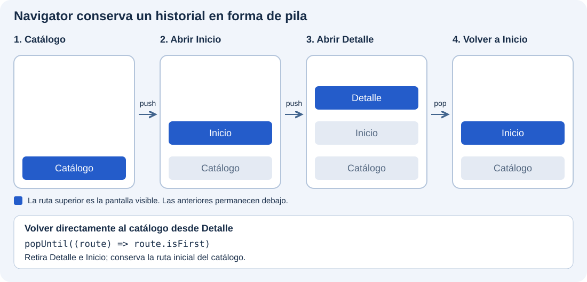
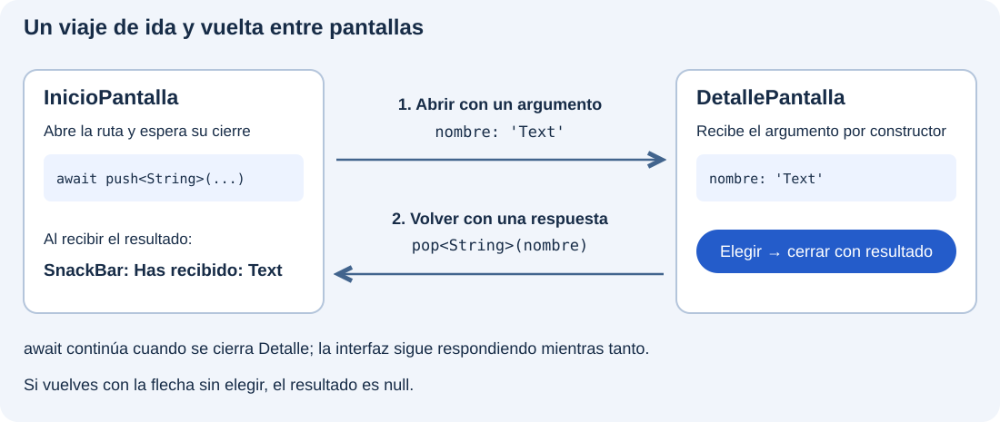

`Navigator` permite abrir pantallas y volver a las anteriores. Lo utilizaremos para consultar el detalle de un componente del catálogo y regresar a la pantalla desde la que lo abrimos.

Trabajaremos dentro de **`catalogo_widgets`**, conservando su arranque y los ejemplos anteriores. A partir de esta demostración estudiaremos las rutas, las operaciones de navegación y el intercambio de datos entre pantallas.

:::note[Qué vamos a construir]
El catálogo abrirá `InicioPantalla`, y esta abrirá `DetallePantalla`. El detalle recibirá un nombre por su constructor y podrá devolver la elección a Inicio, donde la mostraremos en un `SnackBar`.
:::

## Preparar dos pantallas

Crea `lib/ui/navegacion/ui/inicio_pantalla.dart` con esta pantalla:

```dart
import 'package:flutter/material.dart';

import 'detalle_pantalla.dart';

class InicioPantalla extends StatelessWidget {
  const InicioPantalla({super.key});

  @override
  Widget build(BuildContext context) {
    return Scaffold(
      appBar: AppBar(title: const Text('Navegación: inicio')),
      body: Center(
        child: FilledButton(
          onPressed: () {
            Navigator.of(context).push<void>(
              MaterialPageRoute<void>(
                builder: (_) => const DetallePantalla(nombre: 'Text'),
              ),
            );
          },
          child: const Text('Abrir Text'),
        ),
      ),
    );
  }
}

```

Crea en la misma carpeta `detalle_pantalla.dart`:

```dart
import 'package:flutter/material.dart';

class DetallePantalla extends StatelessWidget {
  const DetallePantalla({super.key, required this.nombre});
  final String nombre;

  @override
  Widget build(BuildContext context) {
    return Scaffold(
      appBar: AppBar(title: Text(nombre)),
      body: Center(
        child: FilledButton(
          onPressed: () => Navigator.of(context).pop(),
          child: const Text('Volver'),
        ),
      ),
    );
  }
}
```

En `lib/ui/catalogo/ui/catalogo_pantalla.dart`, añade el import y esta entrada a la lista, conservando las anteriores:

```dart
// Junto a los imports existentes:
import '../../navegacion/ui/inicio_pantalla.dart';

// En children del ListView:
ListTile(
  leading: const Icon(Icons.route_outlined),
  title: const Text('Navegación entre pantallas'),
  onTap: () {
    Navigator.of(context).push(
      MaterialPageRoute<void>(builder: (_) => const InicioPantalla()),
    );
  },
),
```

Conserva `main.dart`: el `MaterialApp` del catálogo ya proporciona el `Navigator`.

Ejecuta `flutter run`, abre «Navegación entre pantallas» en el catálogo y pulsa «Abrir Text» y después «Volver». El botón de retroceso de `AppBar` también permite regresar cuando existe una ruta anterior.

## Navigator y sus operaciones

El `Navigator` mantiene una pila de objetos **`Route`**. `DetallePantalla` es el widget que mostramos; `MaterialPageRoute` es la ruta que lo contiene y proporciona la transición adaptada a la plataforma. Su `builder` construye el widget de destino.

En `Navigator.of(context).push(...)`, `Navigator.of(context)` obtiene el estado del `Navigator` antecesor más cercano. Por eso usamos el contexto de una pantalla situada dentro del `MaterialApp` del catálogo. `push` recibe una ruta, no directamente un widget.

Este uso es **imperativo**: cada pulsación solicita añadir o retirar una ruta. El esquema muestra cómo esas operaciones cambian la pila del catálogo. Consulta las API de [Navigator.of](https://api.flutter.dev/flutter/widgets/Navigator/of.html) y [MaterialPageRoute](https://api.flutter.dev/flutter/material/MaterialPageRoute-class.html).

### La pila de rutas



Cada columna representa el historial en un momento distinto. Lee las rutas de abajo hacia arriba: la última que se ha añadido es la que vemos. Al hacer `pop`, no creamos la pantalla anterior; retiramos la actual para volver a mostrar la que estaba debajo.

Abrir otra vez Inicio mediante `push` crearía una nueva pantalla encima del detalle, en lugar de regresar a la existente. Para volver directamente al listado del catálogo desde cualquier pantalla de esta demostración, retiramos rutas hasta la primera:

```dart
Navigator.of(context).popUntil((route) => route.isFirst);
```

### Principales acciones

Estos métodos se llaman sobre el objeto que obtenemos con `Navigator.of(context)`:

| Operación | Qué hace | Ejemplo de uso en el catálogo |
| --- | --- | --- |
| `push(ruta)` | Añade una ruta encima de la actual. | Abrir Detalle y conservar Inicio debajo. |
| `pushNamed(nombre, arguments: ...)` | Añade una ruta identificada por un nombre registrado; permite pasar argumentos. | Abrir `'/detalle'` si se ha declarado en la configuración de [rutas con nombre](#reconocer-otras-formas-de-definir-rutas). |
| `pop()` | Retira la ruta superior. | Cerrar Detalle y volver a Inicio. |
| `pop(resultado)` | Retira la ruta y devuelve un valor al código que la abrió. | Cerrar Detalle devolviendo `'Text'`. |
| `canPop()` | Consulta si la pila permite retirar una ruta; no cambia la pantalla. | Comprobar si hay una ruta anterior antes de ofrecer «Volver». |
| `maybePop()` | Tramita una petición de retroceso según las reglas de la ruta actual. | Responder a una acción «Volver» que deba respetar esas reglas. |
| `popUntil(condición)` | Retira rutas hasta encontrar una que cumpla la condición; la conserva. | Volver al catálogo con `(route) => route.isFirst`. |
| `pushReplacement(ruta)` | Abre una ruta nueva y sustituye la actual, conservando las anteriores. | Pasar de Inicio a Detalle sin dejar Inicio en el historial. |
| `pushAndRemoveUntil(ruta, condición)` | Abre una ruta y elimina las anteriores hasta encontrar una que conservar. | Abrir un Inicio nuevo y quitar los pasos intermedios, manteniendo el catálogo. |

`canPop()` no consulta todas las restricciones de retroceso de la ruta. `maybePop()` sí tramita esa petición y devuelve un `Future<bool>` que indica si se ha atendido: `true` **no garantiza que la ruta se haya cerrado**, porque también puede haberse atendido bloqueando la salida. Consulta su [referencia](https://api.flutter.dev/flutter/widgets/NavigatorState/maybePop.html).

## Pasar datos al destino

En el ejemplo, `nombre: 'Text'` pasa un dato al constructor. `final String nombre` lo conserva y `Text(nombre)` lo muestra. Cambia `'Text'` por `'Image'` y comprueba el título del detalle. No necesitamos variables globales para comunicar ese dato.

## Recibir una respuesta

Vamos a abrir Detalle desde Inicio y permitir que devuelva el nombre elegido. Hay dos partes: **Detalle envía el valor al cerrarse; Inicio lo recoge cuando termina el `await`**.



### En Detalle: cerrar y enviar el dato

En `lib/ui/navegacion/ui/detalle_pantalla.dart`, sustituye el botón «Volver» por este:

```dart
FilledButton(
  onPressed: () {
    Navigator.of(context).pop<String>(nombre);
  },
  child: const Text('Elegir'),
)
```

Al pasar `nombre` como argumento de `pop<String>`, lo enviamos como **resultado de la ruta** al código que abrió el detalle. En este ejemplo se devuelve `'Text'`.

### En Inicio: recoger la respuesta en una variable

En `lib/ui/navegacion/ui/inicio_pantalla.dart`, añade este método **dentro de `InicioPantalla`, antes de `build`**. No hace falta convertir la pantalla en un `StatefulWidget`, porque vamos a utilizar la respuesta en un mensaje temporal:

```dart
Future<void> _abrirDetalle(BuildContext context) async {
  // 1. Abrimos el detalle y esperamos a que se cierre.
  final String? elegido = await Navigator.of(context).push<String>(
    MaterialPageRoute<String>(
      builder: (_) => const DetallePantalla(nombre: 'Text'),
    ),
  );

  // 2. Aquí ya hemos vuelto: elegido contiene la respuesta del pop.
  if (!context.mounted) return;

  // 3. Si se cerró sin elegir, no procesamos ningún dato.
  if (elegido == null) return;

  // 4. Usamos el dato recibido en la pantalla de origen.
  ScaffoldMessenger.of(context).showSnackBar(
    SnackBar(content: Text('Has recibido: $elegido')),
  );
}
```

**La variable `elegido` recoge el dato devuelto.** `push<String>` devuelve un `Future<String?>`: al cerrarse Detalle, `await` obtiene el resultado y lo asigna a esa variable.

La función queda pendiente durante la visita al detalle, pero la interfaz sigue respondiendo. Al regresar, el código continúa en la línea que sigue al `await`. Comprobamos `context.mounted` antes de utilizar el contexto y descartamos `null`, que recibiríamos si el usuario volviera con la flecha sin pulsar «Elegir».

### Conectar el método al botón de Inicio

En el `build` de `InicioPantalla`, sustituye el botón «Abrir Text» por este. Este método reemplaza el `push` anterior; no mantengas las dos llamadas:

```dart
FilledButton(
  onPressed: () => _abrirDetalle(context),
  child: const Text('Abrir Text'),
)
```

Al probarlo, «Elegir» debe mostrar «Has recibido: Text» en Inicio; volver con la flecha no debe mostrar ningún mensaje.

## Reconocer otras formas de definir rutas

Hasta ahora cada botón construye su ruta con `MaterialPageRoute`. Otra posibilidad es **registrar un destino con un nombre** y pedir a `Navigator` que lo abra usando ese nombre. Por ejemplo, `'/detalle'` puede identificar la pantalla `DetallePantalla`.

El nombre es una clave elegida por nosotros: no es el nombre del archivo ni crea automáticamente una dirección web. La pantalla sigue formando parte de la pila de `Navigator`.

### Registrar el destino

La propiedad `routes` pertenece al **`MaterialApp` que ya está en `lib/main.dart`**, dentro del método `build` de `CatalogoApp`. Se coloca al mismo nivel que `home`, `title` y `debugShowCheckedModeBanner`; no va en `CatalogoPantalla` ni dentro de un botón.

Para probar esta alternativa en el mismo catálogo, añade el import de `DetallePantalla` y la propiedad `routes`. Partiendo del arranque base del curso, `lib/main.dart` quedaría así:

```dart
import 'package:flutter/material.dart';

import 'ui/catalogo/ui/catalogo_pantalla.dart';
import 'ui/navegacion/ui/detalle_pantalla.dart';

void main() => runApp(const CatalogoApp());

class CatalogoApp extends StatelessWidget {
  const CatalogoApp({super.key});

  @override
  Widget build(BuildContext context) {
    return MaterialApp(
      debugShowCheckedModeBanner: false,
      title: 'Catálogo de widgets',
      home: const CatalogoPantalla(),
      routes: {
        '/detalle': (_) => const DetallePantalla(nombre: 'Text'),
      },
    );
  }
}
```

Fíjate en los cambios respecto al arranque inicial:

- **Import nuevo:** `ui/navegacion/ui/detalle_pantalla.dart` permite construir el destino desde este archivo.
- **`MaterialApp` sin `const`:** el mapa contiene una función que construye la pantalla. Conservamos `const` en `CatalogoPantalla` y en el widget de destino.
- **`home` se conserva:** el listado del catálogo sigue siendo la pantalla inicial.
- **`routes` se añade junto a `home`:** la clave `'/detalle'` identifica el destino y la función devuelve `DetallePantalla(nombre: 'Text')` cuando se solicita.

Si tu `MaterialApp` ya tiene un tema u otras propiedades, consérvalos y añade únicamente esta configuración. Si ya tiene `routes`, incorpora `'/detalle'` a ese mismo mapa; no declares otro `routes` ni otro `MaterialApp`. Si has añadido o cambiado la configuración de rutas, reinicia la aplicación antes de probarla.

Este registro prepara el destino; no lo abre todavía. La apertura se hace desde el botón con `pushNamed`, como se muestra a continuación.

### Abrir la ruta y volver

Si ese nombre está registrado, un botón puede utilizar:

```dart
onPressed: () {
  Navigator.of(context).pushNamed('/detalle');
},
```

`pushNamed` busca `'/detalle'` en la configuración, construye su destino y añade la ruta a la pila. No le pasamos un `MaterialPageRoute` porque esa construcción se resuelve desde la configuración.

Para regresar seguimos utilizando `pop()`. También podemos esperar un resultado mediante `await pushNamed<String>(...)`, igual que con el `push<String>` anterior. El nombre utilizado debe coincidir exactamente con el registrado; una cadena desconocida necesita un mecanismo de resolución de rutas que la gestione.
