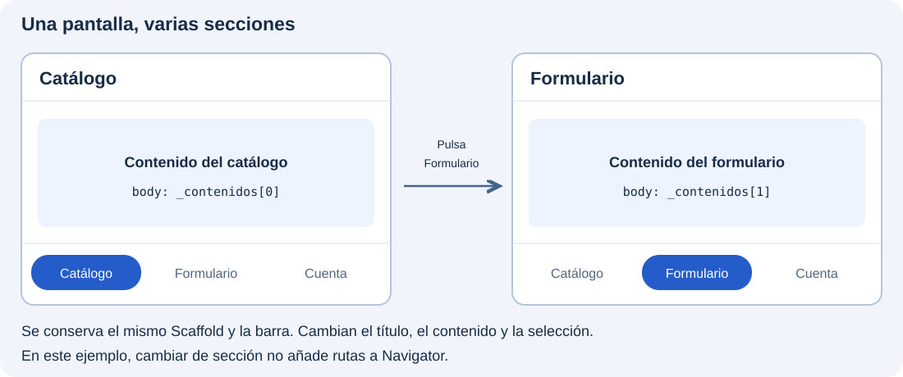
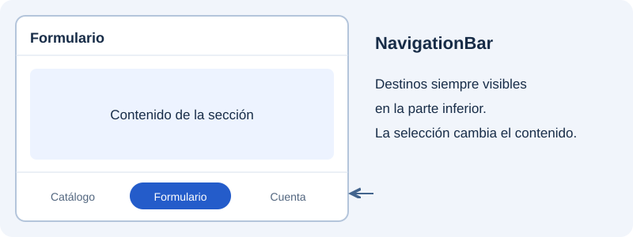
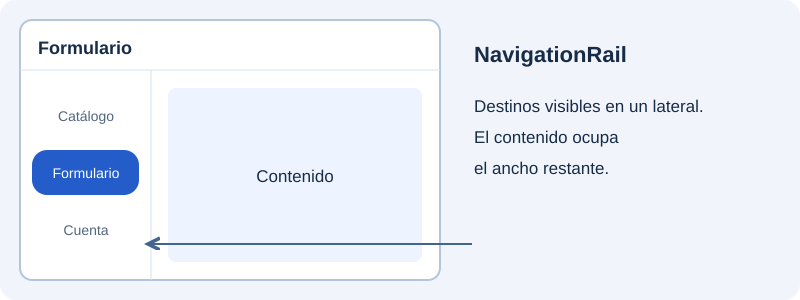
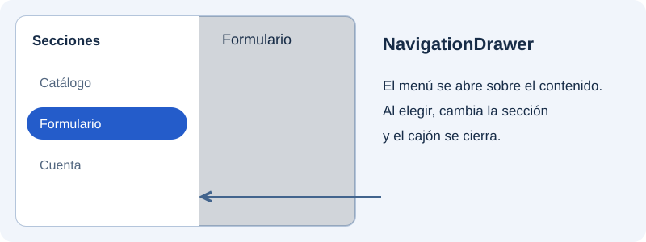
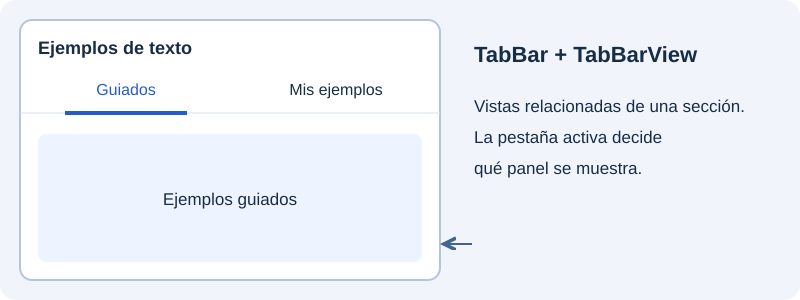

Una aplicación suele agrupar sus funciones en secciones que el usuario necesita consultar con frecuencia: por ejemplo, **Catálogo**, **Formulario** y **Cuenta**. La navegación entre secciones permite elegir una de esas áreas y saber en cuál estamos, sin tener que volver al menú cada vez.

En el apartado anterior abríamos una pantalla de detalle mediante `Navigator.push`. Aquí resolveremos otra necesidad: **cambiar el contenido principal de una misma pantalla**. En nuestra demostración, al elegir Formulario se mostrará su contenido y se marcará ese destino en la barra; al elegir Catálogo se recuperará el contenido de esa sección.



Crearemos cuatro demostraciones independientes dentro de `catalogo_widgets`, cada una en su propio archivo y con una entrada en el menú del catálogo. Conservaremos `SeccionesPantalla` para la barra inferior y añadiremos `SeccionesRailPantalla`, `SeccionesDrawerPantalla` y `SeccionesTabsPantalla`. Al abrir cualquiera desde el menú sí añadiremos una ruta; **una vez dentro, cambiar entre sus secciones no apilará más rutas**. El botón de retroceso permitirá salir de la demostración y regresar al catálogo.

Empezaremos con `NavigationBar`, situada abajo, y probaremos después otras presentaciones: `NavigationRail` en un lateral y `NavigationDrawer` en un cajón. Finalmente veremos las pestañas, que sirven para agrupar contenidos relacionados dentro de una sección. Los textos provisionales nos permitirán observar la selección antes de integrar contenidos reales.

## Cambiar de sección con NavigationBar

**`NavigationBar` mantiene visibles los destinos principales en la parte inferior.** Cada opción combina un icono y una etiqueta, y la opción activa queda resaltada. Es una forma de pasar con rapidez entre las áreas principales, especialmente en una disposición de móvil.

En nuestra demostración, pulsar Formulario actualizará el índice seleccionado, el título y el `body`. La barra seguirá en su sitio para poder elegir después Catálogo o Cuenta.



Añadiremos otra demostración al mismo catálogo. Crea `lib/ui/navegacion/ui/secciones_pantalla.dart` con este código. La barra organizará el contenido dentro de esa pantalla; no sustituye el menú principal del proyecto:

```dart
import 'package:flutter/material.dart';

class SeccionesPantalla extends StatefulWidget {
  const SeccionesPantalla({super.key});

  @override
  State<SeccionesPantalla> createState() => _SeccionesPantallaState();
}

class _SeccionesPantallaState extends State<SeccionesPantalla> {
  int _indice = 0;
  static const _titulos = ['Catálogo', 'Formulario', 'Cuenta'];
  static const _contenidos = [
    Center(child: Text('Contenido del catálogo')),
    Center(child: Text('Contenido del formulario')),
    Center(child: Text('Contenido de la cuenta')),
  ];

  @override
  Widget build(BuildContext context) {
    return Scaffold(
      appBar: AppBar(title: Text(_titulos[_indice])),
      body: _contenidos[_indice],
      bottomNavigationBar: NavigationBar(
        selectedIndex: _indice,
        onDestinationSelected: (indice) {
          setState(() => _indice = indice);
        },
        destinations: const [
          NavigationDestination(icon: Icon(Icons.widgets), label: 'Catálogo'),
          NavigationDestination(icon: Icon(Icons.edit), label: 'Formulario'),
          NavigationDestination(icon: Icon(Icons.person), label: 'Cuenta'),
        ],
      ),
    );
  }
}
```

En `catalogo_pantalla.dart`, añade el import y una nueva entrada:

```dart
// Junto a los imports existentes:
import '../../navegacion/ui/secciones_pantalla.dart';

// En children del ListView:
ListTile(
  leading: const Icon(Icons.view_quilt_outlined),
  title: const Text('Secciones: barra inferior'),
  onTap: () {
    Navigator.of(context).push(
      MaterialPageRoute<void>(builder: (_) => const SeccionesPantalla()),
    );
  },
),
```

Ejecuta el catálogo y abre «Secciones: barra inferior». Podrás cambiar sus destinos y volver al listado mediante la flecha de su barra superior. Conserva este archivo y su entrada: los siguientes ejemplos se añadirán sin modificar esta pantalla.

`selectedIndex` indica el destino activo. `onDestinationSelected` recibe el índice elegido y `setState` reconstruye la pantalla con el título y contenido correspondientes. Los textos de demostración permiten observar qué sección está activa.

## Colocar la navegación en un lateral

**`NavigationRail` coloca los destinos en una franja lateral que permanece visible.** Cumple la misma función de selección principal que la barra inferior, pero deja libre la parte baja y utiliza espacio horizontal. Encaja en una disposición ancha, como una ventana de escritorio o una tableta.

El rail y el contenido se colocan en una `Row`. El rail ocupa su anchura y `Expanded` reserva el espacio restante para la sección elegida. Cambia la distribución, pero conservamos el mismo índice y los mismos destinos.



Crea `lib/ui/navegacion/ui/secciones_rail_pantalla.dart` con este código completo. Es una pantalla nueva; conserva los ejemplos anteriores:

```dart
import 'package:flutter/material.dart';

class SeccionesRailPantalla extends StatefulWidget {
  const SeccionesRailPantalla({super.key});

  @override
  State<SeccionesRailPantalla> createState() => _SeccionesRailPantallaState();
}

class _SeccionesRailPantallaState extends State<SeccionesRailPantalla> {
  int _indice = 0;
  static const _titulos = ['Catálogo', 'Formulario', 'Cuenta'];
  static const _contenidos = [
    Center(child: Text('Contenido del catálogo')),
    Center(child: Text('Contenido del formulario')),
    Center(child: Text('Contenido de la cuenta')),
  ];

  @override
  Widget build(BuildContext context) {
    return Scaffold(
      appBar: AppBar(title: Text(_titulos[_indice])),
      body: Row(
        children: [
          NavigationRail(
            selectedIndex: _indice,
            onDestinationSelected: (indice) {
              setState(() => _indice = indice);
            },
            labelType: NavigationRailLabelType.all,
            destinations: const [
              NavigationRailDestination(
                icon: Icon(Icons.widgets), label: Text('Catálogo')),
              NavigationRailDestination(
                icon: Icon(Icons.edit), label: Text('Formulario')),
              NavigationRailDestination(
                icon: Icon(Icons.person), label: Text('Cuenta')),
            ],
          ),
          const VerticalDivider(width: 1),
          Expanded(child: _contenidos[_indice]),
        ],
      ),
    );
  }
}
```

En `catalogo_pantalla.dart`, añade este import y otra entrada al mismo listado, manteniendo las anteriores:

```dart
// Junto a los imports existentes:
import '../../navegacion/ui/secciones_rail_pantalla.dart';

// Añade otro ListTile a children del ListView:
ListTile(
  leading: const Icon(Icons.view_sidebar_outlined),
  title: const Text('Secciones: rail lateral'),
  onTap: () {
    Navigator.of(context).push<void>(
      MaterialPageRoute<void>(builder: (_) => const SeccionesRailPantalla()),
    );
  },
),
```

`Expanded` deja que el contenido ocupe el espacio restante. El rail es una presentación lateral adecuada para disposiciones anchas. En este ejercicio probamos las dos presentaciones por separado.

## Abrir un cajón de navegación

**`NavigationDrawer` presenta las secciones dentro de un panel que se abre desde un lateral.** En este ejemplo se mantiene cerrado hasta que el usuario pulsa el botón de menú de `AppBar`. Al abrirse, ocupa parte de la pantalla y oscurece el contenido que queda detrás.

Permite dedicar más espacio a las etiquetas sin dejar el panel siempre visible, aunque acceder a un destino requiere abrirlo primero. Al elegir una sección actualizaremos el contenido y cerraremos el cajón. Ese cierre no significa volver a la sección anterior.



Crea `lib/ui/navegacion/ui/secciones_drawer_pantalla.dart` con este código completo. Es una pantalla nueva; conserva los ejemplos anteriores:

```dart
import 'package:flutter/material.dart';

class SeccionesDrawerPantalla extends StatefulWidget {
  const SeccionesDrawerPantalla({super.key});

  @override
  State<SeccionesDrawerPantalla> createState() => _SeccionesDrawerPantallaState();
}

class _SeccionesDrawerPantallaState extends State<SeccionesDrawerPantalla> {
  int _indice = 0;
  static const _titulos = ['Catálogo', 'Formulario', 'Cuenta'];
  static const _contenidos = [
    Center(child: Text('Contenido del catálogo')),
    Center(child: Text('Contenido del formulario')),
    Center(child: Text('Contenido de la cuenta')),
  ];

  @override
  Widget build(BuildContext context) {
    return Scaffold(
      appBar: AppBar(title: Text(_titulos[_indice])),
      body: _contenidos[_indice],
      drawer: NavigationDrawer(
        selectedIndex: _indice,
        onDestinationSelected: (indice) {
          setState(() => _indice = indice);
          Navigator.of(context).pop();
        },
        children: const [
          NavigationDrawerDestination(
            icon: Icon(Icons.widgets), label: Text('Catálogo')),
          NavigationDrawerDestination(
            icon: Icon(Icons.edit), label: Text('Formulario')),
          NavigationDrawerDestination(
            icon: Icon(Icons.person), label: Text('Cuenta')),
        ],
      ),
    );
  }
}
```

En `catalogo_pantalla.dart`, añade este import y otra entrada al mismo listado, manteniendo las anteriores:

```dart
// Junto a los imports existentes:
import '../../navegacion/ui/secciones_drawer_pantalla.dart';

// Añade otro ListTile a children del ListView:
ListTile(
  leading: const Icon(Icons.menu),
  title: const Text('Secciones: cajón'),
  onTap: () {
    Navigator.of(context).push<void>(
      MaterialPageRoute<void>(builder: (_) => const SeccionesDrawerPantalla()),
    );
  },
),
```

El `AppBar` muestra el botón que abre el cajón. Al elegir un destino actualizamos el índice y cerramos el cajón con `pop()`. `Drawer` es el contenedor general; `NavigationDrawer` proporciona los destinos con estilo Material 3. 

## Organizar contenido con pestañas

**Las pestañas permiten alternar entre contenidos relacionados dentro de una sección.** Por ejemplo, en «Ejemplos de texto» podemos separar los ejemplos guiados de los que añade el alumno. La selección ya no representa Catálogo, Formulario o Cuenta, sino dos vistas del mismo tema.

`TabBar` muestra las pestañas y señala la activa; `TabBarView` presenta el panel correspondiente. `DefaultTabController` mantiene sincronizadas ambas partes. El usuario puede pulsar una pestaña o desplazarse horizontalmente entre los paneles.



Crea `lib/ui/navegacion/ui/secciones_tabs_pantalla.dart` con este código completo. Es una pantalla nueva; conserva los ejemplos anteriores:

```dart
import 'package:flutter/material.dart';

class SeccionesTabsPantalla extends StatelessWidget {
  const SeccionesTabsPantalla({super.key});

  @override
  Widget build(BuildContext context) {
    return DefaultTabController(
      length: 2,
      child: Scaffold(
        appBar: AppBar(
          title: const Text('Ejemplos de texto'),
          bottom: const TabBar(
            tabs: [Tab(text: 'Guiados'), Tab(text: 'Mis ejemplos')],
          ),
        ),
        body: const TabBarView(
          children: [
            Center(child: Text('Ejemplos guiados')),
            Center(child: Text('Ejemplos del alumno')),
          ],
        ),
      ),
    );
  }
}
```

En `catalogo_pantalla.dart`, añade este import y otra entrada al mismo listado, manteniendo las anteriores:

```dart
// Junto a los imports existentes:
import '../../navegacion/ui/secciones_tabs_pantalla.dart';

// Añade otro ListTile a children del ListView:
ListTile(
  leading: const Icon(Icons.tab),
  title: const Text('Secciones: pestañas'),
  onTap: () {
    Navigator.of(context).push<void>(
      MaterialPageRoute<void>(builder: (_) => const SeccionesTabsPantalla()),
    );
  },
),
```

`DefaultTabController` coordina `TabBar` y `TabBarView`. Su `length`, el número de pestañas y el número de contenidos deben coincidir. Prueba tanto el clic en las pestañas como el desplazamiento horizontal.

El catálogo conserva ahora cuatro entradas: barra inferior, rail lateral, cajón y pestañas. Puedes abrir cualquiera y regresar al listado para comparar los ejemplos. Dentro de cada pantalla, seleccionar un destino o una pestaña cambia el contenido sin apilar rutas de detalle.

Referencias: [NavigationBar](https://api.flutter.dev/flutter/material/NavigationBar-class.html), [NavigationRail](https://api.flutter.dev/flutter/material/NavigationRail-class.html), [NavigationDrawer](https://api.flutter.dev/flutter/material/NavigationDrawer-class.html) y [DefaultTabController](https://api.flutter.dev/flutter/material/DefaultTabController-class.html).
