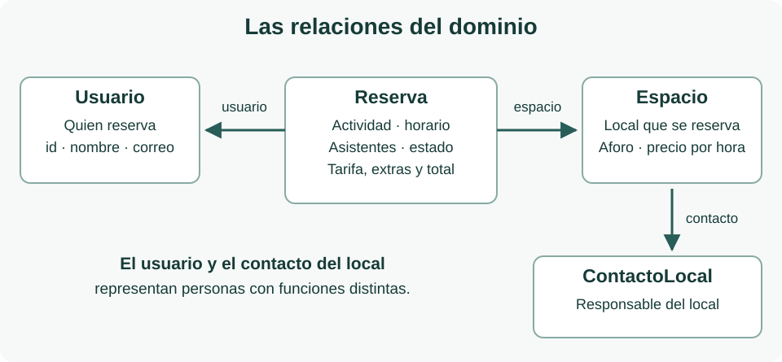

Antes de comenzar, repasa [Ejemplo con datos](../../../widgets/ejemplo-con-datos/), especialmente [Modelos relacionados](../../../widgets/ejemplo-con-datos/modelos/) y [Servicio local y repositorio](../../../widgets/ejemplo-con-datos/datos-locales/). Utilizaremos la misma separación de responsabilidades, adaptada a las reservas de espacios.

## Qué representa el dominio

El dominio reúne los conceptos con los que hablamos de la aplicación: espacios, reservas, usuarios y personas de contacto. Una pantalla puede cambiar su distribución sin que cambie qué significa una reserva. Por eso estas clases viven en `lib/domain/models/`, no importan Flutter y no contienen colores, widgets ni código de navegación.



Los identificadores permiten reconocer la misma entidad en distintas pantallas. La reserva contiene un `Espacio` y un `Usuario`, no sus nombres copiados en cadenas independientes. Para acceder a la persona responsable del local, la vista utiliza `reserva.espacio.contacto`. Ese contacto **no es quien reserva**: representa al interlocutor del local.

Los campos que siguen son mínimos. Usa campos `final` y parámetros nombrados `required`; añade un constructor `const` cuando sea posible. `final` impide reasignar un campo, pero no impide modificar los elementos de una lista: puedes proteger las colecciones con `List.unmodifiable`. Los identificadores del código se comparten entre las dos versiones lingüísticas para mantener compatibles archivos e imports; los textos de la interfaz puedes adaptarlos al idioma de tu aplicación.

## ContactoLocal y Usuario cumplen funciones distintas

`ContactoLocal` permite mostrar una persona con la que consultar las condiciones del espacio. Guarda su identificador, nombre, teléfono y correo. El teléfono es texto: puede contener prefijo internacional, espacios o ceros iniciales. Usa siempre datos ficticios. Este es un archivo completo de referencia, `lib/domain/models/contacto_local.dart`:

```dart
class ContactoLocal {
  const ContactoLocal({
    required this.id,
    required this.nombre,
    required this.telefono,
    required this.correo,
  });

  final String id;
  final String nombre;
  final String telefono;
  final String correo;
}
```

`Usuario`, en `lib/domain/models/usuario.dart`, representa a quien utiliza la demostración y realiza las reservas. Necesita `String id`, `String nombre` y `String correo`. No guarda contraseñas ni información real de cuentas sociales. El login normal y los botones sociales pueden devolver el mismo usuario ficticio. Implementa su constructor siguiendo el patrón anterior.

## Espacio describe el local que se puede reservar

`Espacio`, en `lib/domain/models/espacio.dart`, alimenta tanto las tarjetas del catálogo como la ficha de detalle y el resumen de una nueva reserva. Agrupa estos datos para que las tres pantallas consulten la misma información:

| Campos mínimos | Tipo | Para qué se utilizan |
| --- | --- | --- |
| `id`, `nombre`, `descripcion` | `String` | Identificar el espacio y presentar su contenido. |
| `ubicacion`, `horario`, `condicionesUso` | `String` | Explicar dónde está y cómo se puede utilizar. |
| `aforo` | `int` | Indicar la capacidad y comprobar los ejemplos de reserva. |
| `imagenAsset`, `imagenesAssets` | `String`, `List<String>` | Imagen de portada y galería, con al menos tres rutas locales por espacio. |
| `sitioWeb` | `String?` | Web opcional del local; `null` significa que no dispone de ella. |
| `serviciosDisponibles` | `List<ServicioExtra>` | Servicios adicionales que se pueden contratar, separados del equipamiento incluido. |
| `actividades`, `equipamiento` | `List<String>` | Describir usos admitidos y equipamiento incluido mediante colecciones. |
| `precioHoraCentimos` | `int` | Representar la tarifa final por una hora, con IVA incluido. |
| `moneda` | `String` | Identificar la moneda; en esta entrega, `EUR`. |
| `contacto` | `ContactoLocal` | Acceder al nombre, teléfono y correo del responsable. |

Una vez declarados los campos y el constructor, puedes añadir una consulta que exprese una pregunta del dominio. El siguiente **fragmento va dentro de `Espacio`** y utiliza el campo `actividades` de la tabla:

```dart
bool admiteActividad(String actividad) {
  return actividades.contains(actividad);
}
```

Si el espacio contiene la actividad solicitada, devuelve `true`. Utiliza nombres de actividad coherentes en los datos ficticios, ya que `contains` compara los textos tal como están escritos. Este método no abre ninguna pantalla ni modifica el espacio.

## Reserva relaciona los datos de una solicitud

`Reserva`, en `lib/domain/models/reserva.dart`, representa una reserva precargada de la demostración. La vista utiliza sus relaciones para mostrar el espacio, la persona que reserva y el contacto del local. Conserva también el importe acordado para esa reserva:

| Campos mínimos | Tipo | Significado |
| --- | --- | --- |
| `id` | `String` | Identificador único de la reserva. |
| `espacio`, `usuario` | `Espacio`, `Usuario` | Objetos relacionados; no DTO ni textos duplicados. |
| `actividad` | `String` | Uso solicitado, admitido por ese espacio. |
| `inicio`, `fin` | `DateTime` | Fecha y hora de inicio y fin del mismo intervalo. |
| `asistentes` | `int` | Personas previstas; mayor que cero y dentro del aforo. |
| `estado` | `EstadoReserva` | Estado que la interfaz representará con texto y aspecto. |
| `serviciosContratados` | `List<ServicioContratado>` | Servicios seleccionados y sus precios en el momento de reservar; puede estar vacía. |
| `tarifaHoraCentimos`, `precioTotalCentimos` | `int` | Tarifa aplicada e importe total de esa reserva. |
| `moneda` | `String` | Moneda del importe; debe coincidir con la del espacio. |

Declara este enum fuera de la clase, en el mismo archivo. Un enum limita los valores posibles y evita escribir estados distintos por una errata:

```dart
enum EstadoReserva { confirmada, pendiente, cancelada }
```

El modelo guarda `EstadoReserva.confirmada`; la vista el convierte en una etiqueta como «Confirmada» y elige su color. Para calcular la duración puedes añadir este **fragmento dentro de `Reserva`**, tras declarar `inicio` y `fin`:

```dart
Duration get duracion => fin.difference(inicio);
```

`get` permite consultar `reserva.duracion` como una propiedad calculada. `Duration` conserva el intervalo sin truncarlo; evita almacenar una duración que podría contradecir las fechas. El modelo usa tipos de Dart y no necesita `TimeOfDay`, que pertenece a Flutter.

## Cómo representar y comprobar el precio

Guarda el dinero en céntimos enteros: `3000` representa 30,00 €. Así puedes multiplicar cantidades enteras sin guardar el símbolo de moneda dentro del número. La vista es responsable de mostrar los decimales y el símbolo; el modelo conserva el importe y `EUR`.

Utiliza horas completas y fechas del mismo día para los ejemplos de esta entrega. El siguiente **fragmento de comprobación** supone que ya dispones de una `Reserva reserva`. No implementa un formulario ni modifica reservas:

```dart
final minutos = reserva.duracion.inMinutes;
if (minutos <= 0 || minutos % 60 != 0) {
  throw StateError('Intervalo de ejemplo no valido');
}
final horas = minutos ~/ 60;
final totalEsperado =
    reserva.tarifaHoraCentimos * horas + reserva.totalServiciosCentimos;
if (reserva.precioTotalCentimos != totalEsperado) {
  throw StateError('El precio no coincide con la duracion');
}
```

La comprobación rechaza intervalos de cero minutos, negativos o que no sean horas completas antes de usar la división entera `~/`. Para las horas completas, precarga fechas sin segundos ni fracciones de segundo. Una reserva de 10:00 a 12:00 con tarifa `3000` y sin extras debe contener total `6000`. Mantén ese total al mostrar la solicitud, la confirmación y la reserva de ejemplo.

La tarifa actual de `Espacio` y la tarifa aplicada en `Reserva` tienen funciones distintas. En los ejemplos iniciales pueden coincidir, pero la reserva conserva su importe aunque después cambie el precio del catálogo. No recalcules una reserva histórica utilizando siempre la tarifa actual del espacio.

## Servicios adicionales y precio de la reserva

El equipamiento incluido, como Wi-Fi o una pizarra, forma parte de la tarifa del espacio. Los servicios adicionales, como limpieza, decoración o una pausa de café, se eligen expresamente y se cobran **una sola vez por reserva**, sin cantidades ni cargos por persona en esta entrega.

Implementa `ServicioExtra` en `servicio_extra.dart`, con `String id`, `String nombre`, `String descripcion` e `int precioCentimos`. Cada espacio ofrece su propia lista `serviciosDisponibles`; no se puede contratar un servicio de otro espacio. Todos los importes utilizan la moneda del espacio y son finales con IVA incluido.

`ServicioContratado`, en `servicio_contratado.dart`, conserva `String servicioId`, `String nombre` e `int precioCentimos`. Es la copia del nombre y precio aplicados en esa reserva. Así una modificación futura de la oferta no cambia su importe histórico. No guardes únicamente los identificadores ni calcules siempre el precio de una reserva antigua con la oferta actual.

Este **fragmento dentro de `Reserva`**, una vez declarado `serviciosContratados`, obtiene el coste de los extras:

```dart
int get totalServiciosCentimos => serviciosContratados.fold<int>(
  0,
  (total, servicio) => total + servicio.precioCentimos,
);
```

`fold` parte de cero y acumula el precio de cada servicio; una lista vacía devuelve cero. El total de la reserva es **tarifa por hora × horas + servicios contratados**. Por ejemplo, `r1` cuesta 6000 céntimos por dos horas de sala y 1500 por limpieza: total **7500 céntimos (75,00 €)**. Un extra gratuito, con precio cero, debe distinguirse de uno no seleccionado.

## Comentarios y valoraciones

`Comentario`, en `comentario.dart`, contiene `String id`, `String espacioId`, `Usuario autor`, `int puntuacion`, `String texto` y `DateTime fecha`. Relaciona la opinión con un espacio y un autor existente, sin duplicar sus nombres. La puntuación es un entero de **1 a 5**, ambos incluidos; el texto debe contener algo más que espacios en blanco.

Los comentarios se consultan por espacio, en lugar de incluir toda la colección en cada `Espacio`. La media se calcula con los comentarios que realmente se muestran: suma de puntuaciones dividida por su número. Si no hay comentarios, representa la media con `null` y muestra «Sin valoraciones», no una puntuación de cero. Dos valoraciones de 5 y 4 producen una media de 4,5.

En esta entrega las opiniones del servicio son precargadas. El usuario podrá añadir una opinión de prueba en el detalle, que se conservará únicamente mientras permanezca en esa pantalla. No se exige persistencia, autenticación real ni sincronización entre pantallas.

## Disponibilidad de siete días

`DisponibilidadDia`, en `disponibilidad_dia.dart`, contiene `String espacioId`, `DateTime fecha` y `List<FranjaDisponibilidad> franjas`. `fecha` representa el día local a medianoche. `FranjaDisponibilidad`, en `franja_disponibilidad.dart`, contiene `DateTime inicio`, `DateTime fin` y `bool disponible`. Una franja libre tiene `disponible == true`; una ocupada utiliza `false`.

La fuente proporciona **hoy y los seis días siguientes**, con tres franjas por día: 10:00–12:00, 13:00–15:00 y 17:00–19:00. Deben pertenecer al día indicado, no solaparse y tener fin posterior al inicio. La disponibilidad se genera al arrancar con una única fecha de referencia, utilizando `DateTime(año, mes, día + desplazamiento)` para avanzar por días de calendario.

Es una simulación independiente de las reservas de ejemplo, que conservan fechas fijas. No calcules disponibilidad real, no bloquees intervalos al confirmar y no presentes los resultados como una garantía de reserva. La pantalla debe indicar «Disponibilidad simulada».

## Trabajo que debes completar

Implementa los modelos descritos y sus constructores, con las relaciones indicadas. Crea ejemplos con dos espacios diferentes y comprueba que sus reservas muestran el contacto y precio correctos. Debes poder explicar qué datos guarda cada clase y qué aspectos visuales corresponden a la presentación. En la [capa de datos](../datos/) transformarás los DTO para construir estos objetos.
