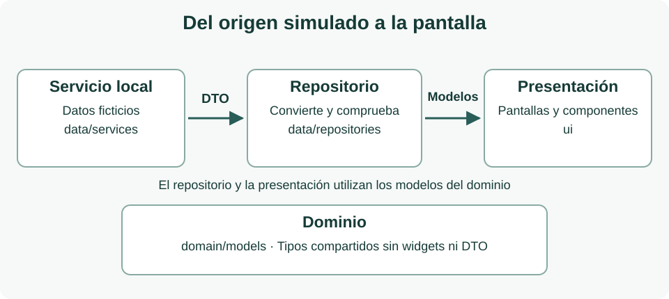

Antes de comenzar la entrega, repasa [Ejemplo con datos de los apuntes](../../widgets/ejemplo-con-datos/). Revisa cómo relaciona los modelos y cómo el servicio y el repositorio transforman los DTO antes de que lleguen a la interfaz. Es la referencia de partida para las subsecciones de dominio y datos.

## Introducción

Vas a desarrollar una aplicación móvil que permita consultar y reservar espacios para reuniones, celebraciones, talleres y otras actividades. El proyecto crecerá mediante distintas entregas y servirá para aplicar y relacionar los conocimientos de la asignatura.

En esta primera entrega construirás **al menos siete pantallas completas**, conectadas mediante navegación, con información ficticia coherente. El resultado debe poder ejecutarse y permitir recorrer el proceso desde el acceso hasta la confirmación de una reserva de prueba.

### Qué debes demostrar

- Aplicar Dart para representar espacios, usuarios y reservas mediante clases, colecciones y parámetros.
- Componer interfaces con widgets, distribuir el contenido y reutilizar componentes propios.
- Organizar el proyecto en presentación, dominio y datos, siguiendo las rutas de los apuntes.
- Implementar la navegación entre las pantallas y comunicar qué espacio se está consultando o reservando.

### Alcance de la primera entrega

Hasta ahora hemos trabajado Introducción a Flutter y Dart, y Widgets. La navegación básica será obligatoria en esta entrega. Puedes apoyarte en los ejemplos de `Navigator` y `MaterialPageRoute` del apartado [Abrir pantallas y volver](../../formularis-i-navegacio/navegacion/entre-pantallas/). Los formularios completos, la gestión compartida del estado y la persistencia se desarrollarán progresivamente. La selección de extras, el carrusel y la opinión de prueba utilizan únicamente estado local con `setState`, como en los ejemplos de widgets.

El acceso y las reservas serán simulados. Puedes mostrar valores precargados en los controles y confirmar una reserva de ejemplo sin guardarla. Indica claramente este comportamiento en la aplicación. No se exige autenticación real, consulta de disponibilidad, almacenamiento ni servicios externos.

Debes incluir las siete pantallas mínimas descritas en la capa de presentación. **Puedes añadir más pantallas** si aportan valor a tu propuesta y mantienen el alcance de la entrega. EspaiReserva es un nombre orientativo: puedes elegir otro nombre, identidad visual y distribución. Los mockups son ejemplos, no plantillas obligatorias; lo exigible son los datos, las acciones y los recorridos indicados en los requisitos.

## Arquitectura propuesta

Organiza el proyecto en tres ámbitos de responsabilidad: ui para presentación, domain para los modelos y data para el acceso y la gestión de los datos. Esta organización sigue el árbol previsto en los apuntes del catálogo. La interfaz se agrupa por funcionalidad y los datos por responsabilidad.

```text
lib/
├── main.dart
├── ui/
│   ├── core/
│   │   └── ui/
│   │       ├── espacio_tarjeta.dart
│   │       └── reserva_tarjeta.dart
│   ├── acceso/ui/
│   │   ├── login_screen.dart
│   │   └── registro_screen.dart
│   ├── espacios/ui/
│   │   ├── espacios_screen.dart
│   │   └── espacio_detalle_screen.dart
│   ├── reservas/ui/
│   │   ├── nueva_reserva_screen.dart
│   │   └── mis_reservas_screen.dart
│   └── perfil/ui/perfil_screen.dart
├── domain/models/
│   ├── espacio.dart
│   ├── reserva.dart
│   ├── usuario.dart
│   ├── contacto_local.dart
│   ├── servicio_extra.dart
│   ├── servicio_contratado.dart
│   ├── comentario.dart
│   ├── disponibilidad_dia.dart
│   └── franja_disponibilidad.dart
└── data/
    ├── models/
    │   ├── espacio_dto.dart
    │   ├── reserva_dto.dart
    │   ├── usuario_dto.dart
    │   ├── contacto_local_dto.dart
    │   ├── servicio_extra_dto.dart
    │   ├── servicio_contratado_dto.dart
    │   ├── comentario_dto.dart
    │   ├── disponibilidad_dia_dto.dart
    │   └── franja_disponibilidad_dto.dart
    ├── repositories/
    │   ├── espacios_repository.dart
    │   ├── usuarios_repository.dart
    │   ├── reservas_repository.dart
    │   ├── comentarios_repository.dart
    │   └── disponibilidad_repository.dart
    └── services/
        ├── datos_demo.dart
        └── datos_simulados_service.dart
assets/images/
README.md
pubspec.yaml
```

Toda pantalla y componente visual se guarda en una subcarpeta ui: dentro de su funcionalidad o en `ui/core/ui` si se comparte. `main.dart` inicia la aplicación, configura `MaterialApp` y conecta las dependencias.

Para esta entrega basta un servicio local que devuelva DTO con datos de ejemplo y repositorios sencillos que los transformen en modelos de dominio, sin operaciones asíncronas. Puedes inyectar los datos mediante constructores. Evita repetir el catálogo en distintas pantallas o escribir toda la aplicación en `main.dart`.

Más adelante añadiremos ui/&lt;funcionalidad&gt;/view_models/ para el estado de presentación y otros servicios cuando cambie la fuente de datos. No se exige crear estas carpetas vacías ni implementar casos de uso en esta entrega.

## Cómo trabajar las tres capas

La arquitectura separa lo que se muestra, la información que utiliza la aplicación y la forma de obtenerla. Cada capa tiene su propia subsección en esta entrega:

- [Capa de dominio](./dominio/): clases, relaciones y reglas de coherencia de los datos, incluidos los precios y el contacto del local.
- [Capa de datos](./datos/): DTO, servicio local y repositorio que transforma la fuente simulada.
- [Capa de presentación](./presentacion/): componentes, criterios visuales, navegación y requisitos de las pantallas.



Las flechas representan el recorrido de los datos. `domain/models` define los tipos que comparten la presentación y el repositorio; no contiene widgets ni importa la capa de datos. La presentación recibe modelos de dominio, nunca DTO. `main.dart` conecta las piezas mediante constructores.

Puedes empezar por los modelos, continuar con los datos simulados y terminar componiendo las pantallas. Al separar estas responsabilidades podrás modificar el aspecto de una tarjeta sin cambiar el servicio, o ampliar los datos sin repetirlos en cada pantalla.

## Convenciones de nombres


| Elemento | Convención y ejemplo |
| --- | --- |
| Proyecto, carpetas y archivos | `lowercase_with_underscores`: reserva_espacios, nueva_reserva_screen.dart |
| Clases y enumeraciones | `UpperCamelCase`: `Espacio`, `NuevaReservaScreen`, `EstadoReserva` |
| Variables, métodos y parámetros | `lowerCamelCase`: espacioSeleccionado, cargarEspacios() |
| Constantes y valores de enum | `lowerCamelCase`: aforoMaximo, `EstadoReserva`.confirmada |
| Privados de biblioteca | Guion bajo inicial cuando proceda: _crearResumen() |
| Recursos de imágenes | Nombres descriptivos: sala_agora.jpg; declararlos en `pubspec.yaml` |

Usa identificadores sin espacios ni tildes y mantén un idioma coherente. En este proyecto se adopta el sufijo Screen para las pantallas; es una convención del proyecto. Las reglas de mayúsculas y minúsculas proceden de Effective Dart. Aplica dart format y conserva los lints de Flutter.

## Entrega y comprobación

Entrega el proyecto Flutter completo con el código fuente, `pubspec.yaml`, los recursos locales y un `README` que permita ejecutarlo. Excluye las carpetas generadas build/ y .dart_tool/. Incluye capturas de las siete pantallas mínimas y de las adicionales que hayas creado y documenta qué acciones son simuladas.

### Lista de comprobación

- Se incluyen al menos las siete pantallas mínimas; las adicionales mantienen el estilo y la navegación del conjunto.
- La aplicación inicia sin errores y todas las pantallas son accesibles mediante controles visibles.
- El recorrido de registro y regreso al login, acceso normal y social simulado, catálogo, detalle, nueva reserva, confirmación y mis reservas funciona; el cierre de sesión limpia la navegación.
- El detalle muestra galería, web opcional, opiniones y disponibilidad simulada de siete días.
- Se pueden seleccionar y desmarcar extras, y el total y la confirmación conservan el desglose correcto.
- Las opiniones nuevas son locales al detalle y desaparecen al cerrarlo.
- Los datos se mantienen coherentes al abrir distintos espacios y confirmar sus ejemplos de reserva.
- Se han extraído los patrones visuales repetidos a componentes propios, como en el catálogo, y se respetan las rutas ui, domain y data.
- Todas las pantallas comparten criterios de color, tipografía, espaciado y uso de botones.
- Las imágenes locales están declaradas y no dependen de una conexión a Internet.
- Los textos y botones se leen en un móvil de referencia de 360 píxeles lógicos de ancho; no hay desbordamientos y el contenido largo permite desplazarse.
- El `README` identifica la versión de Flutter utilizada, los pasos de ejecución, los datos de demostración, las limitaciones y las fuentes de los recursos.
- Desde la raíz del proyecto, ejecuta `dart format lib` para aplicar el formato estándar y `flutter analyze` para detectar problemas en el código. Corrige los errores y explica cualquier aviso pendiente. Si incluyes pruebas, ejecuta `flutter test` desde la misma carpeta y revisa su resultado.

Se revisará la cobertura de los requisitos, la coherencia del recorrido, la composición y reutilización de widgets, la organización del código y tu capacidad para explicar las decisiones tomadas. No se fijan en este documento fechas, modalidad de agrupación ni ponderaciones.

### Preparación para las siguientes entregas

Conserva los identificadores de los modelos y evita depender de valores escritos directamente en las vistas. Así podrás sustituir el origen simulado, incorporar ViewModels y mantener las pantallas a medida que avances en la asignatura.

## Posibles ampliaciones

Las ampliaciones son opcionales y deben incorporarse después de completar los requisitos mínimos. Todas se resuelven con Dart y los widgets trabajados hasta ahora, usando datos simulados. Elige propuestas que puedas explicar y comprobar.

| Ampliación | Posible evolución del proyecto |
| --- | --- |
| Diseño adaptable | Adapta el catálogo a móvil y tablet con los widgets de distribución estudiados. Muestra una lista o una cuadrícula según el ancho disponible y comprueba que no se producen desbordamientos. |
| Componentes con variantes | Amplía `EspacioTarjeta` y `ReservaTarjeta` con variantes seleccionadas mediante parámetros, como destacada, compacta o estado. Reutilízalas con distintos datos de ejemplo. |
| Catálogo más completo | Añade nuevos espacios y actividades mediante clases y colecciones de Dart. Representa aforos, equipamiento y actividades con componentes reutilizables, iconos y textos coherentes. |
| Galería de imágenes locales | Incluye varias imágenes por espacio mediante los widgets de listas o desplazamiento estudiados. Declara los recursos en `pubspec.yaml` y evita depender de imágenes en Internet. |
| Casos visuales alternativos | Diseña variantes con datos simulados para una lista de reservas vacía, nombres largos o un espacio sin imagen. Permite elegir el caso mediante parámetros o datos de ejemplo, sin añadir gestión compartida del estado. |
| Legibilidad y composición | Mejora la jerarquía visual, el contraste, los espaciados y el tamaño de los controles. Acompaña los iconos y colores con textos e identifica los estados de reserva de forma comprensible. |

### Referencias

Arquitectura y organización del curso: El proyecto del catálogo, apartado Qué añadiremos cuando aparezcan otras responsabilidades. Se adopta su estructura ui, domain y data, y la subcarpeta ui para las piezas visuales.

[El proyecto del catálogo y su arquitectura](../../widgets/configuracion-de-un-asistente-de-ia/el-proyecto-del-catalogo/)

Convenciones de nombres y formato de Dart: Effective Dart, Style.

[Effective Dart Style](https://dart.dev/effective-dart/style)

Organización de referencia de Flutter: Architecture case study. La convención del curso usa ui para la subcarpeta visual de cada funcionalidad.

[Caso práctico de arquitectura de Flutter](https://docs.flutter.dev/app-architecture/case-study)
